# 📊 配图索引 - 医美消费心理学可视化图表

    

        <h1 class="hero-title">可视化图表索引</h1>
        
用图表解读医美消费背后的心理机制

    

## 🎨 设计理念

本项目的所有配图遵循以下设计原则：

- **配色优雅**：采用低饱和度色彩，避免过于浓重的色调
- **极简设计**：简洁明了的视觉表达，突出核心信息
- **统一风格**：保持一致的色彩体系和线条样式
- **信息清晰**：确保图表信息传达准确、易于理解

### 🎨 色彩体系

  

    

    主色调 - 温暖橙
    <code>#f59e0b</code>
  

  

    

    理性蓝
    <code>#6366f1</code>
  

  

    

    情感粉
    <code>#ec4899</code>
  

  

    

    成长绿
    <code>#22c55e</code>
  

  

    

    创新紫
    <code>#8b5cf6</code>
  

## 📈 核心概念图表

### 1. 项目结构总览图
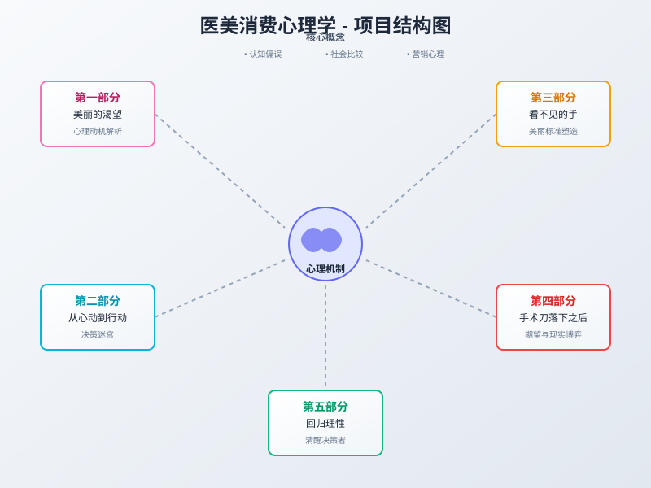

**用途**：展示整本书的结构框架和各部分关系  
**位置**：首页、导航页面  
**核心元素**：五大部分的逻辑关系、心理机制中枢

---

### 2. 心理机制图谱
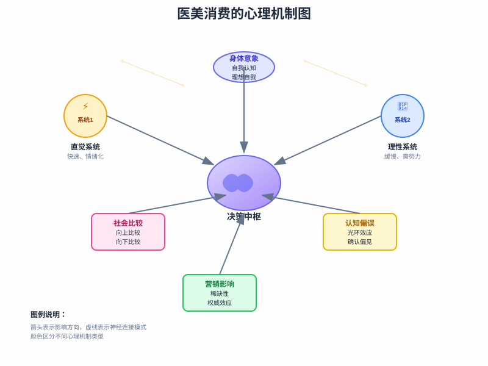

**用途**：解析医美消费的核心心理机制  
**位置**：第一部分导言、心理学原理章节  
**核心元素**：双系统理论、认知偏误、社会比较、营销影响

---

### 3. 决策流程图
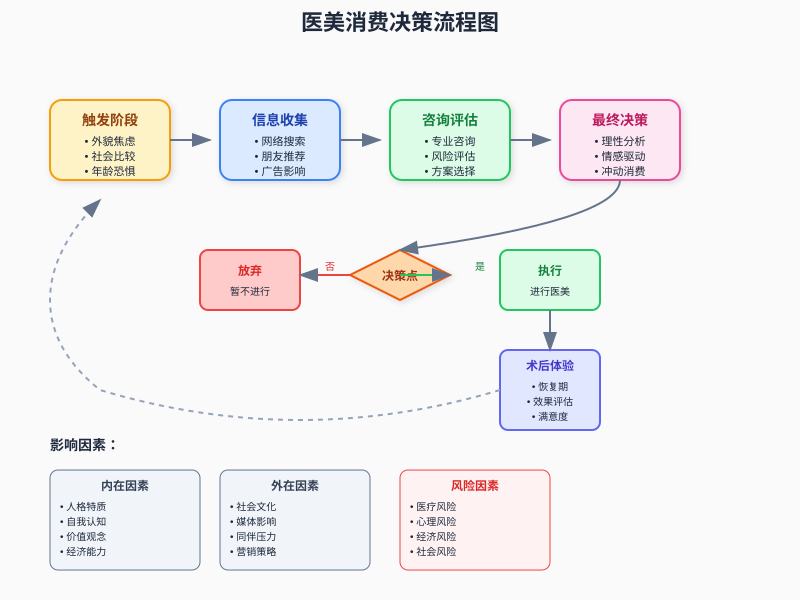

**用途**：展示医美消费的完整决策过程  
**位置**：第二部分各章节、决策工具章节  
**核心元素**：触发→信息收集→咨询评估→决策→执行→反馈

---

### 4. 术后心理历程图
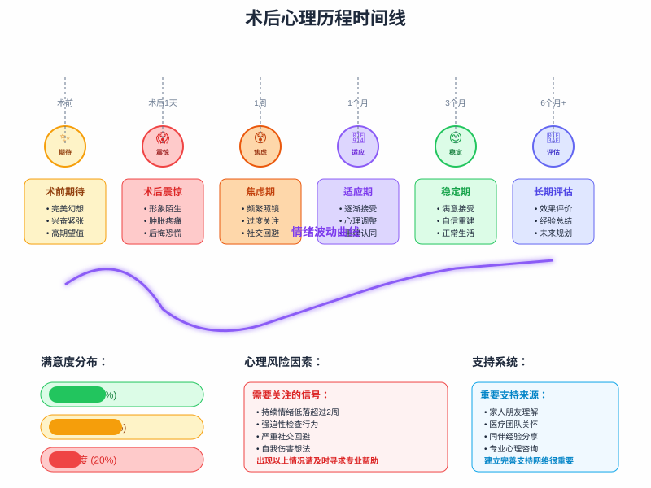

**用途**：描述术后心理变化的时间线和情绪波动  
**位置**：第四部分各章节  
**核心元素**：期待→震惊→焦虑→适应→稳定→评估

---

### 5. 多元美学图谱
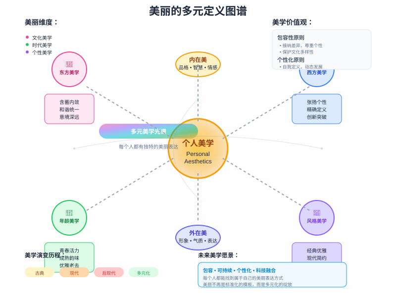

**用途**：展示美丽标准的多元化和个性化  
**位置**：第五部分、美学重新定义章节  
**核心元素**：文化差异、个人美学、内外在美、多元价值观

---

### 6. 认知偏误轮盘图
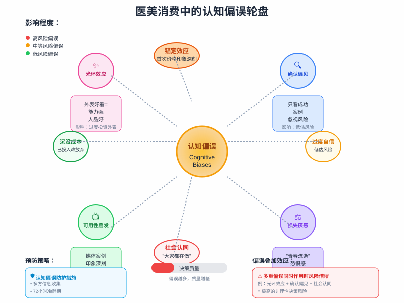

**用途**：展示影响医美决策的各种认知偏误  
**位置**：第一部分认知偏误章节、决策工具章节  
**核心元素**：光环效应、确认偏见、可用性启发、损失厌恶等

---

### 7. 营销心理策略图
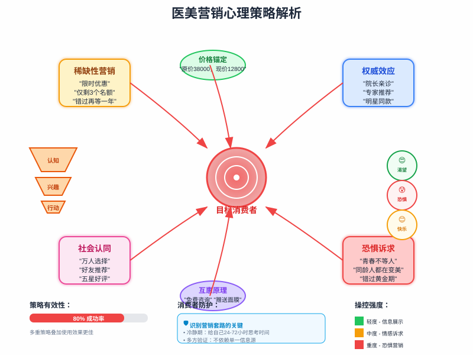

**用途**：解析医美营销的心理操控技巧  
**位置**：第三部分营销章节  
**核心元素**：稀缺性、权威效应、社会认同、恐惧诉求等

---

### 8. 社会比较理论图
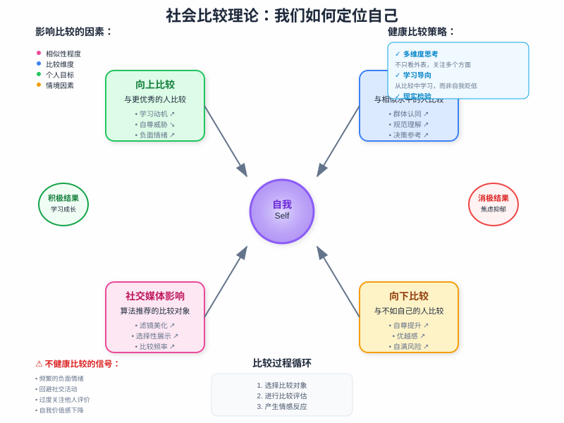

**用途**：展示社会比较的心理机制和影响  
**位置**：第一部分社会比较章节  
**核心元素**：向上比较、向下比较、横向比较、社交媒体影响

---

### 9. 信息茧房效应图
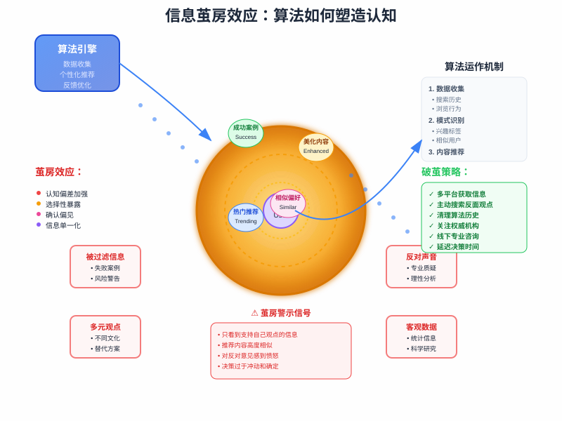

**用途**：展示算法推荐如何塑造认知偏差  
**位置**：第二部分信息收集章节、第三部分算法推荐章节  
**核心元素**：算法机制、信息过滤、认知偏差、破茧策略

---

### 10. 美丽标准演变图
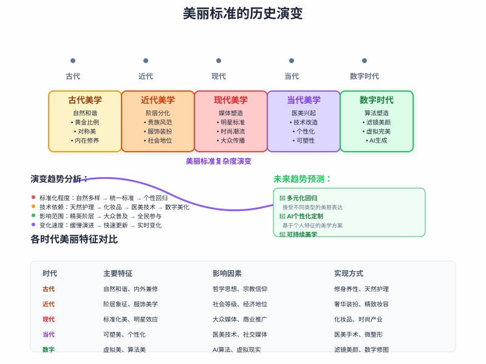

**用途**：展示美丽标准的历史演变过程  
**位置**：第一部分文化差异章节、第五部分美学重新定义章节  
**核心元素**：古代到数字时代的美学变迁、各时代特征对比

---

### 11. 详细决策流程图
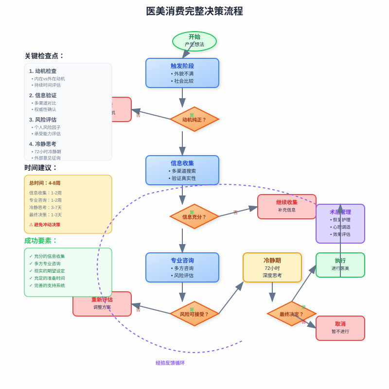

**用途**：展示完整的医美决策流程和检查点  
**位置**：第二部分决策章节、实用工具章节  
**核心元素**：决策检查点、时间建议、成功要素、风险控制

## 📊 专题配图分类

### 🧠 心理学原理类

  

    <h4>认知偏误轮盘图</h4>
    
展示影响医美决策的各种认知偏误

    已完成
    

      
    

  

  

    <h4>社会比较理论图</h4>
    
向上比较、向下比较的心理机制

    已完成
    

      
    

  

  

    <h4>身体意象形成图</h4>
    
自我认知与理想自我的差距

    规划中
  

### 💰 营销心理类

  

    <h4>营销策略解析图</h4>
    
稀缺性、权威效应等营销技巧

    已完成
    

      
    

  

  

    <h4>消费者画像图</h4>
    
不同类型消费者的特征分析

    规划中
  

  

    <h4>价格心理学图</h4>
    
锚定效应、损失厌恶的价格策略

    规划中
  

### 🏥 医疗决策类

  

    <h4>风险评估矩阵</h4>
    
医疗风险与心理风险的评估框架

    规划中
  

  

    <h4>咨询沟通流程图</h4>
    
医患沟通的最佳实践流程

    规划中
  

  

    <h4>满意度影响因素图</h4>
    
影响术后满意度的关键因素

    规划中
  

### 📱 社会文化类

  

    <h4>代际审美变迁图</h4>
    
不同世代美丽观念的演变

    规划中
  

  

    <h4>社交媒体影响图</h4>
    
社交媒体对审美标准的塑造

    规划中
  

  

    <h4>文化美学对比图</h4>
    
东西方美学观念的差异对比

    规划中
  

## 🛠️ 实用工具图表

### 📋 决策工具类

  

    <h4>医美决策自检清单</h4>
    
可视化的决策评估工具

    

      ✅ 动机评估
      ⚖️ 利弊分析
      🎯 风险评估
    

  

  

    <h4>心理准备度测评图</h4>
    
评估心理准备程度的可视化工具

    

      🧠 心理状态
      💪 承受能力
      🤝 支持系统
    

  

  

    <h4>术后恢复追踪图</h4>
    
术后心理恢复的追踪工具

    

      📈 情绪曲线
      🎯 里程碑
      ⚠️ 预警信号
    

  

### 📊 数据可视化类

  

    <h4>医美市场数据图</h4>
    
行业规模、消费趋势等关键数据

    统计图表
  

  

    <h4>消费者调研结果图</h4>
    
消费动机、满意度等调研数据

    调研图表
  

  

    <h4>心理健康指标图</h4>
    
术前术后心理健康状况对比

    对比图表
  

## 🎯 配图使用指南

### 📖 阅读体验优化

- **章节导入**：每章开头使用相关概念图帮助读者建立框架
- **重点强调**：在关键概念处插入解析图表
- **案例说明**：用流程图展示具体案例的心理过程
- **总结回顾**：章节末尾用图表总结核心要点

### 🔄 交互式元素

- **点击展开**：复杂图表支持点击查看详细信息
- **动画效果**：关键流程图支持步骤动画演示
- **响应式设计**：适配不同设备的显示效果
- **无障碍支持**：提供图表的文字描述版本

## 📝 配图制作规范

### 🎨 视觉规范

- **尺寸标准**：800x600px（4:3比例）
- **文件格式**：SVG矢量格式，确保缩放清晰
- **字体规范**：Arial, sans-serif，确保跨平台兼容
- **色彩深度**：使用16进制颜色代码，确保色彩一致

### 📐 布局原则

- **信息层次**：标题→主要内容→辅助信息→说明文字
- **视觉平衡**：合理分配空间，避免视觉重心偏移
- **引导路径**：使用箭头、连线引导阅读顺序
- **留白运用**：适当留白，避免信息过于密集

### 🔤 文字处理

- **标题层级**：主标题22px，副标题14px，正文10-12px
- **颜色对比**：确保文字与背景有足够对比度
- **长度控制**：单行文字不超过15个中文字符
- **多语言支持**：关键术语提供中英文对照

## 🚀 未来扩展计划

### 📱 交互式图表

- **动态数据**：支持实时数据更新的图表
- **用户定制**：允许用户根据需求定制图表内容
- **导出功能**：支持图表导出为多种格式
- **分享功能**：便于在社交媒体分享的优化版本

### 🎮 沉浸式体验

- **3D可视化**：复杂概念的三维立体展示
- **VR/AR支持**：虚拟现实环境下的图表体验
- **语音解说**：为图表添加语音解说功能
- **手势交互**：支持触摸手势的交互操作

### 🤖 智能化功能

- **个性化推荐**：根据阅读偏好推荐相关图表
- **智能标注**：AI自动生成图表解读和标注
- **多语言版本**：自动翻译生成多语言版本
- **无障碍优化**：为视障用户提供更好的体验

---

## 📞 反馈与建议

如果您对配图有任何建议或发现问题，欢迎通过以下方式联系我们：

- **邮箱**：illustrations@beaucare.org
- **微信**：扫描二维码加入配图讨论群
- **GitHub**：在项目仓库提交Issue

---

*"好的配图不仅是信息的载体，更是理解的桥梁。"*

