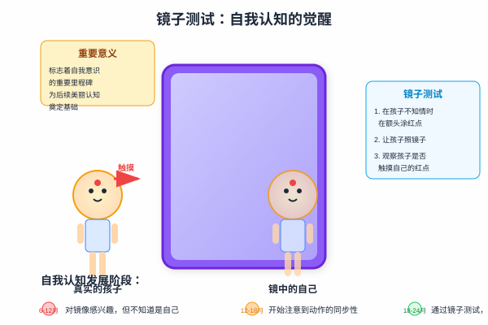

# 第一章：镜中自我 - 我们为什么在意外表？

> "认识你自己" —— 德尔菲神庙箴言

## 引言：从婴儿的第一次自我发现说起

当一个18个月大的婴儿第一次在镜子中认出自己，并试图擦掉额头上的红点时，人类心理学史上最重要的时刻之一就发生了。这个看似简单的动作，标志着自我意识的觉醒，也为我们理解医美消费心理奠定了基础。

在医美咨询室里，当一个人站在镜子前指出自己的"缺陷"时，这个动作的背后隐藏着与婴儿镜子测试相同的心理机制——自我认知。但不同的是，成年人的自我认知已经被社会标准、文化期望和个人经历深深塑造。

每天早晨，我们都会站在镜子前整理自己的形象。这个看似普通的行为，实际上反映了人类一个深层的心理需求——对自我形象的关注和完善。但这种对外表的在意究竟从何而来？是天生的本能，还是后天习得的社会行为？是进化的产物，还是文化的建构？

让我们从一些令人深思的数据开始：

  

    6-8次
    
普通人每天照镜子的次数

  

  

    23分钟
    
女性平均每天花在外表整理上的时间

  

  

    85%
    
的人承认会因外表问题影响心情

  

  

    3岁
    
儿童开始表现出外表偏好的年龄

  

这些数据告诉我们，对外表的关注是一个极其普遍的人类行为。在这一章中，我们将从心理学的角度深入探讨这些问题，为理解医美消费的心理基础奠定理论基础。

## 1.1 镜子测试：自我意识的觉醒

### 实验的起源与设计

1970年，心理学家戈登·盖洛普（Gordon Gallup）设计了一个看似简单却意义深远的实验。他在黑猩猩的额头上涂上红色颜料，然后观察它们在镜子前的反应。令人惊讶的是，一些黑猩猩开始触摸自己额头上的红点，而不是镜子中的影像。这表明它们认识到镜子中的影像就是自己。

这个实验后来被应用到人类婴儿身上，成为了著名的"镜子测试"（Mirror Test）。研究发现，大多数婴儿在18-24个月之间开始通过这个测试，标志着自我意识的重要发展里程碑。

### 测试的具体过程

镜子测试的标准程序包括以下步骤：

1. **准备阶段**：在婴儿不知情的情况下，在其额头或鼻子上涂上无害的红色颜料
2. **镜子接触**：让婴儿面对镜子，观察其反应
3. **行为记录**：记录婴儿是否会触摸自己身上的红点，而不是镜子中的影像
4. **结果判定**：如果婴儿触摸自己的红点，说明通过了测试

### 自我认知的发展阶段

#### 第一阶段：社会性微笑（2-6个月）

在这个阶段，婴儿开始对镜子中的影像表现出兴趣，会对着镜子微笑，但还不理解这是自己的反射。这种反应更多是对"另一个婴儿"的社交回应。

心理机制：此时的婴儿还没有形成自我与他人的明确界限，镜像被当作一个有趣的社交对象。

#### 第二阶段：探索性行为（6-12个月）

婴儿开始注意到镜子中影像的动作与自己的动作是同步的。他们可能会做出各种动作来"测试"这种同步性，比如挥手、做鬼脸等。

心理机制：开始建立动作与视觉反馈之间的联系，但还没有完全理解这种联系的含义。

#### 第三阶段：自我识别（12-18个月）

这是一个过渡阶段，婴儿开始表现出对镜像的困惑。他们可能会看看镜子，再看看自己，试图理解两者之间的关系。

心理机制：认知能力的发展使得婴儿开始质疑之前的理解，为真正的自我识别做准备。

#### 第四阶段：自我意识觉醒（18-24个月）

这是关键的突破阶段。婴儿不仅能够识别镜子中的自己，还能够理解镜像与自身的对应关系。在镜子测试中，他们会触摸自己身上的红点。

心理机制：自我概念的形成，能够将"我"作为一个独立的个体来认知。

### 神经科学基础

现代神经科学研究揭示了镜子测试背后的大脑机制。当我们看到镜子中的自己时，大脑的多个区域会协同工作：

- **视觉皮层**：处理镜像的视觉信息
- **顶叶皮层**：整合身体感觉和空间信息
- **前额叶皮层**：负责自我意识和元认知
- **镜像神经元系统**：帮助理解动作的对应关系

这些大脑区域的成熟和连接，使得婴儿能够理解"镜子中的那个人就是我"这一复杂概念。

### 从镜子测试到美丽认知

通过镜子测试只是自我认知发展的开始。随着年龄的增长，我们对镜子中自己的认知变得越来越复杂：

**3-5岁**：开始注意到外貌特征，能够描述自己的头发颜色、眼睛颜色等
**6-8岁**：开始进行简单的外貌比较，注意到与他人的差异
**9-12岁**：外貌意识增强，开始关注社会对外貌的评价
**青春期**：外貌焦虑达到高峰，镜子成为自我评价的重要工具
**成年期**：形成相对稳定的身体意象，但仍会受到社会因素影响

## 1.2 身体意象的形成：大脑如何构建"理想自我"

### 身体意象的定义与构成

身体意象（Body Image）是指个体对自己身体外观的主观感知、认知和情感反应的综合体。它不是简单的自我观察，而是一个复杂的心理构建过程，包括四个相互关联的核心组成部分：

**感知成分**：我们如何"看到"自己的身体。这不仅仅是视觉上的观察，还包括对身体各部分大小、形状、比例的主观感知。有趣的是，这种感知往往与客观现实存在偏差。

**认知成分**：我们对自己身体的想法、信念和评价。这包括我们如何解释自己的外表，以及我们认为他人如何看待我们的身体。

**情感成分**：我们对自己身体的情感反应，包括满意、不满、焦虑、自豪等各种情绪。这种情感反应直接影响我们的自尊和心理健康。

**行为成分**：我们因为身体意象而产生的行为，包括美容护理、服装选择、运动锻炼，甚至是医美消费等。

### 镜子中的"理想自我"

心理学家发现，当我们照镜子时，看到的往往不是客观的自己，而是经过心理"滤镜"处理的自己。这个"滤镜"包括：

**认知偏差**：我们倾向于放大自己认为的缺陷，这种现象被称为"负面偏向"。一个小小的痘痘在我们眼中可能被无限放大，而优点却容易被忽视。

**社会比较**：我们会不自觉地将镜子中的自己与他人或理想标准进行比较。这种比较往往是不公平的，因为我们用自己最糟糕的状态去比较他人最好的状态。

**情绪状态**：当天的心情会显著影响对自己的评价。心情好的时候，我们更容易看到自己的优点；心情不好时，缺点会被无限放大。

**文化标准**：内化的社会美丽标准会影响我们对镜子中自己的评价。这些标准往往是不现实的，但却深深影响着我们的自我认知。

### 理想自我的构建机制

大脑通过复杂的心理机制构建我们的"理想自我"：

#### 内在模板的形成

**遗传因素**：研究表明，我们对某些面部特征和身体比例的偏好具有遗传基础。例如，对对称性和平均化面孔的偏好在不同文化中都存在，这暗示了进化的影响。

**早期经验**：童年期的重要体验会深刻影响我们的身体意象。父母的评价、同伴的反应、早期的审美体验都会在我们的心理中留下深刻印记。

**文化输入**：社会文化的美丽标准通过媒体、教育、社交等渠道不断输入我们的认知系统，逐渐内化为个人的审美标准。

#### 自我概念的整合过程

现实自我与理想自我之间的关系是动态的。当两者差距适中时，会产生积极的自我提升动机；当差距过大时，则可能导致自我否定和心理困扰。

身体意象的形成是一个持续的过程，它会随着年龄、经历、环境的变化而不断调整。理解这个过程，有助于我们建立更健康、更现实的自我认知。

#### 认知失调的产生与应对

当现实自我与理想自我差距过大时，会产生认知失调，个体会采取不同的应对策略：

**适应性反应**：
- 合理的美容护理和健康生活方式
- 通过运动和营养改善身体状况
- 调整不现实的期望和标准
- 培养多元化的自我价值感

**非适应性反应**：
- 过度的美容消费和医美依赖
- 极端的节食和运动行为
- 社交回避和自我封闭
- 身体意象障碍的发展

理解这些机制，有助于我们在面对身体意象困扰时做出更明智的选择。

## 1.3 进化心理学视角：美丽偏好的生物学基础

### 适应性假说的核心观点

进化心理学家认为，人类的美丽偏好并非任意的文化建构，而是具有深刻的生物学基础。这些偏好是在漫长的进化过程中形成的，它们帮助我们的祖先识别健康、有生育能力的配偶，从而提高繁殖成功率。

这个观点的核心在于：我们今天认为"美"的特征，往往对应着我们祖先生存和繁殖环境中的优势特征。虽然现代社会的生存环境已经发生了巨大变化，但我们的大脑仍然保留着这些古老的偏好模式。

### 面部吸引力的普遍标准

跨文化研究发现，尽管不同文化在具体的美丽标准上存在差异，但在一些基本特征上却表现出惊人的一致性：

#### 对称性偏好

**进化意义**：面部对称性被认为是良好基因和健康发育的指标。在发育过程中，各种环境压力（如疾病、营养不良、基因缺陷）都可能导致不对称的发育。因此，对称的面孔暗示着个体具有抵抗这些压力的能力。

**心理机制**：人类大脑天生就偏好对称的模式。这种偏好不仅体现在面孔识别上，也体现在艺术、建筑等各个领域。神经科学研究发现，观看对称面孔时，大脑的奖励系统会被激活，产生愉悦感。

**现实应用**：这解释了为什么许多医美项目都致力于改善面部的对称性，如双眼皮手术、鼻部整形等。

#### 平均化特征

**进化意义**：平均化的面孔通常被认为更有吸引力。从进化角度看，平均化意味着遗传多样性，这有助于后代适应各种环境挑战。极端的特征可能暗示着基因缺陷或适应性问题。

**心理机制**：大脑处理平均化面孔时更加流畅，这种认知流畅性会被解释为积极的情感体验。这就是为什么我们往往觉得"看起来很舒服"的面孔更有吸引力。

**文化差异**：虽然平均化是普遍偏好，但不同文化的"平均"标准不同，这解释了为什么不同种族的人会有不同的美丽标准。

#### 年轻化特征

**进化意义**：年轻通常意味着更强的生育能力和更长的繁殖期。因此，年轻化的特征（如光滑的皮肤、饱满的嘴唇、明亮的眼睛）会被认为更有吸引力。

**心理机制**：我们的大脑会自动评估他人的年龄和健康状况，年轻化的特征会触发积极的情感反应。

**现代影响**：这解释了抗衰老产业的兴起，以及为什么年轻化是医美市场的主要需求之一。

#### 性别化特征

**进化意义**：明显的性别特征暗示着较高的性激素水平，这与生育能力和健康状况相关。例如，女性的大眼睛、小下巴，男性的方下巴、浓眉等。

**心理机制**：这些特征会激活大脑中与性吸引相关的神经回路，产生吸引力感受。

### 身体比例的偏好

#### 腰臀比（WHR）的研究

大量跨文化研究发现，男性普遍偏好腰臀比在0.7左右的女性身材。这个比例被认为是健康和生育能力的指标。

**生物学基础**：腰臀比反映了女性的激素水平和生育能力。较低的腰臀比通常与较高的雌激素水平和较低的睾酮水平相关，这有利于怀孕和生育。

**文化一致性**：无论是在崇尚丰满的文化还是偏好纤瘦的文化中，0.7的腰臀比都被认为是最有吸引力的。

#### 男性体型偏好

女性普遍偏好具有倒三角形体型的男性，即宽肩窄腰的身材。这种体型暗示着较高的睾酮水平和较强的身体力量。

### 跨文化研究的重要发现

哈佛大学心理学家进行的一项大规模跨文化研究，对37个不同文化背景的群体进行了面部吸引力测试。结果显示：

**高度一致性**：约80%的美丽标准在不同文化间表现出一致性，这支持了美丽偏好具有生物学基础的观点。

**文化差异**：剩余20%的差异主要体现在具体的细节偏好上，如肤色深浅、五官大小等。

**现代化影响**：现代化程度越高的社会，美丽标准的趋同性越强，这可能与全球化和媒体传播有关。

### 案例分析：进化心理学在现实中的体现

#### 案例一：小雅的审美觉醒

小雅，25岁，从小城市来到一线城市工作。在家乡时，她从未对自己的外表感到不满，认为"自然就是美"。但来到大城市后，她开始觉得自己"不够精致"，开始关注医美。

**心理机制分析**：
- **参照群体改变**：从小城市的"平均水平"到大城市的"精英标准"
- **社会比较压力**：新环境中的比较对象发生变化
- **进化偏好激活**：城市环境中的竞争压力激活了对"优势特征"的追求

这个案例说明，虽然进化偏好是普遍的，但它们的表达会受到环境和文化因素的调节。

#### 案例二：海归Lisa的文化冲突

Lisa在国外留学时接受了西方的"健康美"理念，认为自信和个性比外表更重要。但回国后，她发现周围的人更注重"温婉美"，这让她产生了内心冲突。

**心理机制分析**：
- **文化认同危机**：不同文化标准之间的冲突
- **进化基础的普遍性**：无论在哪种文化中，基本的进化偏好都存在
- **表达方式的差异**：同样的进化偏好在不同文化中有不同的表达方式

这个案例展现了进化心理学观点的复杂性：虽然存在普遍的生物学基础，但文化因素会显著影响这些偏好的具体表现。

## 1.4 文化差异：不同文化背景下的美丽标准

### 东西方美学传统的深层差异

虽然进化心理学揭示了美丽偏好的生物学基础，但文化因素在塑造具体的美丽标准方面发挥着至关重要的作用。东西方文化在美学观念上的差异，反映了不同的哲学思想、社会结构和价值体系。

#### 东方美学传统：内敛与和谐

**"温婉"为美的哲学基础**：东方美学强调柔和、含蓄的美，这与儒家文化中的"中庸之道"和道家的"无为而治"思想密切相关。这种美学观念认为，真正的美应该是内敛的、不张扬的，如"清水出芙蓉，天然去雕饰"。

**"白幼瘦"标准的社会根源**：
- **白皙**：在农业社会中，白皙的肌肤象征着不需要从事体力劳动的社会地位
- **年轻**：体现了对生命力和纯洁的追求
- **纤细**：与东方文化中对女性"弱柳扶风"的审美理想相符

**五官精致化的追求**：东方美学注重细节的完美，认为美在于精雕细琢。这体现在对眼部（双眼皮、大眼睛）、鼻部（高挺、精致）等局部特征的重视。

**气质内涵的重要性**：东方文化强调"腹有诗书气自华"，认为外在美必须与内在修养相结合才是真正的美。

#### 西方美学传统：个性与力量

**"自信"为美的文化背景**：西方美学强调个性和自信的表达，这与西方文化中的个人主义价值观相一致。美被视为个人魅力和自我表达的体现。

**"健康性感"的理念**：西方文化更加接受和欣赏身体的自然美，认为健康、有活力的身体本身就是美的。这与古希腊的身体美学传统有关。

**立体轮廓的偏好**：西方美学重视骨骼结构的明显特征，如高鼻梁、深眼窝、明显的下颌线等。这些特征被认为体现了力量和个性。

**多元包容的态度**：现代西方社会更加接受不同类型的美，强调美的多样性和包容性。

### 全球化时代的美丽标准演变

#### 趋同化现象的驱动力

**社交媒体的全球传播**：Instagram、TikTok等平台让全世界的美丽标准得以快速传播和交流。一个在韩国流行的妆容可能很快就会在全球范围内被模仿。

**国际品牌的审美输出**：全球化的美妆品牌和时尚品牌通过广告和营销活动，向全世界输出特定的审美标准。

**流行文化的跨国影响**：韩流、好莱坞电影、日本动漫等流行文化产品携带着特定的审美观念，影响着全球年轻人的美丽标准。

**医美技术的标准化**：医美技术的全球化使得某些"标准化"的美丽特征得以在全世界推广。

#### 本土化反思与文化复兴

然而，全球化的趋同也引发了对本土文化的反思：

**传统文化的复兴**：越来越多的人开始重新审视和欣赏本民族的传统美学。例如，中国的"国风"美学、日本的"和风"美学等都在年轻人中重新流行。

**民族特色的重视**：人们开始意识到，盲目追求单一的美丽标准可能会导致文化同质化，因此更加重视保持和发展民族特色的美学观念。

**多元美学的提倡**：现代社会越来越提倡美的多样性，认为不同的文化背景应该有不同的美丽标准，这种多样性本身就是美的。

## 1.5 心理机制的深度解析

### 大脑的"美丽雷达"：注意偏向理论

人类的大脑就像一个精密的"美丽雷达"，它会自动扫描和处理与外表相关的信息。这种能力不是后天学习的，而是进化过程中形成的本能。

#### 面孔识别的神经特殊性

神经科学研究发现，人类大脑中有一个专门的区域叫做"梭状回面孔区"（Fusiform Face Area），它专门负责处理面孔信息。这个区域的存在说明，面孔识别对人类来说是如此重要，以至于大脑为此专门进化出了特殊的神经回路。

这种特殊性解释了为什么我们能够在人群中迅速识别出熟悉的面孔，为什么我们对面部的细微变化如此敏感，也解释了为什么面部的"缺陷"会让我们感到如此困扰。当我们看到镜子中的自己时，这个专门的大脑区域会立即激活，进行精细的分析和评估。

#### 身体图式的核心地位

身体图式（Body Schema）是指我们对自己身体的内在表征，它不仅包括身体的物理特征，还包括我们对这些特征的感知和评价。这个身体图式在我们的自我概念中占据着核心地位。

当身体图式出现问题时，比如我们对某个身体部位感到不满时，这种不满会扩散到整个自我概念中。这就是为什么一个小小的外表"缺陷"可能会对我们的整体自信心产生巨大影响。

#### 社会评价敏感性的进化意义

人类作为社会性动物，对他人评价的敏感性是生存的必要条件。在原始社会中，被群体接纳意味着生存，被群体排斥可能意味着死亡。因此，我们的大脑进化出了对社会评价的高度敏感性。

在现代社会中，虽然被他人评价不再直接关系到生存，但这种敏感性依然存在。我们会本能地关注他人对我们外表的评价，并将这种评价内化为自我评价的一部分。

### 自我客体化：当自己成为观察的对象

自我客体化理论由心理学家芭芭拉·弗雷德里克森提出，它描述了一种特殊的心理现象：当我们过度关注自己的外表时，我们会将自己视为一个被观察的对象，而不是一个有主观体验的主体。

#### 外在视角的形成

在自我客体化的状态下，我们会习惯性地从他人的角度来看待自己。我们不再问"我感觉怎么样？"，而是问"我看起来怎么样？"。我们不再关注身体的功能和感受，而是关注身体的外观和他人的评价。

这种外在视角的形成往往是渐进的。它可能始于童年时期他人对我们外表的评价，在青春期因为身体变化而加强，在成年后因为社会压力而固化。

#### 持续监控的心理负担

自我客体化会导致持续的自我监控行为。我们会不断地检查自己的外表，担心自己的形象是否符合标准，焦虑他人对我们的评价。这种持续的监控不仅消耗大量的心理资源，还会影响我们的注意力和表现。

研究发现，处于自我客体化状态的女性在进行数学测试时表现更差，因为她们的部分注意力被用于监控自己的外表。这说明自我客体化不仅影响心理健康，还会影响认知功能。

#### 羞耻感的产生机制

当我们将自己客体化时，任何不符合"理想"标准的地方都会成为羞耻感的来源。这种羞耻感不同于一般的不满，它是一种深层的、关于自我价值的质疑。

羞耻感会进一步加强自我客体化，形成恶性循环：越是感到羞耻，越是关注外表；越是关注外表，越是容易发现"问题"；越是发现"问题"，越是感到羞耻。

### 容貌焦虑的现代困境

正如丽格李滨在《永远不可能清零的"容貌焦虑"》一文中深刻指出的，容貌焦虑已经成为现代社会的普遍现象。这种焦虑不仅仅是个人问题，更是社会文化和技术发展共同作用的结果。

!!! quote "李滨观点"
    "美国《时代周刊》曾在封面刊登了医美专题，从标题上便可以看出助长容貌焦虑的意思。人们不但认为医美是个有原罪的行业，更认为它将女性进一步物化了，或者说是将女性彻底PUA了。"
    
    "从事医美行业的人都清楚一点，巧妙地利用人们的容貌焦虑，有助于市场营销，甚至可以说这是医美营销的重要套路，不这么做，就不会有太多生意上门。"
    
    —— 摘自《永远不可能清零的"容貌焦虑"》，[原文链接](https://mp.weixin.qq.com/s/gmYMNsSxffkpKjvNncAKcA?scene=1)

#### 容貌焦虑的三个层次

  

    
1

    

      <h3>生理层次：进化遗留的本能</h3>
      
人类对外表的关注源于进化过程中的生存需要，这种本能反应在现代社会被无限放大

    

  

  

    
2

    

      <h3>心理层次：自我价值的绑定</h3>
      
当外表成为自我价值的重要组成部分时，任何"缺陷"都会引发强烈的心理不适

    

  

  

    
3

    

      <h3>社会层次：比较文化的盛行</h3>
      
社交媒体时代让比较变得无处不在，"完美"的标准不断被刷新和强化

    

  

#### 为什么容貌焦虑"永远不可能清零"？

!!! info "深度解析"
    **技术放大效应**：美颜滤镜、修图软件让"完美"变得触手可及，同时也让现实与理想的差距更加明显
    
    **社交媒体循环**：点赞、评论、分享机制强化了外表的社会价值，形成了难以打破的反馈循环
    
    **商业利益驱动**：美容、医美、时尚等行业需要维持消费者的"不满足感"来推动消费
    
    **文化价值观念**：在"颜值经济"时代，外表被赋予了超越个人审美的社会和经济价值

!!! warning "警惕信号"
    如果你发现自己：
    - 频繁照镜子或自拍
    - 过度关注他人的外表评价
    - 因为外表问题影响社交活动
    - 把自我价值与外表紧密绑定
    - 无法接受照片中"真实"的自己
    - 对他人的外表评价过度敏感
    
    可能需要重新审视自己的身体意象。

## 1.6 实践应用：建立健康身体意象的具体方法

### 重新定义与镜子的关系

镜子是我们与自己外表接触最频繁的媒介，但很多人与镜子的关系是不健康的。我们要么过度依赖镜子，频繁检查自己的外表；要么完全回避镜子，害怕看到自己的"缺陷"。建立健康的身体意象，首先要重新定义与镜子的关系。

#### 中性观察练习的具体操作

**准备阶段**：选择一个光线自然、没有干扰的环境，准备一面普通的镜子（不要使用有美颜功能的镜子）。

**观察过程**：每天花5分钟时间，站在镜子前进行中性观察。这里的"中性"意味着不做价值判断，只是客观地描述看到的内容。

比如，不要说"我的鼻子太塌了"，而是说"我看到一个中等高度的鼻子"；不要说"我的眼睛太小了"，而是说"我看到一双深色的眼睛"。

**记录感受**：观察结束后，记录下自己的感受。刚开始可能会感到不适应，因为我们习惯了评判性的观察。但随着练习的深入，你会发现自己能够更加平和地面对镜子中的自己。

#### 积极确认的实践方法

**寻找身体优点**：每天在镜子前找出自己身体的三个优点。这些优点可以是外观上的，也可以是功能上的。比如，"我的手很灵巧，能够写字画画"，"我的腿很有力，能够支撑我走很远的路"。

**感恩表达的深化**：不仅要感谢身体的功能，还要感谢身体陪伴你经历的所有时光。比如，"感谢我的眼睛，让我看到了这么多美丽的风景"，"感谢我的嘴巴，让我能够表达自己的想法和感受"。

### 内在对话的重构

我们与自己的对话方式直接影响我们的自我感受。很多人习惯于用严厉、批判的语言对待自己，这种内在对话会加重身体意象的问题。

#### 识别负面自我对话的模式

**常见的负面对话模式**：
- 灾难化思维："我这么丑，没人会喜欢我"
- 全或无思维："如果不完美，就是失败"
- 读心术："别人一定觉得我很丑"
- 标签化："我就是个丑八怪"

**识别技巧**：当你对着镜子或想到自己的外表时，注意内心的声音。这些声音是友善的还是严厉的？是客观的还是夸大的？是支持的还是批判的？

#### 语言替代的具体方法

**从批判到描述**：将评判性的语言替换为描述性的语言。比如，将"我的皮肤太差了"替换为"我的皮肤现在有一些痘痘，这是可以改善的"。

**从绝对到相对**：将绝对化的语言替换为相对化的语言。比如，将"我永远不会变美"替换为"我现在还没有找到适合自己的方法"。

**从他人到自己**：将基于他人评价的语言替换为基于自己感受的语言。比如，将"别人会觉得我很丑"替换为"我希望自己能够更加自信"。

#### 自我同情的培养

**自我同情的三个要素**：
1. **自我善待**：像对待好朋友一样对待自己
2. **共同人性**：认识到不完美是人类的共同经历
3. **正念觉察**：以平衡的方式看待自己的经历

**实践方法**：当你因为外表问题感到痛苦时，可以这样对自己说："这种痛苦是可以理解的，很多人都有类似的困扰。我不需要因此而责备自己，我可以给自己一些时间和空间来处理这种感受。"

### 媒体素养的提升

在信息爆炸的时代，我们每天都会接触到大量关于美丽的信息。这些信息中有很多是经过加工和美化的，如果我们缺乏媒体素养，就容易被误导。

#### 批判性思维的培养

**质疑"完美"形象**：当你看到媒体上的"完美"形象时，要问自己几个问题：这个形象是真实的吗？它经过了什么样的处理？它代表的是普通人的状态还是特殊情况？

**了解技术手段**：现在的图像处理技术非常先进，可以轻易地改变人的外貌。了解这些技术的存在和普及程度，有助于我们更理性地看待媒体上的形象。

**识别商业动机**：很多美丽形象的背后都有商业动机。它们的目的不是展示真实，而是激发消费欲望。认识到这一点，有助于我们保持理性的判断。

#### 多元美学的欣赏

**接触不同类型的美**：主动寻找和欣赏不同类型的美，不要只关注单一的美丽标准。可以关注不同年龄、不同种族、不同身材的人的美丽。

**关注内在美**：除了外在美，还要关注内在美。智慧、善良、勇气、坚韧等品质同样是美的体现。

**发现身边的美**：不要只关注媒体上的美，也要发现身边人的美。每个人都有自己独特的美丽之处，学会发现和欣赏这些美丽。
### 建立个人的美学价值体系

最终，建立健康的身体意象需要我们建立自己的美学价值体系。这个体系不应该完全依赖外界的标准，而应该基于我们自己的价值观和需求。

#### 价值观的澄清

**多元价值的认识**：美丽只是人生价值的一部分，我们还有智慧、善良、勇气、创造力等其他重要价值。认识到这一点，有助于我们建立更平衡的自我认知。

**个人特色的发现**：每个人都有自己独特的特质和魅力。这种独特性不是缺陷，而是我们的特色和优势。学会发现和欣赏自己的独特之处，是建立健康身体意象的重要步骤。

**内在美的重视**：外表会随着时间而变化，但内在的品质是更加持久和稳定的。培养内在美，不仅能让我们建立更稳定的自我认同，也能让我们在人际关系中建立更深层的连接。

#### 现实期望的设定

**接受不完美**：完美是不存在的，每个人都有自己的不足和局限。接受这种不完美，能够让我们更加平和地面对自己的外表，减少不必要的焦虑和痛苦。

**关注可控因素**：将注意力集中在我们可以控制的因素上，比如健康的生活方式、良好的护肤习惯、合适的穿搭等，而不是过度纠结于无法改变的遗传特征。

**长期视角的培养**：美丽不是一个静态的状态，而是一个动态的过程。培养长期的视角，关注整体的健康和幸福，而不是短期的外表变化。

## 1.7 身体意象健康度自我评估

### 身体满意度评估工具

在开始任何改变之前，了解自己当前的身体意象状况是很重要的。以下是一个简单但有效的自我评估工具：

**身体满意度量表**

请根据你的真实感受，对以下陈述进行1-5分评分：
- 1分 = 完全不同意
- 2分 = 不太同意  
- 3分 = 中性/不确定
- 4分 = 比较同意
- 5分 = 完全同意

**评估项目**：
1. 我对自己的整体外表感到满意 ___分
2. 我认为自己的身材比例是协调的 ___分  
3. 我对自己的面部特征感到自信 ___分
4. 我觉得自己在他人眼中是有吸引力的 ___分
5. 我能够接受自己身体的不完美之处 ___分
6. 我不会因为外表问题而回避社交活动 ___分
7. 我的自我价值不完全依赖于外表 ___分
8. 我能够客观地看待媒体上的"完美"形象 ___分

**评分解读**：
- **32-40分**：身体意象非常健康，自我接纳度很高
- **24-31分**：身体意象良好，偶有不满但整体积极
- **16-23分**：身体意象一般，存在一定程度的不满情绪
- **8-15分**：身体意象较差，建议寻求专业帮助

### 风险信号的识别

除了量化评估，还需要关注一些可能的风险信号：

**行为层面的信号**：
- 频繁照镜子或完全回避镜子
- 过度关注他人对自己外表的评价
- 因为外表问题而影响日常社交活动
- 花费过多时间和金钱在外表改善上

**认知层面的信号**：
- 将自我价值与外表紧密绑定
- 无法接受照片中"真实"的自己
- 对他人的外表评价过度敏感
- 认为改变外表是解决所有问题的唯一方法

**情绪层面的信号**：
- 因为外表问题而持续感到焦虑或抑郁
- 对自己的外表感到强烈的羞耻感
- 嫉妒他人的外表并因此感到痛苦
- 对外表的不满影响了整体的生活质量

如果你发现自己有多个风险信号，建议寻求专业的心理帮助，以便更好地处理身体意象问题。

## 💬 本章反思

!!! question "深度思考"
    结合你的自测结果，思考以下问题：
    
    1. **美丽记忆追溯**：回想一下你最早对"美"的记忆是什么？这个记忆如何影响了你现在的美丽观念？
    
    2. **影响因素分析**：你认为自己的美丽标准更多来自生物本能还是社会文化？具体有哪些影响因素？
    
    3. **行为模式识别**：在日常生活中，你是否注意到自己的"自我客体化"行为？这些行为给你带来了什么感受？
    
    4. **个人美学定义**：如果让你重新定义"美"，你会如何定义？这个定义与主流标准有何不同？
    
    5. **改变意愿评估**：基于目前的自我认知，你是否有改变外表的想法？这种想法的动机是什么？

## ➡️ 下一章预告

在了解了我们为什么在意外表之后，下一章我们将探讨一个更复杂的问题：**社会比较**。我们将深入分析为什么我们总是忍不住与他人比较，以及这种比较如何影响我们的自我认知和行为决策。

---

*"认识自己的美丽观念，是建立健康自我形象的第一步。"*