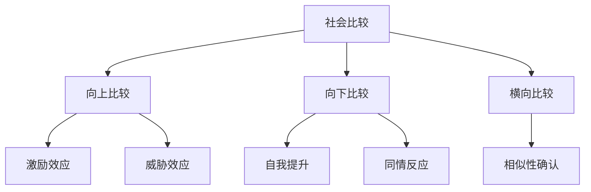

# 第二章：社会比较 - 别人眼中的我与理想中的我

## 👥 从个体到群体：社会比较的无处不在

在第一章中，我们探讨了个体为什么会在意外表。但人类是社会性动物，我们的自我认知很少是在真空中形成的，而是在与他人的不断比较中塑造的。

### 真实案例：Lisa的比较焦虑

!!! example "案例分析"
    **Lisa，28岁，金融行业从业者**
    
    "我以前从来不觉得自己有什么问题，直到加入了一个高端健身房。那里的女性都特别精致，皮肤好、身材好、穿着也很有品味。我开始觉得自己很普通，甚至有点土。
    
    后来我关注了几个健身博主的社交媒体，她们的生活看起来都很完美。我开始对着镜子挑自己的毛病：眼袋、法令纹、身材比例...以前从来没注意过的问题，现在都变成了困扰。
    
    我知道这样不对，但就是控制不住地比较。最后我决定去做一些医美项目，希望能让自己更自信一些。"

Lisa的经历反映了一个重要的心理现象：**我们的自我认知很大程度上是相对的，而非绝对的**。

## 🔍 引言：比较如何塑造我们的美丽标准

"她的皮肤比我好多了"、"他的身材真让人羡慕"——这样的想法每天都在我们的头脑中闪过。社会比较是人类天性中不可避免的一部分，它影响着我们的自我认知、情绪状态和行为选择。

在医美消费的背景下，理解社会比较的机制变得尤为重要，因为：

  

    <h4>📱 社交媒体放大了比较</h4>
    
算法推荐让我们更容易接触到"完美"的形象，加剧了向上比较的频率和强度。

  

  

    <h4>🎯 比较驱动消费决策</h4>
    
很多医美消费的动机来自于与他人的比较，而非真实的个人需求。

  

  

    <h4>💭 比较影响满意度</h4>
    
术后的满意度往往不是绝对的，而是相对于比较对象的。

  

## ⚖️ 2.1 社会比较理论的核心机制

### 费斯廷格的社会比较理论

1954年，社会心理学家莱昂·费斯廷格提出了一个至今仍深刻影响我们理解人类行为的理论——社会比较理论。这个理论的核心洞察是：人类天生就有一种评价自己的内在需求，而当缺乏客观标准时，我们会本能地通过与他人的比较来定位自己。

想象一下，如果你独自生活在一个荒岛上，你可能永远不会觉得自己"不够美"。但当你回到社会中，看到其他人的外表时，比较就不可避免地开始了。费斯廷格发现，这种比较并不是随机的，而是遵循着特定的规律：我们更倾向于与那些在某些方面与我们相似的人进行比较，因为这样的比较更有参考价值。

社会比较的功能是多重的。首先，它帮助我们进行自我评价——通过观察他人，我们能够了解自己在群体中的相对位置。其次，比较为我们指明了自我完善的方向——看到别人的优点，我们知道了努力的目标。最后，比较还具有自我提升的功能——通过选择合适的比较对象，我们可以维护积极的自我形象。

### 现代社会比较理论的发展

#### 多维度比较模型

#### 比较的心理后果
- **认知后果**：自我认知的调整
- **情感后果**：情绪状态的变化
- **行为后果**：行为策略的选择

### 超越审美平均值的心理机制

正如丽格李滨在《超越审美平均值》一文中深刻分析的，现代社会的审美标准已经远远超越了自然的"平均值"。这种现象背后有着复杂的心理和社会机制：

!!! quote "李滨观点"
    "如果忽略功能因素，整形外科是让有审美缺陷的人体尽可能地接近审美平均值，那么医疗美容的追求就应该是对审美平均值的超越。"
    
    "一般而言，医美具有心理学上的疗愈价值，但这一层次的目标往往需要美学造诣深厚的医生才能得心应手地实现，大多数医生的手术刀下只能偶尔实现突破，超越常规审美境界如同登高望远。"
    
    —— 摘自《超越审美平均值》，[原文链接](https://mp.weixin.qq.com/s/GnFwyE0hYLnZU2xmlcDZPg?scene=1)

#### 审美平均值的演变历程

  

    
传统时代

    

      <h3>自然平均值</h3>
      
审美标准基于人群的自然分布，"平均"即"正常"，大多数人都能接受自己的外表

    

  

  

    
媒体时代

    

      <h3>精英化标准</h3>
      
明星、模特成为审美标杆，"平均值"开始向少数精英靠拢，普通人开始感到"不够好"

    

  

  

    
数字时代

    

      <h3>技术化完美</h3>
      
滤镜、修图让"完美"成为常态，审美标准彻底脱离自然分布，进入"超现实"领域

    

  

#### 超越平均值的心理驱动力

!!! info "心理机制分析"
    **稀缺性偏好**：人类天生偏爱稀有的事物，当"完美"变得可见时，"平均"就显得不够吸引人
    
    **社会地位象征**：在"颜值经济"时代，超越平均的外表成为社会地位和成功的象征
    
    **技术可能性**：医美技术的发展让"超越平均"变得可能，进一步推高了审美期望
    
    **比较基准上移**：当周围的人都在"变美"时，不变就等于相对的"变丑"

#### 医美的价值层次分析

李滨在文章中深入探讨了医美的不同价值层次，这对理解现代审美标准的演变具有重要意义：

!!! quote "价值层次的思考"
    "医美业在宣传自己的时候，常常会犯'制造或放大容貌焦虑'的错误，为什么医美的美学叙事会通过制造痛苦、给不幸赋予意义来触达消费者呢？也许有人将医美当成纯粹的生意，有人将其当成严肃的医学，还有人将其视为有审美价值的艺术创造，完全是不同层次的问题。"

  

    
1

    

      <h3>商业层次：纯粹的生意</h3>
      
将医美视为商品，通过制造和放大容貌焦虑来驱动消费，追求短期的经济利益

    

  

  

    
2

    

      <h3>医学层次：严肃的医疗</h3>
      
基于医学原理和安全考虑，以改善功能和修复缺陷为主要目标

    

  

  

    
3

    

      <h3>艺术层次：审美的创造</h3>
      
将医美视为艺术创造，追求超越平均值的审美价值，需要深厚的美学造诣

    

  

#### 自我实现与医美的关系

文章还引用了心理学家的观点来解释现代人通过医美进行自我疗愈的现象：

!!! info "心理学视角"
    **卡尔·罗杰斯的自我实现理论**：
    "它是生命的主要源泉，它是所有心理治疗都依赖的一种倾向，它是一种实现和激活出自我所有潜能的倾向……只需等待适当的时机被释放和表达。"
    
    **马斯洛的需求层次理论**：
    把自我实现看作人类发展的最高需求，现代消费社会中，人们借助医美进行自我疗愈和自我实现。

!!! warning "疗愈叙事的问题"
    "随着医美业的发展，医美、美学与心理学正在走向融合。现代消费社会，人们借助医美进行自我疗愈。可是，'疗愈叙事'，却制造出许多新的心理学和美学问题。"

## 2.2 向上比较vs向下比较：不同比较方式的心理影响

### 向上比较的双刃剑效应

当小雅在健身房看到那些身材完美的女性时，她的内心是复杂的。一方面，她被激励了，想要通过努力达到她们的水平；另一方面，她也感到沮丧，觉得自己差距太大。这就是向上比较的典型体验——它既可能成为进步的动力，也可能成为痛苦的根源。

向上比较是指与比自己更优秀的人进行比较的心理过程。在医美消费的背景下，这种比较无处不在：我们会与明星的容貌比较，与朋友的身材比较，与网红的生活状态比较。这种比较的结果往往是双面的。

#### 向上比较的积极效应：激励与成长

**学习动机的激发**：当我们看到他人的优秀表现时，最直接的反应往往是想要学习和模仿。在医美领域，这表现为对他人成功经验的关注和学习。比如，看到朋友通过某种治疗获得了理想效果，我们会主动了解相关信息，学习她的选择标准和护理方法。

**目标设定的提升**：向上比较会让我们重新审视自己的目标和标准。原本觉得"还可以"的外表，在与更优秀的人比较后，可能会激发我们设立更高的目标。这种目标的提升，在适度的情况下，能够推动我们不断进步和完善自己。

**行为改变的驱动**：看到他人的成功，我们会产生"我也可以"的想法，从而采取积极的行动。这种行为改变不仅体现在医美消费上，也体现在生活方式的调整上，比如更注重护肤、更关注健康饮食、更积极地锻炼身体。

**自我效能感的增强**：当我们通过向上比较找到了努力的方向和方法时，会增强对自己能力的信心。这种自我效能感的增强，是推动我们持续努力的重要心理资源。

#### 向上比较的消极效应：挫败与焦虑

然而，向上比较也有其阴暗面，特别是当比较变得过度或不现实时。

**自尊的损害**：频繁的向上比较会让我们感觉自己总是"不够好"。当我们将注意力过度集中在自己的不足上时，会逐渐损害自尊心，产生"我永远达不到那个水平"的消极想法。

**负面情绪的滋生**：向上比较常常伴随着嫉妒、沮丧、焦虑等负面情绪。看到他人的完美外表，我们可能会感到嫉妒；意识到差距的巨大，我们可能会感到沮丧；担心自己永远无法达到理想状态，我们可能会感到焦虑。

**逃避行为的产生**：当向上比较带来的压力过大时，我们可能会采取逃避策略。比如，避免参加某些社交活动，避免与特定的人接触，甚至避免照镜子或拍照。这种逃避虽然能暂时缓解痛苦，但也限制了我们的生活和成长。

**自我批评的加剧**：过度的向上比较会让我们变得苛刻地审视自己，放大自己的缺点，忽视自己的优点。这种过度的自我批评不仅影响心理健康，也可能导致不理性的医美消费决策。

### 向下比较的心理保护机制

与向上比较相对的是向下比较，即与比自己条件更差的人进行比较。这种比较在心理学上被认为是一种自我保护机制。

#### 向下比较的积极功能

**自尊的维护**：当我们感到挫败或自信心受损时，向下比较能够帮助我们重新找回优越感。比如，当对自己的外表感到不满时，看到条件更差的人，会让我们意识到"其实我还不错"。

**情绪的调节**：向下比较是一种有效的情绪调节策略。当我们因为外表问题感到沮丧时，通过与条件更差的人比较，能够减轻负面情绪，恢复心理平衡。

**应对压力的缓冲**：在面对外表相关的压力和挫折时，向下比较提供了一种心理缓冲。它让我们意识到，自己的问题并不是最严重的，还有很多人面临更大的挑战。

**感恩心态的培养**：向下比较有时能够培养我们的感恩心态，让我们更加珍惜自己已经拥有的条件和优势。

#### 向下比较的潜在风险

然而，过度依赖向下比较也有其问题：

**同理心的缺失**：频繁的向下比较可能会让我们对他人的困难变得麻木，缺乏同理心和同情心。我们可能会将他人的不幸视为自己心理安慰的工具。

**自满情绪的产生**：向下比较可能会让我们产生自满情绪，停止自我提升的努力。当我们总是与条件更差的人比较时，可能会失去进步的动力。

**社会偏见的强化**：向下比较有时会强化我们对特定群体的刻板印象和偏见，影响我们对他人的公正评价。

### 横向比较的参照功能

除了向上和向下比较，还有一种重要的比较方式是横向比较，即与条件相似的人进行比较。这种比较在医美消费中具有重要的参照功能。

#### 横向比较的特点

**相似性确认**：通过与相似条件的人比较，我们能够确认自己在群体中的位置，找到归属感和认同感。比如，与同龄、同职业、同经济条件的人比较，能够帮助我们了解"正常"的标准。

**规范理解**：横向比较帮助我们理解社会规范和期望。通过观察相似条件的人的选择和行为，我们能够了解什么是被社会接受的，什么是合适的。

**决策参考**：在做医美决策时，相似条件的人的经验和选择往往具有重要的参考价值。他们的成功和失败经验，能够为我们的决策提供有价值的信息。

#### 横向比较在医美消费中的应用

在医美消费中，横向比较经常发生在以下情况：

**同事朋友的影响**：当身边的同事或朋友开始关注医美时，我们也容易产生类似的想法。这种影响不是简单的模仿，而是基于相似生活环境和社会压力的共鸣。

**同龄群体的标准**：不同年龄段的人有不同的美丽标准和关注重点。通过与同龄人的比较，我们能够了解这个年龄段的"正常"期望和选择。

**经济条件相似者的选择**：经济条件相似的人的医美选择，往往对我们具有重要的参考价值。他们的消费水平和选择标准，能够帮助我们制定合理的预算和期望。

## 2.3 社交媒体时代的比较陷阱

### 数字化比较的新特征

社交媒体的出现彻底改变了我们进行社会比较的方式。如果说传统的比较主要发生在现实生活中，那么数字时代的比较则是全天候、全方位的。小雅每天早上醒来的第一件事就是刷手机，看到的第一批信息往往是各种"完美"的生活展示，这立刻就为她的一天定下了比较的基调。

#### 比较的无时无刻性

在传统社会中，我们的比较对象主要是身边的人，比较的时间也相对有限。但在社交媒体时代，比较变成了一个24小时不间断的过程。无论是在地铁上、在办公室里、在睡前的床上，我们都可能随时打开手机，接触到各种"完美"的形象，进行无意识的比较。

这种无时无刻的比较带来了前所未有的心理压力。我们的大脑原本是为了处理有限的社交信息而进化的，但现在却要面对海量的比较对象和信息。这种信息过载不仅让我们感到疲惫，也让我们更容易产生焦虑和不满情绪。

#### 比较对象的无限扩展

在现实生活中，我们的比较对象主要是身边的人——同事、朋友、邻居等。但在社交媒体上，我们的比较对象可能是全世界的任何人。我们可能会与素未谋面的网红比较，与遥远国度的明星比较，与经过精心包装的广告模特比较。

这种比较对象的无限扩展带来了一个严重的问题：我们总是能找到比自己更"完美"的人。无论我们在哪个方面有所改善，总有人看起来比我们更好。这种永无止境的向上比较，让我们很难获得真正的满足感。

#### 比较内容的表面化

社交媒体上的内容往往是经过精心策划和包装的，它们展示的是生活中最美好的瞬间，而不是完整的现实。但我们在进行比较时，往往会忘记这一点，将这些精心策划的内容与自己的日常现实进行比较。

这种不公平的比较必然会让我们感到挫败。我们用自己最糟糕的状态去比较他人最好的状态，用自己的内在体验去比较他人的外在展示，用自己的真实生活去比较他人的表演生活。这种比较从一开始就是不公平的，结果也必然是痛苦的。

### 算法推荐的心理操控

社交媒体平台的算法推荐系统进一步加剧了比较的负面影响。这些算法的目标是最大化用户的参与度和使用时间，而不是用户的心理健康。

#### 滤镜泡沫的形成

算法会根据我们的浏览历史和互动行为，推荐相似的内容。如果我们经常关注美容和时尚内容，算法就会不断推荐更多类似的内容。这样，我们就被困在了一个"美丽滤镜泡沫"中，不断接触到各种"完美"的形象，而很少看到普通人的真实状态。

这种滤镜泡沫让我们对"正常"的标准产生了扭曲的认知。当我们每天看到的都是经过美化的形象时，我们会逐渐认为这就是正常的标准，而自己的真实状态则显得"不够好"。

#### 情绪操控的机制

社交媒体平台发现，能够引发强烈情绪反应的内容更容易获得用户的参与。因此，算法会优先推荐那些能够引发嫉妒、羡慕、焦虑等情绪的内容。这些内容虽然会让我们感到不舒服，但也会让我们更加专注和投入。

这种情绪操控的机制让我们陷入了一个恶性循环：我们因为看到"完美"的内容而感到焦虑，但这种焦虑又让我们更加关注这些内容，从而接收到更多类似的推荐。

### 精心策划的"完美"展示

社交媒体上的内容很少是自然和真实的，它们往往经过了精心的策划和包装。

#### 技术美化的普及

现在的美颜技术已经非常先进，可以实时调整面部特征、身材比例、肌肤状态等。很多人在发布照片或视频之前，都会使用各种美化工具。这些技术让"完美"变得触手可及，但也让真实变得稀缺。

当我们看到这些经过技术美化的内容时，往往会忘记它们并不是真实的状态。我们会将这些"完美"的形象内化为标准，然后用这个不现实的标准来评判自己。

#### 选择性展示的策略

社交媒体用户通常只会展示自己生活中最好的一面，而隐藏那些不够完美的部分。他们会选择最佳的角度、最好的光线、最美的瞬间来拍照，然后发布到社交媒体上。

这种选择性展示创造了一种虚假的现实。我们看到的是他人生活的高光时刻，但我们比较的却是自己生活的全貌。这种不对等的比较必然会让我们感到自己的生活不够精彩，自己的外表不够完美。

#### 情境控制的艺术

很多社交媒体内容都是在精心控制的情境中产生的。拍摄地点、服装搭配、道具选择、甚至表情和姿态，都经过了仔细的设计和安排。这些内容看起来自然随意，实际上却是精心策划的表演。

当我们将这些精心策划的内容与自己的日常生活进行比较时，自然会感到差距巨大。我们忘记了，自己的日常生活是真实的，而他人展示的"日常"往往是表演。

### 社交媒体比较的心理后果

#### 身体意象的扭曲

长期接触经过美化的内容，会让我们对"正常"的身体形象产生扭曲的认知。我们可能会认为完美的肌肤、完美的身材、完美的五官是正常的标准，而自己的真实状态则是有问题的。

这种扭曲的身体意象是很多医美消费的心理根源。当我们认为自己的外表"不正常"时，就会产生强烈的改变冲动，而医美似乎提供了一个快速达到"正常"标准的途径。

#### FOMO心理的加剧

FOMO（Fear of Missing Out，错失恐惧症）是社交媒体时代的典型心理现象。当我们看到他人展示的精彩生活时，会担心自己错过了什么，会感到自己的生活不够充实和精彩。

在医美消费的背景下，FOMO心理表现为对"变美机会"的恐惧。我们担心如果不及时行动，就会错过变美的最佳时机，就会在美丽竞争中落后于他人。

#### 社交焦虑的增强

频繁的社交媒体比较会增强我们的社交焦虑。我们会过度担心他人对自己的评价，会害怕自己在社交媒体上的表现不够完美。这种焦虑不仅影响我们的线上行为，也会影响我们的线下社交。

### 建立健康的社交媒体使用习惯

#### 认识社交媒体的本质

首先，我们需要认识到社交媒体内容的本质：它们是经过选择和包装的展示，而不是完整的现实。当我们看到"完美"的内容时，要提醒自己这可能不是真实的状态。

#### 主动策展内容

我们可以主动选择关注的内容，而不是被动接受算法的推荐。可以关注一些展示真实生活、传播正能量的账号，减少关注那些过度美化、引发比较的内容。

#### 设定使用边界

可以设定每日社交媒体使用的时间限制，避免无节制的浏览。也可以在特定时间（如睡前、用餐时）避免使用社交媒体，给自己的心理一些休息的空间。

#### 增加现实社交

增加面对面的社交活动，与真实的人建立真实的连接。现实中的社交能够提供更加真实和平衡的比较参照，有助于我们建立更健康的自我认知。

## 2.4 "取悦自己"还是"取悦他人"：动机的辩证法

### 动机的复杂性：一个真实的内心独白

当小雅坐在医美咨询室里时，咨询师问了她一个看似简单的问题："你为什么想要做这个项目？"小雅愣了一下，这个问题比她想象的要难回答。

"我想要变得更自信。"这是她的第一反应。但紧接着，她的内心开始了复杂的对话："真的只是为了自信吗？还是因为看到同事小李做了之后变得更受欢迎？还是因为担心男朋友会觉得我不够漂亮？还是因为我真的觉得现在的自己有问题？"

这种内心的纠结反映了医美消费动机的复杂性。我们很少是纯粹为了自己或纯粹为了他人而做出选择，更多时候，我们的动机是多重的、交织的、甚至是矛盾的。

### 内在动机的深层探索

#### 自我实现的渴望

内在动机的核心是自我实现的渴望——我们希望成为更好的自己，希望发挥自己的潜能，希望过上更满意的生活。在医美消费中，这种动机表现为对自我完善的追求。

小美是一个典型的例子。她从小就对自己的鼻子不满意，这种不满不是来自他人的评价，而是来自她内心的标准。"我知道别人可能觉得我的鼻子没什么问题，但我自己看着就是不舒服。"她说，"这不是为了别人，就是为了让自己更满意。"

这种内在动机的特点是持久性和稳定性。它不会因为外界环境的变化而轻易改变，也不会因为他人的反对而轻易放弃。即使在没有外界压力的情况下，这种动机依然存在。

#### 内在满足的追求

另一种内在动机是对行为本身带来的满足感的追求。有些人享受变美的过程，享受看到自己一点点改善的感觉，享受掌控自己外表的感觉。

"我喜欢那种'我可以选择成为什么样子'的感觉。"一位医美消费者这样说，"这让我觉得我对自己的生活有控制权。"

这种内在满足不依赖于他人的认可或外在的奖励，它来自于行为本身的意义和价值。

#### 健康需求的驱动

还有一种内在动机是基于健康需求的。比如，因为功能性问题而进行的鼻部手术，因为心理健康考虑而进行的外表调整等。

这种动机的特点是它有明确的问题导向，目标是解决具体的困扰，而不是追求抽象的"美丽"。

### 外在动机的多重面貌

#### 社会认可的渴望

外在动机最常见的形式是对社会认可的渴望。我们希望被他人接受、欣赏、羡慕，希望在社会竞争中获得优势。

在职场中，这种动机尤其明显。"我们公司的女同事都很注重外表，如果我不跟上，可能会影响我的职业发展。"一位金融行业的从业者这样说。

这种动机的特点是它高度依赖于外界环境。当环境发生变化时，这种动机也可能发生变化。

#### 关系维护的需要

另一种外在动机是为了维护或获得人际关系。有些人担心如果不改善外表，可能会失去伴侣的爱，或者无法吸引到理想的伴侣。

"我担心我老公会觉得我老了、丑了。"一位中年女性坦诚地说，"虽然他从来没有这样说过，但我就是担心。"

这种动机反映了我们对关系稳定性的焦虑，以及对外表在关系中作用的过度估计。

#### 社会压力的应对

还有一种外在动机是为了应对社会压力。在一个高度重视外表的社会中，不符合主流审美标准可能会面临各种显性或隐性的压力。

"我不想因为外表而被人看不起。"这是很多人的真实想法。这种动机虽然是被动的，但也是现实的。

### 动机的混合性质与转化

在现实中，纯粹的内在动机或外在动机是很少见的。大多数人的动机都是混合的，既有内在的成分，也有外在的成分。

#### 动机的动态变化

更重要的是，动机不是静态的，它会随着时间和环境的变化而发生转化。

**从外在到内在的转化**：有些人最初可能是因为外在压力而开始关注医美，但在这个过程中，他们可能会发现自己内在的需求，从而将外在动机内化为内在动机。

比如，小张最初是因为同事的影响而考虑做双眼皮，但在了解的过程中，她发现自己确实对现在的眼型不满意，这种不满是发自内心的。于是，她的动机从外在的社会压力转化为内在的自我完善需求。

**从内在到外在的异化**：相反，有些人最初可能有真实的内在需求，但在社会化的过程中，这种内在需求可能会被外在标准所覆盖，导致自我异化。

比如，小王从小就觉得自己的鼻子不够立体，这是她内在的感受。但随着她接触到越来越多的"完美"标准，她开始不确定自己的感受是否正确，开始过度依赖他人的评价来判断自己的外表。

#### 动机冲突的处理

当内在动机和外在动机发生冲突时，我们需要学会处理这种冲突。

**价值澄清**：首先，我们需要澄清自己的核心价值观，明确什么对自己最重要。如果自主性和真实性是我们的核心价值，那么内在动机应该占主导地位。

**现实考量**：同时，我们也不能完全忽视外在因素。在一个社会化的环境中，适度考虑他人的看法和社会标准是必要的。关键是要找到平衡点。

**长期视角**：我们需要从长期的角度来考虑动机的可持续性。基于内在动机的选择通常更加持久和稳定，而基于外在动机的选择可能会随着环境的变化而失去意义。

### 培养健康的动机结构

#### 自我反思的重要性

培养健康的动机结构首先需要深入的自我反思。我们需要诚实地面对自己的内心，了解自己真正的需求和渴望。

这种反思不是一次性的，而是一个持续的过程。我们的需求和价值观会随着年龄和经历的变化而发生变化，因此需要定期进行自我检视。

#### 价值观的建立

健康的动机结构需要建立在清晰的价值观基础上。我们需要明确什么对自己最重要，什么是自己愿意为之努力的。

这些价值观应该是多元的，不仅包括外表和美丽，也包括健康、关系、成长、贡献等其他重要方面。

#### 平衡的艺术

最后，我们需要学会平衡内在需求和外在现实。既不能完全忽视社会环境，也不能完全被外在标准所绑架。

这种平衡需要智慧和经验，需要在实践中不断调整和完善。

## 2.5 社会比较对医美决策的影响路径

### 比较对象的选择心理学

当我们考虑医美时，我们会不自觉地选择特定的人作为比较对象。这种选择并不是随机的，而是遵循着特定的心理规律。

#### 媒体人物的理想化影响

**明星偶像的标杆作用**：明星和偶像往往成为我们美丽标准的重要参照。他们的形象经过专业团队的精心打造，代表着某种"完美"的标准。当我们将自己与他们比较时，往往会产生巨大的差距感。

小雅经常会拿自己与某位韩国女星比较。"她的鼻子真的很完美，我如果能有她那样的鼻子就好了。"但她忘记了，这位女星的形象是经过专业化妆、摄影、后期处理，甚至可能经过医美调整的结果。

**网红博主的亲近感陷阱**：相比于遥不可及的明星，网红博主似乎更加"真实"和"亲近"。她们会分享日常生活，会与粉丝互动，会展示"素颜"状态。这种亲近感让我们更容易将她们视为可以达到的目标。

但实际上，网红博主的"真实"往往也是经过精心包装的。她们的"素颜"可能使用了隐形化妆技术，她们的"日常"可能是精心策划的表演。当我们以为自己在与"普通人"比较时，实际上仍然在与一个虚构的形象比较。

**广告模特的商业操控**：广告中的模特形象往往代表着商业利益想要推广的"理想"标准。这些形象不仅经过了技术处理，更重要的是，它们是为了激发消费欲望而设计的。

当我们将自己与广告模特比较时，我们实际上是在与一个商业构建的理想比较。这种比较从一开始就是不公平的，因为它的目的就是让我们感到不满足。

#### 现实人物的复杂影响

**身边人的直接冲击**：身边的同事、朋友、邻居等现实人物的影响往往更加直接和强烈。因为我们与他们有相似的生活环境和条件，他们的改变会让我们产生"我也可以"的想法。

当小雅的同事小李做了双眼皮手术后，小雅的内心受到了很大冲击。"我们条件差不多，她能做，我为什么不能做？"这种想法比任何明星的影响都要强烈。

**陌生人的偶然触发**：有时候，一个偶然遇到的陌生人也可能成为我们比较的对象，并触发我们的医美想法。在地铁上、在商场里、在餐厅中，一个美丽的陌生人可能会让我们突然意识到自己的"不足"。

这种偶然的比较往往是情绪化的，缺乏理性思考。但正是这种情绪化的冲击，可能会成为我们医美决策的导火索。

**医美案例的示范效应**：医美机构展示的成功案例对我们的影响也很大。这些案例通常会选择效果最好的例子，展示最大的改变幅度，给我们一种"医美万能"的错觉。

但我们往往忽视了这些案例的选择性和特殊性。我们看到的是成功的案例，而失败或效果一般的案例往往不会被展示。

### 比较维度的历史演变

#### 从天然到人工的转变

在传统社会中，我们主要比较的是天然的美貌特征——遗传决定的五官、身材、肤色等。这些特征是相对固定的，我们能做的改变有限，因此比较的焦虑也相对较小。

但在医美技术发达的现代社会，几乎所有的外表特征都变得可以改变。这种可改变性一方面给了我们更多的选择，另一方面也带来了更大的压力。当一切都可以改变时，不改变就成了一种"选择"，而这种"选择"可能会被解读为"不够努力"或"不够重视自己"。

#### 从外表到消费能力的扩展

现代社会的比较维度已经从单纯的外表扩展到了消费能力。我们不仅比较谁更美，还比较谁能承担更高端的医美项目，谁拥有更多的美容知识，谁能接触到更好的医生和机构。

这种比较维度的扩展让医美消费变得更加复杂。它不再只是关于美丽，还关于社会地位、经济能力、信息获取能力等多个方面。

### 比较影响决策的心理路径

#### 第一步：自我评价的触发

社会比较的第一个作用是触发我们对自己的重新评价。当我们看到比自己更美的人时，会自动进行对比，重新审视自己的外表。

这种重新评价往往是批判性的。我们会放大自己的缺点，忽视自己的优点，产生"我不够好"的感觉。

#### 第二步：差距感知的形成

通过比较，我们会形成对差距的感知。这种差距感知不仅包括客观的外表差异，还包括主观的价值判断。我们不仅会认为自己与他人存在差距，还会认为这种差距是有问题的、需要解决的。

#### 第三步：改变动机的激发

差距感知会激发我们的改变动机。我们会产生"我也要变成那样"的想法，开始考虑各种改变的可能性。

这种改变动机的强度取决于多个因素：差距的大小、比较对象的相似性、改变的可能性等。

#### 第四步：信息搜索的开始

一旦产生了改变动机，我们就会开始搜索相关信息。我们会了解各种医美项目，比较不同的方案，寻找合适的医生和机构。

这个阶段的信息搜索往往是有偏向性的。我们更容易关注支持我们决策的信息，而忽视可能的风险和问题。

#### 第五步：方案评估与决策制定

在收集了足够的信息后，我们会评估不同的方案，最终做出决策。这个决策过程会受到多种因素的影响，包括效果预期、风险评估、经济考虑等。

但在这个过程中，最初的比较对象往往仍然发挥着重要作用。我们会以他们为目标，评估不同方案达到这个目标的可能性。

#### 第六步：行为实施与结果评价

决策制定后，我们会实施相应的行为。在实施过程中和实施后，我们会评价结果，这种评价往往又会涉及新的社会比较。

如果结果达到了预期，我们可能会感到满意；如果没有达到预期，我们可能会考虑进一步的改变。这样，一个新的比较循环就开始了。

### 比较循环的自我强化机制

这个比较-决策-行为的循环具有自我强化的特点。每一次的医美行为都可能让我们更加关注外表，更加敏感于与他人的差异，从而产生新的比较和新的改变需求。

这种自我强化机制解释了为什么有些人会陷入医美成瘾的状态。他们不是因为客观上需要更多的改变，而是因为比较的标准在不断提高，满足感在不断降低。

理解这种心理机制，有助于我们更加理性地对待社会比较，避免陷入无休止的比较循环中。

## 2.6 建立健康的比较心态

### 比较的智慧：从破坏性到建设性

社会比较本身并不是问题，问题在于我们如何进行比较。破坏性的比较会让我们感到痛苦和不满，而建设性的比较则能够促进我们的成长和进步。学会区分这两种比较，并培养建设性比较的能力，是建立健康比较心态的关键。

#### 选择性比较的艺术

**多维度思考的重要性**：当我们进行比较时，往往容易只关注单一维度，特别是外表。但人是多维度的存在，外表只是其中一个方面。一个真正智慧的比较应该是多维度的。

比如，当小雅羡慕同事小李的外表时，她也应该看到小李在其他方面的情况。也许小李在外表上有优势，但在专业能力、人际关系、内心平静等方面，小雅可能有自己的优势。这种多维度的思考能够帮助我们建立更平衡的自我认知。

**过程关注vs结果关注**：我们往往只看到他人的结果，而忽视了他们为此付出的过程。当我们看到某人的完美外表时，我们看到的是结果，但我们没有看到她为此付出的时间、金钱、精力，以及可能承受的风险和痛苦。

关注过程而不仅仅是结果，能够帮助我们更全面地理解他人的选择，也能够帮助我们更理性地评估自己是否愿意付出同样的代价。

**情境考虑的必要性**：每个人都有自己独特的背景和条件。年龄、经济状况、家庭环境、职业要求、健康状况等都会影响一个人的选择和可能性。

当我们进行比较时，需要考虑这些情境因素。一个20岁的学生和一个40岁的职业女性，她们面临的情境是完全不同的，简单的比较是没有意义的。

#### 建设性比较的实践

**学习导向的比较**：建设性的比较应该是学习导向的。我们不是为了证明自己不如他人而比较，而是为了从他人身上学习有用的经验和智慧。

当小雅看到某人的皮肤很好时，她可以学习对方的护肤方法；当她看到某人的身材很好时，她可以了解对方的运动和饮食习惯。这种学习导向的比较是积极的、建设性的。

**激励作用的发挥**：好的比较应该能够激励我们采取积极的行动，而不是让我们陷入自怜和沮丧。当我们看到他人的优秀表现时，应该将其转化为自己努力的动力。

但这种激励应该是现实的和可持续的。如果比较对象过于遥远或不现实，激励作用就会变成压力和挫败感。

**现实检验的保持**：建设性的比较需要保持对现实的准确认知。我们需要认识到，我们看到的往往不是完整的现实，而是经过选择和包装的片段。

保持现实检验的能力，能够帮助我们避免被虚假的形象误导，做出更理性的判断。

### 自我关怀的培养

#### 内在对话的转变

我们与自己的对话方式直接影响我们的自我感受和行为选择。很多人习惯于用批判和苛刻的语言对待自己，这种内在对话会加剧比较带来的痛苦。

**自我同情的实践**：自我同情意味着像对待好朋友一样对待自己。当我们的朋友遇到挫折时，我们会给予理解、支持和鼓励，而不是批评和指责。我们也应该用同样的态度对待自己。

当小雅因为外表问题感到沮丧时，她可以对自己说："这种感受是可以理解的，很多人都会有类似的困扰。我不需要因此而责备自己，我可以慢慢寻找适合自己的解决方案。"

**成长心态的建立**：成长心态相信能力和特质是可以通过努力和学习来改善的。这种心态让我们将挫折和不足视为成长的机会，而不是固定的缺陷。

在外表方面，成长心态意味着相信我们可以通过合理的方式改善自己的外表，无论是通过护肤、运动、穿搭，还是适度的医美。关键是要相信改变是可能的，同时也要接受改变需要时间和努力。

**接纳态度的培养**：接纳并不意味着放弃努力，而是意味着接受现实的起点，接受改变的过程，接受不完美的结果。

完美是不存在的，每个人都有自己的不足和局限。接纳这种不完美，能够让我们更加平和地面对比较，减少不必要的焦虑和痛苦。

#### 价值体系的多元化

**全面发展的重要性**：一个健康的自我认知应该是多元的，不应该过度依赖单一的方面。外表只是我们价值的一部分，我们还有智慧、品格、能力、关系等其他重要的价值。

培养多元化的兴趣和能力，能够让我们在面对外表比较时更加从容。当我们知道自己在其他方面也有价值时，外表的不足就不会成为压倒性的问题。

**内在价值的重视**：外表是会变化的，年龄、疾病、意外都可能改变我们的外表。但内在的品质——善良、智慧、勇气、坚韧——这些是更加持久和稳定的价值。

重视内在价值，不仅能够让我们建立更稳定的自我认同，也能够让我们在人际关系中建立更深层的连接。

**个性特色的发现**：每个人都有自己独特的特质和魅力。这种独特性不是缺陷，而是我们的特色和优势。

发现和发展自己的个性特色，能够让我们在比较中找到自己的位置，而不是盲目地模仿他人。

## 2.7 实践练习：重新定义比较

### 比较觉察练习

#### 比较日记的记录

连续一周，每天记录自己的比较行为。这种记录不是为了批判自己，而是为了增加觉察。只有当我们意识到自己的比较模式时，才能开始改变它。

**记录内容包括**：
- 比较发生的时间和地点
- 比较的对象是谁（真实人物、媒体形象、记忆中的人等）
- 比较的具体内容（外表的哪个方面）
- 比较后的情绪反应（沮丧、焦虑、愤怒、羡慕等）
- 比较对后续行为的影响（是否影响了当天的心情、是否触发了某些行为）

**记录示例**：
"今天早上8点，在地铁上看到一个女孩，她的皮肤特别好，没有任何瑕疵。我立刻想到自己脸上的痘印，感到很沮丧。整个上午都心情不好，中午还特意去化妆品店看了遮瑕产品。"

通过这样的记录，我们可以发现自己比较的模式：什么时候最容易进行比较，什么样的对象最容易触发比较，比较后最常出现什么样的情绪反应等。

#### 比较模式的分析

一周的记录结束后，分析自己的比较模式：

**频率分析**：我每天进行多少次比较？这个频率是否过高？
**对象分析**：我最常与什么样的人比较？这些比较对象是否现实和公平？
**内容分析**：我最常比较外表的哪些方面？这些方面对我来说真的重要吗？
**情绪分析**：比较后我最常出现什么情绪？这些情绪对我有什么影响？
**行为分析**：比较是否影响了我的行为？这些影响是积极的还是消极的？

### 建设性比较练习

#### 学习导向的比较

选择一个你认为在某方面比你优秀的人，但不要只是羡慕，而要深入了解：

**背景了解**：她的年龄、职业、生活环境等背景信息
**过程探索**：她为了达到现在的状态付出了什么努力
**方法学习**：她使用了什么具体的方法和策略
**代价评估**：她为此付出了什么代价（时间、金钱、其他机会等）
**适用性分析**：她的方法对你来说是否适用和现实

通过这种深入的了解，你可以从羡慕转向学习，从比较转向行动。

#### 多维度比较练习

选择一个你经常比较的对象，尝试从多个维度来看待她：

**外表维度**：她在外表方面确实有优势
**能力维度**：她在专业能力、学习能力等方面如何
**关系维度**：她的人际关系、家庭关系如何
**内在维度**：她的性格、品格、价值观如何
**生活维度**：她的生活质量、幸福感如何

通过这种多维度的比较，你会发现每个人都有自己的优势和不足，没有人是完美的。

### 自我欣赏练习

#### 每日优点确认

每天晚上，花5分钟时间找出自己当天的3个优点。这些优点可以是：

**外表优点**：今天的妆容很好看、头发很有光泽、笑容很灿烂等
**行为优点**：今天帮助了同事、完成了一项任务、学会了新技能等
**品格优点**：今天表现出了耐心、善良、勇气等品质

这个练习的目的是训练我们关注自己积极面的能力，平衡过度的自我批评。

#### 进步记录与庆祝

记录自己在各个方面的进步，无论多么微小：

**外表进步**：皮肤状况的改善、体重的变化、穿搭的提升等
**能力进步**：工作技能的提升、新知识的学习、问题解决能力的增强等
**关系进步**：与家人朋友关系的改善、新朋友的结识、沟通能力的提升等

为这些进步进行小小的庆祝，可以是买一束花、看一场电影、或者简单地为自己鼓掌。

#### 感恩练习

每周进行一次感恩练习，感谢自己的身体和能力：

**感谢身体**：感谢眼睛让我看到美丽的世界、感谢双手让我能够创造、感谢双腿让我能够行走等
**感谢能力**：感谢自己的学习能力、工作能力、照顾他人的能力等
**感谢经历**：感谢自己经历的挫折让我变得更坚强、感谢自己的努力让我不断进步等

这种感恩练习能够帮助我们建立与自己身体和能力的积极关系，减少对外表的过度关注。

通过这些实践练习，我们可以逐渐建立更健康的比较心态，将比较从痛苦的根源转化为成长的动力。

## 💬 本章反思

!!! question "深度思考"
    1. 回想最近一次让你感到自卑的社会比较经历，分析一下这次比较的触发因素和影响。
    
    2. 你在社交媒体上关注的账号主要是什么类型？它们对你的自我认知有什么影响？
    
    3. 在医美相关的决策中，你的动机主要是内在的还是外在的？你如何评价这种动机？
    
    4. 如何在保持上进心的同时，避免过度比较带来的负面影响？

## ➡️ 下一章预告

了解了社会比较的机制后，下一章我们将探讨另一个重要的心理因素：**认知偏误**。我们将深入分析大脑的"快捷方式"如何影响我们的决策，以及如何识别和避免这些心理陷阱。

---

*"健康的比较是成长的动力，不健康的比较是痛苦的根源。"*