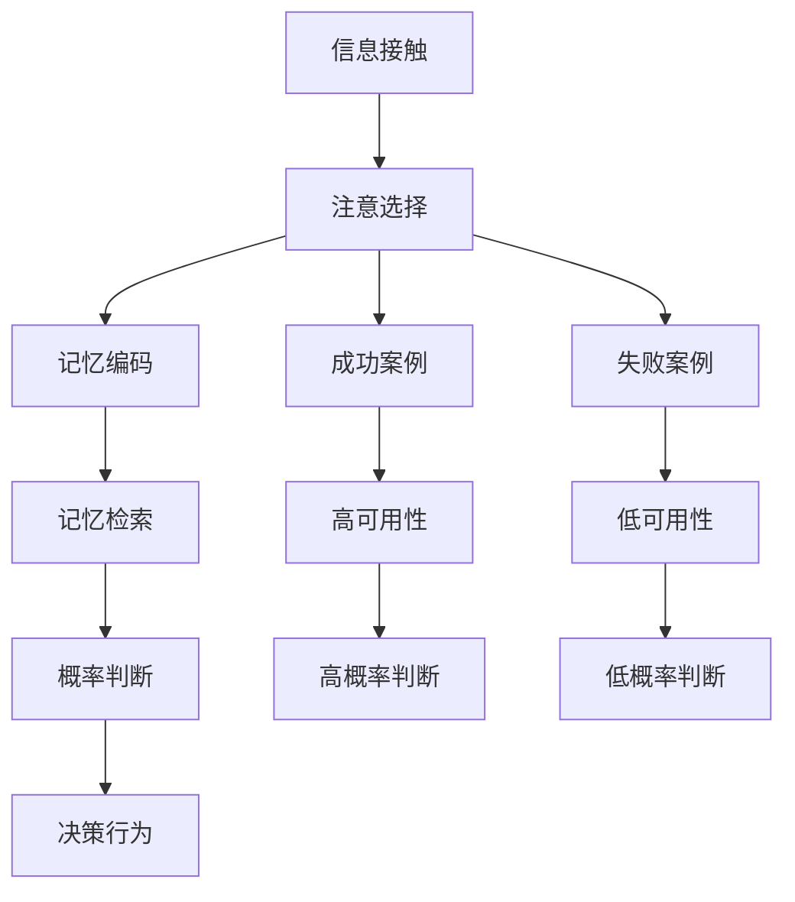
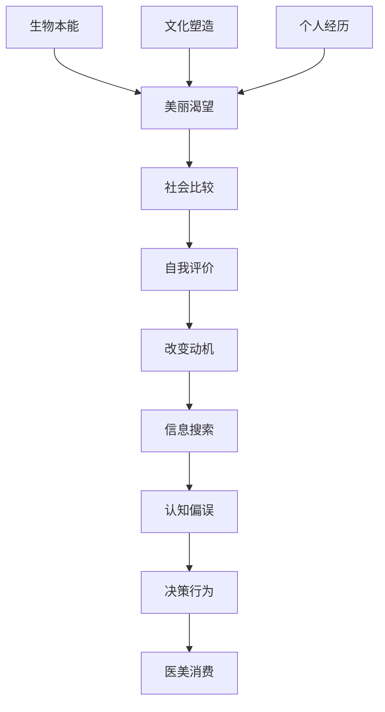

# 第三章：大脑的快捷方式 - 驱动消费的认知偏误

## 引言：当理性遇上偏见

当小雅第一次走进医美机构时，她以为自己是理性的。她做了功课，看了很多资料，咨询了朋友，甚至列了一个详细的问题清单。但是，当她看到装修精美的诊所、穿着白大褂的专业医生、墙上挂满的成功案例照片时，她的理性判断开始悄悄发生变化。

"这家机构看起来很专业，医生也很漂亮，应该技术不错。"
"墙上这么多成功案例，看起来风险很小。"
"朋友推荐的，而且现在有优惠，不做就亏了。"

三个小时后，小雅签下了一份远超预算的医美合同。事后回想，她也不知道自己是怎么做出这个决定的。

这就是认知偏误的威力。我们的大脑是一个高效的信息处理器，但为了提高效率，它经常使用各种"快捷方式"来做决策。这些快捷方式被心理学家称为"启发式"（Heuristics），它们在日常生活中通常是有用的，能帮助我们快速做出合理的判断。

但是，在医美消费这样的复杂决策中，这些心理捷径可能会误导我们，让我们做出不够理性的选择。更重要的是，精明的营销者深谙这些心理机制，会有意无意地利用它们来影响我们的决策。

在这一章中，我们将深入探讨几种最常见、最具影响力的认知偏误，看看它们是如何在医美消费中发挥作用的，以及我们如何识别和应对这些心理陷阱。

## 3.1 医美"真香定律"：从抗拒到接受的心理转变

### 态度转变的心理奥秘

"我绝对不会去做医美的！这是虚荣，是对自然美的背叛！"

这是小王两年前的坚定表态。但是现在，她正坐在医美机构里，准备进行第三次玻尿酸注射。当朋友问起她态度转变的原因时，她有些不好意思地说："真香！早知道效果这么好，我应该早点做。"

这种戏剧性的态度转变，在医美消费中极其常见。正如丽格李滨在《医美"真香定律"》一文中精辟分析的，医美领域的"真香定律"几乎是普遍存在的现象。从心理学的角度来看，这种现象反映了人类认知系统的一个重要特征：我们的态度并不是固定不变的，而是会在新的体验和信息面前发生调整。

#### 认知失调理论的作用机制

当小王第一次接受医美治疗时，她的内心经历了激烈的冲突。一方面，她的行为（接受医美）与她的原有观念（反对医美）产生了冲突；另一方面，她看到了实际的效果，这与她对医美的负面预期也产生了冲突。

这种冲突在心理学上被称为"认知失调"。根据费斯廷格的认知失调理论，当我们的认知、态度和行为之间出现不一致时，大脑会感到不适。为了减少这种不适，我们会采取以下策略之一：

**改变行为**：停止医美治疗，回到原来的状态。但这往往很困难，因为已经看到了效果。

**改变认知**：重新评估医美的价值和意义。比如，"医美其实是一种自我投资"、"适度的医美是对自己的关爱"。

**增加新的认知**：寻找支持新行为的理由。比如，"现在的医美技术很安全"、"很多成功人士都在做医美"。

大多数人会选择后两种策略，因为它们比改变行为更容易。这就是为什么我们会看到如此多的"真香"转变。

#### 自我知觉理论的补充解释

除了认知失调理论，达里尔·贝姆的自我知觉理论也能很好地解释这种现象。这个理论认为，我们有时会通过观察自己的行为来推断自己的态度。

当小王发现自己接受了医美治疗，并且还预约了下一次时，她会自然地推断："我做了医美，而且还要继续做，说明我其实是支持医美的。我之前的反对可能只是因为不了解。"

这种自我推断往往是无意识的，但它会强化新的态度，让态度转变变得更加稳固。

#### 态度转变的典型路径

  

    
1

    

      <h3>初始抗拒期</h3>
      
<strong>心理状态：</strong>"我不需要医美，自然就是美"

      
<strong>认知特点：</strong>道德优越感、对医美的刻板印象、风险过度估计

    

  

  

    
2

    

      <h3>认知失调期</h3>
      
<strong>心理状态：</strong>"也许医美没那么可怕？"

      
<strong>认知特点：</strong>接触成功案例、身边人的影响、原有观念受到冲击

    

  

  

    
3

    

      <h3>尝试体验期</h3>
      
<strong>心理状态：</strong>"试试看，反正是小项目"

      
<strong>认知特点：</strong>从轻医美开始、降低心理门槛、合理化行为

    

  

  

    
4

    

      <h3>"真香"转化期</h3>
      
<strong>心理状态：</strong>"效果不错，早该这样做"

      
<strong>认知特点：</strong>态度彻底转变、成为医美支持者、推荐给他人

    

  

#### "真香定律"的心理机制

!!! info "认知失调理论的应用"
    **费斯廷格的认知失调理论**完美解释了这种态度转变：
    
    - **失调产生**：原有观念与新信息冲突
    - **失调减少**：通过改变态度来减少心理不适
    - **态度固化**：新态度与行为保持一致，形成稳定认知
    
    **自我知觉理论**也发挥作用：
    - 通过观察自己的行为来推断自己的态度
    - "我做了医美，说明我是支持医美的人"

#### 典型案例分析

!!! example "男性医美的"路转粉"现象"
    正如李滨在文章中描述的："很多男性对自己做医美持负面评价，那是女人的事情，纯爷们不需要！文化束缚带给男性医美的羞耻感根深蒂固。然而，当男人们因为衰老或职场形象压力选择必要的医美治疗后，立刻发现'真香'，很快就会悄悄二刷、多刷，甚至办卡的时候根本不讲价。"

#### 营销策略的心理触发

**降低首次尝试的门槛**是"真香定律"在营销中的重要应用：

- **低价引流**：99元小气泡，免费AI面部分析
- **消除心理防线**：用低风险方式让用户尝鲜
- **产生拥有感**：一旦体验过，便催生态度的合理化

!!! warning "认知失调的利用"
    当人的行为发生转向时，会产生不适感。为了降低困扰，人们会改变态度，使行为与新的认知保持一致，同时通过增加新的知识来缓解失调。这正是营销者利用的心理机制。

### 巴纳姆效应在医美咨询中的应用

正如丽格李滨在《整容心理中的巴纳姆效应》一文中深入分析的，巴纳姆效应在医美咨询中被广泛（有时是无意识地）运用：

!!! quote "李滨观点"
    "大部分人决定整容的时候，都或多或少受到巴纳姆效应的影响。虽然没有确切的数据，但是经验告诉我们，心理学上的巴纳姆效应在整容人群中的渗透率相当高，受其影响越大，整形美容出现负面结果的几率就越多。"
    
    —— 摘自《整容心理中的巴纳姆效应》，[原文链接](https://mp.weixin.qq.com/s/Ps-1PzFh57UwGQL3VEWohw?scene=1)

#### 巴纳姆效应的定义
巴纳姆效应（Barnum Effect）是指人们倾向于相信一些模糊、一般性的人格描述，认为这些描述准确地反映了自己的特点。

**心理学家伯特伦·福勒于1948年验证**：每个人都会很容易相信一般性的人格描述特别适合自己，哪怕自己根本不是这种人，仍然认为关于一般人的描述准确地反映了自己的人格面貌。

#### 在整形美容中的延伸表现
接受整容的人无法正确地认识自己的容貌，从而把一些不适合自己的容貌特征强加在自己的脸上。

#### 在医美咨询中的典型表现

  

    <h4>🎯 精准"诊断"</h4>
    <ul>
      <li>"你的脸型属于心形脸，这种脸型的人通常很有亲和力"</li>
      <li>"你的眼型显示你是个很有想法的人"</li>
      <li>"从你的面相看，你应该是个很注重细节的人"</li>
    </ul>
  

  

    <h4>🔮 个性化建议</h4>
    <ul>
      <li>"像你这样的气质，适合做微调，不适合大改"</li>
      <li>"你这种类型的人，做了这个项目会更有自信"</li>
      <li>"根据你的性格，我建议你选择这个方案"</li>
    </ul>
  

#### 巴纳姆效应的心理机制

!!! warning "心理陷阱识别"
    **为什么我们容易相信这些"个性化"描述？**
    
    1. **自我中心偏见**：我们天生认为自己是独特的
    2. **确认偏见**：选择性关注符合自我认知的信息
    3. **权威效应**：专业人士的话更容易被接受
    4. **希望偏见**：我们希望被理解和认可

#### 巴纳姆效应的三种典型表现

根据李滨的分析，巴纳姆效应在整容心理中主要表现为三种情况：

  

    
1

    

      <h3>盲目追逐流行趋势（如网红脸）</h3>
      
女性往往会误认为流行的网红脸特别适合自己，而且大家在网上追捧的形象不就是自己吗？于是要求整形美容医生按照网红脸的模型改造自己。

      
<strong>问题所在：</strong>许多网红脸是在手机上处理过的，拍摄角度也会影响脸型效果，但患者宁愿选择性地相信自己看见的。

    

  

  

    
2

    

      <h3>按照别人的样子整自己</h3>
      
这种心理学上的移情作用，是巴纳姆效应的极端化表现。一些粉丝主观地认为某某明星的某个部位最适合自己，预先在内心设好了答案，然后要求医生去实现。

      
<strong>风险：</strong>如果发现不一致时，往往不会分析自身条件的原因，术后焦虑症多半由此引起。

    

  

  

    
3

    

      <h3>在算命先生的指导下去整容</h3>
      
所谓"开运整形"应该是从面相学里派生，然后与整形美容相结合而出现的营销话术。算命先生通常会揣摩对方的心态，用一些通常的人格描述使对方深信不疑。

      
<strong>营销套路：</strong>既然是为了改变命运，效果如何可以先放在一边，让整容机构多了一条发财路。

    

  

!!! info "历史典故：巴纳姆其人"
    巴纳姆是美国历史上的一个传奇人物，电影《马戏之王》便以他的事迹为蓝本。他早期经营以残疾人为表演内容的马戏团，编造了许多故事，大受欢迎。他最著名的言论是"坏的宣传，也是宣传。没有宣传，什么都不可能发生。"他在描述自己的表演时说：他的节目包含了每个人都喜欢的成分，所以每一分钟都有人上当。

### 医美中的"标签效应"

除了巴纳姆效应，李滨还在《医美中的"标签效应"》一文中深入分析了标签化认知在医美消费中的作用：

!!! quote "李滨观点"
    "标签化认知是人类大脑对信息进行分类和处理的一种手段。人类大脑天生就具有将信息进行归类、区分的功能，这有助于我们更好地理解和适应周围的环境。"
    
    —— 摘自《医美中的"标签效应"》，[原文链接](https://mp.weixin.qq.com/s/zYG7LmsJ-8-CKcsPuHZ-fw?scene=1)

#### 标签化认知的双面性

  

    

      
✅

      <h4 class="comparison-title">好处</h4>
    

    <ul>
      <li><strong>快速认知：</strong>减少认知负担，提高认知效率</li>
      <li><strong>便于沟通：</strong>帮助人们更加清晰地表达，避免沟通误解</li>
      <li><strong>方便记忆：</strong>更容易理解事物，便于日后应用和实践</li>
    </ul>
  

  

    

      
⚠️

      <h4 class="comparison-title">坏处</h4>
    

    <ul>
      <li><strong>容易产生偏见：</strong>简单归类，忽略个体差异和特点</li>
      <li><strong>容易产生歧视：</strong>产生不必要的歧视和偏见</li>
      <li><strong>误导观念：</strong>产生刻板印象，影响正常认知和判断</li>
    </ul>
  

#### 标签效应的心理实验

!!! example "克劳特的慈善实验"
    美国心理学家克劳特的实验中，要求志愿者做慈善捐献，然后根据是否有捐献行为将人群分为慈善者和非慈善者。过了一段时间，当再次要求这些人做捐献时：
    
    - 第一次被称为慈善者的人捐得最多
    - 没有被下过结论的人，无论第一次捐了多少，都比被称为慈善者捐得少
    - 被称为不慈善的人，捐的最少
    
    这表明了标签与自我实现预言、心理暗示和自我确认的密切关系。

## 3.2 "光环效应"：为什么我们会下意识地认为"长得好看的人能力也强"？

### 美貌的神奇力量

当小李走进面试房间时，她立刻被面试官的外表吸引了。这位女性面试官皮肤光滑，五官精致，穿着得体，整个人散发着一种专业而优雅的气质。在还没有开始正式交流之前，小李就在心里给她贴上了"能干"、"专业"、"值得信赖"的标签。

这就是光环效应（Halo Effect）的典型表现。光环效应是指我们对某人或某事的一个特征的认知会影响我们对其他特征的判断。在美貌相关的情境中，这种效应表现得尤为明显。

#### 美貌光环的具体表现

心理学研究发现，我们往往会给美貌的人赋予更多积极特质。这种现象如此普遍，以至于研究者们总结出了一个规律：

**外表吸引力 → 积极特质推断**

具体来说：
- 看到容貌端正的人，我们会推断他们更聪明、更有能力
- 看到身材匀称的人，我们会认为他们更自律、更健康
- 看到穿着得体的人，我们会觉得他们更专业、更可信
- 看到气质优雅的人，我们会认为他们更有修养、更成功

这种推断往往是自动的、无意识的，我们甚至意识不到自己在做这样的判断。

#### 光环效应的心理机制

**认知节约原理**：我们的大脑每天要处理海量信息，为了提高效率，它会寻找各种"快捷方式"。当我们看到一个人的外表时，大脑会迅速调用过往的经验和印象，对这个人的其他特质进行推断。这种推断虽然不一定准确，但能够帮助我们快速形成初步印象，减少认知负荷。

**进化心理学基础**：从进化的角度看，外表吸引力往往与健康状况相关，而健康的个体通常具有更好的基因和更强的生存能力。因此，我们的大脑进化出了对美貌的偏好，并将其与其他积极特质联系起来。

**社会学习机制**：在成长过程中，我们通过观察和学习，逐渐形成了"美貌=成功"的认知模式。媒体、文化、社会环境都在强化这种联系，让我们相信外表吸引力与能力、品格等特质之间存在正相关关系。

#### 光环效应的现实影响

光环效应不仅仅是一个有趣的心理现象，它在现实生活中有着深远的影响：

**职场中的美貌优势**：研究发现，外表更有吸引力的求职者更容易获得面试机会，在面试中也更容易获得好评。即使在工作表现相同的情况下，外表更佳的员工也更容易获得晋升和加薪。

**社交中的偏见**：在社交场合中，我们更愿意与外表吸引力高的人交往，也更容易相信他们的话，接受他们的建议。

**司法中的偏见**：甚至在法庭上，外表更有吸引力的被告也更容易获得轻判，而外表吸引力高的律师也更容易赢得案件。

这些现象说明，光环效应不仅影响我们的个人判断，还深刻地影响着社会的运作方式。

### 光环效应在医美消费中的体现

#### 对医美机构的判断
- **环境装修**：豪华装修=专业水准
- **医生外表**：外表精致=技术精湛
- **宣传材料**：精美包装=服务质量

#### 对医美效果的期望
- **成功案例**：美丽结果=技术保证
- **明星代言**：名人效应=效果背书
- **价格高低**：昂贵费用=优质服务

!!! example "现实案例"
    小张在选择医美机构时，被一家装修豪华、医生都很漂亮的诊所吸引，认为"连医生都这么美，技术肯定不错"。结果发现该机构的实际技术水平并不匹配其外在形象。

### 如何避免光环效应的误导

#### 多维度评估
- **分离不同维度**：外表和能力分别评估
- **客观指标**：关注资质、经验、案例
- **多方信息**：收集不同来源的信息

#### 理性思考训练
- **延迟判断**：给自己时间思考
- **反面思考**：考虑相反的可能性
- **证据导向**：基于事实而非印象

## 3.3 "可用性启发"：为什么社交媒体上铺天盖地的成功案例让我们觉得医美既简单又安全？

### 记忆中的"真相"

小美每天晚上都会刷社交媒体，她的首页充满了各种医美成功案例：朋友做了玻尿酸后皮肤水嫩光滑，网红博主分享隆鼻后的精致侧颜，同事晒出瘦脸针的神奇效果...这些成功故事如此生动、如此频繁地出现在她的视野中，以至于她开始相信医美是一件既简单又安全的事情。

"看起来大家做医美都很成功啊，应该没什么风险吧？"小美这样想着，开始认真考虑自己的医美计划。

但是，小美不知道的是，她的这种判断正在受到一种强大的认知偏误的影响——可用性启发。

#### 可用性启发的工作原理

可用性启发（Availability Heuristic）是由心理学家阿莫斯·特沃斯基和丹尼尔·卡尼曼提出的概念。它是指我们倾向于根据某件事在记忆中的可获得性来判断其发生的概率。简单来说，越容易想起的事件，我们越认为它更可能发生。

这种心理机制在日常生活中通常是有用的。比如，如果我们经常听到某个地区发生交通事故的新闻，我们会认为在那里开车比较危险，从而更加小心驾驶。这种判断往往是合理的，因为频繁报道的事件通常确实更常发生。

但是，在信息传播不均衡的情况下，可用性启发就可能误导我们的判断。

#### 社交媒体的信息扭曲

在社交媒体时代，信息的传播并不是均衡的。某些类型的信息更容易被传播和记住，而另一些信息则容易被忽视或遗忘。

**成功案例的过度曝光**：

**算法推荐的偏向**：社交媒体平台的算法会优先推送那些获得更多点赞、评论和分享的内容。而医美成功案例往往能够获得更多的正面反馈，因此更容易被算法推荐给更多用户。

**用户分享的选择性**：人们更愿意分享自己的成功经历，而不是失败经历。一个医美效果满意的人会兴奋地在社交媒体上展示自己的变化，而一个效果不理想的人则更可能选择沉默。

**商业推广的策略性**：医美机构会主动收集和宣传成功案例，这些案例经过精心挑选和包装，代表了最理想的效果。

**失败案例的系统性隐藏**：

**羞耻心理的作用**：医美失败的人往往会感到羞耻和尴尬，他们不愿意公开自己的经历，担心被人嘲笑或指责。

**法律和商业压力**：一些医美机构会通过法律手段或商业协议来限制负面信息的传播，失败案例很难在公开平台上出现。

**平台规则的限制**：一些社交媒体平台会限制或删除过于负面的内容，认为这些内容可能影响用户体验。

#### 扭曲的概率认知

这种信息传播的不平衡导致了我们对医美风险和收益的扭曲认知。

**真实的统计数据**：
- 医美手术的总体满意度约为80-85%
- 轻微并发症的发生率约为10-15%
- 严重并发症的发生率约为1-3%
- 需要修复手术的比例约为5-10%

**社交媒体呈现的"数据"**：
- 成功案例的展示比例超过95%
- 并发症的讨论比例不到1%
- 修复手术的提及几乎为零
- 长期效果的跟踪报道极少

这种巨大的差异让我们对医美的风险产生了严重的低估，对收益产生了过度的乐观。

### 可用性启发的认知机制

#### 记忆的选择性

#### 情感记忆的强化
- **积极情绪**：成功案例带来的愉悦感
- **视觉冲击**：前后对比的强烈效果
- **认同感**：与自己相似的成功故事

### 真实的成功与失败比例

#### 官方数据vs感知数据
- **医美手术成功率**：实际约85-95%
- **社交媒体呈现**：成功案例占比>95%
- **严重并发症率**：实际约1-5%
- **网络讨论比例**：并发症讨论<1%

#### 幸存者偏差
- **成功者发声**：满意的客户更愿意分享
- **失败者沉默**：不满意的客户选择沉默
- **中间状态**：一般效果的案例被忽略

!!! warning "现实检验"
    根据中国医师协会的数据，医美手术的总体满意度约为80%，但严重并发症的发生率也达到了3-5%。这与我们在社交媒体上看到的"完美成功率"存在显著差异。

### 媒体呈现的心理影响

#### 风险感知的降低
- **熟悉性效应**：频繁接触降低风险感知
- **乐观偏见**：认为坏事不会发生在自己身上
- **确认偏见**：选择性关注支持自己想法的信息

#### 决策阈值的降低
- **冲动性增强**：快速决策的倾向
- **谨慎性减少**：对风险的忽视
- **从众行为**：跟随他人的选择

## 3.4 "现状偏见"与"损失厌恶"：害怕改变，更害怕"不改变"会失去更多

### 矛盾的心理：既想改变又怕改变

小张坐在医美机构的咨询室里，内心充满了矛盾。一方面，她对自己的单眼皮一直不满意，渴望通过手术获得更大更有神的眼睛；另一方面，她又害怕手术的风险，担心万一效果不好怎么办。

但是，当咨询师告诉她"25岁是做双眼皮的黄金年龄，过了这个年龄皮肤弹性下降，效果就不会这么好了"时，她的天平开始倾斜。"如果我现在不做，以后会不会后悔？会不会错过最佳时机？"

最终，对"错过机会"的恐惧战胜了对"改变风险"的担忧，小张签下了手术同意书。

这个案例完美地展现了现状偏见和损失厌恶这两种心理机制在医美消费中的复杂作用。

#### 现状偏见的双重面孔

现状偏见（Status Quo Bias）通常是指人们倾向于维持当前状态，对改变有天然的抗拒。这种偏见在很多情况下是有益的，它让我们避免不必要的风险和变化。

**传统现状偏见的表现**：
- **维持现状的倾向**：倾向于保持当前的生活方式、工作状态、消费习惯等
- **变化阻力**：对任何形式的改变都会产生心理阻力
- **决策拖延**：面对重要决策时，倾向于推迟或回避

但是，在医美消费的情境中，现状偏见呈现出了一种奇特的双重性。

**医美消费中的反向现状偏见**：
- **对当前外表的不满**：现状（当前的外表）成为了需要改变的对象
- **时间紧迫感**：害怕错过"最佳时机"，认为不改变就是在浪费时间
- **竞争压力**：担心在"美丽竞争"中落后于他人

这种反向的现状偏见让人们开始害怕"不改变"，认为维持现状反而是一种损失。

### 损失厌恶的心理机制

#### 经典损失厌恶
根据卡尼曼的研究，人们对损失的敏感度是收益的2-2.5倍。

#### 医美决策中的损失框架
- **时间成本**：青春的流逝
- **机会成本**：错过改变的机会
- **社会成本**：在竞争中的劣势
- **心理成本**：持续的不满和焦虑

### 损失厌恶的营销利用

#### 稀缺性营销
- **限时优惠**：营造紧迫感
- **限量名额**：制造竞争压力
- **年龄焦虑**：强调时间的不可逆性

#### 对比框架
- **前后对比**：突出改变的收益
- **同龄对比**：强调不变的损失
- **成功案例**：展示改变的价值

!!! example "营销话术分析"
    "25岁是肌肤护理的黄金期，过了这个年龄，胶原蛋白流失速度会加快50%。现在不保养，以后要花更多钱才能达到同样效果。"
    
    这个话术同时利用了：
    - 损失厌恶：强调错过的后果
    - 现状偏见：暗示现在就是最佳时机
    - 权威效应：使用看似科学的数据

### 理性应对策略

#### 决策框架的调整
- **收益视角**：关注积极的改变
- **长期视角**：考虑长期的影响
- **全面视角**：权衡所有利弊

#### 时间管理
- **冷静期**：给自己充分的思考时间
- **分阶段**：将大决策分解为小步骤
- **可逆性**：考虑决策的可逆程度

## 3.5 确认偏见：我们如何选择性地接受信息

### 寻找支持自己的"证据"

当小刘决定要做鼻部整形后，她开始疯狂地搜索相关信息。但奇怪的是，她搜索的关键词都是"鼻部整形成功案例"、"隆鼻效果好的医院"、"鼻部整形安全吗"，而从来不搜索"鼻部整形失败案例"或"隆鼻的风险"。

当她偶然看到一些关于鼻部整形风险的文章时，她会这样想："这个案例肯定是去了不正规的机构"、"这个人肯定是没有好好护理"、"这种情况很少见，不会发生在我身上"。

而当她看到成功案例时，她会仔细研究每一个细节，甚至保存图片作为参考。她会想："看，这个人的条件和我很像，她做得这么成功，我肯定也可以"。

这就是确认偏见（Confirmation Bias）的典型表现。确认偏见是指我们倾向于寻找、解释和回忆那些证实我们既有信念的信息，而忽视或贬低相反的证据。

#### 确认偏见的心理机制

**认知一致性的需求**：人类的大脑天生就追求认知的一致性。当我们已经形成了某种观点或做出了某种决定时，大脑会自动寻找支持这种观点或决定的信息，同时回避或贬低相反的信息。这样做能够减少认知失调，让我们感到更加舒适和自信。

**自我保护机制**：确认偏见也是一种自我保护机制。承认自己的判断可能是错误的，会威胁到我们的自尊和自信。因此，我们的大脑会本能地保护我们的既有观点，避免接受可能让我们感到不安的信息。

**信息处理的效率**：从信息处理的角度看，确认偏见也是一种提高效率的方式。如果我们对每一条信息都进行深入的分析和质疑，我们的认知资源很快就会耗尽。通过选择性地关注支持性信息，我们可以更快地做出决策。

#### 医美决策中确认偏见的具体表现

**信息搜索的偏向性**：

**关键词的选择性**：当人们已经倾向于做某个医美项目时，他们在搜索信息时会使用偏向性的关键词。比如，他们会搜索"双眼皮手术效果"而不是"双眼皮手术风险"，会搜索"最好的隆鼻医生"而不是"隆鼻失败案例"。

**信息源的筛选**：他们会偏好那些支持他们观点的信息源。比如，他们更愿意相信医美机构的宣传材料，而对独立媒体的调查报道持怀疑态度。

**内容的过滤**：即使在同一篇文章中，他们也会选择性地关注支持性的内容，而忽略警告性的内容。

**信息解释的偏向性**：

**积极解释倾向**：对于模糊或中性的信息，他们倾向于做出积极的解释。比如，当医生说"这个手术有一定风险"时，他们会理解为"风险很小，基本不用担心"。

**例外化处理**：当遇到负面案例时，他们会将其视为特例或意外，认为这种情况不会发生在自己身上。比如，"这个人肯定是去了不正规的机构"、"她肯定没有按照医嘱护理"。

**合理化机制**：他们会为自己的选择寻找各种合理化的理由，即使这些理由可能并不充分。比如，"我年轻，恢复能力强"、"我选择的是最好的医生"、"我做了充分的准备"。

### 确认偏见的强化机制

#### 认知失调理论
当新信息与既有信念冲突时，我们会：
- **改变信息**：质疑信息的可靠性
- **改变解释**：重新解释信息的含义
- **改变重要性**：降低冲突信息的重要性

#### 社会支持的寻求
- **同伴确认**：寻找持相同观点的人
- **专家意见**：寻求支持自己观点的专家
- **成功案例**：关注相似的成功经历

### 确认偏见的负面影响

#### 风险评估的偏差
- **低估风险**：忽视潜在的负面后果
- **高估收益**：夸大预期的积极结果
- **信息不完整**：基于片面信息做决策

#### 决策质量的下降
- **选择性注意**：错过重要信息
- **过度自信**：对自己的判断过于确信
- **学习障碍**：无法从错误中学习

!!! warning "典型表现"
    如果你发现自己：
    - 只关注医美的成功案例，忽视失败案例
    - 认为负面评价都是"竞争对手的恶意中伤"
    - 只咨询支持你想法的医生或朋友
    - 对质疑你决策的人感到愤怒或排斥
    
    你可能正在受到确认偏见的影响。

### 克服确认偏见的方法

#### 主动寻求反面证据
- **魔鬼代言人**：主动寻找反对观点
- **多元信息源**：接触不同立场的信息
- **批判性思维**：质疑自己的假设

#### 结构化决策过程
- **决策清单**：列出所有相关因素
- **权重分析**：给不同因素分配权重
- **情景分析**：考虑不同可能的结果

## 3.6 认知偏误的协同作用：当多种"快捷方式"同时发挥作用

### 偏误的"完美风暴"

让我们回到小雅的故事。当她走进那家医美机构时，她的大脑同时受到了多种认知偏误的影响：

**光环效应**：精美的装修让她认为这家机构很专业，漂亮的医生让她觉得技术一定很好。

**可用性启发**：墙上满满的成功案例让她觉得医美很安全，失败的概率很低。

**损失厌恶**：咨询师告诉她"现在不做，以后会更贵更难恢复"，让她害怕错过机会。

**确认偏见**：当咨询师介绍项目优点时，她全神贯注地听；当提到风险时，她心不在焉。

**真香定律**：她想起朋友做完医美后的满意表情，开始相信"医美其实挺好的"。

这些偏误不是孤立发挥作用的，而是相互强化，形成了一个强大的心理"完美风暴"。

#### 认知偏误的协同机制

**相互强化**：不同的认知偏误会相互强化彼此的影响。比如，光环效应让我们对某个机构产生好感，这种好感又会激活确认偏见，让我们更容易接受支持性信息，忽视警告性信息。

**循环放大**：认知偏误的影响会形成循环。当我们基于偏误做出决策后，为了减少认知失调，我们会进一步寻找支持这个决策的信息，这又会强化原有的偏误。

**情境依赖**：在特定的情境下，某些认知偏误会变得更加活跃。比如，在时间压力下，我们更容易受到损失厌恶的影响；在信息不足的情况下，我们更容易依赖光环效应。

#### 情感与理性的复杂互动

**情感驱动的理性化**：我们的医美决策往往是情感驱动的——对美的渴望、对衰老的恐惧、对社会认可的需求。但是，我们会用理性的语言来为这些情感驱动的决策进行辩护。认知偏误在这个过程中发挥了重要作用，它们帮助我们找到支持情感决策的"理性"理由。

**理性的情感化**：另一方面，我们以为自己在进行理性分析时，实际上也受到了情感的影响。我们对信息的选择、解释和记忆都带有情感色彩，而认知偏误放大了这种情感色彩的影响。

**决策的双重性**：最终的医美决策既不是纯粹理性的，也不是纯粹情感的，而是两者复杂互动的结果。认知偏误在这个互动过程中起到了"催化剂"的作用，它们加速了决策过程，但也可能导致决策偏离最优选择。

### 求美之心的深层解析

#### 合理的心理需求

我们必须承认，对美的追求是人类的基本需求之一。这种需求有着深刻的生物学和社会学基础：

**生物学基础**：对美的偏好帮助我们的祖先选择健康的配偶，提高了繁殖成功率。这种偏好深深植根于我们的基因中。

**社会学基础**：在现代社会中，外表吸引力与社会成功密切相关。追求美丽不仅是个人偏好，也是社会适应的需要。

**心理学基础**：美丽的外表能够提升自信心，改善心理健康，提高生活质量。这种心理收益是真实存在的。

#### 需求表达的扭曲

但是，当这种合理的心理需求遇到认知偏误时，就可能产生扭曲的表达：

**过度化**：原本适度的美容需求可能被放大为强迫性的改变冲动。

**非理性化**：原本可以通过多种方式满足的需求，被局限为只能通过医美来解决。

**短视化**：只关注短期的外表改变，忽视长期的健康和心理影响。

**依赖化**：将自我价值完全寄托在外表上，形成对医美的心理依赖。

### 求美的深层心理需求

#### 合理的心理需求
- **自我实现**：追求更好的自己
- **社会适应**：在社会中的良好表现
- **情感满足**：通过改变获得快乐

#### 需求的表达方式
- **适度表达**：理性的美容护理
- **过度表达**：冲动的医美消费
- **扭曲表达**：成瘾性的改变行为

### 建立理性决策框架

#### 认知偏误的识别
- **自我监控**：观察自己的思维模式
- **外部提醒**：寻求他人的客观意见
- **工具使用**：使用决策辅助工具

#### 平衡策略
- **情感认知**：承认情感需求的合理性
- **理性分析**：使用客观的评估方法
- **渐进决策**：避免冲动的重大决策

## 3.7 实践工具：认知偏误自检与应对策略

### 认知偏误识别清单

在做出医美决策之前，不妨用这个清单来检查自己是否受到了认知偏误的影响：

#### 光环效应自检

**环境判断**：
- [ ] 我是否因为机构装修豪华而认为技术水平高？
- [ ] 我是否因为医生外表精致而判断其专业能力强？
- [ ] 我是否因为价格昂贵而认为服务质量更好？
- [ ] 我是否因为机构位置高端而提高了信任度？

**如果你勾选了多个选项，说明你可能受到了光环效应的影响。**

**应对策略**：
- 将外在形象与专业能力分开评估
- 重点关注医生的资质、经验和案例
- 通过多个渠道验证机构的实际水平
- 理性分析价格与价值的关系

#### 可用性启发自检

**信息来源分析**：
- [ ] 我对医美风险的认知主要来自社交媒体？
- [ ] 我接触到的成功案例远多于失败案例？
- [ ] 我很少主动搜索医美的负面信息？
- [ ] 我认为医美失败的概率很低？

**如果你勾选了多个选项，说明你的风险认知可能被扭曲了。**

**应对策略**：
- 主动寻找官方统计数据
- 关注医学期刊和专业报告
- 了解真实的成功率和并发症率
- 接触多元化的信息来源

#### 损失厌恶自检

**时间压力感知**：
- [ ] 我担心错过"最佳年龄"或"黄金时期"？
- [ ] 我被"限时优惠"等营销手段影响？
- [ ] 我害怕不做医美会在竞争中落后？
- [ ] 我觉得现在不做以后会更贵更难？

**如果你勾选了多个选项，说明你可能受到了损失厌恶的影响。**

**应对策略**：
- 给自己充分的思考时间
- 客观评估改变与不改变的真实利弊
- 不要被营销制造的紧迫感绑架
- 考虑决策的长期影响

#### 确认偏见自检

**信息处理方式**：
- [ ] 我主要搜索支持我想法的信息？
- [ ] 我对质疑我决策的信息感到排斥？
- [ ] 我将负面案例都归因为特殊情况？
- [ ] 我很少考虑决策可能的负面后果？

**如果你勾选了多个选项，说明你可能陷入了确认偏见。**

**应对策略**：
- 主动寻找反对意见和负面信息
- 请朋友扮演"魔鬼代言人"角色
- 列出决策的所有可能后果
- 保持开放和质疑的心态

### 理性决策的实用方法

#### 10-10-10法则

在做决策时，问自己三个问题：
- 10分钟后，我会如何看待这个决策？
- 10个月后，我会如何看待这个决策？
- 10年后，我会如何看待这个决策？

这个方法能帮助你从不同的时间维度来评估决策的影响。

#### 外部视角法

想象你的好朋友面临同样的决策，你会给她什么建议？这种"外部视角"能够帮助你摆脱情感和偏见的影响，做出更客观的判断。

#### 预设反悔法

假设你已经做了这个决策，但结果不理想，你会后悔什么？这种"预设反悔"的思维能够帮助你提前识别潜在的风险和问题。

#### 多方咨询法

不要只听一个人的意见，要咨询多个不同背景的人：
- 专业医生（最好是不同机构的）
- 有相关经验的朋友
- 没有相关经验但理性客观的朋友
- 专业的心理咨询师（如果需要）

通过多方咨询，你能够获得更全面、更平衡的信息。

## 💬 本章反思

!!! question "深度思考"
    1. 回想一次你的重要决策，分析一下哪些认知偏误可能影响了你的判断？
    
    2. 在医美相关的信息搜索中，你是否发现了自己的确认偏见？
    
    3. 社交媒体上的医美内容如何影响了你对医美风险和收益的认知？
    
    4. 如何在承认情感需求的同时，避免认知偏误的误导？

## 🎯 第一部分核心要点回顾

### 三大心理机制的协同作用

  

    <h4>🪞 个体层面：镜中自我</h4>
    <ul>
      <li>美丽观念的生物学基础</li>
      <li>身体意象的形成过程</li>
      <li>文化对审美标准的塑造</li>
    </ul>
  

  

    <h4>👥 社会层面：比较机制</h4>
    <ul>
      <li>社会比较的心理功能</li>
      <li>向上比较的双重效应</li>
      <li>社交媒体的比较陷阱</li>
    </ul>
  

  

    <h4>🧠 认知层面：偏误影响</h4>
    <ul>
      <li>光环效应的判断误导</li>
      <li>可用性启发的风险低估</li>
      <li>确认偏见的信息筛选</li>
    </ul>
  

### 医美消费心理的整体框架

### 关键洞察

!!! insight "核心发现"
    1. **美丽渴望是多层次的**：既有生物学基础，也有社会文化建构
    2. **比较是相对的**：我们的自我认知很大程度上依赖于社会比较
    3. **决策是有偏的**：认知偏误系统性地影响我们的判断和选择
    4. **心理机制是交互的**：这些因素相互作用，共同推动消费行为

## ➡️ 下一部分预告

在理解了美丽渴望的心理基础之后，第二部分将深入探讨**从心动到行动的决策过程**：

- **信息收集**：如何在信息海洋中避免溺水？
- **风险评估**：被美丽冲昏的头脑如何理性判断？
- **专业咨询**：权威光环下的心理博弈

我们将看到，理解了心理机制只是第一步，真正的挑战在于如何在复杂的现实环境中做出理性的决策。

---

*"理解大脑的运作机制，是做出理性决策的基础。接下来，让我们看看这些心理因素如何在实际决策中发挥作用。"*