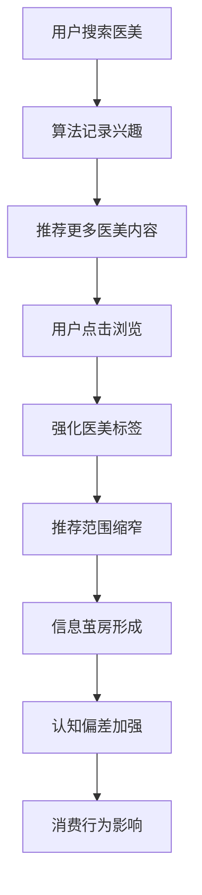

# 第十章：营销的心理魔法 - 他们是如何精准"拿捏"你的？

## 引言：小雅的营销觉醒之路

当小雅第一次看到"少女针"这个名字时，她的反应是瞬间的：心跳加速，眼睛发亮，脑海中立刻浮现出青春、美丽、重新开始的画面。她甚至还没有了解这个项目的具体内容，就已经被深深吸引了。

"少女针...这个名字太美了！"小雅兴奋地对朋友说，"听起来就像能让人重回18岁一样！"

但是，当小雅深入了解后发现，所谓的"少女针"其实就是普通的透明质酸注射，只是换了一个更有吸引力的名字。这个发现让她开始思考：为什么一个简单的名字改变，会对她产生如此大的影响？

这就是现代医美营销的精妙之处。它们不再简单地推销产品，而是在创造需求、塑造认知、操控情感。每一个看似随意的营销概念背后，都有着精密的心理学设计；每一个动人的广告故事背后，都有着深刻的人性洞察。

在这一章中，我们将跟随小雅的觉醒之路，深入剖析医美营销的各种"心理魔法"，学会识破这些精心设计的心理陷阱。

## 10.1 创造"新名词"：从"少女针"到"精灵耳"，概念包装如何让普通技术显得高端神秘？

### 小雅的"少女针"觉醒记

**第一次接触：瞬间的心动**

当小雅在朋友圈看到"少女针"这个词时，她的大脑在0.1秒内完成了一系列复杂的心理活动：

**瞬间的联想链**：
少女 → 青春 → 美丽 → 无瑕 → 重新开始 → 我也想要

"这个名字太有吸引力了！"小雅兴奋地想，"听起来就像能让人重回18岁一样！我一定要了解一下。"

**深入了解后的失望**：

当小雅深入了解后发现，所谓的"少女针"其实就是透明质酸注射，和普通的玻尿酸注射没有本质区别。唯一的不同就是这个充满诱惑力的名字。

"原来就是普通的玻尿酸啊..."小雅有些失望，"但为什么叫'少女针'我就这么心动，叫'玻尿酸'我就觉得很普通呢？"

**营销心理学的启示**：

这个经历让小雅开始思考语言和概念对心理的影响力。她意识到，同样的产品，不同的命名和包装，会产生完全不同的心理效果。

### 语言的魔力：概念包装的心理学原理

在医美营销的世界里，语言不仅仅是沟通的工具，更是塑造认知和情感的武器。一个普通的透明质酸注射，被包装成"少女针"后，瞬间就有了青春、美丽、逆龄的魔力。这种转变的背后，隐藏着深刻的心理学原理。

#### 新奇性偏好的心理基础

人类大脑天生就对新奇事物更加敏感，这是进化过程中形成的生存机制。在信息爆炸的现代社会，这种新奇性偏好被营销师巧妙利用：

**认知吸引机制**：新概念能够突破信息噪音，直接抓住我们的注意力。当我们听到"少女针"、"精灵耳"这样的新名词时，大脑会自动分配更多的认知资源来处理这些信息。

**探索欲望的激发**：新奇的概念会激发我们的好奇心和探索欲望。我们想要了解这是什么，有什么效果，是否适合自己。这种探索欲望本身就是一种强大的心理驱动力。

**早期采用者的优越感**：成为新技术、新概念的早期采用者，会让人产生一种优越感和先进感。这种心理满足感往往比产品本身的效果更有吸引力。

**社交话题的价值**：新概念容易成为社交话题，为社交互动提供素材。分享新发现、新体验是人类的天性，这种社交价值进一步增强了新概念的吸引力。

#### 神秘化效应的心理机制

通过创造专业术语和神秘概念，营销师制造了一种"专业距离感"：

**专业门槛的建立**：复杂的名词和概念让消费者感觉这是一个专业领域，需要专业人士的指导。这种专业门槛的建立，实际上是在培养消费者的依赖心理。

**技术信任的暗示**：复杂、神秘的名词往往被认为代表着高科技和先进技术。消费者会自动将复杂性等同于先进性，将神秘性等同于专业性。

**选择困难的制造**：面对众多神秘的概念和选择，消费者往往会感到困惑和无所适从。这种选择困难会让他们更加依赖专业人士的推荐和指导。

**价值认知的提升**：神秘的、难以理解的东西往往被认为更有价值。这种心理现象被称为"复杂性偏见"，即人们倾向于认为复杂的东西比简单的东西更有价值。

### 概念包装的经典案例分析

#### 注射类项目的语言魔术

让我们深入分析几个经典的概念包装案例：

**"少女针"的心理设计**：
- **年龄暗示**：直接指向青春和年轻，触发对逝去青春的怀念
- **简化理解**：避免"透明质酸注射"这样的医学术语，降低理解门槛
- **情感吸引**：激发对青春美丽的向往和追求
- **社交传播**：朗朗上口，易于在社交媒体传播

**"童颜针"的概念设计**：
- **年龄逆转**：暗示能够回到童年般的肌肤状态
- **天然效果**：与"童颜"的天然美感建立联系
- **无害暗示**：童年代表纯真无害，暗示产品的安全性
- **持久效果**：童颜代表持久的美丽状态

**"瘦脸针"的营销智慧**：
- **效果直接**：直接说明产品的主要功效
- **简化过程**：将复杂的肉毒素注射简化为"瘦脸"
- **便捷性暗示**：一针解决问题的便捷感
- **结果导向**：强调最终效果而非过程

#### 手术类项目的文化包装

**"韩式双眼皮"的文化营销**：
- **地域化标签**：借用韩流文化的影响力
- **时尚感营造**：与韩国的时尚形象建立联系
- **技术先进性**：暗示韩国在医美技术上的领先地位
- **审美标准输出**：推广特定的审美标准

**"欧式大双眼皮"的异域魅力**：
- **异域化吸引**：利用对西方审美的向往
- **立体感强调**：突出欧洲人的立体五官特征
- **高端定位**：与欧洲的高端形象建立联系
- **差异化竞争**：与亚洲传统审美形成差异

**"精灵耳"的童话营销**：
- **童话化包装**：借用精灵的美好形象
- **可爱元素**：迎合对可爱文化的喜爱
- **个性化表达**：满足个性化审美需求
- **年轻化定位**：主要针对年轻消费群体

### 概念包装的深层心理策略

#### 情感联想的建立

营销师深知，理性的说服往往不如情感的触动。通过巧妙的概念包装，他们建立了产品与美好情感之间的联系：

**美好联想的植入**：将产品与青春、美丽、成功、幸福等美好概念联系起来，让消费者在想到产品时自动产生积极的情感反应。

**身份认同的构建**：通过概念包装，营销师为消费者构建了一种身份认同。使用"少女针"的人是追求青春的，选择"精灵耳"的人是个性独特的。

**生活方式的暗示**：每个概念背后都暗示着一种特定的生活方式。这种生活方式的暗示让产品超越了功能性，成为了一种生活态度的表达。

**社会地位的象征**：高端的概念包装往往暗示着社会地位的提升。能够接受新概念、新技术的人，往往被认为是有品味、有地位的。

#### 技术神秘化的策略

**科技感的营造**：使用科技相关的词汇，如"纳米"、"量子"、"生物"等，营造高科技的感觉。

**进口优势的强调**：强调技术来自发达国家，利用消费者对进口产品的信任和偏好。

**专利技术的暗示**：暗示技术的独特性和先进性，让消费者感觉这是独一无二的选择。

**最新研发的强调**：强调技术的前沿性和时效性，让消费者感觉自己走在时代前沿。

### 如何识破概念包装的"魔法"

#### 还原真实面目的方法

**查阅专业资料**：通过医学文献、专业网站等渠道，了解产品的真实医学名称和原理。

**成分分析**：了解产品的实际成分和作用机制，不被华丽的包装所迷惑。

**原理理解**：深入理解产品的作用原理，判断宣传效果的合理性。

**效果对比**：对比宣传效果与实际可能达到的效果，识别夸大宣传。

#### 保持理性思考的策略

**批判性思维**：对所有营销宣传保持批判态度，不轻易相信华丽的包装。

**多方验证**：通过多个独立的渠道验证信息，不依赖单一来源。

**专业咨询**：咨询专业医生的意见，获得客观的专业判断。

**理性分析**：用理性的态度分析产品的真实价值，不被情感因素左右。

理解了概念包装的心理机制，我们就能在面对各种华丽的营销概念时保持清醒的头脑，做出更加理性的选择。

### 典型的概念包装案例

#### 注射类项目的包装
| 医学名称 | 营销名称 | 包装策略 |
|----------|----------|----------|
| 透明质酸注射 | 少女针 | 年龄暗示 + 效果暗示 |
| 胶原蛋白注射 | 童颜针 | 年龄逆转 + 天然效果 |
| 肉毒素注射 | 瘦脸针 | 简化效果 + 便捷性 |
| PRP注射 | 血清美容 | 自然概念 + 科技感 |

#### 手术类项目的包装
- **韩式双眼皮**：地域化 + 时尚感
- **欧式大双眼皮**：异域化 + 立体感
- **精灵耳**：童话化 + 可爱元素
- **芭比鼻**：偶像化 + 完美标准

### 概念包装的说服策略

#### 情感联想
- **美好联想**：将产品与美好事物联系
- **身份认同**：与特定群体或形象关联
- **生活方式**：暗示特定的生活方式
- **社会地位**：暗示社会地位的提升

#### 技术暗示
- **科技感**：使用科技相关的词汇
- **进口优势**：强调国外技术的先进性
- **专利技术**：暗示技术的独特性
- **最新研发**：强调技术的前沿性

!!! example "概念包装分析"
    "少女针"这个概念的成功在于：
    - **年龄暗示**：暗示回到少女时代
    - **简化理解**：避免复杂的医学术语
    - **情感吸引**：激发对青春的向往
    - **社交传播**：易于口耳相传

### 识别概念包装的方法

#### 还原真实名称
- **查阅资料**：查询产品的真实医学名称
- **成分分析**：了解产品的实际成分
- **原理理解**：理解产品的作用原理
- **效果对比**：对比宣传效果与实际效果

#### 质疑营销宣传
- **批判思维**：对营销宣传保持批判态度
- **多方验证**：通过多渠道验证信息
- **专业咨询**：咨询专业医生的意见
- **理性分析**：理性分析产品的真实价值

## 10.2 情感叙事：广告里那些"丑小鸭变天鹅"的故事，如何触动你的情感软肋？

### 故事的心理威力：为什么我们无法抗拒叙事营销

当小雅看到一个医美广告时，她被深深打动了。广告讲述了一个普通女孩因为单眼皮而自卑，在求职和恋爱中屡屡受挫，最后通过双眼皮手术重获自信，不仅找到了理想工作，还收获了美好爱情的故事。看完这个故事，小雅的眼眶湿润了，她仿佛看到了自己的影子。

这就是情感叙事的威力。它不是在推销产品，而是在讲述人生；它不是在描述功能，而是在触动情感；它不是在说服理性，而是在激发共鸣。

#### 人类天生的故事动物

从进化心理学的角度看，人类是天生的故事动物。在漫长的进化过程中，故事是我们传递经验、分享智慧、建立联系的主要方式。这种对故事的天然偏好，深深植根于我们的基因中。

**情感共鸣的神经基础**：当我们听故事时，大脑中的镜像神经元会被激活，让我们仿佛亲身经历故事中的情节。这种神经层面的共鸣，使得故事具有了强大的说服力。

**记忆优势的认知机制**：相比于抽象的数据和概念，故事更容易被记住。这是因为故事具有情节、人物、情感等多重信息，为大脑提供了多个记忆锚点。

**身份认同的心理需求**：人们天然地会将自己代入故事中的角色，这种代入感满足了我们对身份认同的心理需求。

**行为激励的动机机制**：好的故事不仅能触动情感，还能激发行动。当我们看到故事中的主人公通过某种方式获得成功时，我们也会产生模仿的冲动。

### 医美营销中的经典叙事模式

#### "丑小鸭变天鹅"模式

这是医美营销中最经典的叙事模式，它遵循着固定的情节结构：

**起始状态：困境与痛苦**
- 主人公因为外貌问题而感到自卑和痛苦
- 详细描述这种痛苦对生活各方面的影响
- 营造强烈的情感共鸣和同情心理

**转折点：勇敢的决定**
- 主人公决定通过医美来改变自己
- 强调这个决定的勇气和智慧
- 暗示这是人生的重要转折点

**蜕变过程：专业与关怀**
- 详细描述医美过程中的专业服务
- 强调医生的技术和团队的关怀
- 展示过程中的点点滴滴

**美好结局：全面的成功**
- 不仅外貌得到改善，整个人生都发生了积极变化
- 事业成功、爱情美满、自信重建
- 强调医美带来的全方位改变

#### "人生逆袭"模式

这种模式强调医美作为人生转折点的作用：

**低谷期的描述**：详细描述主人公在事业、感情等方面的低谷状态，营造强烈的挫败感。

**转机的出现**：通过改变外表获得转机，强调外表对人生的重要影响。

**成功的实现**：展示改变外表后在各方面取得的成功，强调因果关系。

**感悟的分享**：主人公分享对外表重要性的深刻认识，强化营销信息。

#### "重获自信"模式

这种模式聚焦于心理层面的变化：

**自卑的根源**：深入挖掘因外表问题导致的心理创伤和自卑情结。

**勇敢的尝试**：决定通过医美来改变自己，强调这种勇气的可贵。

**内心的蜕变**：不仅外表改变，内心也发生了深刻的变化。

**自信的重建**：重新找回自信和快乐，强调心理健康的重要性。

### 情感操控的精密技巧

#### 痛点挖掘的策略

**恐惧营销的运用**：
- 放大对衰老的恐惧："时间不等人，青春不再来"
- 强化对落后的担忧："别人都在变美，你还在等什么"
- 制造对错过的焦虑："限时优惠，错过就没有了"

**焦虑制造的手法**：
- 对现状的不满："你真的满意现在的自己吗？"
- 对未来的担忧："再不改变就来不及了"
- 对他人的比较："看看别人，再看看自己"

**遗憾暗示的技巧**：
- 错过机会的遗憾："如果早点做这个决定就好了"
- 时间流逝的遗憾："青春不等人，美丽需要及时"
- 选择错误的遗憾："选择比努力更重要"

**社会压力的营造**：
- 竞争压力："在这个看脸的时代"
- 同伴压力："身边的朋友都在做"
- 社会期待："社会对女性的要求越来越高"

#### 美好愿景的描绘

**理想化生活的展示**：
- 描绘改变后的美好生活状态
- 强调外表改变带来的全方位提升
- 营造对理想生活的强烈向往

**成功保证的暗示**：
- 暗示成功的高概率："99%的客户都很满意"
- 强调专业的保障："专业团队，值得信赖"
- 展示成功的案例："看看她们的改变"

**快乐承诺的给予**：
- 承诺带来的快乐和满足
- 强调心理健康的改善
- 描绘自信带来的积极影响

**价值实现的暗示**：
- 暗示自我价值的实现
- 强调个人潜力的释放
- 描绘人生价值的提升

### 案例深度分析：一个完整的情感叙事解构

#### 案例背景

某医美机构的广告片《我的蜕变日记》，讲述了一个名叫小美的普通上班族通过医美改变人生的故事。

#### 叙事结构分析

**第一幕：困境设定**
- 小美因为单眼皮和塌鼻子而缺乏自信
- 在公司聚会上被同事嘲笑外貌
- 暗恋的男同事对她视而不见
- 求职面试屡屡失败

**心理分析**：这一幕通过具体的生活场景，让观众产生强烈的代入感和同情心。每个人都有过被嘲笑、被忽视、被拒绝的经历，这种共同的痛苦经历建立了情感连接。

**第二幕：决策过程**
- 小美在网上看到医美广告，开始心动
- 经过反复思考和咨询，最终下定决心
- 强调这个决定的勇气和智慧
- 展示对未来的美好期待

**心理分析**：这一幕将观众的注意力引向解决方案，同时通过展示主人公的决策过程，让观众感受到这是一个经过深思熟虑的明智选择。

**第三幕：蜕变过程**
- 详细展示医美过程中的专业服务
- 强调医生的技术精湛和团队的贴心关怀
- 记录恢复过程中的点点滴滴
- 展示逐渐显现的效果

**心理分析**：这一幕通过展示专业的服务和贴心的关怀，建立对机构的信任感。同时通过记录恢复过程，增强真实感和可信度。

**第四幕：美好结局**
- 小美的外貌发生了显著改变
- 重新获得自信，在工作中表现出色
- 得到了暗恋男同事的关注和表白
- 整个人生都发生了积极的变化

**心理分析**：这一幕通过展示全方位的积极变化，强化了医美的价值和意义。不仅仅是外貌的改变，更是人生的逆袭。

#### 情感操控技巧分析

**痛点挖掘**：
- 利用外貌焦虑：通过展示因外貌问题导致的各种困扰
- 激发社会压力：强调外貌在职场和情场中的重要性
- 制造时间紧迫感：暗示青春易逝，机会难得

**情感共鸣**：
- 选择普通人作为主角，增强代入感
- 展示具体的生活场景，触发共同经历
- 使用真实的情感表达，建立情感连接

**美好愿景**：
- 描绘全方位的人生改变
- 强调内在自信的重建
- 展示社会认可的获得

### 小雅的情感叙事免疫力培养

#### 识别情感操控的信号

**小雅的学习过程**：

经过几次被情感故事"套路"的经历后，小雅开始学会识别情感操控的信号：

**过度煽情的警告信号**：
- 故事过于完美，缺乏真实的挫折和困难
- 效果描述过于夸张，超出常理范围
- 情感表达过于激烈，明显在刻意煽情
- 时间线过于紧凑，缺乏合理的恢复期

**因果关系的逻辑漏洞**：
- 将复杂的人生成功简单归因于外表改变
- 忽略其他可能的成功因素
- 夸大外表对人生的影响程度
- 回避可能的风险和副作用

**商业动机的隐藏线索**：
- 故事的发布时间与促销活动的关联
- 故事中对特定机构或医生的过度赞美
- 缺乏客观的风险提示和理性建议
- 明显的引导性结论和行动召唤

#### 建立情感防火墙

**情感距离管理**：

小雅学会了在观看情感内容时保持适当的心理距离：

**观察者视角**：
"我现在是在看一个故事，而不是在经历一个故事。我需要保持观察者的理性视角。"

**批判性提问**：
- 这个故事的目的是什么？
- 谁会从这个故事中获益？
- 这个故事省略了什么信息？
- 如果是我的朋友遇到这种情况，我会给什么建议？

**情感调节技巧**：
- 深呼吸，让情绪平静下来
- 提醒自己这可能是营销内容
- 想象如果是别人的故事，自己会如何看待
- 寻求朋友或家人的客观意见

#### 多元信息验证法

**小雅的信息验证流程**：

**第一步：来源分析**
- 这个故事来自哪里？
- 发布者是否有商业利益？
- 是否有明确的广告标识？
- 发布者的历史内容是否可信？

**第二步：内容核查**
- 故事中的医学信息是否准确？
- 效果描述是否符合医学常识？
- 时间线是否合理？
- 是否有其他人的类似经历？

**第三步：专业咨询**
- 咨询专业医生的意见
- 了解真实的效果和风险
- 获得客观的专业建议
- 对比不同专家的观点

**第四步：理性决策**
- 综合所有信息做出判断
- 不被单一故事左右
- 考虑自己的具体情况
- 制定理性的行动计划

### 小雅的营销免疫力成长记录

#### 从冲动到理性的转变

**第一阶段：完全被动**
- 看到感人故事就立刻心动
- 完全相信故事的真实性
- 冲动地想要模仿故事主人公
- 缺乏任何批判性思维

**第二阶段：开始怀疑**
- 意识到有些故事可能是营销
- 开始质疑故事的真实性
- 但仍然容易被情感左右
- 缺乏系统的分析方法

**第三阶段：理性分析**
- 建立了系统的分析框架
- 能够识别常见的操控技巧
- 保持情感距离和理性思考
- 会主动寻求多元化信息

**第四阶段：平衡欣赏**
- 既能欣赏故事的艺术价值
- 又不会被其商业目的操控
- 能够从故事中学到有用信息
- 保持独立的判断和决策

#### 实用的防御工具包

**小雅的"情感叙事分析清单"**：

**故事真实性检查**：
□ 故事是否过于完美？
□ 时间线是否合理？
□ 效果是否符合常识？
□ 是否有风险提示？

**商业动机分析**：
□ 发布者是否有利益关系？
□ 是否有明确广告标识？
□ 故事是否引导特定行为？
□ 是否配合促销活动？

**情感操控识别**：
□ 是否过度煽情？
□ 是否制造焦虑恐惧？
□ 是否暗示紧迫性？
□ 是否利用从众心理？

**信息完整性评估**：
□ 是否提供完整信息？
□ 是否有客观风险提示？
□ 是否有专业医学建议？
□ 是否鼓励理性决策？

理解了情感叙事的心理机制，我们就能在面对各种动人故事时保持清醒，既能欣赏故事的美好，又不会被其操控。

### 典型的情感叙事模式

#### "丑小鸭变天鹅"模式
- **起始状态**：描述主人公的困境和痛苦
- **转折点**：通过医美获得改变的机会
- **蜕变过程**：详细描述改变的过程
- **美好结局**：展示改变后的美好生活

#### "人生逆袭"模式
- **低谷期**：事业、感情的低谷
- **转机**：通过改变外表获得转机
- **成功期**：事业、感情双丰收
- **感悟**：强调外表改变的重要性

#### "重获自信"模式
- **自卑阶段**：因外表问题导致的自卑
- **勇敢决定**：决定通过医美改变自己
- **蜕变过程**：身心的双重蜕变
- **自信重建**：重新找回自信和快乐

### 情感操控的技巧

#### 痛点挖掘
- **恐惧营销**：放大对未来的恐惧
- **焦虑制造**：制造对现状的焦虑
- **遗憾暗示**：暗示错过的遗憾
- **社会压力**：强调社会竞争的压力

#### 美好愿景
- **理想化描述**：描绘理想的生活状态
- **成功保证**：暗示成功的可能性
- **快乐承诺**：承诺带来的快乐
- **价值实现**：暗示自我价值的实现

!!! warning "情感操控识别"
    当广告中出现以下元素时需要警惕：
    - 过度煽情的个人故事
    - 夸大的对比效果
    - 绝对化的承诺
    - 急迫的时间压力

### 案例分析：经典情感叙事

#### 案例：《我的整容日记》
**叙事结构**：
1. **困境描述**：单眼皮影响自信，求职屡屡失败
2. **决策过程**：经过深思熟虑决定做双眼皮
3. **改变过程**：详细记录手术和恢复过程
4. **美好结局**：获得理想工作，收获美好爱情

**心理影响**：
- **身份认同**：读者容易将自己代入主人公
- **因果关系**：建立外表与成功的因果关系
- **效果暗示**：通过个人经历暗示效果
- **行为激励**：激发读者的行动意愿

### 理性应对情感叙事

#### 保持理性距离
- **情感察觉**：识别自己的情感反应
- **理性分析**：用理性分析情感内容
- **事实求证**：验证故事的真实性
- **多角度思考**：从不同角度分析问题

#### 建立防御机制
- **批判性思维**：对情感内容保持批判态度
- **多元化信息**：接触多元化的信息源
- **延迟决策**：避免在情感冲动下做决定
- **外部支持**：寻求他人的理性意见

## 10.3 社交媒体的算法陷阱：你以为是巧合，其实是精心设计

### 小雅的"被算法选中"经历

**看似偶然的推荐**：

小雅最近经常在各个社交平台上看到医美相关的内容：
- 小红书上推荐"少女针"的笔记
- 抖音上刷到鼻部整形的视频
- 微博上看到明星医美的新闻
- 朋友圈里出现医美机构的广告

"怎么最近到处都是医美的内容？"小雅疑惑地想，"是不是因为我最近在关注这个话题，所以平台给我推荐了更多相关内容？"

**算法的精密计算**：

实际上，这些看似偶然的推荐背后，是算法的精密计算：

**小雅的数字画像**：
- 25岁，女性，一线城市，白领
- 最近搜索过"鼻部整形"相关关键词
- 在医美相关内容上停留时间较长
- 点赞和收藏了几条医美相关内容
- 关注了几个美妆博主

**算法的推荐逻辑**：
基于这些数据，算法判断小雅是医美的潜在消费者，开始有针对性地推送相关内容。

### 算法推荐的心理操控机制

#### 信息茧房的构建

**什么是信息茧房？**

信息茧房是指人们只接触到符合自己既有观念和兴趣的信息，逐渐被包围在自己构建的信息环境中。

**算法如何构建信息茧房？**

**第一步：兴趣识别**
- 通过用户行为分析兴趣点
- 识别潜在的消费需求
- 标记用户的心理状态
- 预测用户的行为倾向

**第二步：内容筛选**
- 优先推荐符合兴趣的内容
- 过滤掉可能产生负面影响的信息
- 强化用户的既有观念
- 创造需求的紧迫感

**第三步：反馈强化**
- 根据用户反应调整推荐策略
- 不断优化内容的吸引力
- 增加用户的参与度
- 提高转化的可能性

**小雅的茧房体验**：

随着算法的不断推荐，小雅发现自己接触到的信息越来越单一：
- 看到的都是医美成功的案例
- 很少看到失败或后悔的分享
- 接触到的都是正面的评价
- 很难看到客观的风险提醒

"我感觉整个世界都在告诉我应该做医美。"小雅说，"好像不做就out了一样。"

#### 个性化推荐的心理陷阱

**精准定位的威力**：

算法能够根据用户的具体特征进行精准推荐：

**针对小雅的个性化策略**：
- **年龄焦虑**：推送"25岁是护肤分水岭"的内容
- **职场压力**：推送"职场形象管理"的文章
- **社交需求**：推送"提升颜值增强自信"的视频
- **经济能力**：推送适合她收入水平的项目

**情感共鸣的制造**：

算法会推送那些最容易引起用户情感共鸣的内容：

**小雅看到的"共鸣"内容**：
- "25岁女孩的变美日记"
- "职场女性如何通过医美提升竞争力"
- "和我一样的塌鼻子女孩的逆袭之路"
- "月薪8000也能变美的秘诀"

这些内容让小雅感觉"这就是在说我"，大大增强了内容的说服力。

### KOL营销的影响力操控

#### 小雅的"偶像"推荐经历

**关注的美妆博主突然推荐医美**：

小雅一直关注的美妆博主小仙女突然发布了一条医美体验的视频：

"姐妹们，我终于鼓起勇气去做了鼻部微调！效果真的太自然了，完全没有人工痕迹。我选择的是XX机构的XX医生，真的很专业..."

**小雅的心理反应**：
"连小仙女都去做了，看起来效果确实很好。她一直很谨慎的，既然她都推荐，应该很靠谱吧。"

**KOL营销的心理机制**：

**权威转移效应**：
- 博主在美妆领域的权威性转移到医美领域
- 粉丝对博主的信任转移到推荐的机构
- 专业形象掩盖了商业推广的本质

**社会认同强化**：
- "连她都做了"的从众心理
- "像她这样的人的选择"的群体认同
- "成功人士的选择"的地位暗示

#### 社会认同理论的深层机制

社会心理学家罗伯特·西奥迪尼在《影响力》一书中提出，人们在不确定的情况下，会通过观察他人的行为来指导自己的行为。这种心理机制被称为"社会认同"，它是影响力营销的核心基础。

**相似性认同的威力**：我们更容易被与自己相似的人影响。当一个年龄、职业、生活背景都与我们相似的KOL分享她的医美经历时，我们会自然地认为"她的选择对我也适用"。

**权威性认同的作用**：专业人士或在某个领域有权威地位的人，他们的建议更容易被接受。这就是为什么医美机构喜欢邀请医生、专家来做推广的原因。

**群体认同的压力**：当我们看到很多人都在做同样的事情时，会产生"大家都在做，我也应该做"的心理压力。这种群体压力是推动消费行为的重要力量。

**社会证明的效应**：他人的选择为我们提供了行为的"证明"。看到别人通过医美获得成功，我们会认为这种选择是正确的、安全的。

#### "寄生虫营销"的精密设计

KOL营销实际上是一种巧妙的"寄生虫"策略，它寄生在KOL与粉丝之间的信任关系上：

**信任的借用与转移**：KOL通过长期的内容创作建立了与粉丝的信任关系，而品牌通过与KOL合作，将这种信任"借用"到自己的产品上。

**情感的嫁接与利用**：粉丝对KOL的喜爱、崇拜、认同等情感，会通过KOL的推荐转移到产品上。这种情感转移往往是无意识的，但却非常有效。

**权威的背书与强化**：KOL在特定领域的权威性为产品提供了强有力的背书，让消费者觉得这是专业、可靠的选择。

**网络的放大与传播**：KOL的社交网络成为了品牌信息传播的放大器，一个推荐可以迅速传播到成千上万的潜在消费者。

### KOL营销的分层策略

#### 头部KOL策略
- **明星代言**：利用明星的巨大影响力
- **权威专家**：借用专业权威的可信度
- **顶级网红**：利用超级网红的粉丝基础
- **意见领袖**：借用行业意见领袖的影响力

#### 腰部KOL策略
- **垂直领域**：专注特定领域的专家
- **细分市场**：针对特定群体的影响者
- **地域性KOL**：本地化的影响力人物
- **专业博主**：专业内容创作者

#### 底部KOL策略
- **素人分享**：普通人的真实体验
- **微影响者**：小范围内的影响者
- **社群达人**：社群内的活跃用户
- **用户生成内容**：真实用户的内容创作

### 影响力矩阵的运作机制

#### 信任建立

#### 模仿闭环
- **展示效果**：KOL展示使用效果
- **激发向往**：粉丝产生模仿愿望
- **购买行为**：粉丝购买相同产品
- **效果分享**：粉丝分享自己的体验
- **循环放大**：形成病毒式传播

### 识别虚假KOL营销

#### 内容分析
- **过度推销**：内容过度商业化
- **缺乏真实性**：缺乏真实的使用体验
- **时间集中**：多个KOL同时推广
- **内容雷同**：推广内容高度相似

#### 关系分析
- **利益关系**：KOL与品牌的利益关系
- **推广频率**：推广医美产品的频率
- **专业度**：对产品专业知识的了解
- **一致性**：推广内容与个人形象的一致性

!!! tip "KOL营销识别技巧"
    识别真实与虚假KOL营销的方法：
    1. 查看是否有明确的广告标识
    2. 分析推广内容的专业性
    3. 观察推广频率和时间集中度
    4. 验证效果展示的真实性
    5. 了解KOL的专业背景

## 10.4 算法推荐：你在网上搜索的每一个词，都在为你构建一个"美丽的牢笼"

### 算法推荐的工作原理

#### 数据收集
- **搜索历史**：记录用户的搜索关键词
- **浏览行为**：追踪用户的页面浏览路径
- **互动数据**：收集点赞、评论、分享数据
- **时间分析**：分析用户的活跃时间段

#### 个性化推荐
- **兴趣画像**：基于行为数据构建用户画像
- **内容匹配**：推荐相关度高的内容
- **协同过滤**：基于相似用户的行为推荐
- **实时优化**：根据用户反馈实时调整

### 算法偏见的形成

#### 正反馈循环

#### 商业驱动
- **广告优先**：付费内容获得更多曝光
- **转化导向**：优先推荐转化率高的内容
- **用户粘性**：推荐容易产生依赖的内容
- **商业合作**：与医美机构的合作推广

### 算法推荐的心理影响

#### 认知偏差强化
- **确认偏见**：算法强化用户的既有观念
- **选择性暴露**：用户只接触符合预期的信息
- **可得性偏见**：频繁接触的信息被认为更重要
- **锚定效应**：首次接触的信息影响后续判断

#### 需求创造
- **潜在需求激活**：激活用户潜在的美容需求
- **比较心理**：通过对比内容刺激不满情绪
- **FOMO效应**：制造错过机会的恐惧
- **社会压力**：通过社交内容制造压力

### 算法推荐的商业策略

#### 内容策略
- **钩子内容**：吸引用户点击的标题和图片
- **情感内容**：触发用户情感反应的内容
- **对比内容**：突出效果对比的内容
- **权威内容**：借用权威背书的内容

#### 时机策略
- **高峰时段**：在用户活跃时段推送
- **情绪低谷**：在用户情绪低落时推送
- **特殊时期**：在特殊时期增加推送
- **个性化时机**：根据用户习惯选择时机

### 破解算法牢笼的方法

#### 多样化行为
- **搜索多样化**：主动搜索不同类型的内容
- **平台多样化**：使用不同的信息平台
- **内容多样化**：主动关注不同类型的内容
- **时间多样化**：在不同时间段浏览内容

#### 主动控制
- **清理历史**：定期清理搜索和浏览历史
- **调整设置**：调整推荐算法的设置
- **屏蔽关键词**：屏蔽特定的推荐内容
- **限制时间**：限制在特定平台的时间

!!! tip "算法意识提升"
    提高算法意识的方法：
    1. 定期检查自己的推荐内容
    2. 主动搜索不同观点的内容
    3. 关注推荐内容的商业性质
    4. 保持对算法推荐的批判态度
    5. 主动寻求多元化的信息源

## 10.5 营销心理学的防御策略

### 建立营销免疫力

#### 认知防御
- **知识武装**：了解常见的营销策略
- **批判思维**：对营销信息保持批判态度
- **逻辑分析**：用逻辑分析营销内容
- **事实核查**：主动核查关键信息

#### 情感防御
- **情感控制**：识别和控制情感反应
- **延迟满足**：避免冲动性决策
- **理性思考**：用理性压制情感冲动
- **外部支持**：寻求他人的理性建议

### 信息素养提升

#### 来源分析
- **资金来源**：分析内容的资金来源
- **利益关系**：识别可能的利益冲突
- **动机分析**：分析内容创作的动机
- **立场判断**：判断内容的立场倾向

#### 内容评估
- **逻辑检验**：检验内容的逻辑性
- **事实核查**：核查关键事实的准确性
- **数据分析**：分析统计数据的可靠性
- **专业评估**：寻求专业人士的评估

### AI时代的情绪价值：人工智能无法替代的咨询核心

正如李滨在《情绪价值——AI时代医美咨询师的贡献》一文中深入分析的，在AI技术快速发展的今天，医美咨询师的价值正在发生重要转变：

!!! quote "李滨观点"
    "是不是有人担心AI在未来会抢了医美咨询师的工作？不错，人工智能会在相当程度上取代咨询师，特别是网电咨询，那种不用见面的咨询会全面被AI替代。但是只要咨询师掌握一项本领，就永远不会失业。这项本领机器人不太可能学得会，那就是持续地为对医美感兴趣的人提供情绪价值。"
    
    —— 摘自《情绪价值——AI时代医美咨询师的贡献》，[原文链接](https://mp.weixin.qq.com/s/2fD4VJ76dDyJPc4ViaJRMg?scene=1)

#### AI能做什么，不能做什么？

  

    

      
🤖

      <h4 class="comparison-title">AI的优势</h4>
    

    <ul>
      <li><strong>消灭信息差：</strong>提供海量信息和快速分析，抹平信息不对称</li>
      <li><strong>减少认知差：</strong>帮助用户提升美学认知，形成合理的价值体系</li>
      <li><strong>24小时服务：</strong>不受时间限制的深度沟通</li>
      <li><strong>客观分析：</strong>基于数据的客观分析和建议</li>
    </ul>
  

  

    

      
❌

      <h4 class="comparison-title">AI的局限</h4>
    

    <ul>
      <li><strong>缺乏情感共鸣：</strong>无法提供真正的情感共鸣与同理心</li>
      <li><strong>无法处理复杂情绪：</strong>难以处理焦虑、抑郁、自卑等复杂情绪</li>
      <li><strong>缺乏个性化关怀：</strong>无法根据具体情况提供个性化的关怀</li>
      <li><strong>无法建立信任关系：</strong>无法建立长期的信任和依赖关系</li>
    </ul>
  

#### 情绪价值的独特性

!!! info "为什么情绪价值无法被AI替代？"
    **人际连接的本质：**
    - 情感共鸣与同理心只能产生在活生生的人与人之间
    - 医美患者的复杂情绪需要专业的心理学知识和技巧处理
    - 每个患者的需求都是独特的，需要个性化的关怀和支持
    - 信任和依赖关系只能通过深入交流和关怀来建立
    
    **强连接的价值：**
    - 这种强连接必须要靠人际来维系
    - 即便是能通过高等级图灵测试的智能体，也无法提供人类的情感模拟
    - 只要科学还无法破解人脑的秘密，情绪价值就独属于人

#### 情绪价值在医美营销中的应用

  

    
1

    

      <h3>情感陪伴</h3>
      
在整个医美过程中提供情感陪伴，从咨询到术后恢复全程关怀

    

  

  

    
2

    

      <h3>心理疏导</h3>
      
帮助患者处理术前焦虑、术后不适应等心理问题

    

  

  

    
3

    

      <h3>个性化关怀</h3>
      
根据每个患者的具体情况提供个性化的关怀和支持

    

  

  

    
4

    

      <h3>长期关系维护</h3>
      
建立和维护长期的信任关系，成为患者的美丽顾问

    

  

!!! warning "情绪价值的商业化风险"
    虽然情绪价值很重要，但也要警惕其被过度商业化：
    - 真诚的情感关怀 vs 虚假的情感操控
    - 专业的心理支持 vs 销售导向的情感绑架
    - 长期的关系建设 vs 短期的交易目标
    - 患者利益优先 vs 商业利益优先

### 情绪管理在医美实操中的应用

!!! quote "实践观察"
    "我见过几位从事医美的女性咨询师，她们哪怕正在因为私事而哭泣，只要客户来电话，立刻变脸，清清喉咙，开始和对方甜言蜜语，浑然不觉腮帮子上还挂着晶莹的泪珠。"
    
    —— 摘自《情绪管理在医美实操中的应用》，[原文链接](https://mp.weixin.qq.com/s/example)

情绪有时候是天使，更多时候像魔鬼。好的情绪管理能让医美效果加倍，无论近期的，还是远期的，而坏的情绪会让效果归于虚无，甚至造成恶果。

#### 情绪冲突的危害

很多恶性的医美争议和纠纷，不是源于医疗失误，罪魁祸首是不佳的情绪冲突，并且对恶劣的情绪不加控制。

  <h4>⚠️ 情绪失控的后果</h4>
  <ul>
    <li><strong>决策偏差：</strong>情绪化决策导致错误选择</li>
    <li><strong>沟通障碍：</strong>情绪影响有效沟通</li>
    <li><strong>效果影响：</strong>负面情绪影响恢复效果</li>
    <li><strong>关系破裂：</strong>情绪冲突破坏医患关系</li>
  </ul>

#### 医美过程中的情绪管理策略

**术前情绪准备**
- **心理建设**：做好充分的心理准备
- **期望管理**：设定合理的期望值
- **压力释放**：通过适当方式释放压力
- **支持系统**：建立可靠的情感支持

**术中情绪控制**
- **放松技巧**：掌握放松和缓解紧张的技巧
- **正面思维**：保持积极正面的思维
- **信任建立**：与医生建立信任关系
- **沟通配合**：积极配合医生的指导

**术后情绪调节**
- **耐心等待**：对恢复过程保持耐心
- **情绪疏导**：及时疏导负面情绪
- **专业咨询**：必要时寻求专业心理咨询
- **社会支持**：获得家人朋友的支持

### 个人价值体系建设

#### 内在标准
- **价值澄清**：澄清个人的核心价值观
- **目标设定**：设定个人的人生目标
- **优先级排序**：确定不同价值的优先级
- **标准内化**：将外在标准内化为内在追求

#### 抗压能力
- **自我认同**：建立稳定的自我认同
- **自信建设**：建立内在的自信
- **支持系统**：建立可靠的支持系统
- **应对策略**：建立应对外部压力的策略

## 💬 本章反思

!!! question "深度思考"
    1. 你是否曾经被医美营销的"新概念"吸引？这些概念如何影响了你的认知？
    
    2. 回想一个触动你的医美广告故事，分析一下它使用了哪些情感操控技巧？
    
    3. 你关注的KOL中，有哪些经常推广医美产品？你如何判断他们的推荐是否真实？
    
    4. 你是否注意到算法推荐对你的影响？如何在享受个性化推荐的同时保持独立思考？

## ➡️ 下一章预告

了解了营销策略的影响后，下一章我们将探讨社交媒体这个更大的"完美幻象"制造者，看看屏幕里的世界是如何塑造我们的审美标准的。

---

*"识破营销的魔法，是保持理性消费的关键。"*- 社
会期待："社会对女性的要求越来越高"

#### 美好愿景的描绘

**理想化生活的展示**：
- 描绘改变后的美好生活状态
- 强调外表改变带来的全方位提升
- 营造对理想生活的强烈向往

**成功保证的暗示**：
- 暗示成功的高概率："99%的客户都很满意"
- 强调专业的保障："专业团队，值得信赖"
- 展示成功的案例："看看她们的改变"

**快乐承诺的给予**：
- 承诺带来的快乐和满足
- 强调心理健康的改善
- 描绘自信带来的积极影响

**价值实现的暗示**：
- 暗示自我价值的实现
- 强调个人潜力的释放
- 描绘人生价值的提升

### 案例深度分析：一个完整的情感叙事解构

#### 案例背景

某医美机构的广告片《我的蜕变日记》，讲述了一个名叫小美的普通上班族通过医美改变人生的故事。

#### 叙事结构分析

**第一幕：困境设定**
- 小美因为单眼皮和塌鼻子而缺乏自信
- 在公司聚会上被同事嘲笑外貌
- 暗恋的男同事对她视而不见
- 求职面试屡屡失败

**心理分析**：这一幕通过具体的生活场景，让观众产生强烈的代入感和同情心。每个人都有过被嘲笑、被忽视、被拒绝的经历，这种共同的痛苦经历建立了情感连接。

**第二幕：决策过程**
- 小美在网上看到医美广告，开始心动
- 经过反复思考和咨询，最终下定决心
- 强调这个决定的勇气和智慧
- 展示对未来的美好期待

**心理分析**：这一幕将观众的注意力引向解决方案，同时通过展示主人公的决策过程，让观众感受到这是一个经过深思熟虑的明智选择。

**第三幕：蜕变过程**
- 详细展示医美过程中的专业服务
- 强调医生的技术精湛和团队的贴心关怀
- 记录恢复过程中的点点滴滴
- 展示逐渐显现的效果

**心理分析**：这一幕通过展示专业的服务和贴心的关怀，建立对机构的信任感。同时通过记录恢复过程，增强真实感和可信度。

**第四幕：美好结局**
- 小美的外貌发生了显著改变
- 重新获得自信，在工作中表现出色
- 得到了暗恋男同事的关注和表白
- 整个人生都发生了积极的变化

**心理分析**：这一幕通过展示全方位的积极变化，强化了医美的价值和意义。不仅仅是外貌的改变，更是人生的逆袭。

#### 情感操控技巧分析

**痛点挖掘**：
- 利用外貌焦虑：通过展示因外貌问题导致的各种困扰
- 激发社会压力：强调外貌在职场和情场中的重要性
- 制造时间紧迫感：暗示青春易逝，机会难得

**情感共鸣**：
- 选择普通人作为主角，增强代入感
- 展示具体的生活场景，触发共同经历
- 使用真实的情感表达，建立情感连接

**美好愿景**：
- 描绘全方位的人生改变
- 强调内在自信的重建
- 展示社会认可的获得

### 小雅的情感叙事免疫力培养

#### 识别情感操控的信号

**小雅的学习过程**：

经过几次被情感故事"套路"的经历后，小雅开始学会识别情感操控的信号：

**过度煽情的警告信号**：
- 故事过于完美，缺乏真实的挫折和困难
- 效果描述过于夸张，超出常理范围
- 情感表达过于激烈，明显在刻意煽情
- 时间线过于紧凑，缺乏合理的恢复期

**因果关系的逻辑漏洞**：
- 将复杂的人生成功简单归因于外表改变
- 忽略其他可能的成功因素
- 夸大外表对人生的影响程度
- 回避可能的风险和副作用

**商业动机的隐藏线索**：
- 故事的发布时间与促销活动的关联
- 故事中对特定机构或医生的过度赞美
- 缺乏客观的风险提示和理性建议
- 明显的引导性结论和行动召唤

#### 建立情感防火墙

**情感距离管理**：

小雅学会了在观看情感内容时保持适当的心理距离：

**观察者视角**：
"我现在是在看一个故事，而不是在经历一个故事。我需要保持观察者的理性视角。"

**批判性提问**：
- 这个故事的目的是什么？
- 谁会从这个故事中获益？
- 这个故事省略了什么信息？
- 如果是我的朋友遇到这种情况，我会给什么建议？

**情感调节技巧**：
- 深呼吸，让情绪平静下来
- 提醒自己这可能是营销内容
- 想象如果是别人的故事，自己会如何看待
- 寻求朋友或家人的客观意见

#### 多元信息验证法

**小雅的信息验证流程**：

**第一步：来源分析**
- 这个故事来自哪里？
- 发布者是否有商业利益？
- 是否有明确的广告标识？
- 发布者的历史内容是否可信？

**第二步：内容核查**
- 故事中的医学信息是否准确？
- 效果描述是否符合医学常识？
- 时间线是否合理？
- 是否有其他人的类似经历？

**第三步：专业咨询**
- 咨询专业医生的意见
- 了解真实的效果和风险
- 获得客观的专业建议
- 对比不同专家的观点

**第四步：理性决策**
- 综合所有信息做出判断
- 不被单一故事左右
- 考虑自己的具体情况
- 制定理性的行动计划

### 小雅的营销免疫力成长记录

#### 从冲动到理性的转变

**第一阶段：完全被动**
- 看到感人故事就立刻心动
- 完全相信故事的真实性
- 冲动地想要模仿故事主人公
- 缺乏任何批判性思维

**第二阶段：开始怀疑**
- 意识到有些故事可能是营销
- 开始质疑故事的真实性
- 但仍然容易被情感左右
- 缺乏系统的分析方法

**第三阶段：理性分析**
- 建立了系统的分析框架
- 能够识别常见的操控技巧
- 保持情感距离和理性思考
- 会主动寻求多元化信息

**第四阶段：平衡欣赏**
- 既能欣赏故事的艺术价值
- 又不会被其商业目的操控
- 能够从故事中学到有用信息
- 保持独立的判断和决策

#### 实用的防御工具包

**小雅的"情感叙事分析清单"**：

**故事真实性检查**：
□ 故事是否过于完美？
□ 时间线是否合理？
□ 效果是否符合常识？
□ 是否有风险提示？

**商业动机分析**：
□ 发布者是否有利益关系？
□ 是否有明确广告标识？
□ 故事是否引导特定行为？
□ 是否配合促销活动？

**情感操控识别**：
□ 是否过度煽情？
□ 是否制造焦虑恐惧？
□ 是否暗示紧迫性？
□ 是否利用从众心理？

**信息完整性评估**：
□ 是否提供完整信息？
□ 是否有客观风险提示？
□ 是否有专业医学建议？
□ 是否鼓励理性决策？

## 10.3 社交媒体的算法陷阱：你以为是巧合，其实是精心设计

### 小雅的"被算法选中"经历

**看似偶然的推荐**：

小雅最近经常在各个社交平台上看到医美相关的内容：
- 小红书上推荐"少女针"的笔记
- 抖音上刷到鼻部整形的视频
- 微博上看到明星医美的新闻
- 朋友圈里出现医美机构的广告

"怎么最近到处都是医美的内容？"小雅疑惑地想，"是不是因为我最近在关注这个话题，所以平台给我推荐了更多相关内容？"

**算法的精密计算**：

实际上，这些看似偶然的推荐背后，是算法的精密计算：

**小雅的数字画像**：
- 25岁，女性，一线城市，白领
- 最近搜索过"鼻部整形"相关关键词
- 在医美相关内容上停留时间较长
- 点赞和收藏了几条医美相关内容
- 关注了几个美妆博主

**算法的推荐逻辑**：
基于这些数据，算法判断小雅是医美的潜在消费者，开始有针对性地推送相关内容。

### 算法推荐的心理操控机制

#### 信息茧房的构建

**什么是信息茧房？**

信息茧房是指人们只接触到符合自己既有观念和兴趣的信息，逐渐被包围在自己构建的信息环境中。

**算法如何构建信息茧房？**

**第一步：兴趣识别**
- 通过用户行为分析兴趣点
- 识别潜在的消费需求
- 标记用户的心理状态
- 预测用户的行为倾向

**第二步：内容筛选**
- 优先推荐符合兴趣的内容
- 过滤掉可能产生负面影响的信息
- 强化用户的既有观念
- 创造需求的紧迫感

**第三步：反馈强化**
- 根据用户反应调整推荐策略
- 不断优化内容的吸引力
- 增加用户的参与度
- 提高转化的可能性

**小雅的茧房体验**：

随着算法的不断推荐，小雅发现自己接触到的信息越来越单一：
- 看到的都是医美成功的案例
- 很少看到失败或后悔的分享
- 接触到的都是正面的评价
- 很难看到客观的风险提醒

"我感觉整个世界都在告诉我应该做医美。"小雅说，"好像不做就out了一样。"

#### 个性化推荐的心理陷阱

**精准定位的威力**：

算法能够根据用户的具体特征进行精准推荐：

**针对小雅的个性化策略**：
- **年龄焦虑**：推送"25岁是护肤分水岭"的内容
- **职场压力**：推送"职场形象管理"的文章
- **社交需求**：推送"提升颜值增强自信"的视频
- **经济能力**：推送适合她收入水平的项目

**情感共鸣的制造**：

算法会推送那些最容易引起用户情感共鸣的内容：

**小雅看到的"共鸣"内容**：
- "25岁女孩的变美日记"
- "职场女性如何通过医美提升竞争力"
- "和我一样的塌鼻子女孩的逆袭之路"
- "月薪8000也能变美的秘诀"

这些内容让小雅感觉"这就是在说我"，大大增强了内容的说服力。

### 小雅的算法免疫力建设

#### 信息多元化策略

**主动破圈行为**：

小雅学会了主动寻找不同观点的信息：

**多平台获取信息**：
- 不只看小红书，也看知乎的理性讨论
- 不只看成功案例，也主动搜索失败案例
- 不只看网红推荐，也看专业医生的科普
- 不只看国内信息，也了解国外的观点

**关键词多样化搜索**：
- 搜索"医美风险"而不只是"医美效果"
- 搜索"医美后悔"而不只是"医美成功"
- 搜索"医美维权"而不只是"医美推荐"
- 搜索"医美真实成本"而不只是"医美优惠"

**反向验证法**：
对于每一个吸引人的内容，小雅都会进行反向验证：
- 这个博主有没有商业合作？
- 这个案例是不是过度美化了？
- 这个效果是不是可以复制？
- 这个风险提示是不是足够充分？

#### 算法意识的培养

**理解算法逻辑**：

小雅开始学习算法的基本原理：
- 算法会根据我的行为调整推荐
- 我的每一次点击都在"训练"算法
- 算法的目标是让我更多地使用平台
- 算法不一定考虑我的真实利益

**主动干预算法**：

**多样化行为**：
- 故意点击不同类型的内容
- 关注不同观点的账号
- 搜索多元化的关键词
- 定期清理浏览历史

**设置信息边界**：
- 限制医美相关内容的接触时间
- 设置特定时段查看相关信息
- 使用不同账号获取不同类型信息
- 定期进行"信息断食"

### 小雅的社交媒体使用新策略

#### 批判性思维的应用

**内容分析框架**：

当看到医美相关内容时，小雅会问自己：
1. **信息来源**：这个内容来自哪里？是否可靠？
2. **商业动机**：发布者是否有商业利益？
3. **信息完整性**：是否只展示了好的一面？
4. **适用性**：这个信息是否适用于我的情况？
5. **时效性**：这个信息是否是最新的？

**案例分析实践**：

**分析一条"少女针"推广内容**：
- **表面信息**：某博主分享少女针体验，效果很好
- **深层分析**：博主是否收费推广？效果是否经过美化？
- **风险考虑**：是否提及了可能的副作用？
- **个体差异**：我的情况是否和博主相似？

#### 社交媒体使用的健康边界

**时间管理**：
- 设定每天浏览医美内容的时间上限
- 避免在情绪低落时浏览相关内容
- 定期进行"数字排毒"

**情感管理**：
- 识别内容对情绪的影响
- 学会在冲动时暂停决策
- 培养对自己的接纳和欣赏

**决策独立性**：
- 不因为网络内容而匆忙做决定
- 重要决策前咨询专业人士
- 保持对自己判断的信心

## 10.4 KOL营销的影响力矩阵：如何识破"真实分享"背后的商业逻辑

### 影响力营销的心理学基础

当小雅看到她关注的美妆博主分享自己的医美经历时，她的心情是复杂的。一方面，她信任这个博主，觉得她的分享很真实；另一方面，她也隐约感觉到这可能是一种营销手段。这种复杂的心理反应，正是现代影响力营销的精妙之处。

#### 社会认同理论的深层机制

社会心理学家罗伯特·西奥迪尼在《影响力》一书中提出，人们在不确定的情况下，会通过观察他人的行为来指导自己的行为。这种心理机制被称为"社会认同"，它是影响力营销的核心基础。

**相似性认同的威力**：我们更容易被与自己相似的人影响。当一个年龄、职业、生活背景都与我们相似的KOL分享她的医美经历时，我们会自然地认为"她的选择对我也适用"。

**权威性认同的作用**：专业人士或在某个领域有权威地位的人，他们的建议更容易被接受。这就是为什么医美机构喜欢邀请医生、专家来做推广的原因。

**群体认同的压力**：当我们看到很多人都在做同样的事情时，会产生"大家都在做，我也应该做"的心理压力。这种群体压力是推动消费行为的重要力量。

#### "寄生虫营销"的精密设计

KOL营销实际上是一种巧妙的"寄生虫"策略，它寄生在KOL与粉丝之间的信任关系上：

**信任的借用与转移**：KOL通过长期的内容创作建立了与粉丝的信任关系，而品牌通过与KOL合作，将这种信任"借用"到自己的产品上。

**情感的嫁接与利用**：粉丝对KOL的喜爱、崇拜、认同等情感，会通过KOL的推荐转移到产品上。这种情感转移往往是无意识的，但却非常有效。

### KOL营销的分层策略

#### 不同类型KOL的影响策略

**专业型KOL（医生博主）**：

**小雅关注的医生博主**：
某知名整形医生在社交媒体上分享专业知识，同时推广自己的服务。

**影响策略分析**：
- **专业权威**：利用医生身份建立权威性
- **知识输出**：通过科普建立信任关系
- **案例展示**：用成功案例证明实力
- **软性推广**：在专业内容中植入推广信息

**生活方式型KOL（网红博主）**：

**小雅喜欢的生活博主**：
某生活方式博主将医美包装成精致生活的一部分。

**影响策略分析**：
- **生活方式植入**：将医美融入日常生活分享
- **精致人设**：通过医美维持完美人设
- **情感共鸣**：分享变美过程中的情感体验
- **同伴效应**："和我一样的女孩都在做"

**素人型KOL（真实用户）**：

**小雅看到的素人分享**：
普通用户分享自己的医美经历和效果。

**影响策略分析**：
- **真实性**：素人分享显得更真实可信
- **可达性**："普通人也能变美"的可达性
- **参照性**：提供具体的参照和对比
- **激励性**："我也可以像她一样"的激励

### 识别虚假KOL营销的方法

#### 内容分析技巧

**小雅的识别清单**：

**推广频率分析**：
- 这个KOL多久推广一次医美产品？
- 推广的产品是否过于集中在某个机构？
- 推广内容是否与平时内容风格一致？
- 是否有明确的广告标识？

**专业度评估**：
- KOL对推广产品的了解是否专业？
- 是否能回答粉丝的专业问题？
- 推广内容是否包含准确的医学信息？
- 是否提及了可能的风险和副作用？

**真实性验证**：
- 效果展示是否过于完美？
- 恢复过程是否符合医学常识？
- 是否有其他渠道可以验证效果？
- 时间线是否合理？

#### 关系分析方法

**利益关系调查**：
- KOL与推广机构是否有长期合作关系？
- 是否经常出现在该机构的活动中？
- 推广内容是否过于商业化？
- 是否有其他形式的利益交换？

**推广模式分析**：
- 多个KOL是否同时推广同一产品？
- 推广内容是否高度相似？
- 推广时间是否过于集中？
- 是否配合特定的营销活动？

### 小雅的KOL营销免疫力建设

#### 建立批判性关注习惯

**多元化信息源**：
- 不只关注一个领域的KOL
- 主动寻找不同观点的声音
- 关注专业医生的科普内容
- 了解行业内部的真实情况

**理性分析框架**：
当看到KOL推荐时，小雅会问自己：
1. 这个推荐的动机是什么？
2. KOL是否有相关的专业背景？
3. 推荐内容是否客观全面？
4. 是否有其他人的不同意见？
5. 这个推荐是否适合我的情况？

#### 保持独立判断能力

**情感距离管理**：
- 欣赏KOL的内容，但不盲目崇拜
- 理解KOL也是普通人，会有商业考虑
- 将KOL的建议作为参考，而非绝对标准
- 保持对自己判断的信心

**决策独立性**：
- 重要决策不依赖单一信息源
- 咨询专业人士的意见
- 考虑自己的具体情况和需求
- 给自己充分的思考时间

## 10.5 营销心理学的综合防御策略

### 建立营销免疫力的系统方法

经过前面几个部分的学习，小雅已经对各种营销手段有了深入的了解。现在，她需要建立一个综合的防御体系，来应对复杂多变的营销环境。

#### 认知层面的防御

**知识武装**：
- 了解常见的营销策略和心理学原理
- 学习基本的医学知识，能够识别虚假宣传
- 掌握批判性思维的方法和技巧
- 培养信息素养，学会辨别信息的真伪

**逻辑分析能力**：
- 学会分析因果关系的合理性
- 识别逻辑谬误和推理错误
- 质疑过于绝对的表述
- 寻找被隐藏或忽略的信息

#### 情感层面的防御

**情感控制技巧**：
- 学会识别自己的情感反应
- 掌握情绪调节的方法
- 在情感冲动时学会暂停
- 寻求理性的外部支持

**价值观澄清**：
- 明确自己的核心价值观
- 建立稳定的自我认同
- 不被外界标准轻易左右
- 培养内在的自信和满足感

#### 行为层面的防御

**决策流程优化**：
- 建立理性的决策流程
- 设置冷静期，避免冲动决策
- 多方咨询，获得不同观点
- 考虑长远后果，而非短期满足

**信息获取多元化**：
- 主动寻找不同观点的信息
- 使用多个信息渠道
- 关注专业和权威的声音
- 定期进行信息"排毒"

### 小雅的营销防御工具箱

#### 日常使用的分析工具

**"5W1H"分析法**：
当遇到任何营销信息时，小雅都会问：
- **Who**：谁在推广这个信息？他们的动机是什么？
- **What**：具体推广的是什么？真实的内容是什么？
- **When**：什么时候推广的？是否配合特定活动？
- **Where**：在哪里看到的？平台是否可靠？
- **Why**：为什么要推广？背后的商业逻辑是什么？
- **How**：如何推广的？使用了什么技巧？

**"红绿灯"评估法**：
- **红灯**：明显的营销信号，需要高度警惕
- **黄灯**：可疑的信息，需要进一步验证
- **绿灯**：相对可信的信息，但仍需理性对待

#### 应急处理策略

**当感到强烈冲动时**：
1. **立即暂停**：不要马上做决定
2. **深呼吸**：让情绪平静下来
3. **离开现场**：暂时远离刺激源
4. **寻求支持**：找朋友或家人聊聊
5. **延迟决策**：给自己至少24小时的思考时间

**当面临选择困难时**：
1. **列出利弊**：客观分析优缺点
2. **咨询专家**：寻求专业意见
3. **参考经验**：借鉴他人的经验教训
4. **考虑后果**：想象各种可能的结果
5. **相信直觉**：在理性分析基础上相信直觉

### 长期的心理建设

#### 自我价值体系的建立

**内在标准的培养**：
- 建立基于内在品质的自我评价体系
- 不过度依赖外在的认可和评价
- 培养多元化的兴趣和能力
- 建立稳定的人际关系网络

**抗压能力的提升**：
- 学会接受不完美的自己
- 培养面对挫折的韧性
- 建立积极的应对策略
- 寻求专业的心理支持

#### 持续学习和成长

**知识更新**：
- 关注行业发展和新趋势
- 学习新的分析方法和工具
- 了解营销手段的演变
- 提升自己的判断能力

**经验积累**：
- 记录自己的决策过程和结果
- 分析成功和失败的经验
- 与他人分享和交流经验
- 不断完善自己的防御体系

### 小雅的成长感悟

经过这一段时间的学习和实践，小雅对营销有了全新的认识：

"我现在明白了，营销并不是敌人，它只是商业世界的一部分。关键是要保持清醒的头脑，不被其操控。我学会了欣赏好的创意和内容，同时也能识破其中的套路。最重要的是，我建立了自己的价值体系，不再轻易被外界的标准左右。"

"现在当我看到那些精美的广告和动人的故事时，我会想：'这很有趣，但它对我真的有用吗？它符合我的价值观和需求吗？'我学会了在欣赏和批判之间找到平衡。"

"我也意识到，完全拒绝所有营销信息是不现实的，也是不必要的。关键是要有选择地接受，理性地分析，独立地决策。这样，我既能获得有用的信息，又不会被不良营销所伤害。"

## 💬 本章反思

!!! question "深度思考"
    1. 你是否曾经被医美营销的"新概念"吸引？这些概念如何影响了你的认知？
    
    2. 回想一个触动你的医美广告故事，分析一下它使用了哪些情感操控技巧？
    
    3. 你关注的KOL中，有哪些经常推广医美产品？你如何判断他们的推荐是否真实？
    
    4. 你是否注意到算法推荐对你的影响？如何在享受个性化推荐的同时保持独立思考？
    
    5. 通过学习这些营销策略，你对自己的消费决策有什么新的认识？

## ➡️ 下一章预告

了解了营销策略的影响后，下一章我们将探讨社交媒体这个更大的"完美幻象"制造者，看看屏幕里的世界是如何塑造我们的审美标准的。

---

*"识破营销的魔法，是保持理性消费的关键。当我们理解了这些心理机制，就能在享受营销创意的同时，保持独立的判断和选择。"*