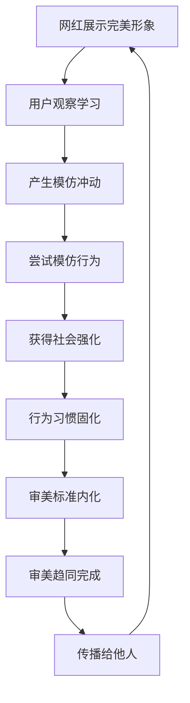

# 第十一章：屏幕里的"完美幻象" - 社交媒体与审美趋同

## 引言：小雅的"完美"困惑

小雅每天早上醒来的第一件事，就是拿起手机刷社交媒体。屏幕上，一张张精致的面孔映入眼帘：完美的瓜子脸、大大的双眼皮、高挺的鼻梁、白皙无瑕的皮肤...

"为什么她们都这么完美？"小雅看着镜子中的自己，再看看手机屏幕，心情越来越沉重，"我怎么和她们差这么多？"

这种对比让小雅感到深深的挫败感。她开始怀疑自己的价值，开始觉得只有变得和屏幕里的人一样，才能获得认可和幸福。

但小雅不知道的是，她所看到的"完美"，很多都是经过精心包装、滤镜美化、甚至人工智能处理的结果。她正在与一个虚幻的标准进行比较，这个标准本身就是不真实的。

在这一章中，我们将跟随小雅的觉醒之路，深入探讨社交媒体如何塑造我们的审美观念，以及我们如何在这个充满"完美幻象"的世界中保持真实的自我。

## 11.1 "网红脸"与"A4腰"：社交媒体如何加速单一审美的传播与内化？

### 小雅的"网红脸"觉醒

**第一次意识到"网红脸"现象**：

小雅在刷抖音时突然意识到一个奇怪的现象：屏幕上的美女们看起来都很相似。她开始仔细观察，发现了一个惊人的规律。

**小雅的观察记录**：

"我今天特意观察了一下我关注的美妆博主们，发现她们的长相真的很相似：
- 都是大眼睛、双眼皮，眼睛占脸的比例特别大
- 鼻子都很高很挺，鼻翼很小
- 脸都是瓜子脸，下巴很尖
- 皮肤都白得发光，看不到一个毛孔
- 嘴唇都是那种嘟嘟唇的形状"

**困惑的产生**：

"这些人是天生就长得这么相似，还是后天调整成这样的？为什么大家都要长成一个样子？难道这就是美的标准吗？"

### "网红脸"标准化的深度分析

#### 标准化特征的形成过程

**第一阶段：个体突破**
某个具有特定面部特征的网红因为某种原因（可能是运气、才华或营销）获得了大量关注。

**第二阶段：模仿跟风**
其他想要获得关注的人开始模仿这种面部特征，通过化妆、医美等方式调整自己的外貌。

**第三阶段：算法强化**
社交媒体算法发现这种面部特征的内容获得更多点赞和互动，开始优先推荐类似的内容。

**第四阶段：标准固化**
经过大量的重复曝光，这种面部特征逐渐被认为是"美"的标准，形成了固化的审美模式。

#### "网红脸"的具体标准解析

**眼部标准**：
- **大眼睛**：眼睛与脸部的比例要达到特定标准
- **双眼皮**：必须是明显的双眼皮，最好是欧式大双
- **眼型**：杏眼或桃花眼，眼尾略微上扬
- **睫毛**：长而浓密，有明显的卷翘效果

**鼻部标准**：
- **高鼻梁**：鼻梁要高挺，有明显的立体感
- **小鼻翼**：鼻翼要小巧精致
- **鼻尖**：鼻尖要尖而翘，形成所谓的"精灵鼻"
- **鼻基底**：鼻基底要饱满，与唇部形成和谐比例

**面部轮廓标准**：
- **瓜子脸**：脸型要是标准的瓜子脸或鹅蛋脸
- **尖下巴**：下巴要尖而小巧
- **苹果肌**：苹果肌要饱满，显得年轻有活力
- **面部比例**：三庭五眼的标准比例

### "A4腰"现象的心理学分析

#### 小雅的"A4腰"挑战经历

**第一次接触"A4腰"**：

小雅在朋友圈看到同事发的"A4腰"照片，照片中同事用一张A4纸遮住自己的腰部，腰部完全被遮住了。

"哇，她的腰这么细！"小雅惊叹道，"我也要试试看我的腰能不能被A4纸遮住。"

**尝试的挫败感**：

小雅回到家立刻拿出A4纸试了试，发现自己的腰部明显比A4纸宽。这让她感到深深的挫败感。

"为什么我的腰这么粗？我是不是应该减肥了？还是应该去做腰部吸脂？"

#### "A4腰"现象的社会心理机制

**量化美的危险性**：

"A4腰"将身材美用具体的、可测量的标准进行量化，这种量化看似客观，实际上却忽略了个体差异和健康因素。

**挑战文化的传播机制**：
- **游戏化**：将身材展示包装成有趣的挑战游戏
- **社交性**：鼓励用户参与并分享结果
- **竞争性**：暗示只有达到标准才是"赢家"
- **病毒性**：通过社交网络快速传播

**群体参与的心理压力**：
- **从众压力**：看到别人都在参与，自己也想参与
- **社会认同**：通过参与获得群体认同
- **自我证明**：通过挑战证明自己的价值
- **恐惧驱动**：害怕被认为身材不好而被排斥

### 审美趋同的心理机制深度解析

#### 社会学习理论在审美中的应用

**观察学习的过程**：

小雅通过观察社交媒体上的"美女"，学习她们的外貌特征、化妆技巧、穿衣风格等。

**模仿行为的产生**：

小雅开始模仿这些"美女"的外貌和行为，比如学习她们的化妆方法、购买相似的服装、甚至考虑做相似的医美项目。

**社会强化的作用**：

当小雅按照"网红脸"的标准打扮自己时，她收到了更多的点赞和好评，这种正面反馈强化了她的模仿行为。

**行为固化的结果**：

经过反复的强化，小雅逐渐将这种审美标准内化为自己的标准，认为这就是"美"的定义。

#### 从众心理的强大力量

**小雅的从众心理体验**：

"我发现我越来越不敢发素颜照了。"小雅对朋友说，"看到别人都是那么精致的照片，我觉得我的素颜照会显得很突兀，很不合群。"

**从众心理的具体表现**：

**社会认同的需求**：
- 希望通过符合主流审美获得他人的认同和接受
- 担心自己的外貌不符合标准会被边缘化
- 渴望成为"受欢迎"的群体中的一员

**群体压力的影响**：
- 害怕因为外貌不同而被群体排斥
- 担心在社交场合中显得格格不入
- 感受到无形的压力要求自己"变美"

**安全感的寻求**：
- 跟随大众的审美选择感觉更安全
- 认为主流的就是正确的
- 避免做出"与众不同"的选择

**社会比较的痛苦**：
- 不断与他人进行外貌比较
- 总是觉得自己不如别人
- 在比较中产生焦虑和自卑情绪

#### 审美趋同的心理路径

**心理路径的详细分析**：

**第一步：完美形象的展示**
社交媒体上的网红、明星展示经过精心包装的完美形象。

**第二步：观察学习的启动**
用户通过观察这些完美形象，学习其外貌特征和表现方式。

**第三步：模仿冲动的产生**
用户产生"我也想变成这样"的强烈冲动。

**第四步：模仿行为的尝试**
用户开始尝试通过化妆、服装、医美等方式模仿这些形象。

**第五步：社会强化的获得**
当用户的模仿行为获得点赞、好评等正面反馈时，行为得到强化。

**第六步：行为习惯的固化**
经过反复的强化，模仿行为逐渐成为习惯。

**第七步：审美标准的内化**
用户将这种外在的审美标准内化为自己的标准。

**第八步：审美趋同的完成**
用户完全接受并认同这种单一的审美标准。

**第九步：传播给他人**
用户开始向他人传播这种审美标准，形成循环。

### 社交媒体的放大效应：算法如何塑造我们的审美

#### 小雅的算法"投喂"经历

**算法的精准捕捉**：

小雅发现，自从她在一个美妆博主的视频上停留了较长时间后，她的推荐页面就开始充斥着类似的内容。

"奇怪，我只是多看了几眼那个博主的视频，现在我的推荐页面全都是这种类型的美女。"小雅困惑地说。

**推荐内容的同质化**：

小雅开始记录她一天内看到的推荐内容：
- 早上：10个美妆视频，8个都是相似的"网红脸"
- 中午：15个时尚博主，12个都有相似的面部特征
- 晚上：20个生活分享，18个都符合同一种审美标准

"我感觉我的世界被这种脸型包围了。"小雅说，"好像除了这种长相，就没有其他类型的美女了。"

#### 算法推荐的同质化机制

**相似内容推荐的逻辑**：

**用户行为分析**：
- 算法记录用户在每个内容上的停留时间
- 分析用户的点赞、评论、分享行为
- 识别用户感兴趣的内容类型
- 预测用户的偏好趋势

**内容标签化**：
- 将内容按照特征进行标签化
- 相似外貌特征的内容被归为同一类
- 算法优先推荐同类标签的内容
- 形成内容的聚类效应

**反馈循环强化**：
- 用户对推荐内容的正面反应强化算法判断
- 算法进一步推荐相似内容
- 用户接触的内容越来越单一
- 形成"信息茧房"效应

**商业利益的驱动**：

**广告投放的影响**：
- 医美机构投放大量广告
- 广告内容影响算法推荐
- 商业内容与有机内容混合
- 用户难以区分广告与真实分享

**流量变现的压力**：
- 平台需要保持用户活跃度
- 推荐容易引起关注的内容
- 符合主流审美的内容获得更多流量
- 形成"美貌经济"的循环

#### 视觉文化的强大影响力

**图像至上的时代特征**：

**小雅的视觉体验**：
"我发现我现在很少看长文字了，基本都是看图片和视频。"小雅说，"一张漂亮的照片比一篇文章更能吸引我的注意力。"

**视觉内容的心理优势**：

**即时冲击力**：
- 视觉信息的处理速度比文字快60,000倍
- 美丽的图像能够瞬间抓住注意力
- 第一印象往往决定后续的关注度
- 视觉冲击比理性分析更有说服力

**情绪感染力**：
- 美丽的图像容易引发积极情绪
- 情绪反应比理性思考更直接
- 正面情绪促进分享和传播行为
- 形成情绪驱动的传播链条

**记忆持久性**：
- 视觉信息比文字信息更容易被记住
- 美丽的形象在大脑中留下深刻印象
- 重复的视觉刺激强化记忆
- 形成固化的审美印象

**社交传播性**：
- 视觉内容更容易被分享
- 美丽的图像具有天然的传播优势
- 社交媒体的设计偏向视觉内容
- 形成病毒式传播效应

### 小雅的觉醒：识破算法的"美丽陷阱"

#### 意识到问题的存在

**第一次质疑**：

有一天，小雅突然意识到一个问题："为什么我在现实生活中很少见到像网上这么完美的人？是我的生活圈子有问题，还是网上的世界有问题？"

**开始观察现实**：

小雅开始有意识地观察身边的人：
- 地铁上的乘客
- 商场里的购物者
- 办公室的同事
- 街上的路人

"我发现现实中的人和网上的'美女'差别很大。"小雅说，"现实中的人更加多样化，有各种不同的长相和气质。"

#### 主动破解算法控制

**多样化搜索策略**：

小雅开始有意识地搜索不同类型的内容：
- 搜索"自然美女"而不只是"网红脸"
- 关注不同年龄段的博主
- 寻找不同文化背景的内容创作者
- 主动点击多样化的内容

**算法重训练**：

"我发现当我开始点击不同类型的内容后，我的推荐页面也开始变得多样化了。"小雅说，"原来我可以'训练'算法给我推荐更多元的内容。"

**时间管理**：

小雅开始控制自己使用社交媒体的时间：
- 设定每天的使用时间上限
- 避免在情绪低落时刷社交媒体
- 增加现实生活中的社交活动
- 培养其他兴趣爱好

!!! example "审美趋同案例"
    以"网红脸"为例：
    - **起源**：某位网红的特定面部特征受到追捧
    - **传播**：通过社交媒体快速传播
    - **模仿**：其他网红开始模仿这种特征
    - **固化**：逐渐形成固定的审美标准
    - **内化**：普通用户也开始追求这种外貌

### 审美趋同的负面影响

#### 个体层面
- **自我认同危机**：失去独特的个人特色
- **焦虑情绪**：因为不符合标准而产生焦虑
- **自我价值绑定**：将自我价值与外表绑定
- **创造力压抑**：压抑个性化的审美表达

#### 社会层面
- **多样性缺失**：社会审美多样性的缺失
- **文化同质化**：不同文化背景的审美趋同
- **创新阻碍**：阻碍审美文化的创新发展
- **社会压力**：增加社会整体的外表压力

## 11.2 滤镜与P图文化：数字美化如何扭曲我们对真实人体的认知？

### 小雅的滤镜依赖症

**第一次使用美颜相机**：

小雅还记得第一次使用美颜相机时的震撼："天哪，这还是我吗？我怎么可以这么好看！"

屏幕上的自己皮肤白皙无瑕，眼睛大而有神，鼻梁高挺，下巴尖细，完全就是她梦想中的样子。

**从尝试到依赖**：

**第一阶段：偶尔使用**
- 只在特殊场合使用美颜
- 觉得美颜是一种有趣的尝试
- 对效果感到新奇和兴奋

**第二阶段：习惯使用**
- 开始在日常拍照中使用美颜
- 觉得美颜后的自己更好看
- 逐渐习惯美颜后的效果

**第三阶段：完全依赖**
- 不使用美颜就不敢拍照
- 觉得真实的自己很丑
- 对美颜产生强烈的心理依赖

**第四阶段：现实失调**
- 对镜子中的自己感到失望
- 现实与美颜效果的巨大差距让她痛苦
- 开始考虑通过医美达到美颜的效果

### 数字美化技术的演进历程

#### 美颜技术的发展轨迹

**1.0时代：基础美颜**

**小雅的回忆**：
"我记得最早的美颜相机只能磨皮和美白，效果还很假，一看就知道是P过的。"

**基础功能**：
- **磨皮**：去除皮肤瑕疵，让皮肤看起来光滑
- **美白**：提亮肤色，让皮肤看起来更白皙
- **亮眼**：增强眼部亮度，让眼睛看起来更有神
- **红润**：增加面部红润感，让气色看起来更好

**2.0时代：五官调整**

**小雅的体验**：
"后来的美颜相机越来越厉害，可以调整五官的形状和大小，简直像整容一样。"

**调整功能**：
- **瘦脸**：缩小脸部轮廓，打造小脸效果
- **大眼**：放大眼睛，让眼睛看起来更大更有神
- **高鼻梁**：增高鼻梁，让鼻子看起来更立体
- **尖下巴**：调整下巴形状，打造尖下巴效果

**3.0时代：身材修饰**

**小雅的发现**：
"现在的美颜相机连身材都能调整，可以瘦身、长腿、丰胸，简直无所不能。"

**身材调整**：
- **瘦身**：缩小身体轮廓，打造苗条身材
- **长腿**：拉长腿部比例，让腿看起来更长
- **丰胸**：增大胸部，打造完美身材曲线
- **细腰**：缩小腰围，打造"A4腰"效果

**4.0时代：AI智能美颜**

**小雅的惊叹**：
"最新的美颜相机用了人工智能，能够自动识别我的脸型和特征，给出最适合我的美颜方案。"

**AI功能**：
- **智能识别**：自动识别面部特征和缺陷
- **个性化调整**：根据个人特征提供定制化美颜方案
- **自然效果**：让美颜效果看起来更自然
- **实时处理**：实时处理视频中的美颜效果

### 滤镜文化的全面普及

#### 从拍照到生活的全面渗透

**小雅的滤镜生活**：

**拍照必备**：
"我现在拍照必须开美颜，不开美颜我就觉得照片很丑，不敢发朋友圈。"

**视频通话**：
"连视频通话我都要开美颜，不然觉得自己在别人面前很丑。"

**直播互动**：
"看直播的时候，主播们都开着美颜，看起来都特别完美。"

**社交展示**：
"在社交媒体上，大家发的照片都是美颜过的，不美颜就显得很突兀。"

#### 滤镜技术的多样化发展

**实时滤镜的普及**：

**技术特点**：
- 拍摄时即时美化，无需后期处理
- 支持视频实时美颜
- 多种风格滤镜可选
- 操作简单，一键美颜

**AR增强现实技术**：

**创新应用**：
- 虚拟化妆效果
- 3D面部重建
- 实时换脸技术
- 虚拟服装试穿

**智能识别技术**：

**精准识别**：
- 自动识别面部关键点
- 智能分析面部特征
- 个性化美颜建议
- 自适应调整参数

### 数字美化对认知的深层影响

#### 认知基线的悄然改变

**小雅的认知变化记录**：

**第一个月**：
"刚开始用美颜的时候，我还能清楚地区分美颜前后的差别。"

**第三个月**：
"用了几个月后，我开始觉得美颜后的样子才是'正常'的我。"

**第六个月**：
"现在我看到镜子中的自己，总觉得哪里不对劲，好像缺少了什么。"

**一年后**：
"我已经完全习惯了美颜后的样子，真实的自己在我眼中变得'不正常'了。"

#### 美的标准的无形提升

**标准提升的过程**：

**第一阶段：接受美化**
- 认为美颜是一种改善
- 觉得美颜后的自己更好看
- 开始习惯美颜后的效果

**第二阶段：依赖美化**
- 不使用美颜就感到不适
- 认为美颜后的样子才是正常的
- 对真实的自己产生不满

**第三阶段：标准内化**
- 将美颜后的效果视为美的标准
- 用美颜标准评判自己和他人
- 现实与标准的差距让人痛苦

**第四阶段：现实扭曲**
- 对真实的人体产生认知偏差
- 认为现实中的人都"不够美"
- 产生通过医美达到美颜效果的冲动

#### 真实性认知的严重偏差

**小雅的认知实验**：

为了测试自己的认知偏差程度，小雅做了一个实验：

**实验设计**：
1. 收集10张网红的照片（包括美颜和素颜）
2. 让朋友猜测哪些是美颜，哪些是素颜
3. 记录自己和朋友的判断准确率

**实验结果**：
- 小雅的判断准确率：30%
- 朋友的判断准确率：70%
- 小雅对美颜照片的接受度：90%
- 朋友对美颜照片的接受度：50%

**实验结论**：
"我发现我已经完全失去了对真实和虚假的判断能力。我把明显P过的照片当成了真实的，把真实的照片当成了'不够好看'的。"

#### 期望值与现实的巨大落差

**小雅的期望值变化**：

**对自己的期望**：
- 希望自己的皮肤像美颜后一样完美无瑕
- 期望自己的五官像调整后一样精致
- 想要自己的身材像修饰后一样完美
- 渴望在现实中也能达到数字化的效果

**对他人的期望**：
- 用美颜标准评判现实中的人
- 觉得现实中的人都"不够美"
- 对医美效果抱有不切实际的期望
- 认为医美应该能达到美颜的效果

**对生活的期望**：
- 希望现实生活像社交媒体一样精彩
- 期望自己的生活状态像网红一样完美
- 对平凡的日常生活感到不满
- 追求不切实际的完美生活

#### 现实与虚拟界限的彻底模糊

**循环陷阱的详细分析**：

**第一步：真实自我**
小雅开始时对自己的真实外貌有基本的认知。

**第二步：数字美化**
开始使用美颜、滤镜等数字美化工具。

**第三步：虚拟理想形象**
通过数字美化创造出理想的虚拟形象。

**第四步：提高期望标准**
将虚拟形象的标准内化为对自己的期望。

**第五步：现实失落感**
发现现实中的自己无法达到虚拟标准，产生失落感。

**第六步：更强烈的美化需求**
为了缓解失落感，更加依赖数字美化。

**第七步：进一步脱离现实**
对数字美化的依赖让她进一步脱离现实。

**第八步：认知完全扭曲**
对真实和虚假的认知完全扭曲。

**第九步：寻求医美实现虚拟效果**
希望通过医美手段在现实中实现虚拟效果。

**第十步：回到数字美化**
即使做了医美，仍然需要数字美化来达到"完美"效果。

### 滤镜文化的深层心理影响

#### 自我认知的多重分裂

**小雅的"四个自我"困惑**：

小雅发现自己仿佛生活在四个不同的世界中，每个世界中的自己都不一样：

**镜像自我（现实中的自己）**：
"每天早上照镜子的时候，我看到的是真实的自己。皮肤有瑕疵，眼睛不够大，鼻子不够高，这是最真实的我，但也是我最不愿意接受的我。"

**数字自我（美化后的自己）**：
"在手机相机里，我看到的是美颜后的自己。皮肤光滑无瑕，五官精致立体，这是我最喜欢的自己，但我知道这不是真实的。"

**理想自我（期望中的自己）**：
"在我的想象中，我希望自己能够像那些网红一样完美。这是我努力的目标，但似乎永远无法达到。"

**社交自我（展示给他人的自己）**：
"在社交媒体上，我展示的是经过精心挑选和美化的自己。这是我希望别人看到的我，但这也不是完整的我。"

**四个自我的冲突**：

这四个不同的自我之间存在着激烈的冲突：
- 镜像自我让她感到失望和自卑
- 数字自我让她产生虚假的满足感
- 理想自我让她感到压力和焦虑
- 社交自我让她感到疲惫和虚伪

#### 成瘾性行为的发展轨迹

**小雅的成瘾历程**：

**第一阶段：尝试期（1-2个月）**
- 偶尔使用美颜功能
- 觉得很有趣，效果很好
- 开始在朋友圈分享美颜照片
- 收到很多点赞和好评

**第二阶段：习惯期（3-6个月）**
- 每次拍照都会使用美颜
- 开始尝试不同的滤镜和效果
- 花费更多时间调整参数
- 对美颜效果有了更高要求

**第三阶段：依赖期（6-12个月）**
- 不使用美颜就不敢拍照
- 会反复拍摄直到满意为止
- 开始使用专业的修图软件
- 对真实的自己越来越不满意

**第四阶段：强迫期（1年以上）**
- 强迫性地修饰每一张照片
- 即使是很小的瑕疵也无法容忍
- 花费大量时间在修图上
- 对现实中的自己产生严重的认知偏差

**成瘾行为的具体表现**：

**拍摄依赖**：
"我现在完全不敢不开美颜拍照。"小雅说，"即使是给家人拍照，我也会习惯性地开美颜。"

**修图强迫**：
"我会花几个小时修一张照片，调整每一个细节，直到我觉得完美为止。有时候为了一张照片，我可以熬到深夜。"

**完美主义**：
"我对照片的要求越来越高，一点点瑕疵都不能容忍。皮肤必须完美无瑕，五官必须精致立体，身材必须完美无缺。"

**社交焦虑**：
"我现在很害怕和别人面对面交流，因为我担心他们会发现我和照片中的自己差别很大。我甚至开始回避一些社交活动。"

#### 数字美化成瘾的心理机制

**即时满足的心理陷阱**：

美颜和滤镜提供了即时的心理满足：
- 瞬间看到"完美"的自己
- 获得他人的点赞和好评
- 暂时缓解对外貌的焦虑
- 体验到控制感和成就感

**逃避现实的心理防御**：

数字美化成为了逃避现实的工具：
- 逃避对真实外貌的不满
- 逃避现实生活的压力
- 逃避与他人的真实交流
- 逃避对自我价值的质疑

**社会认同的心理需求**：

通过美化获得社会认同：
- 符合社会的审美标准
- 获得他人的认可和赞美
- 维护在他人心中的形象
- 满足归属感的需求

### 小雅的数字美化戒断之路

#### 意识到问题的严重性

**转折点的到来**：

有一天，小雅的朋友看到她的真实照片后说："这是你吗？和你平时发的照片差别好大啊。"

这句话让小雅突然意识到问题的严重性："我已经完全活在虚假的世界里了。我对自己的认知完全扭曲了。"

#### 戒断过程的挑战

**第一周：强烈的不适感**
- 不使用美颜拍照感到极度不适
- 看到真实的自己感到沮丧
- 担心别人会发现自己的"真面目"
- 多次想要放弃戒断

**第一个月：逐渐适应**
- 开始能够接受不完美的照片
- 学会欣赏自己的真实特征
- 减少拍照和发朋友圈的频率
- 开始关注内在品质的提升

**第三个月：重新认识自己**
- 对真实的自己有了更客观的认知
- 不再过度依赖他人的评价
- 开始享受真实的社交互动
- 建立了更健康的自我形象

#### 戒断成功的关键策略

**认知重建**：
- 学习区分真实和虚假
- 建立合理的审美标准
- 培养对多样性美的欣赏
- 重新定义什么是真正的美

**行为改变**：
- 逐步减少美颜的使用
- 增加现实生活中的活动
- 培养其他兴趣爱好
- 建立真实的人际关系

**情感支持**：
- 寻求家人朋友的理解和支持
- 加入相关的支持小组
- 必要时寻求专业心理帮助
- 与有相似经历的人交流

### 数字美化的社会影响

#### 真实性的缺失
- **信息失真**：社交媒体上的信息缺乏真实性
- **标准扭曲**：扭曲了社会对美的标准
- **比较偏差**：与不真实的形象进行比较
- **期望错位**：对现实生活的期望错位

#### 代际差异
- **数字原住民**：年轻一代对数字美化的依赖
- **现实感知**：对真实世界的感知能力下降
- **社交技能**：面对面社交技能的退化
- **自信建设**：真实自信的建立困难

!!! warning "数字美化的风险"
    过度依赖数字美化可能导致：
    - 对真实自我的认知偏差
    - 社交焦虑和自信心下降
    - 对医美的不切实际期望
    - 难以接受真实的自己

## 11.3 "美丽羞辱"与网络暴力：对外貌的评判如何演变成一种网络暴力？

### 小雅的网络暴力亲历记

**第一次遭遇网络美丽羞辱**：

小雅永远不会忘记那个晚上。她在社交媒体上发了一张素颜照片，配文是"真实的自己也很美"。本来是想传递正能量，没想到却引来了一场网络暴力。

**评论区的恶意攻击**：

"这也叫美？我的眼睛要瞎了"
"素颜这么丑还敢发出来，真是勇气可嘉"
"建议去整容，不然真的没法看"
"这种长相还好意思说自己美，脸皮真厚"
"快删了吧，影响大家心情"

**小雅的心理创伤**：

看到这些评论，小雅的心情瞬间跌到谷底："我只是想鼓励大家接受真实的自己，为什么会遭到这样的攻击？我真的有这么丑吗？"

那一夜，小雅哭了很久，她开始怀疑自己的价值，怀疑自己是否真的应该接受真实的自己。

### 网络美丽羞辱的多种形式

#### 直接羞辱：赤裸裸的恶意攻击

**外貌攻击的具体表现**：

**针对面部特征**：
- "这个鼻子真的太塌了"
- "眼睛小得像绿豆"
- "这张脸真的没救了"
- "长得像车祸现场"

**针对身材特征**：
- "这个身材真的太胖了"
- "腿粗得像大象"
- "胸平得像飞机场"
- "腰粗得像水桶"

**针对整体形象**：
- "这个人真的太丑了"
- "长得像恐怖片里的怪物"
- "这种长相还敢出来见人"
- "建议去整容医院报到"

**比较贬低的恶毒手段**：

**与明星比较**：
- "和某某明星比起来，简直是天壤之别"
- "人家是天仙，你是什么？"
- "看看人家再看看你，差距太大了"

**与网红比较**：
- "网红随便一个都比你好看"
- "你和网红的差距不是一般的大"
- "建议学学网红怎么打扮"

**与身边人比较**：
- "你朋友都比你好看"
- "站在你旁边的人都被你衬托得很美"
- "你拉低了整个群体的颜值"

#### 间接羞辱：隐蔽而持久的伤害

**暗示性评论的阴险**：

**假装关心**：
- "你是不是最近压力很大？看起来憔悴了很多"
- "要不要推荐个好的护肤品给你？"
- "我知道一个很好的整容医生"

**委婉建议**：
- "你可能更适合其他风格"
- "这个角度可能不太适合你"
- "你的优点在其他地方"

**反讽赞美**：
- "你真的很有勇气"
- "你的自信值得学习"
- "你真的很特别"

**标准暗示的压迫**：

**展示"完美"标准**：
- 频繁分享美女照片
- 强调某种特定的审美标准
- 暗示只有符合标准才是美的

**制造对比**：
- 在评论中提及其他"更美"的人
- 分享"美丽标准"的文章
- 暗示不符合标准就是不美的

### "傻子共振"：网络时代的群体心理陷阱

在分析网络暴力之前，我们需要理解一个更深层的心理现象——"傻子共振"。正如李滨在《傻子共振》一文中深入分析的：

!!! quote "李滨观点"
    "傻子共振（Fool's resonance）是一种社会心理问题，又被称为'群体共振效应'，也是网络时代的一种心理陷阱，它在互联网世界的算法之下会变得更加可怕。指的是那些明显错误或无知的观点，却可以在一定的人群中产生共识，盲目跟风并迅速传播，如同成千上万只井底之蛙在互联网上相亲相爱，一致认为世界只有井口这么大。"
    
    —— 摘自《傻子共振》，[原文链接](https://mp.weixin.qq.com/s/fKrr9x5yudRnPZgdfelMMQ?scene=1)

#### 傻子共振在网络美丽羞辱中的表现

**小雅观察到的群体行为**：

在遭受网络暴力后，小雅开始观察网络上的群体行为，她发现了一个可怕的现象：

**算法加持下的恶意聚集**：
"我发现那些攻击我的人，他们的观点都很相似，用词也很相似，好像是一个模子刻出来的。"

**信息茧房中的偏见强化**：
"他们只关注那些符合他们偏见的内容，对于不同的观点完全视而不见。"

**选择性糊涂的群体行为**：
"明明知道网络暴力是不对的，但他们选择性地忽略这一点，继续参与攻击。"

**群体智商的明显下降**：
"单独和他们交流时，他们可能还算理性，但一旦在群体中，就变得特别极端和愚蠢。"

#### 傻子共振的形成机制

  

    
1

    

      <h3>算法推荐的同质化</h3>
      
社交媒体算法将观点相似的人聚集在一起，形成同质化的信息环境

    

  

  

    
2

    

      <h3>信息茧房的强化</h3>
      
人们只接触符合自己观点的信息，偏见得到不断强化

    

  

  

    
3

    

      <h3>群体压力的作用</h3>
      
为了获得群体认同，个体会压抑理性思考，盲目跟随群体

    

  

  

    
4

    

      <h3>道德责任的分散</h3>
      
在群体中，个体的道德责任感被分散，更容易做出不当行为

    

  

#### 傻子共振的理论基础

**戈夫曼的社会互动理论**：

社会学家戈夫曼在1959年的著作中首次提出"傻瓜的共振"概念，认为人们在实际社会互动中，往往不是理性的、清醒的，而是"愚弄与被愚弄"的。

**认知封闭理论的现实体现**：

美国社会学家保罗·拉波特提出的"认知封闭"概念在网络时代得到了完美的体现："人们往往只相信他们看到的、他们想到的、他们已经得到认可的和与他们自己的世界观相符的事物。其他东西他们视而不见。"

#### 如何识别和避免傻子共振

  

    
🤔

    <h3>独立思考</h3>
    
保持独立思考的能力，不盲目跟随群体观点，质疑看似"理所当然"的观念

  

  

    
📚

    <h3>多元信息</h3>
    
主动接触多元化的信息源，避免陷入信息茧房，听取不同的声音

  

  

    
🔍

    <h3>事实检验</h3>
    
用事实和逻辑检验观点，而非情感和偏好，追求真相而非认同

  

  

    
⏸️

    <h3>暂停反思</h3>
    
在参与群体讨论前给自己时间反思，避免情绪化的反应

  

!!! warning "网络美丽羞辱中的傻子共振现象"
    在网络美丽羞辱中，傻子共振可能表现为：
    - 盲目跟风攻击某个人的外貌
    - 无视个体差异，用单一标准评判所有人
    - 在群体压力下参与网络暴力
    - 拒绝接受审美多样性的观念
    - 将复杂的美学问题简单化、极端化

### 网络暴力的心理机制深度解析

#### 去抑制效应的放大

**匿名性带来的道德松绑**：

在网络环境中，人们往往使用化名或匿名，这种匿名性让他们感觉自己的行为不会有后果，从而降低了道德约束。

**小雅的观察**：
"我发现那些攻击我的人，很多都是用假名或者头像也不是真人照片。他们好像觉得在网上说什么都没关系。"

**物理距离减少的共情能力**：

网络交流缺乏面对面的情感交流，人们很难感受到对方的真实情感，共情能力大大降低。

**群体效应降低的个人责任感**：

在群体攻击中，个人的责任感被分散，每个人都觉得"不是我一个人在做这件事"，从而降低了罪恶感。

#### 道德脱离的心理机制

**道德合理化的自我欺骗**：

攻击者会为自己的行为寻找合理的理由：
- "我是在帮她认清现实"
- "我是在给她建设性的建议"
- "她自己发出来的，就要承受评价"
- "我只是说出了大家都在想的话"

**责任转移的心理防御**：

攻击者会将责任转移给他人或环境：
- "是她自己要发照片的"
- "大家都在说，不是我一个人"
- "网络就是这样，她应该有心理准备"
- "我只是跟风，主要责任不在我"

**后果忽视的选择性失明**：

攻击者选择性地忽视自己行为可能造成的伤害：
- 不考虑对方的感受
- 不关心可能造成的心理创伤
- 不思考行为的长远影响
- 不承认自己的行为是暴力

**受害者贬低的认知扭曲**：

攻击者会贬低受害者来合理化自己的行为：
- "她就是想博眼球"
- "她心理承受能力太差"
- "她就是矫情"
- "她活该被批评"

### "傻子共振"：网络时代的群体心理陷阱

在分析网络暴力之前，我们需要理解一个更深层的心理现象——"傻子共振"。正如李滨在《傻子共振》一文中深入分析的：

!!! quote "李滨观点"
    "傻子共振（Fool's resonance）是一种社会心理问题，又被称为'群体共振效应'，也是网络时代的一种心理陷阱，它在互联网世界的算法之下会变得更加可怕。指的是那些明显错误或无知的观点，却可以在一定的人群中产生共识，盲目跟风并迅速传播，如同成千上万只井底之蛙在互联网上相亲相爱，一致认为世界只有井口这么大。"
    
    —— 摘自《傻子共振》，[原文链接](https://mp.weixin.qq.com/s/fKrr9x5yudRnPZgdfelMMQ?scene=1)

#### 傻子共振的理论基础

**戈夫曼的观点：**社会学家戈夫曼在1959年的著作中首次提出"傻瓜的共振"概念，认为人们在实际社会互动中，往往不是理性的、清醒的，而是"愚弄与被愚弄"的。

**认知封闭理论：**美国社会学家保罗·拉波特提出的"认知封闭"概念："人们往往只相信他们看到的、他们想到的、他们已经得到认可的和与他们自己的世界观相符的事物。其他东西他们视而不见。"

#### 傻子共振在医美领域的表现

  

    
1

    

      <h3>算法加持下的群体聚集</h3>
      
互联网推送算法让认知相似的人聚集在一起，形成正反馈机制，越来越强大

    

  

  

    
2

    

      <h3>信息茧房的形成</h3>
      
人们深陷某种状态而无法自拔，只关注自己想关注的事情，只赞同自己想赞同的观点

    

  

  

    
3

    

      <h3>选择性糊涂</h3>
      
明知完全脱离底层逻辑，但是选择性糊涂，表现出无法自我控制的从众

    

  

  

    
4

    

      <h3>群体智商下降</h3>
      
正如勒庞在《乌合之众》中所说：一群人聚在一起时，他们的行为往往会变得愚蠢

    

  

#### 傻子共振的形成原因

  

    

      
🧠

      <h4 class="comparison-title">愚蠢的一致性</h4>
    

    
当一个人坚持一种错误的决策或观点，仅仅是因为眼前利益或思维惰性而无法改变自己的思维模式，无法顾及事实证据或其事物的底层逻辑。

  

  

    

      
⚡

      <h4 class="comparison-title">认知对抗</h4>
    

    
人们在面对信息错乱和观念冲突时，感到极度不适，为了减少这种不适，选择性地接受符合自己观念的信息。

  

!!! warning "医美领域的傻子共振现象"
    在医美消费中，傻子共振可能表现为：
    - 盲目跟风某种"网红项目"
    - 无视风险，只相信成功案例
    - 在群体压力下做出不理性决策
    - 拒绝接受与自己观念不符的专业建议
    - 在社交媒体上形成"医美崇拜"群体

#### 如何避免陷入傻子共振

  

    
🤔

    <h3>独立思考</h3>
    
保持独立思考的能力，不盲目跟随群体观点

  

  

    
📚

    <h3>多元信息</h3>
    
主动接触多元化的信息源，避免信息茧房

  

  

    
🔍

    <h3>事实检验</h3>
    
用事实和逻辑检验观点，而非情感和偏好

  

  

    
⏸️

    <h3>暂停反思</h3>
    
在做重要决策前给自己时间反思和冷静

  

### 网络暴力的心理机制

#### 去抑制效应
- **匿名性**：网络的匿名性降低道德约束
- **距离感**：物理距离减少共情能力
- **群体效应**：群体行为降低个人责任感
- **即时性**：即时反应减少深思熟虑

#### 道德脱离
- **道德合理化**：为攻击行为寻找合理理由
- **责任转移**：将责任转移给他人或环境
- **后果忽视**：忽视行为对他人的伤害
- **受害者贬低**：贬低受害者来合理化行为

### 美丽羞辱的深远社会影响

#### 对个体的创伤性影响

**小雅的创伤体验**：

遭受网络暴力后，小雅经历了一系列的心理创伤：

**急性应激反应**：
- 失眠、噩梦、食欲不振
- 反复回想攻击性评论
- 情绪波动剧烈，经常哭泣
- 对社交媒体产生恐惧

**长期心理影响**：
- 自信心严重受挫
- 对自己的外貌产生严重的负面认知
- 开始回避社交活动
- 产生社交焦虑症状

**行为改变**：
- 不再敢发布自己的照片
- 减少外出和社交活动
- 开始考虑整容来"改善"自己
- 对镜子和相机产生恐惧

**认知扭曲**：
- 认为自己真的很丑
- 觉得所有人都在评判自己的外貌
- 将自我价值完全与外貌绑定
- 对未来失去信心

#### 对社会氛围的毒化作用

**审美焦虑的社会传播**：

网络美丽羞辱不仅伤害直接受害者，还会在社会中传播审美焦虑：

**旁观者效应**：
- 看到他人被攻击，旁观者也会产生焦虑
- 担心自己也会成为攻击目标
- 开始更加关注自己的外貌
- 对发布照片变得谨慎

**标准单一化的推动**：
- 只有符合特定标准的外貌才被认为是"安全"的
- 多样性的审美被压制
- 个性化的美被边缘化
- 社会审美趋向同质化

**群体对立的加剧**：
- "美"与"丑"的群体对立
- 不同审美观念的群体冲突
- 社会包容性的下降
- 歧视和偏见的增加

### 小雅的反击与成长

#### 从受害者到倡导者的转变

**重新站起来的决心**：

经过一段时间的痛苦和反思，小雅做出了一个重要决定：

"我不能让这些恶意的声音定义我的价值。我要重新站起来，不仅为了自己，也为了其他可能遭受同样伤害的人。"

**积极应对策略的实施**：

**心理重建**：
- 寻求专业心理咨询师的帮助
- 学习认知行为疗法的技巧
- 重新建立健康的自我认知
- 培养内在力量和韧性

**支持网络的建立**：
- 寻找有相似经历的朋友
- 加入反网络暴力的支持小组
- 与家人朋友分享自己的经历
- 建立可靠的情感支持系统

**积极行动的开展**：
- 在社交媒体上分享正能量内容
- 支持其他遭受网络暴力的人
- 参与反网络暴力的公益活动
- 倡导审美多样性和包容性

#### 个人防护策略的完善

**小雅的"网络安全手册"**：

经过这次经历，小雅总结了一套完整的网络安全防护策略：

**预防策略**：
- 设置隐私保护，限制陌生人评论
- 谨慎选择发布的内容和平台
- 建立支持网络，提前获得情感支持
- 培养心理韧性，提高抗压能力

**应对策略**：
- 不与网络暴力者正面冲突
- 及时屏蔽和举报恶意用户
- 寻求朋友和专业人士的支持
- 保留证据，必要时采取法律行动

**恢复策略**：
- 暂时远离社交媒体，给自己时间恢复
- 专注于现实生活中的积极活动
- 寻求专业心理帮助
- 重新建立健康的自我认知

### 社会层面的积极变化

#### 平台责任的觉醒

**技术手段的改进**：

越来越多的社交媒体平台开始采取技术手段对抗网络暴力：

**AI识别系统**：
- 自动识别恶意评论和攻击性内容
- 实时过滤和屏蔽有害信息
- 智能预警系统提醒用户风险
- 自动保护机制减少伤害

**举报机制的完善**：
- 简化举报流程，提高处理效率
- 建立专业的审核团队
- 对恶意用户进行严厉处罚
- 保护举报者的隐私和安全

**正向引导的加强**：
- 推广正能量内容
- 支持多样性和包容性的表达
- 教育用户文明上网
- 营造积极健康的网络环境

#### 法律保护的完善

**相关法律的制定和完善**：

**网络安全法的实施**：
- 明确网络暴力的法律定义
- 规定平台的监管责任
- 保护受害者的合法权益
- 对施暴者进行法律制裁

**司法实践的发展**：
- 网络暴力案件的成功判决
- 受害者获得法律救济
- 震慑潜在的施暴者
- 提高社会的法律意识

#### 教育普及的推进

**网络文明教育的开展**：

**学校教育的加强**：
- 将网络文明纳入课程体系
- 教育学生理性使用网络
- 培养批判性思维能力
- 提高媒体素养水平

**社会教育的推广**：
- 开展网络文明宣传活动
- 普及网络暴力的危害知识
- 教授应对网络暴力的方法
- 营造文明上网的社会氛围

### 小雅的新使命：成为改变的力量

#### 从受害者到倡导者

**创建支持社群**：

小雅创建了一个名为"真实之美"的社交媒体账号，专门支持那些遭受网络美丽羞辱的人：

**内容分享**：
- 分享真实的生活照片
- 讲述自己的成长故事
- 传播正面的审美观念
- 支持审美多样性

**互动支持**：
- 回复每一个求助的私信
- 为遭受攻击的人提供情感支持
- 分享应对网络暴力的经验
- 建立互助的社群网络

**教育宣传**：
- 普及网络暴力的危害
- 教授自我保护的方法
- 倡导理性的网络交流
- 推广包容的审美文化

#### 影响力的扩大

**媒体关注**：
小雅的故事引起了媒体的关注，她开始接受采访，分享自己的经历和观点。

**公益活动**：
她参与了多个反网络暴力的公益活动，成为了这个领域的倡导者。

**政策建议**：
她向相关部门提出了完善网络治理的政策建议，为法律的完善贡献了力量。

**社会影响**：
她的努力影响了越来越多的人，让更多人意识到网络暴力的危害，参与到创造更好网络环境的行动中来。

## 11.4 寻找出口："反容貌焦虑"运动与审美多样性的兴起

### 小雅的觉醒：加入反容貌焦虑运动

**发现新的声音**：

在经历了网络暴力的痛苦后，小雅开始寻找不同的声音。她发现了一个全新的世界——反容貌焦虑运动。

"我第一次看到有人在社交媒体上发布真实的、未经美化的照片，并且获得了很多支持和鼓励。"小雅说，"这让我意识到，原来还有这么多人和我一样，厌倦了虚假的完美。"

**参与素颜挑战**：

小雅鼓起勇气参与了一个"素颜挑战"活动：

"今天我决定发布一张完全没有美颜的照片。这是真实的我，有瑕疵但真实的我。我想告诉大家，真实的美比虚假的完美更有价值。"

**意外的积极反响**：

让小雅惊喜的是，这次她收到了很多积极的回应：

"谢谢你的勇气，让我也有勇气接受真实的自己"
"你的真实比任何美颜都美丽"
"这才是真正的美，自然而真实"
"你激励了我，我也要尝试素颜出镜"

### 反容貌焦虑运动的深度解析

#### 运动兴起的社会背景

**容貌焦虑的普遍化**：

现代社会中，容貌焦虑已经成为一个普遍的社会问题：

**统计数据显示**：
- 超过70%的年轻人对自己的外貌不满意
- 60%的人表示社交媒体加剧了他们的外貌焦虑
- 50%的人考虑过通过医美改善外貌
- 40%的人因为外貌问题影响了正常的社交生活

**心理健康意识的觉醒**：

越来越多的人开始关注心理健康：
- 认识到外貌焦虑对心理健康的危害
- 开始寻求专业的心理帮助
- 重视内在品质的培养
- 追求身心的和谐发展

**多元化呼声的增强**：

社会对审美多样性的呼声越来越强：
- 质疑单一的审美标准
- 倡导包容不同类型的美
- 支持个性化的审美表达
- 反对审美歧视和偏见

#### 运动的多样化表现形式

**素颜挑战的深层意义**：

**小雅的素颜挑战体验**：

"参与素颜挑战不仅仅是不化妆拍照这么简单，它是一种对真实自我的接纳，是对虚假完美的反抗。"

**挑战的核心价值**：
- **真实性**：展示真实的自己，不加任何修饰
- **勇气**：需要勇气面对可能的负面评价
- **自信**：建立基于真实自我的自信
- **影响力**：通过自己的行动影响他人

**身体积极运动的推广**：

**理念核心**：
- 接受和爱护自己的身体
- 关注身体的功能而非外观
- 反对身材羞辱和歧视
- 倡导健康的生活方式

**实践方式**：
- 分享不同身材的美丽照片
- 讲述身体积极的个人故事
- 教育公众正确的身体观念
- 支持身材多样性的表达

**多元美的展示平台**：

**不同年龄的美**：
- 展示各个年龄段的美丽
- 反对年龄歧视和恐老症
- 倡导自然老化的美丽
- 支持不同人生阶段的女性

**不同文化的美**：
- 展示不同文化背景的美丽标准
- 反对西方中心主义的审美观
- 倡导文化多样性的价值
- 支持本土审美文化的发展

**不同身材的美**：
- 展示各种身材的美丽
- 反对身材歧视和偏见
- 倡导健康比瘦更重要
- 支持身材多样性的表达

### 审美多样性的价值与意义

#### 对个人发展的积极影响

**小雅的个人成长**：

通过参与反容貌焦虑运动，小雅获得了巨大的个人成长：

**自我接纳的提升**：
"我开始真正接纳自己的外貌，不再为了不符合某种标准而自卑。我意识到每个人都有自己独特的美。"

**个性发展的释放**：
"我不再试图让自己变成别人的样子，而是开始发展自己独特的风格和个性。"

**创造力的激发**：
"当我不再被单一的审美标准束缚时，我发现自己在穿衣搭配、化妆造型等方面更有创造力了。"

**心理健康的改善**：
"我的焦虑减少了，自信增强了，整个人的精神状态都好了很多。"

#### 对社会发展的深远意义

**文化丰富性的增强**：

审美多样性为社会文化带来了丰富性：
- 不同的审美观念丰富了文化内容
- 多元化的美学表达促进了艺术发展
- 包容性的文化环境促进了创新
- 多样性的价值观推动了社会进步

**创新动力的提供**：

多样性是创新的源泉：
- 不同的审美观念激发新的创意
- 多元化的需求推动产品创新
- 包容性的环境鼓励大胆尝试
- 多样性的思维促进突破性发展

**社会包容性的提升**：

审美多样性提升了社会的包容性：
- 减少了基于外貌的歧视和偏见
- 增强了对不同群体的理解和接纳
- 促进了社会的和谐与团结
- 建设了更加公平的社会环境

### 建立多元审美观的实践指南

#### 个人层面的实践

**小雅的多元审美培养计划**：

**主动接触多样化的美**：
- 关注不同类型的博主和创作者
- 欣赏不同文化背景的艺术作品
- 参观多元化的艺术展览
- 阅读关于美学多样性的书籍

**质疑单一审美标准**：
- 思考"为什么这样才是美的？"
- 分析审美标准的文化和历史背景
- 质疑媒体传播的审美观念
- 反思自己的审美偏见

**欣赏个体独特性**：
- 学会发现每个人的独特之美
- 关注内在品质而非外在形象
- 欣赏不同的个性和风格
- 支持个性化的审美表达

**培养内在美的感知**：
- 重视品格、智慧、善良等内在品质
- 学会从行为和言语中感受美
- 培养对精神美的敏感度
- 建立全面的美的概念

#### 社会层面的推动

**教育体系的改革**：

**媒体素养教育**：
- 教授识别和分析媒体信息的能力
- 培养批判性思维和独立判断能力
- 提高对美化技术的认知
- 增强对商业营销的免疫力

**审美教育的多元化**：
- 介绍不同文化的审美观念
- 展示多样化的美的表达
- 培养包容和欣赏的态度
- 鼓励个性化的审美发展

**心理健康教育的加强**：
- 普及心理健康知识
- 教授应对外貌焦虑的方法
- 提供心理支持和帮助
- 建立健康的自我认知

**文化建设的引导**：

**多元表达的鼓励**：
- 支持不同类型的美的表达
- 为多元化创作提供平台
- 奖励具有包容性的作品
- 推广多样性的价值观念

**包容文化的建设**：
- 营造接纳差异的社会氛围
- 反对基于外貌的歧视
- 倡导平等和尊重的价值观
- 建设和谐包容的社会环境

### 小雅的新生活：拥抱真实的美

#### 生活方式的转变

**社交媒体使用的改变**：

"我现在使用社交媒体的方式完全不同了。"小雅说：

**内容选择的改变**：
- 关注传播正能量的账号
- 屏蔽传播焦虑的内容
- 主动寻找多元化的声音
- 支持真实和包容的表达

**互动方式的改变**：
- 给真实分享的人点赞和鼓励
- 分享自己的真实生活
- 支持遭受攻击的人
- 传播积极正面的信息

**时间管理的改变**：
- 减少无意义的刷屏时间
- 增加现实生活中的活动
- 培养其他兴趣爱好
- 重视面对面的交流

#### 自我认知的重建

**价值观的重新确立**：

"我重新思考了什么对我来说是真正重要的。"小雅说：

**内在品质的重视**：
- 善良比美貌更重要
- 智慧比外表更有价值
- 真诚比完美更珍贵
- 勇气比顺从更可贵

**多元美的欣赏**：
- 欣赏不同年龄的美
- 接纳不同身材的美
- 理解不同文化的美
- 支持不同风格的美

**真实自我的接纳**：
- 接受自己的不完美
- 珍视自己的独特性
- 发展自己的个性
- 建立真实的自信

#### 影响他人的力量

**成为改变的种子**：

小雅的转变不仅改变了她自己，也影响了身边的人：

**家人朋友的影响**：
- 妈妈开始接受自己的皱纹
- 朋友们减少了对外貌的焦虑
- 同事们开始关注内在品质
- 更多人加入了反容貌焦虑的行列

**社会影响的扩散**：
- 她的故事激励了更多人
- 她的行动带动了更多参与
- 她的理念传播得更广
- 她的努力产生了更大的社会价值

### 审美多样性的价值

#### 个人价值
- **自我接纳**：学会接纳真实的自己
- **个性发展**：发展独特的个人特色
- **创造力释放**：释放创造力和想象力
- **心理健康**：维护良好的心理健康

#### 社会价值
- **文化丰富**：丰富社会文化内容
- **创新动力**：为社会创新提供动力
- **包容性**：增强社会的包容性
- **和谐发展**：促进社会和谐发展

### 建立多元审美观

#### 教育引导
- **媒体素养**：提高媒体素养教育
- **审美教育**：加强审美多样性教育
- **心理健康**：重视心理健康教育
- **价值观教育**：培养正确的价值观

#### 文化建设
- **多元表达**：鼓励多元化的美丽表达
- **包容文化**：建设包容性的文化环境
- **正面引导**：引导积极正面的文化
- **创新鼓励**：鼓励文化创新和发展

!!! tip "培养多元审美观"
    1. 主动接触不同类型的美
    2. 质疑单一的审美标准
    3. 欣赏个体的独特性
    4. 培养内在美的感知能力
    5. 支持审美多样性的表达

## 11.5 在社交媒体时代保持真实：小雅的实践指南

### 数字化时代的自我保护策略

#### 意识觉醒：认清虚拟世界的本质

**小雅的觉醒过程**：

"经过这一段时间的经历，我终于明白了一个道理：社交媒体上的世界很大程度上是虚假的，我不能让虚假的标准定义真实的我。"

**影响识别的具体方法**：

**记录情绪变化**：
小雅开始记录自己使用社交媒体前后的情绪变化：
- 使用前：心情平静，对自己满意度7分
- 使用后：心情低落，对自己满意度3分

"我发现每次刷完社交媒体，我对自己的满意度都会下降。这让我意识到社交媒体对我的负面影响有多大。"

**分析内容来源**：
小雅开始分析自己看到的内容：
- 有多少是商业广告？
- 有多少是经过美化的？
- 有多少是真实的分享？
- 有多少是为了获得关注？

**真实性思考的深度实践**：

**重新定义美的标准**：
"我开始思考，什么才是真正的美？是完美无瑕的皮肤，还是健康自然的状态？是精致立体的五官，还是真诚善良的笑容？"

**价值观的重新排序**：
小雅重新排列了自己的价值观优先级：
1. 健康（身心健康）
2. 善良（对他人的关爱）
3. 真诚（真实的自我表达）
4. 智慧（持续的学习成长）
5. 外貌（适度的关注）

#### 行为调整的系统方法

**使用控制的具体策略**：

**时间限制法**：
- 设定每天使用社交媒体的时间上限（2小时）
- 使用手机应用监控使用时间
- 设置提醒，避免过度使用
- 睡前1小时不使用社交媒体

**内容筛选法**：
- 取消关注传播焦虑的账号
- 关注传播正能量的创作者
- 屏蔽包含特定关键词的内容
- 主动搜索多元化的内容

**真实表达的勇气培养**：

**小雅的真实分享实践**：

**分享真实的生活状态**：
"我开始分享自己真实的生活状态，包括工作的压力、生活的琐碎、情绪的起伏。我发现这样的分享反而获得了更多真诚的回应。"

**展示不完美的自己**：
"我分享了自己素颜的照片、失败的尝试、犯错的经历。我想告诉大家，不完美才是真实的人生。"

**支持他人的真实表达**：
"当我看到别人分享真实的内容时，我会积极地点赞和评论，给他们鼓励和支持。"

### 建立健康的社交媒体关系

#### 消费习惯的优化

**小雅的健康消费指南**：

**时间管理的精细化**：

**分时段使用**：
- 早上：10分钟浏览正能量内容
- 中午：15分钟休息时间浏览
- 晚上：30分钟与朋友互动
- 其他时间：专注于现实生活

**内容选择的标准化**：

**积极内容的标准**：
- 传播正能量和希望
- 展示真实的生活体验
- 提供有用的知识和信息
- 促进个人成长和发展

**消极内容的识别**：
- 制造焦虑和恐惧
- 传播虚假和夸张的信息
- 促进不健康的比较
- 推广不切实际的标准

**互动方式的改善**：

**积极互动的实践**：
- 给真实分享的人点赞
- 留下鼓励和支持的评论
- 分享有价值的内容
- 参与有意义的讨论

**避免消极互动**：
- 不参与恶意的争论
- 不传播负面的信息
- 不进行无意义的比较
- 不支持网络暴力行为

#### 创作理念的转变

**小雅的创作新理念**：

**真实分享的价值**：

"我现在的创作理念是'真实胜过完美'。我要分享真实的生活体验，包括快乐和痛苦，成功和失败，美丽和平凡。"

**具体实践方式**：
- 分享日常生活的真实片段
- 记录个人成长的心路历程
- 展示不同情绪状态下的自己
- 讲述真实的故事和感悟

**积极传播的责任**：

**传播正能量的方法**：
- 分享积极的生活态度
- 传播有用的知识和经验
- 支持和鼓励他人
- 倡导健康的价值观

**多元展示的意义**：

**展示多样性的美**：
- 分享不同状态下的自己
- 支持不同类型的美
- 倡导包容和接纳
- 反对单一的审美标准

**承担社会责任**：

"作为社交媒体的用户，我们每个人都有责任创造一个更好的网络环境。"

**责任的具体体现**：
- 不传播虚假信息
- 不参与网络暴力
- 支持弱势群体
- 倡导正确的价值观

### 小雅的社交媒体使用新模式

#### 日常使用的新习惯

**早晨的正能量启动**：
- 浏览3-5条正能量内容
- 给朋友的积极分享点赞
- 分享一句励志的话语
- 设定一天的积极目标

**工作间隙的放松**：
- 看看朋友的生活分享
- 学习一些有用的小知识
- 欣赏美丽的风景照片
- 给需要支持的人留言

**晚上的反思总结**：
- 回顾一天的收获和感悟
- 分享一天中的美好时刻
- 感谢给予帮助的朋友
- 为明天设定新的期待

#### 内容创作的新标准

**真实性优先**：
- 不使用过度的美颜和滤镜
- 分享真实的情感和体验
- 承认自己的不完美和错误
- 展示成长和学习的过程

**价值性导向**：
- 分享有意义的内容
- 传播有用的信息
- 提供积极的观点
- 促进他人的成长

**包容性体现**：
- 支持不同观点的表达
- 尊重个体的差异
- 倡导多元化的美
- 反对歧视和偏见

### 小雅的成长感悟

**对社交媒体的新认识**：

"社交媒体本身不是敌人，关键是我们如何使用它。当我们用它来连接真实的情感、分享有价值的内容、支持他人的成长时，它就是一个很好的工具。但当我们用它来逃避现实、追求虚假的完美、伤害他人时，它就会成为毒药。"

**对真实自我的新理解**：

"真实的自己不是完美的，但却是最珍贵的。我的价值不在于我有多美，而在于我有多真诚、多善良、多勇敢。当我接受了这一点，我就获得了真正的自由和快乐。"

**对未来的新期待**：

"我希望通过自己的努力，能够影响更多的人，让更多的人认识到真实的价值，让我们的网络世界变得更加真实、包容、美好。这不仅是为了我自己，也是为了我们的下一代，让他们能够在一个更健康的环境中成长。"

## 💬 本章反思

!!! question "深度思考"
    1. 你是否注意到自己受到"网红脸"等单一审美标准的影响？这种影响是如何发生的？
    
    2. 你使用美颜滤镜的频率如何？这是否影响了你对自己真实外貌的认知？
    
    3. 你是否遇到过网络美丽羞辱？你是如何应对的？
    
    4. 你是否愿意支持审美多样性？你会如何在日常生活中实践这一理念？

## ➡️ 下一章预告

探讨了社交媒体的影响后，下一章我们将从更宏观的角度分析文化与社会环境如何塑造我们的美丽标准，了解我们所身处的"美丽场域"。

---

*"认清虚幻的完美，拥抱真实的自己。"*
## 💬 本章反思

!!! question "深度思考"
    1. 你是否注意到自己受到"网红脸"等单一审美标准的影响？这种影响是如何发生的？
    
    2. 你使用美颜滤镜的频率如何？这是否影响了你对自己真实外貌的认知？
    
    3. 你是否遇到过网络美丽羞辱？你是如何应对的？如果没有遇到过，你会如何支持遭受此类攻击的人？
    
    4. 你是否愿意支持审美多样性？你会如何在日常生活中实践这一理念？
    
    5. 通过小雅的故事，你对社交媒体的使用有什么新的思考？你准备如何调整自己的使用习惯？

!!! tip "实践建议"
    **建立健康的社交媒体关系**：
    1. 定期审视自己关注的账号，取消关注那些让你感到焦虑的内容
    2. 主动寻找和关注传播正能量、展示真实生活的创作者
    3. 练习发布真实的、未经过度美化的内容
    4. 当看到他人的真实分享时，给予积极的支持和鼓励
    5. 设定社交媒体使用时间限制，增加现实生活中的活动

    **培养多元审美观**：
    1. 主动接触不同文化、不同年龄、不同身材的美的表达
    2. 质疑和反思单一的审美标准
    3. 学会欣赏内在美和个性美
    4. 支持身边人的个性化表达
    5. 在日常交流中避免基于外貌的评判

## ➡️ 下一章预告

探讨了社交媒体的影响后，下一章我们将从更宏观的角度分析文化与社会环境如何塑造我们的美丽标准，了解我们所身处的"美丽场域"的深层结构。

---

*"认清虚幻的完美，拥抱真实的自己。在这个充满滤镜的世界里，最美的是那些敢于展示真实的人。"*