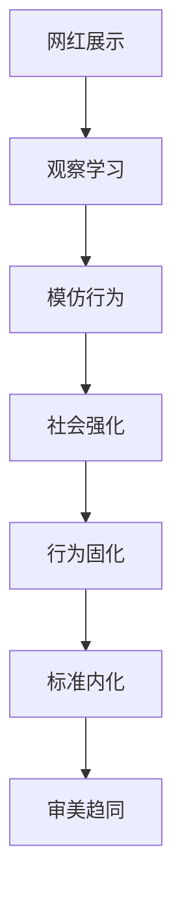

# 第十三章：算法与推荐 - 个性化推送背后的心理操控

## 📱 引言

社交媒体已经成为现代人生活中不可或缺的一部分，它不仅改变了我们的沟通方式，更深刻地影响着我们的审美观念。在这个由算法驱动的虚拟世界中，"完美"似乎触手可及，但这种完美往往是虚幻的。

## 👥 8.1 "网红脸"与"A4腰"：社交媒体如何加速单一审美的传播与内化？

### 审美趋同的现象分析

#### "网红脸"的标准化
现代社交媒体上的"网红脸"呈现出惊人的相似性：
- **眼部特征**：大眼睛、双眼皮、长眼睫毛
- **鼻部特征**：高鼻梁、小鼻翼、精致鼻尖
- **面部轮廓**：瓜子脸、尖下巴、苹果肌
- **皮肤状态**：无暇白皙、毛孔隐形

#### "A4腰"现象的社会心理
- **量化标准**：将身材美用具体数字量化
- **挑战性质**：将身材展示变成挑战游戏
- **社交传播**：通过社交媒体快速传播
- **群体参与**：形成全民参与的趋势

### 审美趋同的心理机制

#### 社会学习理论

#### 从众心理
- **社会认同**：通过符合主流审美获得认同
- **群体压力**：害怕因为不同而被排斥
- **安全感**：跟随大众选择感觉更安全
- **社会比较**：与他人比较产生的压力

### 社交媒体的放大效应

#### 算法推荐的同质化
- **相似内容推荐**：算法推荐相似的美貌内容
- **热门内容优先**：符合主流审美的内容获得更多曝光
- **用户行为反馈**：用户的点赞行为强化算法偏好
- **商业利益驱动**：商业广告推动特定审美标准

#### 视觉文化的影响
- **图像至上**：视觉内容比文字更有影响力
- **即时传播**：图片和视频的即时传播特性
- **情绪感染**：视觉内容容易引发情绪共鸣
- **记忆深刻**：视觉信息更容易被记忆

!!! example "审美趋同案例"
    以"网红脸"为例：
    - **起源**：某位网红的特定面部特征受到追捧
    - **传播**：通过社交媒体快速传播
    - **模仿**：其他网红开始模仿这种特征
    - **固化**：逐渐形成固定的审美标准
    - **内化**：普通用户也开始追求这种外貌

### 审美趋同的负面影响

#### 个体层面
- **自我认同危机**：失去独特的个人特色
- **焦虑情绪**：因为不符合标准而产生焦虑
- **自我价值绑定**：将自我价值与外表绑定
- **创造力压抑**：压抑个性化的审美表达

#### 社会层面
- **多样性缺失**：社会审美多样性的缺失
- **文化同质化**：不同文化背景的审美趋同
- **创新阻碍**：阻碍审美文化的创新发展
- **社会压力**：增加社会整体的外表压力

## 📷 8.2 滤镜与P图文化：数字美化如何扭曲我们对真实人体的认知？

### 数字美化技术的发展

#### 美颜技术的演进
- **基础美颜**：磨皮、美白、亮眼等基础功能
- **五官调整**：瘦脸、大眼、高鼻梁等调整功能
- **身材修饰**：瘦身、长腿、丰胸等身材调整
- **AI美颜**：基于人工智能的智能美化

#### 滤镜文化的普及
- **实时滤镜**：拍摄时即时美化
- **后期处理**：拍摄后的精细调整
- **AR技术**：增强现实的美颜效果
- **智能识别**：自动识别并优化面部特征

### 数字美化对认知的影响

#### 认知基线的改变
- **美的标准提高**：数字美化提高了美的标准
- **真实性认知偏差**：难以区分真实与虚假
- **期望值失调**：现实与数字化形象的差距
- **自我认知扭曲**：对自己真实外貌的认知偏差

#### 现实与虚拟的界限模糊

### 滤镜文化的心理影响

#### 自我认知的分裂
- **镜像自我**：真实镜子中的自己
- **数字自我**：美化后的数字形象
- **理想自我**：期望达到的理想形象
- **社交自我**：在社交媒体上展示的形象

#### 成瘾性行为
- **拍摄依赖**：不用美颜就不敢拍照
- **修图强迫**：强迫性地修饰每一张照片
- **完美主义**：追求照片的完美效果
- **社交焦虑**：害怕展示真实的自己

### 数字美化的社会影响

#### 真实性的缺失
- **信息失真**：社交媒体上的信息缺乏真实性
- **标准扭曲**：扭曲了社会对美的标准
- **比较偏差**：与不真实的形象进行比较
- **期望错位**：对现实生活的期望错位

#### 代际差异
- **数字原住民**：年轻一代对数字美化的依赖
- **现实感知**：对真实世界的感知能力下降
- **社交技能**：面对面社交技能的退化
- **自信建设**：真实自信的建立困难

!!! warning "数字美化的风险"
    过度依赖数字美化可能导致：
    - 对真实自我的认知偏差
    - 社交焦虑和自信心下降
    - 对医美的不切实际期望
    - 难以接受真实的自己

## ⚠️ 8.3 "美丽羞辱"与网络暴力：对外貌的评判如何演变成一种网络暴力？

### 网络美丽羞辱的形式

#### 直接羞辱
- **外貌攻击**：直接攻击他人的外貌特征
- **比较贬低**：通过与他人比较进行贬低
- **标签化**：用负面标签定义他人
- **群体攻击**：集体参与的外貌攻击

#### 间接羞辱
- **暗示性评论**：通过暗示进行羞辱
- **标准暗示**：通过展示标准进行间接羞辱
- **群体排斥**：通过排斥表达不认同
- **冷暴力**：通过忽视进行心理伤害

### "傻子共振"：网络时代的群体心理陷阱

在分析网络暴力之前，我们需要理解一个更深层的心理现象——"傻子共振"。正如李滨在《傻子共振》一文中深入分析的：

!!! quote "李滨观点"
    "傻子共振（Fool's resonance）是一种社会心理问题，又被称为'群体共振效应'，也是网络时代的一种心理陷阱，它在互联网世界的算法之下会变得更加可怕。指的是那些明显错误或无知的观点，却可以在一定的人群中产生共识，盲目跟风并迅速传播，如同成千上万只井底之蛙在互联网上相亲相爱，一致认为世界只有井口这么大。"
    
    —— 摘自《傻子共振》，[原文链接](https://mp.weixin.qq.com/s/fKrr9x5yudRnPZgdfelMMQ?scene=1)

#### 傻子共振的理论基础

**戈夫曼的观点：**社会学家戈夫曼在1959年的著作中首次提出"傻瓜的共振"概念，认为人们在实际社会互动中，往往不是理性的、清醒的，而是"愚弄与被愚弄"的。

**认知封闭理论：**美国社会学家保罗·拉波特提出的"认知封闭"概念："人们往往只相信他们看到的、他们想到的、他们已经得到认可的和与他们自己的世界观相符的事物。其他东西他们视而不见。"

#### 傻子共振在医美领域的表现

  

    
1

    

      <h3>算法加持下的群体聚集</h3>
      
互联网推送算法让认知相似的人聚集在一起，形成正反馈机制，越来越强大

    

  

  

    
2

    

      <h3>信息茧房的形成</h3>
      
人们深陷某种状态而无法自拔，只关注自己想关注的事情，只赞同自己想赞同的观点

    

  

  

    
3

    

      <h3>选择性糊涂</h3>
      
明知完全脱离底层逻辑，但是选择性糊涂，表现出无法自我控制的从众

    

  

  

    
4

    

      <h3>群体智商下降</h3>
      
正如勒庞在《乌合之众》中所说：一群人聚在一起时，他们的行为往往会变得愚蠢

    

  

#### 傻子共振的形成原因

  

    

      
🧠

      <h4 class="comparison-title">愚蠢的一致性</h4>
    

    
当一个人坚持一种错误的决策或观点，仅仅是因为眼前利益或思维惰性而无法改变自己的思维模式，无法顾及事实证据或其事物的底层逻辑。

  

  

    

      
⚡

      <h4 class="comparison-title">认知对抗</h4>
    

    
人们在面对信息错乱和观念冲突时，感到极度不适，为了减少这种不适，选择性地接受符合自己观念的信息。

  

!!! warning "医美领域的傻子共振现象"
    在医美消费中，傻子共振可能表现为：
    - 盲目跟风某种"网红项目"
    - 无视风险，只相信成功案例
    - 在群体压力下做出不理性决策
    - 拒绝接受与自己观念不符的专业建议
    - 在社交媒体上形成"医美崇拜"群体

#### 如何避免陷入傻子共振

  

    
🤔

    <h3>独立思考</h3>
    
保持独立思考的能力，不盲目跟随群体观点

  

  

    
📚

    <h3>多元信息</h3>
    
主动接触多元化的信息源，避免信息茧房

  

  

    
🔍

    <h3>事实检验</h3>
    
用事实和逻辑检验观点，而非情感和偏好

  

  

    
⏸️

    <h3>暂停反思</h3>
    
在做重要决策前给自己时间反思和冷静

  

### 网络暴力的心理机制

#### 去抑制效应
- **匿名性**：网络的匿名性降低道德约束
- **距离感**：物理距离减少共情能力
- **群体效应**：群体行为降低个人责任感
- **即时性**：即时反应减少深思熟虑

#### 道德脱离
- **道德合理化**：为攻击行为寻找合理理由
- **责任转移**：将责任转移给他人或环境
- **后果忽视**：忽视行为对他人的伤害
- **受害者贬低**：贬低受害者来合理化行为

### 美丽羞辱的社会影响

#### 个体创伤
- **心理创伤**：造成长期的心理创伤
- **自信打击**：严重打击自信心
- **社交回避**：回避社交活动
- **极端行为**：可能导致极端行为

#### 社会氛围
- **审美焦虑**：加剧社会的审美焦虑
- **标准单一化**：推动审美标准的单一化
- **群体对立**：造成不同群体的对立
- **文化倒退**：推动文化的倒退

### 应对网络美丽羞辱

#### 个人防护
- **心理建设**：建立强大的心理防护
- **支持系统**：建立可靠的支持系统
- **理性思考**：理性分析网络言论
- **专业帮助**：必要时寻求专业帮助

#### 社会干预
- **平台责任**：社交平台承担监管责任
- **法律保护**：通过法律保护受害者
- **教育普及**：普及网络文明教育
- **文化引导**：引导积极的网络文化

## 🧭 8.4 寻找出口："反容貌焦虑"运动与审美多样性的兴起

### 反容貌焦虑运动的兴起

#### 运动背景
- **焦虑普遍化**：容貌焦虑成为社会普遍问题
- **健康意识**：对心理健康的关注增加
- **多元呼声**：对审美多样性的呼声增强
- **社会反思**：对单一审美标准的反思

#### 运动形式
- **素颜挑战**：鼓励展示真实的自己
- **身体积极**：倡导身体积极的理念
- **多元展示**：展示不同类型的美
- **教育宣传**：普及正确的审美观念

### 审美多样性的价值

#### 个人价值
- **自我接纳**：学会接纳真实的自己
- **个性发展**：发展独特的个人特色
- **创造力释放**：释放创造力和想象力
- **心理健康**：维护良好的心理健康

#### 社会价值
- **文化丰富**：丰富社会文化内容
- **创新动力**：为社会创新提供动力
- **包容性**：增强社会的包容性
- **和谐发展**：促进社会和谐发展

### 建立多元审美观

#### 教育引导
- **媒体素养**：提高媒体素养教育
- **审美教育**：加强审美多样性教育
- **心理健康**：重视心理健康教育
- **价值观教育**：培养正确的价值观

#### 文化建设
- **多元表达**：鼓励多元化的美丽表达
- **包容文化**：建设包容性的文化环境
- **正面引导**：引导积极正面的文化
- **创新鼓励**：鼓励文化创新和发展

!!! tip "培养多元审美观"
    1. 主动接触不同类型的美
    2. 质疑单一的审美标准
    3. 欣赏个体的独特性
    4. 培养内在美的感知能力
    5. 支持审美多样性的表达

## 🛡️ 8.5 在社交媒体时代保持真实

### 数字化时代的自我保护

#### 意识觉醒
- **影响识别**：识别社交媒体的影响
- **真实性思考**：思考什么是真实的美
- **价值澄清**：澄清个人的价值观
- **目标设定**：设定合理的生活目标

#### 行为调整
- **使用控制**：控制社交媒体的使用
- **内容筛选**：筛选积极正面的内容
- **真实表达**：鼓励真实的自我表达
- **支持他人**：支持他人的真实表达

### 建立健康的社交媒体关系

#### 消费习惯
- **时间管理**：合理管理使用时间
- **内容选择**：选择积极健康的内容
- **互动方式**：采用积极的互动方式
- **现实平衡**：平衡虚拟与现实生活

#### 创作理念
- **真实分享**：分享真实的生活体验
- **积极传播**：传播积极正面的信息
- **多元展示**：展示多元化的美
- **责任意识**：承担社会责任

## 💬 本章反思

!!! question "深度思考"
    1. 你是否注意到自己受到"网红脸"等单一审美标准的影响？这种影响是如何发生的？
    
    2. 你使用美颜滤镜的频率如何？这是否影响了你对自己真实外貌的认知？
    
    3. 你是否遇到过网络美丽羞辱？你是如何应对的？
    
    4. 你是否愿意支持审美多样性？你会如何在日常生活中实践这一理念？

## ➡️ 下一章预告

探讨了社交媒体的影响后，下一章我们将从更宏观的角度分析文化与社会环境如何塑造我们的美丽标准，了解我们所身处的"美丽场域"。

---

*"认清虚幻的完美，拥抱真实的自己。"*