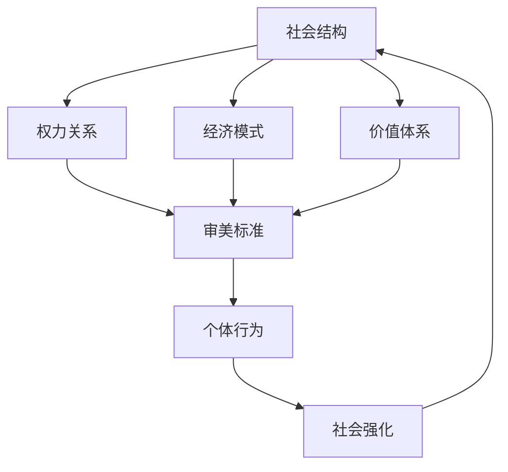
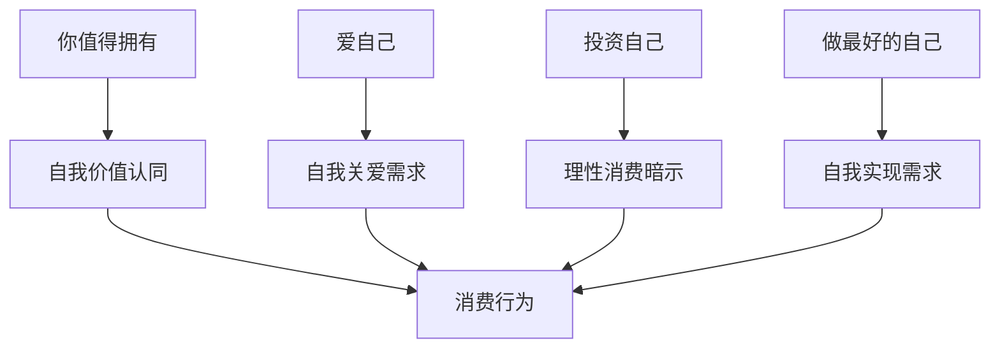

# 第十四章：消费文化的深层影响 - 美丽经济学

## 🌍 引言

美丽标准从来不是孤立存在的，它深深植根于特定的文化土壤中，受到社会环境的深刻影响。理解我们身处的"美丽场域"，有助于我们更好地认识自己的审美观念是如何形成的，以及如何在全球化的浪潮中保持文化自信。

## ☯️ 9.1 东亚的"白幼瘦"审美 vs. 欧美的"健康性感"风

### 东亚传统审美的文化根源

#### "白幼瘦"标准的历史演变
- **白**：肤色白皙的文化意义
  - 历史背景：古代农业社会的阶级象征
  - 文化内涵：纯洁、高贵、脱离劳作
  - 现代演变：与西方审美的融合
  - 商业推动：美白产业的商业利益

- **幼**：年轻化审美的心理基础
  - 生物学基础：年轻与生育能力的关联
  - 文化象征：纯真、可爱、需要保护
  - 社会期待：男性保护欲的满足
  - 现代表现：萝莉文化、少女感追求

- **瘦**：纤细身材的社会意义
  - 传统观念：弱柳扶风的女性美
  - 现代演变：与西方瘦身文化的结合
  - 心理暗示：自律、控制力的象征
  - 社会压力：媒体和同伴的影响

### 欧美"健康性感"审美的文化背景

#### 健康导向的审美观
- **健康美学**：身体健康与外在美的统一
- **运动文化**：健身文化的普及和推广
- **自然主义**：对自然状态的推崇
- **功能性美**：身体功能与美感的结合

#### 性感文化的社会接受
- **身体解放**：女性身体解放运动的影响
- **个性表达**：通过身体表达个性和自信
- **多元包容**：对不同身材的包容和接纳
- **力量美学**：力量与美感的结合

### 文化差异的深层分析

#### 社会结构的影响

#### 性别角色的差异
- **东亚模式**：温柔、顺从、需要保护
- **欧美模式**：独立、自信、自主选择
- **角色期待**：社会对女性角色的不同期待
- **自我实现**：个人价值实现的不同路径

### 全球化下的审美融合

#### 文化交流的影响
- **媒体传播**：影视文化的全球传播
- **时尚产业**：国际时尚的标准化
- **社交媒体**：全球化的审美展示平台
- **移民文化**：人口流动带来的文化融合

#### 本土化的抵抗与适应
- **文化自信**：对本土审美的重新认识
- **创新融合**：传统与现代的创新结合
- **差异化发展**：保持文化特色的发展
- **多元共存**：不同审美标准的并存

!!! example "文化差异案例"
    **东亚明星**：通常追求精致、娇小、可爱的形象
    **欧美明星**：更多展现健康、性感、力量的形象
    **融合趋势**：现代东亚娱乐业也开始接受多元化的美丽标准

## 📺 9.2 影视剧、综艺节目如何潜移默化地影响我们的审美观？

### 影视媒体的审美塑造机制

#### 视觉文化的力量
- **形象塑造**：通过角色形象塑造审美标准
- **情节强化**：通过情节发展强化审美观念
- **情感认同**：通过情感认同传递价值观
- **重复暴露**：通过重复暴露形成习惯

#### 媒体议程设置
- **话题引导**：设置社会讨论的话题
- **标准定义**：定义美丽和成功的标准
- **价值传递**：传递特定的社会价值观
- **行为示范**：提供行为模式的示范

### 影视作品的审美影响

#### 角色塑造的影响
- **主角光环**：主角形象成为审美标准
- **反面对比**：通过反面角色强化标准
- **类型化**：将人物类型化标签化
- **理想化**：呈现理想化的人物形象

#### 情节设计的暗示
- **美貌与成功**：将美貌与成功联系起来
- **改变与救赎**：通过外表改变获得救赎
- **爱情与外表**：将爱情与外表吸引力联系
- **社会认同**：通过外表获得社会认同

### 综艺节目的审美导向

#### 选秀节目的标准化
- **外貌门槛**：设置隐性的外貌门槛
- **改造节目**：通过改造传递审美标准
- **评判标准**：专家评判传递的价值观
- **观众反应**：观众投票反映的审美趋势

#### 真人秀的生活化影响
- **日常展示**：展示日常生活中的美丽标准
- **互动效应**：观众与节目的互动影响
- **模仿行为**：观众对节目内容的模仿
- **社交传播**：通过社交媒体的二次传播

### 媒体影响的心理机制

#### 社会学习理论
- **观察学习**：通过观察媒体内容学习
- **模仿行为**：模仿媒体中的行为模式
- **强化机制**：通过反复观看强化认知
- **泛化效应**：将媒体标准泛化到现实

#### 培养理论
- **长期影响**：长期观看的累积影响
- **现实建构**：通过媒体建构现实认知
- **价值内化**：将媒体价值内化为个人价值
- **行为指导**：媒体内容指导现实行为

!!! warning "媒体影响警示"
    需要警惕的媒体影响：
    - 过度美化的角色形象
    - 单一化的审美标准
    - 外表与成功的简单联系
    - 通过改变外表解决问题的暗示

## 🛍️ 9.3 "她经济"下的消费主义："爱自己，就给自己最好的"如何被商家巧妙利用？

### 医美时尚的形成与演变

在探讨"她经济"之前，我们需要理解医美时尚是如何形成和演变的。正如李滨在《医美时尚的形成与演变》一文中深入分析的：

!!! quote "李滨观点"
    "时尚（fashion）本是服装业的概念，字面解释是符合潮流的、被大规模群体接受的流行风格，也包括风气和习惯。按消费心理学视角解释，时尚则是指在一定时期内，在某个社会群体中普遍流行的，并为大多数人所仿效的生活方式或行为模式。"
    
    "医美被贴上时尚的标签，并不一定总是从'时尚'中得到好处。反而，因为时尚与消费密切关联，所以医美的消费属性逐渐侵蚀医疗属性，让医美从'医疗的'变成了'时尚的'、'消费的'。"
    
    —— 摘自《医美时尚的形成与演变》，[原文链接](https://mp.weixin.qq.com/s/rrR7YIJ7bcrWkLpVUnymiw?scene=1)

#### 医美时尚的定义与特征

**定义：**在一段时间内，能够被大量爱美群体接受的医美方式或产品，人们受某种方式的影响而选用这种方式或替代原有方式来解决医美需求。

#### 医美时尚的类型分析

  

    
脉冲型

    

      <h3>短期流行</h3>
      
<strong>特点：</strong>红极一时，但很快便归于平淡

      
<strong>例子：</strong>欧洲之星、线雕技术、金丝植入

    

  

  

    
对数型

    

      <h3>持续趋势</h3>
      
<strong>特点：</strong>历久弥新，获得人们持续认可

      
<strong>例子：</strong>肉毒素、玻尿酸、热玛吉

    

  

  

    
长尾型

    

      <h3>经典项目</h3>
      
<strong>特点：</strong>较长时间成长，机会合适突然勃发，然后长期持续

      
<strong>例子：</strong>鼻综合等美容外科项目

    

  

#### 医美时尚与服装时尚的差异

  

    <h4>🏭 基础不同</h4>
    <ul>
      <li><strong>医美时尚：</strong>依赖医疗技术与产品科学发展，与工业化水平息息相关</li>
      <li><strong>服装时尚：</strong>更多仰仗文化因素，如设计师灵感、地域环境与民族习惯</li>
    </ul>
  

  

    <h4>🔄 演进方式不同</h4>
    <ul>
      <li><strong>医美时尚：</strong>以替代方式演进，一旦被新方式替代，很难起死回生</li>
      <li><strong>服装时尚：</strong>有循环性，可能循环出现</li>
    </ul>
  

  

    <h4>⚕️ 本质不同</h4>
    <ul>
      <li><strong>医美时尚：</strong>涉及医学伦理及合规化体系，本质上仍然是医疗</li>
      <li><strong>服装时尚：</strong>主要涉及文化内涵和价值观</li>
    </ul>
  

  

    <h4>📱 表达方式不同</h4>
    <ul>
      <li><strong>医美时尚：</strong>间接表达，通过作用于人体后的效果来表达，具有隐蔽性</li>
      <li><strong>服装时尚：</strong>直接表达，时尚元素与文化信号是显性的</li>
    </ul>
  

#### 医美时尚传播的心理机制

正如李滨在《建立关系：正确利用医美时尚对消费者的影响》一文中分析的：

!!! info "从众心理与群体选择"
    "因为有了群体决策而形成时尚，所以能够影响更多群体。从业时间长的医美人都有相同的感受，即医美业在蛰伏了20年之后，突然迎来爆发式增长。而作为单一的消费者，在信息不对称的领域更愿意相信集体决策，所以，从众心理让某种医美时尚迅速占领消费者认知。"

  

    
1

    

      <h3>群体决策形成时尚</h3>
      
集体选择形成时尚潮流，影响更多群体参与

    

  

  

    
2

    

      <h3>信息不对称下的从众</h3>
      
消费者在专业信息缺乏时更愿意相信集体决策

    

  

  

    
3

    

      <h3>网络传染模型</h3>
      
医美时尚遵从幂律分布规则，形成病毒式传播

    

  

  

    
4

    

      <h3>势能宣泄</h3>
      
积累的"势能"用宣泄的方式在人群中传播

    

  

!!! warning "医美时尚的风险"
    医美时尚的非理性被传媒层层放大，时尚传播能够赢者通吃。因此需要警惕：
    - 盲目跟风的风险
    - 忽视个体差异的问题
    - 过度商业化的倾向
    - 缺乏科学依据的新技术

### "她经济"的兴起背景

#### 女性经济地位的提升
- **收入增长**：女性收入水平的显著提升
- **消费能力**：女性消费能力的增强
- **决策权力**：在消费决策中的主导地位
- **市场份额**：在消费市场中的重要地位

#### 消费观念的变化
- **自我投资**：将消费视为对自己的投资
- **品质追求**：对产品品质的更高要求
- **体验消费**：注重消费体验和感受
- **个性化需求**：追求个性化的消费体验

### 西方学者眼中的"脸蛋经济学"

在探讨消费主义策略之前，让我们先了解西方学者对"颜值经济学"的研究。正如李滨在《西人眼中的"脸蛋经济学"》一文中介绍的：

!!! quote "李滨观点"
    "所谓'脸蛋经济学'，更学术一点的叫法是'颜值经济学'，它指的是医美消费背后的经济学原理与社会心理机制的纠缠，透过消费心理、社会分层和消费社会的视角，分析当代医美消费的特征、陷阱及发展趋势。"
    
    "过去的几十年，中国的医美同行埋头经营、不问对错的同时，西方的诸多学者都对颜值经济进行了广泛而深入的研究，这些成果对行业的发展，有一定的借鉴价值。"
    
    —— 摘自《西人眼中的"脸蛋经济学"》，[原文链接](https://mp.weixin.qq.com/s/MlWFg7RioyGjH4UBJhsB8A?scene=1)

#### 脸蛋经济学的三个核心原则

  

    
1

    

      <h3>"帕累托法则"（二八法则）</h3>
      
多数情况下，80%的结果由20%的因素决定，即适当的投入就可能获得大部分效果。关键在于找到那个最优的投入点，而不是盲目追求投入的最大化。

    

  

  

    
2

    

      <h3>"边际效应"原则</h3>
      
所有的医美投入，都存在一个平衡点，一旦超过这个点，投入带来的回报会急剧下降。高价医美消费很容易忽视这一点，不断追加投入，却往往收效甚微。

    

  

  

    
3

    

      <h3>"比较心理"原则</h3>
      
医美带来的满足感主要来自三个维度的比较：与过去的自己相比、与身边的人相比、与自己对未来的期许相比。

    

  

### 消失的差异化：内卷下的单向度医美

正如李滨在《消失的差异化：内卷下的单向度医美》一文中深刻分析的：

!!! quote "李滨观点"
    "作为集医学、美学与心理学于一体的医美，差异化应该是'基因'，但是在互联网低价团购和博主破价带货的价格战中，这个标签正迅速变得模糊。医美业自我销毁了差异化，走向了'单向度医美'。"
    
    —— 摘自《消失的差异化：内卷下的单向度医美》，[原文链接](https://mp.weixin.qq.com/s/myrunIvnUbbTfaQ6oghFIg?scene=1)

#### 医美本应具备的差异化基因

!!! info "医美的天然差异化优势"
    医美应当秉持差异化的基因：
    - **每个医生都是不同的**：专业擅长、美学观点、心理学造诣、性格特点与人格魅力的差异
    - **每个求美者也是不同的**：性格、年龄、职业、条件、阶层、学识、教养千差万别
    - **同一个人在不同阶段也是不同的**：对美的认知与配合度形成千人千面的医美效果

#### 内卷现象的危害

价格战带来行业的疯狂内卷，医生沦为产品销售员，成为流水线上的工具人。人只有到了黔驴技穷的同质化、无差别的时候，才会陷入内卷，直到同归于尽。

### 消费主义的包装策略

#### 自我关爱的话语包装
- **"爱自己"概念**：将消费包装为自我关爱
- **"投资自己"理念**：将消费视为投资行为
- **"取悦自己"文化**：鼓励为自己消费
- **"值得拥有"暗示**：强调个人价值和权利

#### 情感营销的策略
- **情感共鸣**：通过情感故事引起共鸣
- **身份认同**：通过消费建立身份认同
- **社群归属**：通过消费获得社群归属感
- **自我实现**：通过消费实现自我价值

### 医美消费中的消费主义

#### 概念包装的演变
- **医美 = 自我投资**：将医美包装为投资行为
- **美丽 = 自我关爱**：将变美视为关爱自己
- **改变 = 成长**：将外表改变视为个人成长
- **消费 = 自由**：将消费选择视为自由表达

#### 营销话术的分析

### 消费主义的心理陷阱

#### 需求创造与放大
- **人造需求**：创造原本不存在的需求
- **需求放大**：将小需求放大为大需求
- **紧迫感**：制造立即满足的紧迫感
- **不满足感**：持续创造不满足感

#### 价值观的扭曲
- **物质主义**：将物质消费与自我价值绑定
- **外在评价**：过度关注外在评价
- **比较心理**：通过比较刺激消费欲望
- **身份焦虑**：通过消费缓解身份焦虑

### 理性消费的思考框架

#### 需求真实性分析
- **内在需求**：分析真实的内在需求
- **外在影响**：识别外在影响的因素
- **价值判断**：评估消费的真实价值
- **长期影响**：考虑长期的影响和后果

#### 消费决策的理性化
- **目标明确**：明确消费的真实目标
- **成本收益**：全面分析成本和收益
- **替代方案**：考虑其他替代方案
- **风险评估**：评估消费的风险

!!! tip "理性消费建议"
    在面对"爱自己"的消费诱惑时：
    1. 区分真实需求与人造需求
    2. 分析消费动机的真实性
    3. 评估消费的长期价值
    4. 寻找更多元化的自我关爱方式
    5. 建立理性的消费观念

## 🧭 9.4 文化自信与审美独立

### 建立文化自信

#### 理解文化根源
- **历史传承**：了解本土审美的历史传承
- **文化内涵**：理解文化符号的深层内涵
- **价值体系**：认识文化价值体系的独特性
- **创新发展**：在传承中创新发展

#### 批判性思考
- **标准质疑**：质疑单一的审美标准
- **媒体素养**：提高媒体素养和批判能力
- **文化比较**：理性比较不同文化的优劣
- **独立判断**：形成独立的审美判断

### 审美独立的实践

#### 个人层面
- **自我认知**：深入了解自己的审美偏好
- **价值澄清**：澄清个人的核心价值观
- **多元接纳**：接纳多元化的审美表达
- **创新表达**：创新性地表达个人审美

#### 社会层面
- **文化保护**：保护本土文化的多样性
- **教育推广**：推广审美教育和文化教育
- **媒体责任**：媒体承担文化传承的责任
- **制度支持**：建立支持文化多样性的制度

### 全球化时代的文化策略

#### 开放与保护的平衡
- **文化交流**：积极参与全球文化交流
- **本土保护**：保护本土文化的独特性
- **创新融合**：在交流中创新融合
- **差异化发展**：保持文化发展的差异化

#### 文化软实力的建设
- **文化输出**：向世界展示本土文化的魅力
- **品牌建设**：建设具有文化特色的品牌
- **人才培养**：培养文化创新人才
- **平台建设**：建设文化交流平台

## 💡 9.5 构建健康的文化生态

### 多元文化的价值

#### 文化多样性的意义
- **创新动力**：文化多样性是创新的动力
- **社会活力**：多元文化增强社会活力
- **个人发展**：为个人发展提供更多选择
- **和谐共处**：促进不同群体的和谐共处

#### 包容性文化的建设
- **平等尊重**：尊重不同文化的平等地位
- **对话交流**：促进不同文化的对话交流
- **合作共赢**：在合作中实现共赢发展
- **和谐发展**：促进文化的和谐发展

### 健康文化生态的要素

#### 制度环境
- **法律保护**：通过法律保护文化多样性
- **政策支持**：政策支持文化创新发展
- **资源配置**：合理配置文化资源
- **监管规范**：规范文化市场秩序

#### 社会环境
- **社会氛围**：营造包容开放的社会氛围
- **公众参与**：鼓励公众参与文化建设
- **教育普及**：普及文化教育和素养
- **媒体责任**：媒体承担文化传播责任

## 💬 本章反思

!!! question "深度思考"
    1. 你认为自己的审美观念更接近东亚的"白幼瘦"还是欧美的"健康性感"？这种偏好是如何形成的？
    
    2. 回想一部对你审美观念影响较大的影视作品，分析它是如何影响你的？
    
    3. 你是否曾经在"爱自己"的名义下进行医美消费？现在你如何看待这种消费行为？
    
    4. 你认为应该如何在全球化的时代保持文化自信和审美独立？

## ➡️ 第三部分总结

通过第三部分的学习，我们了解了塑造美丽标准的三大社会力量：
- 营销策略如何精准影响我们的认知和行为
- 社交媒体如何创造完美幻象和推动审美趋同
- 文化环境如何深层次地影响我们的审美观念

在下一部分中，我们将探讨医美手术后的心理变化，了解从期待到现实的心理过程。

---

*"在文化的海洋中保持独立思考，在全球化的浪潮中坚持文化自信。"*