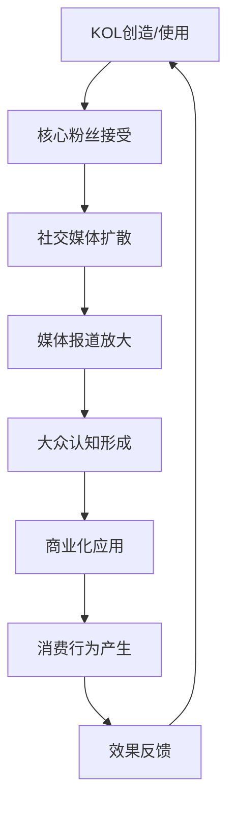

# 第十五章：媒体建构的美丽标准 - 从传统媒体到新媒体

    

        <h1 class="hero-title">美丽话语的传播密码</h1>
        
解析网络时代医美传播的心理机制

    

## 🌐 引言：当传播遇上消费

在社交媒体时代，一个词汇的流行可能只需要几天时间。从"妈生脸"到"少女感"，从"胶原满满"到"侧颜杀"，这些看似简单的网络用语背后，隐藏着传播心理学与消费心理学相互作用的复杂机制。

### 传播心理学与消费心理学的交汇

  

    <h4>📡 传播心理学视角</h4>
    
研究信息如何在人群中传播，以及传播过程中的心理机制

    <ul>
      <li>信息的编码与解码</li>
      <li>传播渠道的选择</li>
      <li>受众的接受心理</li>
      <li>传播效果的评估</li>
    </ul>
  

  

    <h4>🛒 消费心理学视角</h4>
    
研究消费者的购买决策过程和影响因素

    <ul>
      <li>需求的激发与强化</li>
      <li>品牌认知的建立</li>
      <li>购买意愿的形成</li>
      <li>消费行为的实现</li>
    </ul>
  

## 📊 医美传播术语的心理解析

### 核心术语分类与分析

我们选择了18个具有代表性的医美传播术语，按照其心理作用机制进行分类分析：

## 🎭 第一类：身份认同型术语

### 1. "妈生脸"

  

    
👶

    <h3 class="category-title">妈生脸</h3>
  

  

    
<strong>传播心理学分析：</strong>

    <ul>
      <li><strong>语义建构：</strong>"妈生"暗示天然、无人工痕迹</li>
      <li><strong>情感共鸣：</strong>触发对"天然美"的向往</li>
      <li><strong>社会认同：</strong>与"网红脸"形成对比，满足差异化需求</li>
    </ul>
    
<strong>消费心理学分析：</strong>

    <ul>
      <li><strong>需求创造：</strong>将"自然"包装为一种可购买的服务</li>
      <li><strong>价值重构：</strong>让消费者为"看起来没做过"的效果付费</li>
      <li><strong>心理安慰：</strong>降低对医美的心理阻抗</li>
    </ul>
  

### 2. "少女感"

  

    
🌸

    <h3 class="category-title">少女感</h3>
  

  

    
<strong>传播心理学分析：</strong>

    <ul>
      <li><strong>时间焦虑：</strong>激发对青春流逝的恐惧</li>
      <li><strong>年龄模糊：</strong>将生理年龄与心理/外表年龄分离</li>
      <li><strong>群体归属：</strong>创造一个可以"重新加入"的年龄群体</li>
    </ul>
    
<strong>消费心理学分析：</strong>

    <ul>
      <li><strong>损失厌恶：</strong>强化对青春流逝的焦虑</li>
      <li><strong>获得框架：</strong>将医美包装为"重获青春"</li>
      <li><strong>持续消费：</strong>需要不断维护的"状态"</li>
    </ul>
  

### 3. "高级脸"

  

    
👑

    <h3 class="category-title">高级脸</h3>
  

  

    
<strong>传播心理学分析：</strong>

    <ul>
      <li><strong>阶层暗示：</strong>"高级"暗示社会地位和品味</li>
      <li><strong>稀缺性：</strong>暗示这种美是少数人才能拥有的</li>
      <li><strong>文化资本：</strong>需要一定的审美素养才能理解</li>
    </ul>
    
<strong>消费心理学分析：</strong>

    <ul>
      <li><strong>身份消费：</strong>购买的不仅是外表，更是身份认同</li>
      <li><strong>价格锚定：</strong>为高价服务提供心理依据</li>
      <li><strong>排他性：</strong>满足消费者的优越感需求</li>
    </ul>
  

## 💫 第二类：效果描述型术语

### 4. "胶原满满"

  

    
✨

    <h3 class="category-title">胶原满满</h3>
  

  

    
<strong>传播心理学分析：</strong>

    <ul>
      <li><strong>科学包装：</strong>用"胶原"这一科学术语增加可信度</li>
      <li><strong>量化表达：</strong>"满满"给人充盈、丰富的感觉</li>
      <li><strong>视觉联想：</strong>让人联想到饱满、年轻的肌肤状态</li>
    </ul>
    
<strong>消费心理学分析：</strong>

    <ul>
      <li><strong>功能诉求：</strong>将抽象的"年轻"具象化为"胶原"</li>
      <li><strong>即时满足：</strong>暗示可以快速获得理想效果</li>
      <li><strong>持续需求：</strong>胶原会流失，需要持续补充</li>
    </ul>
  

### 5. "侧颜杀"

  

    
📐

    <h3 class="category-title">侧颜杀</h3>
  

  

    
<strong>传播心理学分析：</strong>

    <ul>
      <li><strong>视角创新：</strong>将注意力引向特定角度</li>
      <li><strong>冲击表达：</strong>"杀"字体现强烈的视觉冲击</li>
      <li><strong>完美主义：</strong>暗示360度无死角的美</li>
    </ul>
    
<strong>消费心理学分析：</strong>

    <ul>
      <li><strong>细分需求：</strong>将整体美容细分为具体部位</li>
      <li><strong>技术导向：</strong>暗示需要专业技术才能达到</li>
      <li><strong>社交价值：</strong>在拍照时代的实用价值</li>
    </ul>
  

### 6. "冷白皮"

  

    
❄️

    <h3 class="category-title">冷白皮</h3>
  

  

    
<strong>传播心理学分析：</strong>

    <ul>
      <li><strong>色彩心理：</strong>"冷"暗示高级、疏离的美感</li>
      <li><strong>肤色分类：</strong>创造新的肤色评价体系</li>
      <li><strong>时尚关联：</strong>与时尚界的审美标准接轨</li>
    </ul>
    
<strong>消费心理学分析：</strong>

    <ul>
      <li><strong>标准重构：</strong>重新定义"好看的肤色"</li>
      <li><strong>产品导向：</strong>为美白、调色产品创造需求</li>
      <li><strong>群体区分：</strong>创造肤色优越感</li>
    </ul>
  

## 🎯 第三类：技术包装型术语

### 7. "童颜针"

  

    
💉

    <h3 class="category-title">童颜针</h3>
  

  

    
<strong>传播心理学分析：</strong>

    <ul>
      <li><strong>效果承诺：</strong>"童颜"直接承诺年轻化效果</li>
      <li><strong>技术神秘：</strong>将复杂医疗技术简化为一个词</li>
      <li><strong>即时联想：</strong>让人立即理解产品功能</li>
    </ul>
    
<strong>消费心理学分析：</strong>

    <ul>
      <li><strong>需求明确：</strong>直接对应抗衰老需求</li>
      <li><strong>简化决策：</strong>降低消费者的认知负担</li>
      <li><strong>品牌化：</strong>将医疗项目品牌化包装</li>
    </ul>
  

### 8. "少女针"

  

    
🌺

    <h3 class="category-title">少女针</h3>
  

  

    
<strong>传播心理学分析：</strong>

    <ul>
      <li><strong>年龄定位：</strong>精准定位目标年龄段心理</li>
      <li><strong>情感诉求：</strong>触发对青春期的美好回忆</li>
      <li><strong>社会认同：</strong>符合社会对"少女"的正面评价</li>
    </ul>
    
<strong>消费心理学分析：</strong>

    <ul>
      <li><strong>时间商品：</strong>将"青春"包装为可购买的商品</li>
      <li><strong>心理补偿：</strong>满足重返青春的心理需求</li>
      <li><strong>持续消费：</strong>需要定期维护的"少女状态"</li>
    </ul>
  

### 9. "精灵耳"

  

    
🧚

    <h3 class="category-title">精灵耳</h3>
  

  

    
<strong>传播心理学分析：</strong>

    <ul>
      <li><strong>幻想元素：</strong>引入童话、动漫元素</li>
      <li><strong>独特性：</strong>创造前所未有的美学概念</li>
      <li><strong>亚文化：</strong>迎合特定群体的审美偏好</li>
    </ul>
    
<strong>消费心理学分析：</strong>

    <ul>
      <li><strong>细分市场：</strong>开发小众但高价值的市场</li>
      <li><strong>个性表达：</strong>满足个性化、差异化需求</li>
      <li><strong>话题营销：</strong>通过争议性获得关注</li>
    </ul>
  

## 🌟 第四类：状态描述型术语

### 10. "氛围感"

  

    
🌙

    <h3 class="category-title">氛围感</h3>
  

  

    
<strong>传播心理学分析：</strong>

    <ul>
      <li><strong>抽象美学：</strong>将具体的外表特征抽象化</li>
      <li><strong>情境营造：</strong>强调整体感觉而非局部特征</li>
      <li><strong>想象空间：</strong>给受众留下想象和解释的空间</li>
    </ul>
    
<strong>消费心理学分析：</strong>

    <ul>
      <li><strong>体验消费：</strong>销售的是感觉和体验</li>
      <li><strong>整体包装：</strong>推动综合性医美消费</li>
      <li><strong>价值模糊：</strong>难以量化，便于定价</li>
    </ul>
  

### 11. "纯欲风"

  

    
🎀

    <h3 class="category-title">纯欲风</h3>
  

  

    
<strong>传播心理学分析：</strong>

    <ul>
      <li><strong>矛盾统一：</strong>"纯"与"欲"的对立统一</li>
      <li><strong>性别符号：</strong>重新定义女性魅力的表达方式</li>
      <li><strong>边界模糊：</strong>在保守与开放之间找平衡</li>
    </ul>
    
<strong>消费心理学分析：</strong>

    <ul>
      <li><strong>复合需求：</strong>同时满足多种心理需求</li>
      <li><strong>市场细分：</strong>针对特定审美偏好的市场</li>
      <li><strong>文化适应：</strong>适应东方文化的审美特点</li>
    </ul>
  

### 12. "初恋脸"

  

    
💕

    <h3 class="category-title">初恋脸</h3>
  

  

    
<strong>传播心理学分析：</strong>

    <ul>
      <li><strong>情感记忆：</strong>唤起对初恋的美好回忆</li>
      <li><strong>纯真符号：</strong>代表未经世事的纯真美</li>
      <li><strong>怀旧情结：</strong>满足对过去美好时光的怀念</li>
    </ul>
    
<strong>消费心理学分析：</strong>

    <ul>
      <li><strong>情感消费：</strong>购买的是情感体验</li>
      <li><strong>年龄焦虑：</strong>缓解对年龄增长的焦虑</li>
      <li><strong>关系价值：</strong>在情感关系中的工具价值</li>
    </ul>
  

## 🔥 第五类：流行趋势型术语

### 13. "A4腰"

  

    
📄

    <h3 class="category-title">A4腰</h3>
  

  

    
<strong>传播心理学分析：</strong>

    <ul>
      <li><strong>量化标准：</strong>用具体物品作为衡量标准</li>
      <li><strong>挑战性：</strong>设定一个看似可达成的目标</li>
      <li><strong>传播便利：</strong>易于理解和传播的概念</li>
    </ul>
    
<strong>消费心理学分析：</strong>

    <ul>
      <li><strong>目标设定：</strong>为消费者设定明确目标</li>
      <li><strong>紧迫感：</strong>创造"必须达到"的心理压力</li>
      <li><strong>产业链：</strong>带动相关产品和服务消费</li>
    </ul>
  

### 14. "漫画腿"

  

    
🦵

    <h3 class="category-title">漫画腿</h3>
  

  

    
<strong>传播心理学分析：</strong>

    <ul>
      <li><strong>二次元文化：</strong>将动漫审美引入现实</li>
      <li><strong>理想化：</strong>追求超越现实的完美比例</li>
      <li><strong>视觉冲击：</strong>强调极致的视觉效果</li>
    </ul>
    
<strong>消费心理学分析：</strong>

    <ul>
      <li><strong>极致追求：</strong>推动消费者追求极端效果</li>
      <li><strong>技术依赖：</strong>暗示需要高端技术才能实现</li>
      <li><strong>亚文化消费：</strong>迎合特定群体的消费需求</li>
    </ul>
  

### 15. "天鹅颈"

  

    
🦢

    <h3 class="category-title">天鹅颈</h3>
  

  

    
<strong>传播心理学分析：</strong>

    <ul>
      <li><strong>动物比喻：</strong>借用天鹅的优雅形象</li>
      <li><strong>贵族暗示：</strong>天鹅象征高贵、优雅</li>
      <li><strong>形象具体：</strong>让抽象的"优雅"变得具体</li>
    </ul>
    
<strong>消费心理学分析：</strong>

    <ul>
      <li><strong>气质消费：</strong>销售的是气质和形象</li>
      <li><strong>整体改造：</strong>推动颈部到肩部的综合改造</li>
      <li><strong>社交价值：</strong>在社交场合的形象价值</li>
    </ul>
  

## 🎪 第六类：新兴概念型术语

### 16. "颅顶高"

  

    
🧠

    <h3 class="category-title">颅顶高</h3>
  

  

    
<strong>传播心理学分析：</strong>

    <ul>
      <li><strong>解剖学包装：</strong>用专业术语增加权威性</li>
      <li><strong>细节关注：</strong>将注意力引向细微特征</li>
      <li><strong>标准创新：</strong>创造新的美学评价标准</li>
    </ul>
    
<strong>消费心理学分析：</strong>

    <ul>
      <li><strong>需求创造：</strong>发现并创造新的消费需求</li>
      <li><strong>技术导向：</strong>推动相关技术和产品发展</li>
      <li><strong>市场细分：</strong>开发头部美学市场</li>
    </ul>
  

### 17. "直角肩"

  

    
📐

    <h3 class="category-title">直角肩</h3>
  

  

    
<strong>传播心理学分析：</strong>

    <ul>
      <li><strong>几何美学：</strong>用几何概念定义美</li>
      <li><strong>力量暗示：</strong>直角暗示力量和坚定</li>
      <li><strong>性别重构：</strong>重新定义女性的力量美</li>
    </ul>
    
<strong>消费心理学分析：</strong>

    <ul>
      <li><strong>身材管理：</strong>推动肩部塑形消费</li>
      <li><strong>服装搭配：</strong>影响服装消费选择</li>
      <li><strong>健身产业：</strong>带动相关健身消费</li>
    </ul>
  

### 18. "蜜桃臀"

  

    
🍑

    <h3 class="category-title">蜜桃臀</h3>
  

  

    
<strong>传播心理学分析：</strong>

    <ul>
      <li><strong>食物比喻：</strong>用美味食物比喻身体部位</li>
      <li><strong>感官联想：</strong>触发多重感官联想</li>
      <li><strong>可爱化：</strong>将性感用可爱的方式表达</li>
    </ul>
    
<strong>消费心理学分析：</strong>

    <ul>
      <li><strong>身材焦虑：</strong>创造新的身材焦虑点</li>
      <li><strong>技术需求：</strong>推动臀部塑形技术发展</li>
      <li><strong>运动消费：</strong>带动相关运动和器械消费</li>
    </ul>
  

## 🔄 传播机制分析

### 病毒式传播的心理基础

  

    <h4>🎯 注意力捕获</h4>
    <ul>
      <li><strong>新奇性：</strong>新词汇容易引起注意</li>
      <li><strong>争议性：</strong>引发讨论和辩论</li>
      <li><strong>视觉化：</strong>容易形成视觉联想</li>
    </ul>
  

  

    <h4>💭 认知加工</h4>
    <ul>
      <li><strong>易理解：</strong>概念简单易懂</li>
      <li><strong>可操作：</strong>暗示可以通过行动达成</li>
      <li><strong>有价值：</strong>与个人利益相关</li>
    </ul>
  

  

    <h4>📢 主动传播</h4>
    <ul>
      <li><strong>社交货币：</strong>分享显示自己的品味</li>
      <li><strong>群体认同：</strong>通过使用获得群体归属</li>
      <li><strong>影响他人：</strong>希望影响他人的审美</li>
    </ul>
  

### 传播路径分析

## 💰 商业化机制分析

### 从概念到消费的转化路径

  

    
第一阶段

    

      <h3>概念植入</h3>
      
通过KOL、媒体等渠道植入新概念，建立初步认知

    

  

  

    
第二阶段

    

      <h3>标准建立</h3>
      
通过案例展示、对比分析等方式建立评价标准

    

  

  

    
第三阶段

    

      <h3>需求激发</h3>
      
通过自我对比、社会比较激发改变需求

    

  

  

    
第四阶段

    

      <h3>解决方案</h3>
      
提供相应的产品、服务作为解决方案

    

  

### 价值链分析

  

    概念创造
    
KOL、机构、品牌

  

  

    内容生产
    
自媒体、MCN机构

  

  

    平台传播
    
社交媒体平台

  

  

    商业转化
    
医美机构、产品商

  

## 🔮 未来发展趋势

### 技术驱动的新趋势

  

    
🤖

    <h3>AI个性化</h3>
    
基于个人特征生成专属美学概念

    <ul>
      <li>个人专属美学标签</li>
      <li>AI生成的理想形象</li>
      <li>个性化改造方案</li>
    </ul>
  

  

    
🥽

    <h3>虚拟现实</h3>
    
通过VR/AR技术预览效果

    <ul>
      <li>虚拟试妆试型</li>
      <li>3D效果预览</li>
      <li>沉浸式体验</li>
    </ul>
  

  

    
📊

    <h3>数据驱动</h3>
    
基于大数据分析的趋势预测

    <ul>
      <li>流行趋势预测</li>
      <li>个人匹配度分析</li>
      <li>效果量化评估</li>
    </ul>
  

### 社会文化的演进方向

  

    

      
📈

      <h3 class="comparison-title">积极趋势</h3>
    

    <ul>
      <li><strong>多元化发展：</strong>审美标准更加多元包容</li>
      <li><strong>理性化消费：</strong>消费者更加理性和谨慎</li>
      <li><strong>技术透明：</strong>技术和风险信息更加透明</li>
      <li><strong>个性化服务：</strong>更加注重个人特色</li>
    </ul>
  

  

    

      
⚠️

      <h3 class="comparison-title">潜在风险</h3>
    

    <ul>
      <li><strong>标准固化：</strong>新的单一标准可能形成</li>
      <li><strong>技术依赖：</strong>过度依赖技术解决方案</li>
      <li><strong>焦虑加剧：</strong>更多细分标准带来更多焦虑</li>
      <li><strong>商业操控：</strong>商业利益对审美的过度影响</li>
    </ul>
  

## 🛡️ 理性应对策略

### 个人层面的应对

  <li><strong>批判性思维：</strong>质疑新概念的合理性和必要性</li>
  <li><strong>多元审美：</strong>培养多元化的审美观念</li>
  <li><strong>信息素养：</strong>提高识别和筛选信息的能力</li>
  <li><strong>自我认知：</strong>建立稳定的自我价值体系</li>
  <li><strong>理性消费：</strong>基于真实需求而非流行趋势消费</li>

### 社会层面的引导

  

    
监管

    

      <h3>加强行业监管</h3>
      
规范医美广告宣传，防止虚假概念误导消费者

    

  

  

    
教育

    

      <h3>提升媒体素养</h3>
      
通过教育提高公众的媒体素养和批判思维能力

    

  

  

    
文化

    

      <h3>倡导多元文化</h3>
      
推广多元化的美学观念，减少单一标准的压力

    

  

## 💡 本章小结

### 核心洞察

!!! insight "关键发现"
    1. **语言塑造现实**：医美传播术语不仅描述美，更在创造和定义美
    2. **心理机制复合**：传播心理学与消费心理学相互作用，放大影响效果
    3. **商业逻辑清晰**：从概念创造到消费转化有着清晰的商业路径
    4. **社会影响深远**：这些术语正在重塑社会的审美标准和价值观念

### 理性思考框架

当面对新的医美传播术语时，可以问自己：

  

    

      
❓

      <h3 class="category-title">批判性问题</h3>
    

    

      <ul>
        <li>这个概念是基于什么标准提出的？</li>
        <li>它解决了什么真实的问题？</li>
        <li>谁在推广这个概念？有什么利益关系？</li>
        <li>它是否符合我的真实需求和价值观？</li>
        <li>追求这个标准的成本和风险是什么？</li>
      </ul>
    

  

---

*"理解传播的力量，是在信息时代保持理性的关键。不要让美丽的定义权完全交给他人。"*