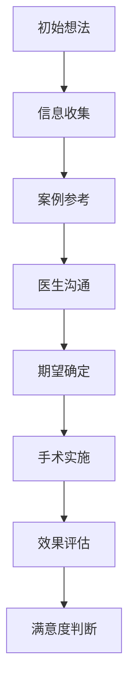

# 第十七章：效果的评判 - 满意度由谁定义？

## 章节概述

医美项目完成后，如何评判效果的好坏？满意度应该由谁来定义？这些看似简单的问题背后，隐藏着复杂的心理机制和社会因素。本章将深入探讨影响医美满意度的各种因素，帮助读者建立合理的评价标准和健康的心理预期。

## 满意度的多维度分析

### 客观效果 vs 主观感受

#### 客观效果评估
- **技术指标**：手术的技术成功率
- **医学标准**：符合医学美学标准
- **对比数据**：术前术后的客观对比
- **专业评价**：医生的专业评估

#### 主观感受评估
- **个人喜好**：符合个人审美偏好
- **心理满足**：心理需求的满足程度
- **自信提升**：自信心的改善情况
- **生活影响**：对生活质量的影响

### 内在标准 vs 外在标准

#### 内在评价标准
- **个人目标**：是否达到个人设定的目标
- **自我认同**：是否符合自我认同
- **功能改善**：功能性问题的改善
- **心理健康**：心理健康状况的变化

#### 外在评价标准
- **他人反应**：他人的评价和反应
- **社会标准**：社会主流审美标准
- **媒体影响**：媒体宣传的效果标准
- **同伴比较**：与同伴的比较结果

## 影响满意度的关键因素

### 期望管理

#### 期望形成过程

#### 期望偏差的来源
- **信息不对称**：获得的信息不够全面或准确
- **案例误导**：被精选的成功案例误导
- **沟通不充分**：与医生沟通不够充分
- **心理美化**：心理上对效果的美化

### 时间因素

#### 不同时期的满意度变化
- **术后初期**：由于肿胀等因素，满意度较低
- **恢复中期**：随着恢复，满意度逐渐提升
- **稳定期**：效果稳定后的真实满意度
- **长期评价**：时间推移后的综合评价

#### 时间对心理的影响
- **适应效应**：逐渐适应新的外貌
- **遗忘偏差**：对术前状态的记忆模糊
- **标准变化**：审美标准的变化
- **生活整合**：新外貌与生活的整合

### 社会环境因素

#### 社会支持的影响
- **家人态度**：家人的支持或反对
- **朋友反应**：朋友圈的反应和评价
- **工作环境**：工作场所的接受度
- **社会文化**：所在社会的文化背景

#### 比较参照的影响
- **同伴比较**：与同龄人的比较
- **明星标准**：与明星或网红的比较
- **理想自我**：与理想中的自己比较
- **过去自己**：与过去的自己比较

## 建立合理的评价标准

### 个性化评价体系

#### 核心评价维度
1. **功能改善**：是否解决了功能性问题
2. **美观提升**：是否达到了美观改善的目标
3. **心理健康**：是否促进了心理健康
4. **生活质量**：是否提升了整体生活质量

#### 权重分配原则
- 根据个人价值观确定各维度权重
- 考虑项目特点调整评价重点
- 平衡短期效果与长期影响
- 综合主观感受与客观标准

### 动态评价机制

#### 分阶段评价
- **即时评价**：术后即时的感受
- **短期评价**：恢复期的阶段性评价
- **中期评价**：效果稳定后的评价
- **长期评价**：长期使用后的综合评价

#### 评价标准的调整
- 随着时间推移调整评价重点
- 根据生活变化调整评价标准
- 结合新的认知调整期望值
- 保持评价的客观性和理性

## 提升满意度的策略

### 术前准备策略

#### 充分的信息收集
- 了解项目的真实效果范围
- 收集多样化的案例信息
- 咨询多个专业医生意见
- 了解可能的风险和并发症

#### 合理的期望设定
- 基于个人条件设定现实目标
- 考虑恢复过程的时间因素
- 准备应对可能的不完美结果
- 建立多元化的成功标准

### 术后调适策略

#### 心理调适技巧
- 关注积极变化而非缺陷
- 给自己充足的适应时间
- 避免过度的自我批评
- 寻求专业的心理支持

#### 社会支持利用
- 与理解和支持的人交流
- 避免负面评价的影响
- 建立积极的反馈环境
- 参与相关的支持群体

## 满意度评估工具

### 自我评估量表

#### 综合满意度评估
1. 整体效果满意度（1-10分）
2. 与期望的符合度（1-10分）
3. 对生活的积极影响（1-10分）
4. 推荐给他人的意愿（1-10分）

#### 分维度评估
- **外观改善**：外观变化的满意度
- **功能改善**：功能改善的满意度
- **心理影响**：心理变化的满意度
- **社会影响**：社会反应的满意度

### 专业评估标准

#### 医学评估标准
- 手术技术的成功率
- 并发症的发生率
- 恢复过程的顺利程度
- 长期效果的稳定性

#### 心理评估标准
- 心理健康状况的改善
- 自信心的提升程度
- 生活质量的改善
- 社会适应能力的变化

## 应对不满意结果

### 理性分析原因
- 分析期望与现实的差距
- 识别影响满意度的具体因素
- 评估是否存在客观问题
- 考虑时间因素的影响

### 寻求解决方案
- 与医生充分沟通
- 考虑修复或调整的可能性
- 寻求第二意见
- 探索非手术的改善方法

### 心理调适支持
- 接受专业心理咨询
- 参与支持小组
- 学习接纳和适应技巧
- 重新建立自我认同

## 本章小结

医美满意度的评判是一个复杂的过程，涉及客观效果、主观感受、社会环境等多个因素。建立合理的评价标准，采用动态的评价机制，可以帮助我们更客观地评估医美效果，提升整体满意度。最重要的是，满意度应该主要由自己定义，而不是完全依赖他人的评价。

---

*"真正的满意度来自内心的认同，而不是他人的赞美。"*