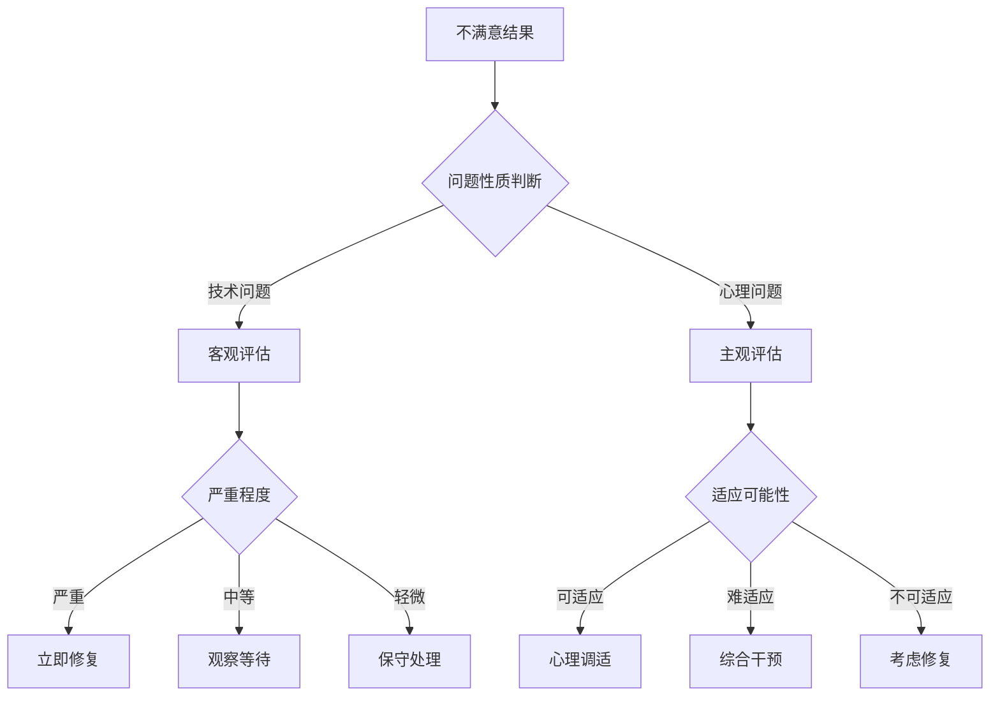

# 第十八章：当结果不尽如人意 - 修复、接纳与和解

## 章节概述

并非所有的医美项目都能达到预期效果，当面对不尽如人意的结果时，如何应对？是选择修复、接纳还是寻求其他解决方案？本章将探讨面对医美失败或不满意结果时的心理应对策略和实际解决方案，帮助读者在困境中找到最适合的出路。

## 不满意结果的类型分析

### 技术性问题

#### 手术技术问题
- **操作失误**：手术过程中的技术失误
- **设计不当**：手术方案设计不合理
- **材料问题**：使用材料的质量问题
- **感染并发症**：术后感染等并发症

#### 效果不达标
- **改善不明显**：效果不如预期明显
- **不对称问题**：左右不对称或比例失调
- **过度矫正**：矫正过度导致不自然
- **效果消失**：效果维持时间过短

### 心理期望问题

#### 期望过高
- **不现实期望**：设定了不现实的目标
- **完美主义**：追求绝对完美的效果
- **参照错误**：以不合适的案例为参照
- **信息误导**：被错误信息误导期望

#### 适应困难
- **身份认同**：难以适应新的外貌
- **心理落差**：心理期望与现实的巨大落差
- **社会压力**：来自社会环境的压力
- **后悔情绪**：对决策的强烈后悔

## 应对策略的选择框架

### 问题评估矩阵

### 决策考虑因素

#### 客观因素
- **问题的严重程度**：影响功能还是仅影响美观
- **修复的可行性**：技术上是否可以修复
- **修复的风险**：修复手术的风险评估
- **经济承受能力**：修复的经济成本

#### 主观因素
- **心理承受能力**：对现状的心理承受度
- **生活影响程度**：对日常生活的影响
- **社会支持情况**：家人朋友的支持程度
- **未来规划考虑**：对未来生活的影响

## 修复策略

### 修复前的准备

#### 充分评估
- **问题诊断**：准确诊断问题的性质和程度
- **修复方案**：制定详细的修复方案
- **风险评估**：全面评估修复的风险
- **效果预期**：设定合理的修复效果预期

#### 心理准备
- **心理咨询**：接受专业心理咨询
- **支持系统**：建立强大的支持系统
- **压力管理**：学会管理修复过程的压力
- **应急预案**：准备应对可能的不良结果

### 修复过程管理

#### 医生选择
- **专业资质**：选择有修复经验的专业医生
- **成功案例**：了解医生的修复成功案例
- **沟通能力**：选择沟通良好的医生
- **医德医风**：考虑医生的职业道德

#### 过程监控
- **定期复查**：按时进行复查和评估
- **问题反馈**：及时反馈出现的问题
- **调整方案**：根据情况调整修复方案
- **心理支持**：持续的心理支持和关怀

## 接纳策略

### 认知重构

#### 重新定义完美
- **接受不完美**：理解完美是相对的概念
- **关注整体**：关注整体效果而非局部缺陷
- **价值重排**：重新排列价值的优先级
- **意义重构**：重新构建经历的意义

#### 积极归因
- **学习经验**：将经历视为宝贵的学习经验
- **成长机会**：把挫折当作成长的机会
- **智慧积累**：认为这是人生智慧的积累
- **同理心培养**：培养对他人的同理心

### 心理调适技巧

#### 情绪管理
- **接纳情绪**：接纳负面情绪的存在
- **情绪表达**：找到合适的情绪表达方式
- **放松训练**：学习放松和减压技巧
- **正念练习**：练习正念和冥想

#### 行为调整
- **避免比较**：减少与他人或理想状态的比较
- **关注其他**：将注意力转向其他重要事物
- **社交恢复**：逐步恢复正常的社交活动
- **兴趣培养**：培养新的兴趣和爱好

## 和解策略

### 与自己和解

#### 自我宽恕
- **承认错误**：承认决策中的错误
- **理解动机**：理解当时决策的动机
- **宽恕自己**：学会宽恕自己的不完美决策
- **重新开始**：给自己重新开始的机会

#### 自我接纳
- **接纳现状**：接纳当前的外貌状态
- **发现优点**：发现和强化自己的优点
- **建立自信**：重新建立自信心
- **价值确认**：确认自己的内在价值

### 与他人和解

#### 家人朋友
- **坦诚沟通**：与家人朋友坦诚沟通
- **寻求理解**：寻求他们的理解和支持
- **修复关系**：修复可能受损的关系
- **感谢支持**：感谢他们的支持和陪伴

#### 医疗团队
- **理性沟通**：与医疗团队理性沟通
- **责任界定**：合理界定各方责任
- **寻求解决**：共同寻求解决方案
- **维护权益**：合法维护自己的权益

## 预防策略

### 决策前预防

#### 充分准备
- **信息收集**：收集全面准确的信息
- **多方咨询**：咨询多个专业意见
- **风险评估**：全面评估各种风险
- **心理准备**：做好充分的心理准备

#### 合理期望
- **现实目标**：设定现实可达的目标
- **个体差异**：考虑个体差异因素
- **时间因素**：合理估计恢复时间
- **不确定性**：接受结果的不确定性

### 过程中预防

#### 积极配合
- **遵医嘱**：严格遵守医生的指导
- **定期复查**：按时进行复查
- **问题反馈**：及时反馈异常情况
- **耐心等待**：给恢复过程充足时间

#### 心理维护
- **情绪监控**：监控自己的情绪变化
- **支持利用**：充分利用支持系统
- **压力管理**：有效管理恢复期压力
- **专业求助**：必要时寻求专业帮助

## 法律维权

### 维权的条件
- **医疗过错**：存在明确的医疗过错
- **损害结果**：造成了实际的损害
- **因果关系**：过错与损害之间有因果关系
- **证据充分**：有充分的证据支持

### 维权的途径
- **协商解决**：与医疗机构协商解决
- **调解处理**：通过第三方调解
- **行政投诉**：向卫生行政部门投诉
- **司法诉讼**：通过法律途径解决

## 本章小结

面对不尽如人意的医美结果，我们有多种应对策略可以选择。无论是修复、接纳还是和解，关键是要根据具体情况做出理性的选择。重要的是要记住，外貌只是我们人生的一部分，真正的美丽和价值来自内在的品质和人生的丰富体验。

---

*"人生没有完美的结果，只有完整的经历。学会与不完美和解，是成长的重要一课。"*