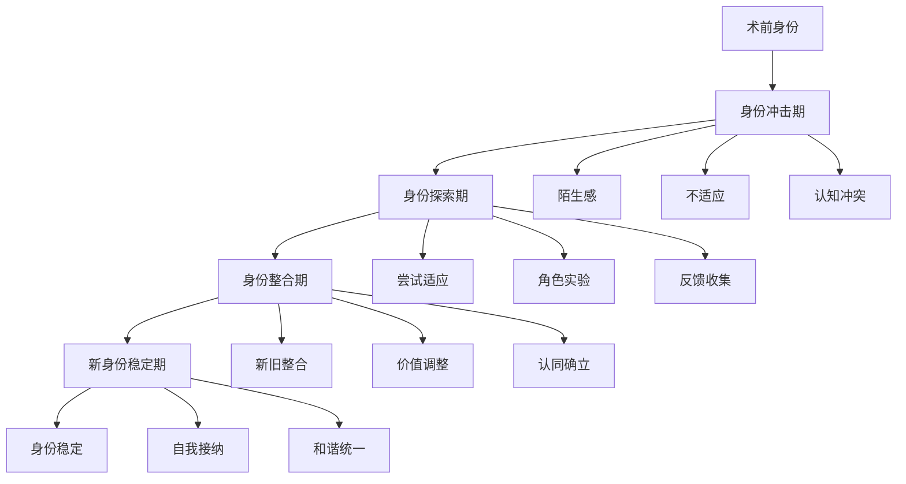

# 第十九章：身份重构 - 新形象下的自我认同

## 🪞 引言

医美项目完成后，外表的改变往往会带来深层的心理变化。这不仅仅是外貌的改变，更是一个重新认识自己、重构身份认同的过程。本章将探讨术后身份认同的重建过程，以及如何在新形象下建立健康的自我认同。

## 🔄 身份认同的重构过程

### 身份认同的定义

身份认同是指个体对"我是谁"这一问题的回答，它包括：
- **个人身份**：独特的个人特征和经历
- **社会身份**：在社会中的角色和地位
- **身体身份**：对自己身体和外表的认知
- **心理身份**：内在的价值观和信念

### 医美对身份认同的影响

#### 直接影响
- **外表变化**：最直观的身体形象改变
- **自我感知**：对自己的感知发生变化
- **镜像认知**：在镜子中看到"新的自己"
- **身体意象**：身体意象的重新建构

#### 间接影响
- **他人反应**：他人对新形象的反应
- **社会角色**：可能的社会角色变化
- **人际关系**：人际关系的微妙变化
- **自信水平**：自信心的提升或波动

### 身份重构的阶段

## 🎭 身份冲击期的心理挑战

### 镜像陌生感

#### 现象描述
术后初期，许多人会在镜子中看到一个"陌生的自己"，产生强烈的不真实感。

#### 心理机制
- **认知失调**：新形象与内在自我形象的冲突
- **习惯性期待**：大脑习惯了原来的形象
- **身份连续性**：对身份连续性的质疑
- **真实性怀疑**：对"真实自我"的怀疑

#### 常见反应
- **否认**："这不是真的我"
- **焦虑**：对变化的焦虑和不安
- **后悔**：对决策的后悔和质疑
- **逃避**：避免照镜子或拍照

### 认知冲突

#### 内在冲突的表现
- **新旧对比**：不断比较新旧形象
- **价值质疑**：质疑自己的价值观
- **动机反思**：反思做医美的动机
- **身份困惑**：不确定自己是谁

#### 应对策略
- **接纳变化**：学会接纳外表的变化
- **时间给予**：给自己充分的适应时间
- **专业支持**：寻求专业心理支持
- **渐进适应**：逐步适应新的形象

## 🔍 身份探索期的适应过程

### 角色实验

#### 实验的内容
- **社交试探**：在不同社交场合试探他人反应
- **风格尝试**：尝试不同的穿衣风格和妆容
- **行为调整**：调整自己的行为模式
- **关系重建**：重新定义人际关系

#### 实验的目的
- **寻找定位**：找到适合新形象的定位
- **收集反馈**：收集他人的反馈和反应
- **建立信心**：逐步建立对新形象的信心
- **整合身份**：将新形象整合到身份中

### 反馈处理

#### 积极反馈的处理
- **适度接受**：适度接受他人的赞美
- **内化积极**：将积极反馈内化为自信
- **保持理性**：不过度依赖外在评价
- **感恩心态**：以感恩的心态对待赞美

#### 消极反馈的处理
- **理性分析**：理性分析消极反馈的原因
- **选择性接受**：选择性接受建设性意见
- **情绪管理**：管理因消极反馈产生的情绪
- **坚持自我**：坚持自己的选择和判断

## 🧩 身份整合期的心理工作

### 新旧身份的整合

#### 整合的挑战
- **连续性维持**：保持身份的连续性
- **一致性建立**：建立内外的一致性
- **价值协调**：协调新旧价值观
- **记忆重构**：重构自我记忆和叙事

#### 整合的策略
- **叙事重构**：重新构建自己的人生故事
- **价值澄清**：澄清和确认核心价值观
- **优势整合**：整合新旧身份的优势
- **意义赋予**：为改变赋予积极意义

### 自我概念的重建

#### 重建的维度
- **外表自我**：对新外表的接纳和认同
- **能力自我**：对自己能力的重新评估
- **价值自我**：对自己价值的重新认识
- **关系自我**：在关系中的自我定位

#### 重建的方法
- **自我对话**：进行积极的自我对话
- **优势发现**：发现和强化自己的优势
- **目标设定**：设定新的人生目标
- **行动计划**：制定实现目标的行动计划

## 🌟 新身份稳定期的特征

### 稳定身份的标志

#### 内在标志
- **自我接纳**：完全接纳新的自己
- **身份一致**：内在身份与外在形象一致
- **价值明确**：价值观清晰稳定
- **目标清楚**：人生目标明确

#### 外在标志
- **行为自然**：行为表现自然流畅
- **关系和谐**：人际关系和谐稳定
- **社交自信**：在社交中表现自信
- **生活满意**：对生活整体满意

### 维持身份稳定的策略

#### 内在维护
- **持续反思**：定期进行自我反思
- **价值坚持**：坚持核心价值观
- **成长心态**：保持持续成长的心态
- **平衡发展**：注重全面平衡发展

#### 外在支持
- **社会支持**：维护良好的社会支持网络
- **专业指导**：必要时寻求专业指导
- **同伴交流**：与有相似经历的人交流
- **持续学习**：保持学习和适应能力

## 🚧 身份重构中的常见问题

### 身份分裂

#### 表现形式
- **内外不一**：内在自我与外在形象不一致
- **角色冲突**：不同角色之间的冲突
- **价值矛盾**：价值观之间的矛盾
- **行为不协调**：行为与身份不协调

#### 解决方法
- **整合治疗**：寻求专业的整合治疗
- **价值澄清**：澄清和统一价值观
- **角色协调**：协调不同角色的关系
- **行为调整**：调整行为以匹配身份

### 身份依赖

#### 表现形式
- **外表依赖**：过度依赖外表获得认同
- **他人依赖**：过度依赖他人的评价
- **物质依赖**：通过物质消费维持身份
- **关系依赖**：通过关系获得身份确认

#### 预防策略
- **内在建设**：加强内在品质的建设
- **多元发展**：发展多元化的身份认同
- **独立思考**：培养独立思考的能力
- **自我确认**：学会自我确认和肯定

## 💪 促进健康身份重构的方法

### 心理技巧

#### 认知重构技巧
- **积极重构**：将改变重构为积极的成长
- **意义寻找**：为改变寻找积极意义
- **优势聚焦**：聚焦于改变带来的优势
- **未来导向**：关注未来的可能性

#### 情绪管理技巧
- **情绪识别**：准确识别和命名情绪
- **情绪接纳**：接纳各种情绪的存在
- **情绪调节**：学会调节负面情绪
- **情绪表达**：适当表达自己的情绪

### 行为策略

#### 渐进适应策略
- **小步骤**：采用小步骤的适应方法
- **循序渐进**：循序渐进地增加挑战
- **反馈调整**：根据反馈调整策略
- **耐心等待**：给自己充分的时间

#### 社会支持策略
- **支持网络**：建立强大的支持网络
- **专业帮助**：寻求专业心理帮助
- **同伴支持**：寻找有相似经历的同伴
- **家庭支持**：获得家庭的理解和支持

## 🎯 身份重构的成功指标

### 内在指标

#### 心理健康指标
- **自我接纳度**：对新自己的接纳程度
- **身份一致性**：内外身份的一致程度
- **心理韧性**：面对挑战的心理韧性
- **生活满意度**：整体生活满意度

#### 成长指标
- **自我认知**：对自己的深入认知
- **价值明确**：价值观的清晰程度
- **目标导向**：目标的明确和导向性
- **适应能力**：对变化的适应能力

### 外在指标

#### 行为表现指标
- **行为一致性**：行为与身份的一致性
- **社交自信**：在社交中的自信表现
- **角色胜任**：各种角色的胜任能力
- **关系质量**：人际关系的质量

#### 社会功能指标
- **工作表现**：工作中的表现和成就
- **社会参与**：社会活动的参与程度
- **关系维护**：人际关系的维护能力
- **社会贡献**：对社会的贡献程度

## 📋 身份重构自我评估工具

### 身份认同评估量表

#### 自我接纳维度（1-10分）
- 我能够接纳现在的自己 ___分
- 我对自己的外表感到满意 ___分
- 我认为自己是有价值的 ___分
- 我对自己的选择不后悔 ___分

#### 身份一致性维度（1-10分）
- 我的内在与外在是一致的 ___分
- 我的行为符合我的价值观 ___分
- 我在不同场合都是真实的自己 ___分
- 我的生活方式反映了我的身份 ___分

#### 社会适应维度（1-10分）
- 我在社交中感到自信 ___分
- 我能够维护良好的人际关系 ___分
- 我能够胜任各种社会角色 ___分
- 我对自己的社会表现满意 ___分

### 评估结果解读

- **24-30分**：身份重构非常成功
- **18-23分**：身份重构基本成功
- **12-17分**：身份重构需要改善
- **12分以下**：建议寻求专业帮助

## 💬 本章反思

!!! question "深度思考"
    1. 你是否经历过身份认同的重构过程？这个过程中最大的挑战是什么？
    
    2. 你如何处理新形象与内在自我的冲突？有哪些有效的方法？
    
    3. 在身份重构过程中，哪些支持对你最重要？
    
    4. 你认为什么样的身份认同是健康和稳定的？

## ➡️ 下一章预告

在完成身份重构后，下一章我们将探讨如何重新融入社会生活，以及在新形象下如何建立和维护人际关系。

---

*"真正的美丽不在于外表的完美，而在于内外的和谐统一。"*