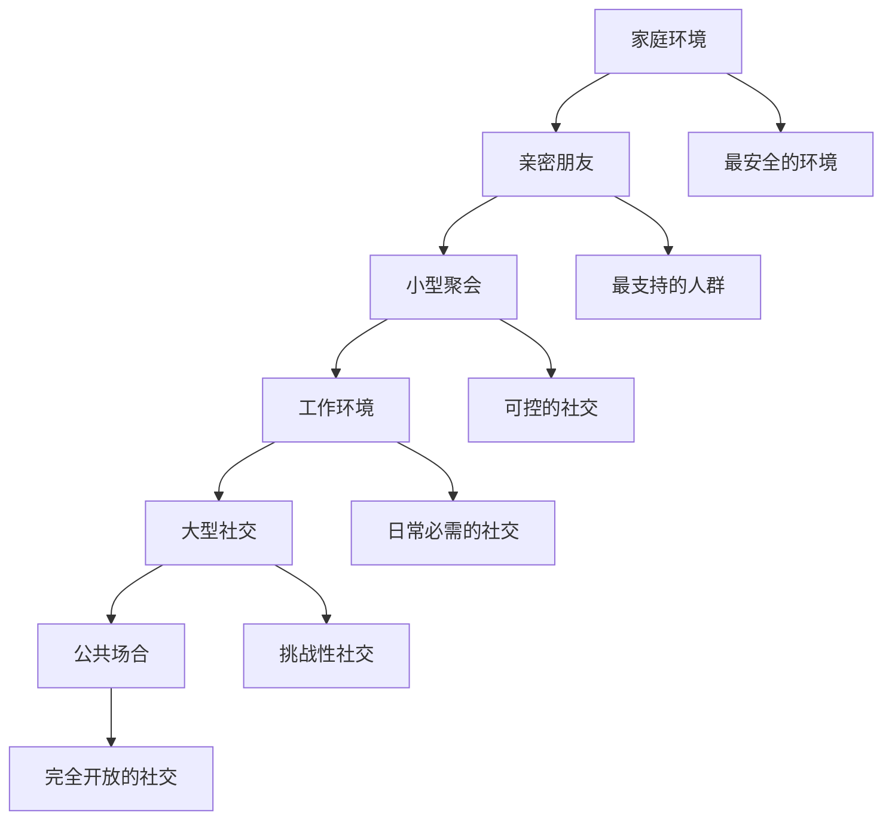

# 第二十章：社交重启 - 重新融入社会生活

## 🌐 引言

医美项目完成并度过恢复期后，许多人面临着一个新的挑战：如何以新的形象重新融入社会生活。这个过程不仅涉及外表的适应，更涉及心理的调整和社交关系的重建。本章将探讨社交重启的心理机制和实用策略。

## 🚪 社交重启的心理挑战

### 社交焦虑的产生

#### 焦虑的来源
- **注意力焦虑**：担心成为他人关注的焦点
- **评价焦虑**：担心他人对新形象的评价
- **真实性焦虑**：担心被质疑形象的真实性
- **期望焦虑**：担心无法满足他人的期望

#### 焦虑的表现
- **回避行为**：避免参加社交活动
- **过度准备**：为社交场合过度准备
- **自我监控**：过度关注自己的表现
- **防御心理**：对他人的反应过度敏感

### 身份展示的困境

#### 新旧身份的冲突
- **连续性问题**：如何保持身份的连续性
- **解释压力**：是否需要解释外表的变化
- **角色适应**：适应新形象下的社会角色
- **关系重定义**：重新定义与他人的关系

#### 展示策略的选择
- **坦诚策略**：公开承认进行了医美
- **模糊策略**：不主动提及但不否认
- **否认策略**：否认进行了医美
- **转移策略**：将注意力转移到其他方面

## 👥 他人反应的心理分析

### 常见的他人反应类型

#### 积极反应
- **赞美认可**：对新形象的赞美和认可
- **羡慕嫉妒**：对改变勇气的羡慕
- **支持鼓励**：对决定的支持和鼓励
- **好奇询问**：出于好奇的友善询问

#### 消极反应
- **批评质疑**：对医美决定的批评
- **嫉妒敌意**：因嫉妒产生的敌意
- **疏远冷淡**：关系的疏远和冷淡
- **恶意传播**：恶意传播相关信息

#### 中性反应
- **无所谓态度**：对变化无所谓的态度
- **礼貌回应**：礼貌但不深入的回应
- **观望态度**：观望后续发展的态度
- **专业建议**：提供专业性的建议

### 他人反应的影响因素

#### 关系亲密度
- **亲密关系**：家人朋友更容易接受
- **一般关系**：同事熟人反应较为中性
- **陌生关系**：陌生人通常不会特别关注
- **竞争关系**：竞争对手可能有消极反应

#### 文化背景
- **开放文化**：对医美接受度较高的文化
- **保守文化**：对医美接受度较低的文化
- **年龄差异**：不同年龄群体的接受度差异
- **社会地位**：不同社会地位的观念差异

## 🎭 社交重启的策略

### 渐进式重启策略

#### 从熟悉环境开始

#### 逐步扩大社交圈
- **内圈扩展**：从最亲密的人开始
- **中圈适应**：扩展到一般朋友和同事
- **外圈融入**：最后融入更广泛的社交圈
- **反馈调整**：根据反馈调整策略

### 沟通策略的选择

#### 主动沟通策略
- **坦诚分享**：主动分享自己的经历
- **教育解释**：解释医美的相关知识
- **感受表达**：表达自己的感受和想法
- **界限设定**：设定讨论的界限

#### 被动应对策略
- **简单回应**：对询问给出简单回应
- **转移话题**：巧妙转移话题
- **幽默化解**：用幽默化解尴尬
- **沉默应对**：选择性沉默

### 自信建设策略

#### 内在自信的培养
- **价值确认**：确认自己的内在价值
- **成就回顾**：回顾自己的成就和优点
- **目标设定**：设定新的人生目标
- **技能提升**：提升各方面的技能

#### 外在自信的展现
- **姿态调整**：保持自信的身体姿态
- **眼神交流**：保持自然的眼神交流
- **声音表达**：用自信的声音表达
- **服装搭配**：选择合适的服装搭配

## 🔄 关系重建的艺术

### 亲密关系的维护

#### 家庭关系
- **理解寻求**：寻求家人的理解和支持
- **沟通加强**：加强与家人的沟通
- **角色适应**：适应家庭中的新角色
- **传统平衡**：平衡传统观念与个人选择

#### 恋爱关系
- **坦诚沟通**：与伴侣坦诚沟通
- **信任重建**：重建或加强相互信任
- **吸引力调整**：适应吸引力的变化
- **未来规划**：共同规划未来

### 社交关系的重建

#### 友谊关系
- **真诚维护**：真诚维护重要的友谊
- **新友结交**：结交理解和支持的新朋友
- **圈子融入**：融入新的社交圈子
- **活动参与**：积极参与社交活动

#### 工作关系
- **专业形象**：维护专业的工作形象
- **能力展示**：通过能力获得认可
- **关系平衡**：平衡个人变化与工作关系
- **机会把握**：把握新的职业机会

## 🛡️ 应对负面反应的策略

### 心理防护机制

#### 认知防护
- **理性分析**：理性分析负面反应的原因
- **价值坚持**：坚持自己的价值观和选择
- **选择性关注**：选择性关注积极反馈
- **意义重构**：为负面反应寻找积极意义

#### 情绪防护
- **情绪调节**：学会调节负面情绪
- **支持寻求**：寻求情感支持
- **压力释放**：找到压力释放的方式
- **自我安慰**：学会自我安慰和鼓励

### 具体应对技巧

#### 面对批评质疑
- **冷静回应**：保持冷静和理性
- **事实澄清**：澄清事实和误解
- **界限维护**：维护个人隐私界限
- **支持寻求**：寻求支持者的帮助

#### 面对嫉妒敌意
- **理解动机**：理解他人嫉妒的动机
- **避免冲突**：避免不必要的冲突
- **距离保持**：与恶意者保持距离
- **正面应对**：用正面态度应对

## 🌟 成功社交重启的标志

### 内在标志

#### 心理状态
- **自信稳定**：自信心稳定和持续
- **焦虑减少**：社交焦虑显著减少
- **身份整合**：新旧身份成功整合
- **满意度高**：对社交生活满意度高

#### 行为表现
- **主动参与**：主动参与社交活动
- **自然表现**：在社交中表现自然
- **关系维护**：成功维护重要关系
- **新关系建立**：建立新的社交关系

### 外在标志

#### 社交表现
- **受欢迎程度**：在社交中受欢迎
- **影响力提升**：社交影响力提升
- **机会增加**：获得更多社交机会
- **反馈积极**：收到积极的社交反馈

#### 生活质量
- **生活满意度**：整体生活满意度提升
- **幸福感增强**：主观幸福感增强
- **目标实现**：实现预期的社交目标
- **成长感受**：感受到个人成长

## 📋 社交重启行动计划

### 准备阶段行动清单

#### 心理准备
- [ ] 建立合理的社交期望
- [ ] 准备应对各种反应的策略
- [ ] 加强自信心建设
- [ ] 寻求必要的心理支持

#### 实际准备
- [ ] 选择合适的重启时机
- [ ] 准备合适的服装和形象
- [ ] 练习自我介绍和回应
- [ ] 安排支持者的陪伴

### 执行阶段行动清单

#### 渐进式参与
- [ ] 从最安全的环境开始
- [ ] 逐步扩大社交范围
- [ ] 记录社交经历和感受
- [ ] 根据反馈调整策略

#### 关系维护
- [ ] 主动联系重要的人
- [ ] 参与有意义的社交活动
- [ ] 建立新的社交连接
- [ ] 维护积极的社交形象

### 评估阶段行动清单

#### 效果评估
- [ ] 评估社交重启的效果
- [ ] 分析成功和失败的经验
- [ ] 收集他人的反馈意见
- [ ] 调整未来的社交策略

#### 持续改进
- [ ] 继续提升社交技能
- [ ] 扩大社交网络
- [ ] 深化重要关系
- [ ] 保持积极的社交态度

## 💡 专家建议

### 心理学家的建议

#### 心理调适
- **接纳变化**：接纳外表和心理的变化
- **耐心等待**：给社交适应充足的时间
- **积极心态**：保持积极乐观的心态
- **专业求助**：必要时寻求专业帮助

#### 社交技巧
- **真诚沟通**：保持真诚的沟通态度
- **倾听技巧**：提升倾听和理解能力
- **共情能力**：培养共情和理解能力
- **冲突处理**：学会处理社交冲突

### 社交专家的建议

#### 形象管理
- **整体搭配**：注重整体形象的搭配
- **个人风格**：发展独特的个人风格
- **场合适应**：根据场合调整形象
- **自然表达**：保持自然的表达方式

#### 网络建设
- **质量优先**：注重社交网络的质量
- **多元发展**：发展多元化的社交网络
- **互惠原则**：遵循互惠互利的原则
- **长期维护**：注重长期的关系维护

## 💬 本章反思

!!! question "深度思考"
    1. 你在社交重启过程中遇到了哪些挑战？是如何克服的？
    
    2. 他人对你的变化有什么反应？你是如何应对不同反应的？
    
    3. 你的社交关系发生了哪些变化？这些变化是积极的还是消极的？
    
    4. 你认为成功的社交重启需要具备哪些条件？

## ➡️ 下一章预告

完成了社交重启后，我们将进入本书的最后一部分——回归理性。下一章将提供全面的医美决策自检清单，帮助读者做出更理性的决策。

---

*"真正的美丽不仅在于外表的改变，更在于内心的成长和社交的和谐。"*