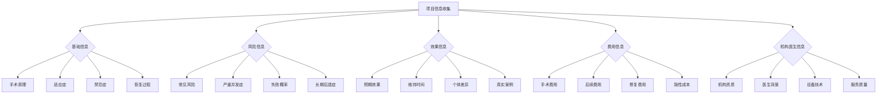

# 第二十一章：理性决策框架 - 你的医美决策自检清单

## 引言：决策前的最后一道防线

当小雅坐在医美机构的咨询室里，面对咨询师热情的推荐和诱人的优惠价格时，她的内心是矛盾的。一方面，她渴望改变；另一方面，她又担心风险和后果。这种矛盾的心情，几乎每个考虑医美的人都经历过。

在这个关键时刻，我们需要的不是更多的情感冲动，而是一套科学、系统的决策框架。这个框架就像是决策前的最后一道防线，帮助我们在理性和感性之间找到平衡，做出真正适合自己的选择。

医美决策的复杂性在于它涉及多个层面：心理需求、身体条件、经济能力、社会环境、风险承受能力等。每一个层面都有其重要性，任何一个层面的考虑不周都可能导致不理想的结果。

据统计，约有30%的医美消费者在术后会出现不同程度的后悔情绪，其中很大一部分原因是决策过程中的考虑不够充分。这些后悔往往不是因为技术问题，而是因为期望与现实的差距、对风险的低估、对自身需求的误判等。

一个科学的决策框架应该帮助我们：
- 澄清真实的动机和需求
- 全面评估个人条件和准备度
- 系统收集和分析相关信息
- 客观评估风险和收益
- 制定合理的期望和计划
- 建立有效的支持系统

在这一章中，我们将构建一套完整的医美决策自检清单，这个清单不是为了阻止你做医美，而是为了帮助你做出更明智、更适合自己的决策。

## 21.1 决策准备度的多维评估框架

### 第一维度：自我认知与动机澄清

#### 深度动机分析工具

在做出医美决策之前，我们需要深入挖掘自己的真实动机。表面的动机往往不是真实的动机，只有找到深层的驱动力，才能做出真正适合自己的选择。

**动机层次分析法**：

**表层动机**（我说我想要什么）
- "我想要变得更美"
- "我想要提升自信"
- "我想要改善某个部位"

**中层动机**（我为什么想要这些）
- "因为我觉得现在的自己不够好"
- "因为我想要获得更多关注"
- "因为我想要在职场/情场更有竞争力"

**深层动机**（我真正渴望的是什么）
- "我渴望被接纳和认可"
- "我想要掌控自己的人生"
- "我希望找到自己的价值和意义"

!!! question "动机真实性深度评估"
    **请花时间诚实地回答以下问题：**
    
    **基础动机识别**
    1. **我想要进行医美的最初原因是什么？**
       - [ ] 解决功能性问题（如呼吸困难、视力影响等）
       - [ ] 改善外观缺陷（如疤痕、胎记等）
       - [ ] 提升整体美观度
       - [ ] 抗衰老需求
       - [ ] 跟随潮流或他人建议
       - [ ] 其他：_____________
    
    2. **这个想法是如何产生的？**
       - [ ] 自己长期的想法
       - [ ] 看到他人的效果后产生的
       - [ ] 受到广告或营销影响
       - [ ] 他人的建议或压力
       - [ ] 特定事件的触发
    
    3. **这个想法持续了多长时间？**
       - [ ] 不到1个月（需要更多时间考虑）
       - [ ] 1-6个月（可以考虑，但需谨慎）
       - [ ] 6个月-1年（相对成熟的想法）
       - [ ] 1年以上（深思熟虑的决定）
    
    **动机纯度测试**
    4. **如果没有其他人知道我做了医美，我还会做吗？**
       - [ ] 是，这完全是为了自己
       - [ ] 可能会，但动机会减弱
       - [ ] 不确定
       - [ ] 不会，主要是为了他人
    
    5. **如果我最在意的人反对我做医美，我会怎么选择？**
       - [ ] 坚持自己的决定
       - [ ] 会重新考虑，但可能还是会做
       - [ ] 会暂停决定，寻求更多意见
       - [ ] 会放弃这个想法
    
    **替代方案考虑**
    6. **我是否考虑过其他改善方法？**
       - [ ] 是，已经尝试过多种方法但效果不佳
       - [ ] 是，考虑过但认为医美更有效
       - [ ] 考虑过一些，但没有深入尝试
       - [ ] 没有，直接考虑医美
    
    **现状接受度**
    7. **如果永远无法改变现状，我能接受吗？**
       - [ ] 完全可以接受，医美只是锦上添花
       - [ ] 基本可以接受，但希望有所改善
       - [ ] 难以接受，这个问题困扰我很久
       - [ ] 完全无法接受，必须要改变

#### 心理状态与决策能力评估

心理状态直接影响决策质量。在情绪不稳定或心理压力较大的时期做出的决策，往往不够理性和客观。

!!! warning "心理健康状态自检"
    **以下情况如果存在，强烈建议暂缓医美决策：**
    
    **情绪状态评估**
    - [ ] 最近3个月内经历重大生活变故（失恋、离婚、失业、亲人去世等）
    - [ ] 正在经历持续的情绪低落或抑郁状态
    - [ ] 经常感到焦虑、恐慌或不安
    - [ ] 情绪波动较大，难以保持稳定状态
    - [ ] 对未来感到绝望或无助
    
    **身体意象评估**
    - [ ] 对自己的外貌有过度的不满或厌恶
    - [ ] 经常因为外貌问题影响日常生活和社交
    - [ ] 花费大量时间关注和检查自己的外貌
    - [ ] 无法接受他人对自己外貌的正面评价
    - [ ] 认为改变外貌是解决所有问题的唯一方法
    
    **决策能力评估**
    - [ ] 有完美主义倾向，难以接受不完美的结果
    - [ ] 容易冲动决策，缺乏耐心和深思熟虑
    - [ ] 经常后悔自己做出的重要决定
    - [ ] 过度依赖他人意见，缺乏独立判断能力
    - [ ] 对风险的认知和承受能力较低
    
    **生理状态评估**
    - [ ] 正在服用影响情绪或认知的药物
    - [ ] 存在影响手术的慢性疾病
    - [ ] 正在经历生理周期的特殊阶段（如孕期、哺乳期等）
    - [ ] 近期有其他医疗计划或手术安排
    - [ ] 身体状况不佳，免疫力较低

#### 价值观与期望一致性检查

我们的决策应该与个人的核心价值观保持一致，否则即使获得了想要的结果，也可能感到内心的冲突和不安。

**价值观澄清练习**：

1. **我的核心价值观是什么？**
   请从以下选项中选择最重要的5个价值观：
   - [ ] 真实性/诚实
   - [ ] 美丽/外表
   - [ ] 健康/安全
   - [ ] 成功/成就
   - [ ] 关系/爱情
   - [ ] 家庭/亲情
   - [ ] 自由/独立
   - [ ] 安全/稳定
   - [ ] 创造/表达
   - [ ] 服务/奉献
   - [ ] 学习/成长
   - [ ] 享乐/快乐
   - [ ] 其他：_______

2. **医美决策与我的价值观是否一致？**
   - 这个决策是否支持我的核心价值观？
   - 是否与任何重要价值观产生冲突？
   - 如果产生冲突，我如何平衡？

3. **我的期望是否现实？**
   - 我期望医美带来什么具体改变？
   - 这些期望是否基于现实的可能性？
   - 我是否准备好接受可能的不完美结果？

### 第二维度：身体条件与适应性评估

#### 生理条件评估

**基础健康状况**：
- [ ] 整体健康状况良好，无严重慢性疾病
- [ ] 无影响伤口愈合的疾病（如糖尿病、免疫系统疾病等）
- [ ] 无血液凝固功能障碍
- [ ] 无严重过敏史
- [ ] 近期无其他手术或医疗计划

**特定部位条件**：
- [ ] 手术部位皮肤状况良好
- [ ] 无感染或炎症
- [ ] 骨骼结构适合预期手术
- [ ] 软组织条件符合要求

**年龄与发育状况**：
- [ ] 已过发育期（一般18岁以上）
- [ ] 年龄适合所选择的项目
- [ ] 皮肤弹性和恢复能力良好

#### 心理适应能力评估

**压力承受能力**：
- [ ] 能够承受手术过程中的不适
- [ ] 有足够的心理准备面对恢复期的挑战
- [ ] 能够处理可能的并发症或不理想结果
- [ ] 有良好的情绪调节能力

**社会支持系统**：
- [ ] 有家人或朋友的理解和支持
- [ ] 有人能够在恢复期提供照顾
- [ ] 工作或学习环境允许恢复时间
- [ ] 经济条件能够支持整个过程

## 21.2 信息准备度的系统化评估

### 项目知识的全面性检查

充分的信息收集是理性决策的基础。很多医美消费者的后悔和不满，往往源于对项目了解的不够全面和深入。

!!! checklist "信息收集完整性清单"
    **请确认以下信息是否已经充分了解和验证：**
    
    **基础信息（必须100%了解）**
    - [ ] 手术的具体原理和操作步骤
    - [ ] 使用的材料、设备和技术
    - [ ] 适合的人群和身体条件要求
    - [ ] 绝对和相对禁忌症
    - [ ] 术前准备的具体要求
    - [ ] 恢复过程的详细时间线
    - [ ] 术后护理的具体要求
    
    **风险信息（必须100%了解）**
    - [ ] 常见副作用的发生概率和处理方法
    - [ ] 严重并发症的类型和发生概率
    - [ ] 手术失败的定义和概率
    - [ ] 可能的长期后遗症和影响
    - [ ] 需要修复或重做的概率
    - [ ] 与个人体质相关的特殊风险
    
    **效果信息（必须客观了解）**
    - [ ] 预期效果的具体描述和量化指标
    - [ ] 效果的维持时间和变化规律
    - [ ] 个体差异对效果的影响
    - [ ] 真实案例的长期跟踪结果
    - [ ] 不同技术方案的效果差异
    - [ ] 与个人条件匹配的预期效果
    
    **费用信息（必须透明了解）**
    - [ ] 手术费用的详细构成
    - [ ] 麻醉、材料、设备等各项费用
    - [ ] 术后复查和护理费用
    - [ ] 可能的额外费用和隐性成本
    - [ ] 修复或重做的费用标准
    - [ ] 退款和保障政策
    
    **机构和医生信息（必须验证）**
    - [ ] 机构的合法资质和认证
    - [ ] 医生的执业资格和专业背景
    - [ ] 医生在该项目上的经验和案例数量
    - [ ] 设备的先进性和安全性
    - [ ] 机构的服务质量和口碑
    - [ ] 售后服务和保障体系

### 信息来源的可靠性评估

不是所有的信息都是可靠的。我们需要学会识别和筛选可靠的信息源。

**信息源可靠性等级**：

**一级信息源（最可靠）**：
- [ ] 权威医学期刊的研究报告
- [ ] 官方医疗机构的统计数据
- [ ] 专业医学会的指南和建议
- [ ] 监管部门的公开信息

**二级信息源（较可靠）**：
- [ ] 知名医院的官方信息
- [ ] 资深医生的专业意见
- [ ] 专业医学媒体的报道
- [ ] 同行评议的学术文献

**三级信息源（需要验证）**：
- [ ] 医美机构的官方宣传
- [ ] 医生的个人介绍和案例
- [ ] 专业论坛的讨论
- [ ] 医美媒体的报道

**四级信息源（需要谨慎对待）**：
- [ ] 社交媒体的个人分享
- [ ] 网红博主的推荐
- [ ] 商业广告和营销内容
- [ ] 未经验证的网络信息

### 信息验证的方法

**交叉验证法**：
- 同一信息通过3个以上独立来源验证
- 对比不同来源信息的一致性
- 识别和分析信息差异的原因

**专业咨询法**：
- 咨询至少2-3个不同的专业医生
- 寻求第三方专业机构的意见
- 参考专业医学顾问的建议

**实地调查法**：
- 实地考察医美机构的环境和设备
- 与已完成手术的患者直接交流
- 观察医生的专业水平和沟通能力

## 21.3 风险承受能力的综合评估

### 经济风险承受能力

医美不仅仅是一次性的费用支出，还可能涉及长期的经济投入。

**经济能力评估表**：

**基础经济条件**：
- [ ] 手术费用不超过年收入的20%
- [ ] 有足够的应急资金应对意外情况
- [ ] 不需要借贷或分期付款
- [ ] 不会影响基本生活质量
- [ ] 有能力承担可能的修复费用

**长期经济规划**：
- [ ] 考虑了维护和保养的长期费用
- [ ] 预留了可能的二次手术费用
- [ ] 不会影响其他重要的财务计划
- [ ] 有稳定的收入来源保障

### 身体风险承受能力

**手术耐受性评估**：
- [ ] 身体状况能够承受手术创伤
- [ ] 有良好的伤口愈合能力
- [ ] 能够承受麻醉和药物反应
- [ ] 有足够的恢复时间安排

**并发症应对能力**：
- [ ] 了解并接受可能的并发症风险
- [ ] 有应对并发症的心理准备
- [ ] 有可靠的医疗支持和保障
- [ ] 能够承担并发症的治疗费用

### 心理风险承受能力

**期望管理能力**：
- [ ] 对手术效果有现实的期望
- [ ] 能够接受不完美的结果
- [ ] 不会因为效果不理想而严重影响心理健康
- [ ] 有处理失望情绪的能力

**社会压力应对能力**：
- [ ] 能够面对他人的质疑或批评
- [ ] 不会因为他人的反应而后悔决定
- [ ] 有足够的自信维护自己的选择
- [ ] 能够处理可能的社会偏见

## 21.4 决策时机的科学判断

### 最佳决策时机的识别

**个人状态最佳时机**：
- [ ] 身体健康状况良好
- [ ] 心理状态稳定积极
- [ ] 生活和工作相对稳定
- [ ] 有充足的恢复时间
- [ ] 经济条件允许

**外部环境最佳时机**：
- [ ] 选择了合适的季节（考虑恢复需要）
- [ ] 避开重要的社交或工作活动
- [ ] 家人朋友能够提供支持
- [ ] 医生和机构的时间安排合适

### 需要推迟决策的情况

**个人状态不佳**：
- [ ] 正在经历重大生活变故
- [ ] 情绪状态不稳定
- [ ] 身体健康状况不佳
- [ ] 经济压力较大
- [ ] 时间安排紧张

**外部条件不成熟**：
- [ ] 缺乏家人朋友的支持
- [ ] 工作或学习压力大
- [ ] 季节或天气不适合
- [ ] 医生或机构的条件不理想

## 21.5 决策执行的行动计划

### 决策实施的步骤规划

**第一阶段：最终确认（决策前1-2周）**
- [ ] 再次确认所有信息的准确性
- [ ] 与医生进行最后一次详细沟通
- [ ] 完成所有必要的检查和评估
- [ ] 签署知情同意书
- [ ] 安排好恢复期的各项事务

**第二阶段：术前准备（手术前1周）**
- [ ] 按照医嘱进行术前准备
- [ ] 调整心理状态，保持积极心态
- [ ] 安排好陪同人员和交通
- [ ] 准备好恢复期需要的用品
- [ ] 与工作单位或学校请好假

**第三阶段：手术实施（手术当天）**
- [ ] 按时到达医疗机构
- [ ] 配合医生完成术前检查
- [ ] 保持放松的心态
- [ ] 严格遵守医嘱和注意事项

**第四阶段：恢复管理（术后1-3个月）**
- [ ] 严格按照医嘱进行术后护理
- [ ] 定期复查，及时沟通问题
- [ ] 保持良好的心态和生活习惯
- [ ] 记录恢复过程，为后续决策提供参考

### 应急预案的制定

**并发症应急预案**：
- [ ] 明确紧急联系人和联系方式
- [ ] 了解应急处理的医疗机构
- [ ] 准备应急医疗费用
- [ ] 制定家人朋友的支持计划

**心理危机应急预案**：
- [ ] 识别心理危机的预警信号
- [ ] 准备心理支持的联系方式
- [ ] 制定情绪调节的应对策略
- [ ] 寻求专业心理帮助的渠道

## 21.6 决策质量的自我评估

### 决策过程的回顾检查

**信息收集质量**：
- [ ] 信息来源是否多样化和可靠
- [ ] 是否充分了解了风险和收益
- [ ] 是否考虑了个人的特殊情况
- [ ] 是否进行了充分的比较和选择

**决策逻辑的合理性**：
- [ ] 决策理由是否充分和合理
- [ ] 是否考虑了长期的影响
- [ ] 是否平衡了各种因素
- [ ] 是否符合个人的价值观

**决策时机的适当性**：
- [ ] 是否在最佳状态下做出决策
- [ ] 是否给了自己充分的思考时间
- [ ] 是否避免了冲动和压力下的决策
- [ ] 是否考虑了外部环境的影响

### 最终决策的确认

**决策确认清单**：
- [ ] 我已经充分了解了所有相关信息
- [ ] 我的动机是真实和持久的
- [ ] 我有足够的风险承受能力
- [ ] 我选择了合适的时机和条件
- [ ] 我制定了完整的实施计划
- [ ] 我准备好了应对各种可能的结果

**最终决策声明**：
"基于以上全面的评估和考虑，我确认自己已经做好了充分的准备，能够理性地做出医美决策。我理解并接受所有可能的风险和后果，并承诺会负责任地执行这个决策。"

## 本章总结

理性的医美决策需要一个系统化的评估框架。这个框架不是为了阻止你做医美，而是为了帮助你做出更明智、更适合自己的选择。

通过这套决策自检清单，你可以：
- 深入了解自己的真实动机和需求
- 全面评估自己的准备度和条件
- 系统收集和验证相关信息
- 科学评估风险和收益
- 选择最佳的决策时机
- 制定完整的实施计划

记住，最好的医美决策不是最冲动的决策，也不是最保守的决策，而是最适合你的决策。只有经过充分思考和准备的决策，才能带来真正的满意和幸福。

## 💬 本章反思

!!! question "深度思考"
    1. 通过这套自检清单，你对自己的医美决策有了什么新的认识？
    
    2. 你认为自己在哪些方面还需要进一步的准备和完善？
    
    3. 这个决策框架对你的其他重要人生决策有什么启发？
    
    4. 你会如何向朋友推荐使用这套决策框架？

---

*"理性的决策是最好的决策，适合自己的选择是最正确的选择。"*
    - [ ] 预期能达到的效果
    - [ ] 效果的维持时间
    - [ ] 个体差异的影响
    - [ ] 真实案例的对比
    
    **费用信息**
    - [ ] 手术的直接费用
    - [ ] 后续维护费用
    - [ ] 可能的修复费用
    - [ ] 恢复期的隐性成本

#### 医生和机构评估

!!! info "医生选择评估标准"
    **医生资质评估：**
    - [ ] 具有相关专业资质证书
    - [ ] 有丰富的相关手术经验
    - [ ] 有良好的口碑和评价
    - [ ] 沟通能力强，能充分解答疑问
    - [ ] 对风险和并发症有充分告知
    - [ ] 不过度推销，给出客观建议
    
    **机构评估：**
    - [ ] 具有合法的医疗资质
    - [ ] 设备先进，环境良好
    - [ ] 有完善的术后服务
    - [ ] 有应急处理能力
    - [ ] 收费透明，无隐性消费
    - [ ] 有良好的行业声誉

### 资源评估维度

#### 经济能力评估

!!! calculator "经济承受能力计算"
    **总费用预算：**
    - 手术费用：¥_______
    - 麻醉费用：¥_______
    - 材料费用：¥_______
    - 检查费用：¥_______
    - 药物费用：¥_______
    - 护理费用：¥_______
    - 恢复期生活费：¥_______
    - 可能的修复费用：¥_______
    - **总计：¥_______**
    
    **经济能力评估：**
    - 月收入：¥_______
    - 月支出：¥_______
    - 可用储蓄：¥_______
    - 这笔费用占储蓄的比例：_______%
    - 是否会影响正常生活：[ ] 是 [ ] 否
    - 是否需要借贷：[ ] 是 [ ] 否

#### 时间资源评估

!!! clock "时间安排检查"
    **手术时间安排：**
    - [ ] 手术日期已确定
    - [ ] 已请好相应假期
    - [ ] 工作安排已妥善处理
    - [ ] 重要事务已提前安排
    
    **恢复期时间：**
    - 预计恢复时间：_______天/周
    - [ ] 有充足的休息时间
    - [ ] 有人照顾日常生活
    - [ ] 可以避免重要社交活动
    - [ ] 工作安排可以灵活调整

#### 支持系统评估

!!! people "支持系统检查"
    **家庭支持：**
    - [ ] 家人了解并支持我的决定
    - [ ] 有家人可以陪伴和照顾
    - [ ] 家庭关系和谐稳定
    - [ ] 经济上得到家庭支持
    
    **朋友支持：**
    - [ ] 有朋友了解我的决定
    - [ ] 朋友给予积极的支持
    - [ ] 有朋友可以提供帮助
    - [ ] 朋友圈氛围包容开放
    
    **专业支持：**
    - [ ] 有可靠的医疗团队
    - [ ] 必要时可获得心理咨询
    - [ ] 有经验丰富的朋友指导
    - [ ] 了解相关的支持群体

### 风险承受能力评估

#### 心理承受能力

!!! heart "心理承受力测试"
    **请根据自己的实际情况选择：**
    
    1. **面对不确定结果的态度：**
       - [ ] 能够接受各种可能的结果
       - [ ] 基本能接受，但会有些担心
       - [ ] 比较担心，希望有保证
       - [ ] 非常担心，难以承受不确定性
    
    2. **对疼痛的承受能力：**
       - [ ] 疼痛承受能力强
       - [ ] 一般的疼痛可以承受
       - [ ] 对疼痛比较敏感
       - [ ] 非常怕痛，难以承受
    
    3. **对恢复期的心理准备：**
       - [ ] 充分了解并做好心理准备
       - [ ] 基本了解，有一定准备
       - [ ] 了解不够，准备不足
       - [ ] 没有充分了解和准备

#### 社会风险承受能力

!!! society "社会风险评估"
    **考虑以下社会风险因素：**
    
    - [ ] 工作环境对医美的接受度
    - [ ] 社交圈对医美的态度
    - [ ] 可能面临的偏见和议论
    - [ ] 对职业发展的潜在影响
    - [ ] 对人际关系的可能影响
    - [ ] 对未来生活的长远影响

## 决策时机评估

### 最佳决策时机

!!! success "适合进行医美的时机特征"
    - 心理状态稳定，情绪平和
    - 生活相对稳定，无重大变故
    - 经济条件允许，不会造成负担
    - 时间安排充裕，可以充分恢复
    - 支持系统完善，有人照顾陪伴
    - 信息收集充分，决策理性客观
    - 期望合理现实，能接受不完美结果

### 应该推迟的情况

!!! warning "建议推迟医美的情况"
    - 正在经历重大生活变故
    - 情绪状态不稳定或有心理问题
    - 经济压力大，需要借贷进行
    - 时间安排紧张，无法充分恢复
    - 缺乏支持系统，需要独自面对
    - 信息了解不足，决策过于匆忙
    - 期望过高不现实，难以接受风险

## 决策工具

### 决策矩阵

| 评估维度 | 权重 | 得分(1-10) | 加权得分 |
|---------|------|-----------|----------|
| 动机合理性 | 20% | ___ | ___ |
| 心理准备度 | 15% | ___ | ___ |
| 信息充分度 | 15% | ___ | ___ |
| 经济承受力 | 15% | ___ | ___ |
| 时间安排 | 10% | ___ | ___ |
| 支持系统 | 10% | ___ | ___ |
| 风险承受力 | 10% | ___ | ___ |
| 时机合适性 | 5% | ___ | ___ |
| **总分** | **100%** | | **___** |

**评分标准：**
- 8-10分：非常好，可以考虑进行
- 6-7分：一般，需要改善后再考虑
- 4-5分：不够好，建议暂缓
- 1-3分：很差，强烈建议不要进行

### 风险-收益分析

#### 潜在收益
- [ ] 外貌改善带来的自信提升
- [ ] 功能问题的解决
- [ ] 生活质量的改善
- [ ] 社交能力的提升
- [ ] 职业发展的帮助
- [ ] 心理健康的改善

#### 潜在风险
- [ ] 手术失败的风险
- [ ] 并发症的风险
- [ ] 经济损失的风险
- [ ] 时间成本的风险
- [ ] 心理创伤的风险
- [ ] 社会关系的风险

## 最终决策建议

### 决策原则
1. **理性优于感性**：基于理性分析而非冲动决策
2. **长远考虑**：考虑长期影响而非短期效果
3. **风险可控**：确保风险在可承受范围内
4. **支持充分**：确保有足够的支持系统
5. **时机合适**：选择最佳的决策时机

### 行动建议

!!! tip "根据评估结果的行动建议"
    **如果总分≥8分：**
    - 可以考虑进行医美项目
    - 继续完善准备工作
    - 选择合适的医生和机构
    - 制定详细的计划
    
    **如果总分6-7分：**
    - 识别薄弱环节并改善
    - 补充必要的信息和准备
    - 寻求更多的支持
    - 改善后重新评估
    
    **如果总分<6分：**
    - 建议暂缓医美决策
    - 深入反思动机和需求
    - 寻求专业咨询和帮助
    - 考虑其他解决方案

## 本章小结

这份自检清单提供了一个系统性的决策评估框架，帮助读者从多个维度全面评估自己的医美决策准备度。记住，医美决策不应该是冲动的选择，而应该是经过深思熟虑的理性决定。只有在充分准备的基础上，才能最大化收益，最小化风险。

---

*"好的决策来自充分的准备，而不是一时的冲动。"*