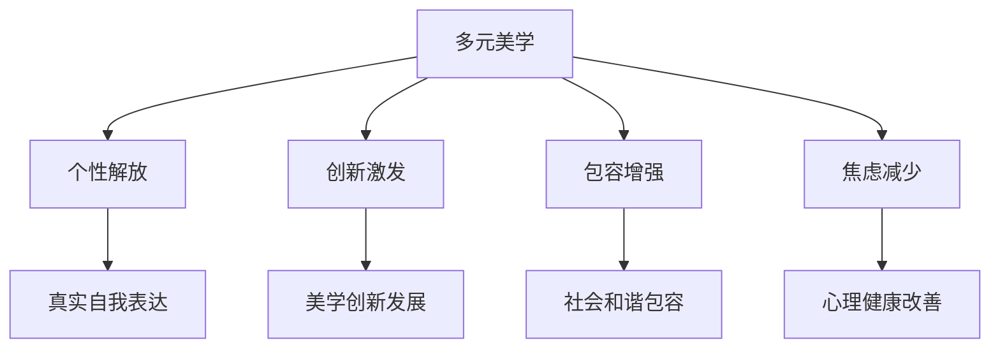
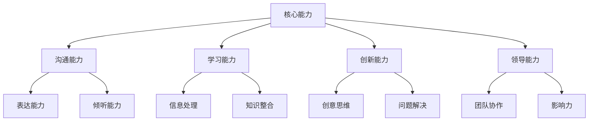
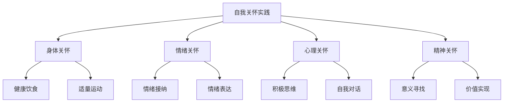

# 第二十二章：拥抱真实的自己 - 构建内在的自信

## 💖 引言

在经历了前面章节的深度分析和自我检视后，我们来到了最重要的一章：如何真正地拥抱和爱护自己。真正的美丽和自信不是来自外在的改变，而是来自内心的和谐与接纳。本章将帮助你构建持久的内在自信，发现属于自己的独特美丽。

## 🌈 15.1 美丽是多元的：欣赏不同类型的美，打破单一标准

### 美丽标准的历史变迁

#### 不同时代的美丽标准
- **古典时期**：强调自然和谐的美
- **工业时代**：追求标准化的美
- **现代社会**：多元化美的兴起
- **数字时代**：虚拟与现实的交融

#### 文化差异中的美
- **东方美学**：含蓄、内敛、和谐
- **西方美学**：张扬、个性、自信
- **非洲美学**：力量、生命力、自然
- **拉美美学**：热情、曲线、活力

### 多元美学的价值

### 欣赏美的多样性

#### 发现不同类型的美
- **自然美**：未经修饰的自然状态
- **个性美**：独特个性的外在表达
- **智慧美**：知识和智慧的魅力
- **善良美**：内在品格的外在体现
- **创造美**：创造力和才华的展现

#### 培养多元审美能力
- **开放心态**：对不同美的形式保持开放
- **文化学习**：学习不同文化的美学观念
- **艺术欣赏**：通过艺术培养审美能力
- **生活观察**：在日常生活中发现美

### 打破单一标准的束缚

#### 单一标准的危害
- **个性压抑**：压抑个人特色和独特性
- **焦虑增加**：增加外貌焦虑和不满
- **创新阻碍**：阻碍美学创新和发展
- **社会分化**：加剧社会的美丑分化

#### 解构单一标准
- **质疑权威**：质疑所谓的"权威"标准
- **寻找多样性**：主动寻找美的多样性
- **个人定义**：建立个人的美丽定义
- **价值重构**：重构美的价值体系

### 建立个人美学观

#### 个人美学的特征
- **独特性**：体现个人的独特特质
- **一致性**：与个人价值观一致
- **发展性**：随着成长而发展变化
- **包容性**：包容不同的美的表达

#### 个人美学的构建
- **自我探索**：深入了解自己的特质
- **价值澄清**：明确自己的价值观
- **风格实验**：尝试不同的表达方式
- **持续调整**：根据成长持续调整

!!! tip "培养多元审美的实践"
    1. **每天发现一种美**：在日常生活中发现不同类型的美
    2. **接触不同文化**：了解不同文化的美学观念
    3. **欣赏艺术作品**：通过艺术作品拓展审美视野
    4. **记录美的瞬间**：记录生活中美的瞬间和感受
    5. **与他人分享**：与他人分享对美的不同理解

## 💎 15.2 投资内在：培养爱好、提升能力、建立健康的社交关系

### 医美的"精要主义"：更少，但更好

在探讨内在投资之前，让我们先理解一个重要的理念——"精要主义"。正如李滨在《医美的"精要主义"》一文中深入分析的：

!!! quote "李滨观点"
    "《精要主义》这本书说的是一种思维模式，帮助人们摆脱无意义的多数，专注有意义的少数，成就有意义、有目的的人生。这种思维模式对医美业具有指导价值，它倡导的价值观，正是医美业极端缺乏的。精要主义追求的是'更少，但更好'，这难道不是医美的精髓吗？"
    
    "对于医美人而言，让就医者把手里的金钱和时间以及身体的代价，用在最有价值的项目上，就是医美精要主义。"
    
    —— 摘自《医美的"精要主义"》，[原文链接](https://mp.weixin.qq.com/s/u4jNA-CrCtUjHI6LX3MAOw?scene=1)

#### 精要主义的核心理念

  

    
1

    

      <h3>探索和评估</h3>
      
精要主义者在专注解决某件事之前，会先广泛地探索和评估各种选项，然后做出最接近正确的选择。就像医生或咨询师在长时间的研讨之后拿出的医美方案。

    

  

  

    
2

    

      <h3>专注有意义的少数</h3>
      
摆脱无意义的多数，专注有意义的少数。在医美选择中，这意味着选择真正有价值、有必要的项目，而不是盲目追求数量。

    

  

  

    
3

    

      <h3>价值最大化</h3>
      
让金钱、时间以及身体的代价，用在最有价值的项目上。这不仅是对消费者的要求，也是对医生、咨询师的要求。

    

  

#### 医美精要主义的实践原则

!!! info "精要主义在医美中的应用"
    **避免非精要主义的陷阱：**
    - 价格战的盲目参与
    - 迎合就医者喜好而不顾效果
    - 盲目追求所谓的医美时尚
    - 成为同质化的医美手艺人
    - 陷入"决定疲劳"的状态
    
    **精要主义的医美选择：**
    - 关注医生的品牌和技术，而非产品或价格
    - 选择真正适合自己的项目
    - 追求质量而非数量
    - 基于长期价值而非短期效果

#### 从精要主义角度重新审视医美消费

  

    

      
❌

      <h4 class="comparison-title">非精要主义的医美</h4>
    

    <ul>
      <li>盲目跟风，什么流行做什么</li>
      <li>贪多求全，恨不得一次性解决所有问题</li>
      <li>价格导向，只选便宜的</li>
      <li>短期思维，只看眼前效果</li>
    </ul>
  

  

    

      
✅

      <h4 class="comparison-title">精要主义的医美</h4>
    

    <ul>
      <li>理性选择，只做真正需要的</li>
      <li>专注重点，解决最核心的问题</li>
      <li>价值导向，选择最有价值的</li>
      <li>长远考虑，追求持久的改善</li>
    </ul>
  

!!! tip "精要主义的医美决策框架"
    在做医美决策时，问自己这些问题：
    1. 这个项目真的是我最需要的吗？
    2. 它能解决我最核心的问题吗？
    3. 投入产出比是否合理？
    4. 是否有更简单有效的替代方案？
    5. 这个选择符合我的长期目标吗？

### 内在投资的重要性

#### 内在vs外在投资
- **外在投资**：短期的、表面的、易变的
- **内在投资**：长期的、深层的、持久的
- **投资回报**：内在投资的回报更持久和全面
- **风险对比**：内在投资的风险更低

#### 内在美的构成要素
- **知识修养**：丰富的知识和文化修养
- **品格品质**：良好的品格和道德品质
- **能力技能**：各种能力和技能的掌握
- **情感智慧**：情感管理和人际交往能力

### 培养兴趣爱好

#### 兴趣爱好的价值
- **自我实现**：通过爱好实现自我价值
- **压力释放**：缓解生活和工作压力
- **社交拓展**：通过爱好结识志同道合的朋友
- **技能发展**：发展新的技能和能力

#### 选择适合的爱好

  

    

      
🎨

      <h3 class="category-title">创造性爱好</h3>
    

    

      <ul>
        <li>绘画、摄影、写作</li>
        <li>音乐、舞蹈、戏剧</li>
        <li>手工制作、设计</li>
        <li>烹饪、园艺</li>
      </ul>
    

  

  
  

    

      
🏃

      <h3 class="category-title">运动健身</h3>
    

    

      <ul>
        <li>瑜伽、普拉提</li>
        <li>跑步、游泳</li>
        <li>球类运动</li>
        <li>户外探险</li>
      </ul>
    

  

  
  

    

      
📚

      <h3 class="category-title">学习成长</h3>
    

    

      <ul>
        <li>语言学习</li>
        <li>专业技能</li>
        <li>读书学习</li>
        <li>在线课程</li>
      </ul>
    

  

### 能力提升策略

#### 核心能力发展

#### 能力提升的方法
- **刻意练习**：有目标、有反馈的练习
- **学习新知**：持续学习新的知识和技能
- **实践应用**：在实际工作和生活中应用
- **反思总结**：定期反思和总结经验

### 建立健康的社交关系

#### 社交关系的重要性
- **情感支持**：提供情感上的支持和安慰
- **信息交流**：获得有价值的信息和建议
- **成长促进**：促进个人成长和发展
- **生活丰富**：丰富生活体验和乐趣

#### 健康社交关系的特征
- **相互尊重**：彼此尊重和理解
- **真诚沟通**：开放、诚实的沟通
- **互相支持**：在困难时相互支持
- **共同成长**：一起学习和成长

#### 社交关系的建立和维护
- **主动出击**：主动参与社交活动
- **真诚待人**：以真诚的态度对待他人
- **倾听理解**：学会倾听和理解他人
- **持续维护**：持续维护和深化关系

### 内在投资的实践计划

#### 短期计划（1-3个月）
- **选择一个新爱好**：开始培养一个新的兴趣爱好
- **学习一项技能**：学习一项实用的技能
- **扩展社交圈**：认识一些新朋友
- **建立学习习惯**：建立定期学习的习惯

#### 中期计划（3-12个月）
- **深化爱好发展**：在选择的爱好上有所成就
- **能力显著提升**：在某个领域能力显著提升
- **建立深度关系**：建立几个深度的友谊关系
- **形成个人风格**：形成独特的个人风格

#### 长期计划（1-3年）
- **成为某领域专家**：在某个领域成为小专家
- **建立影响力**：在某个圈子里建立影响力
- **拥有稳定社交网络**：拥有稳定的社交支持网络
- **实现自我价值**：通过内在发展实现自我价值

!!! example "内在投资成功案例"
    小李原本因为外貌不自信，后来她开始学习摄影，逐渐发现了生活中的美。通过摄影，她不仅提升了审美能力，还结识了很多志同道合的朋友。现在的她虽然外表没有太大改变，但整个人散发着自信的光芒。

## 🧘 15.3 正念与自我关怀：学会与自己的身体对话，感谢它的服务而非苛责它的不完美

### 正念的概念和价值

#### 正念的定义
- **当下觉察**：专注于当下的体验
- **非评判态度**：不对体验进行好坏评判
- **接纳态度**：接纳当下的一切体验
- **观察者视角**：以观察者的角度看待自己

#### 正念对身体意象的影响
- **减少自我批判**：减少对身体的苛刻批判
- **增强身体觉察**：增强对身体感受的觉察
- **提升接纳能力**：提升对身体的接纳能力
- **改善情绪状态**：改善与身体相关的情绪

### 身体正念练习

#### 身体扫描练习
1. **准备阶段**：找一个安静舒适的地方躺下
2. **呼吸调节**：进行几次深呼吸，放松身心
3. **逐步扫描**：从头到脚逐步感受身体各部位
4. **接纳感受**：接纳身体的各种感受，不做评判
5. **感恩结束**：以感恩的心态结束练习

#### 正念进食练习
- **慢慢品味**：慢慢品味食物的味道和质感
- **感受身体**：感受身体对食物的反应
- **感恩食物**：感恩食物对身体的滋养
- **觉察情绪**：觉察进食时的情绪变化

### 自我关怀的实践

#### 自我关怀的三个要素
- **自我善待**：像对待好朋友一样对待自己
- **共同人性**：认识到痛苦是人类共同的体验
- **正念觉察**：以正念的态度觉察自己的体验

#### 自我关怀的具体实践

### 与身体对话的艺术

#### 感恩身体的服务
- **感恩双眼**：感恩眼睛让我们看到世界的美丽
- **感恩双手**：感恩双手让我们创造和拥抱
- **感恩双脚**：感恩双脚带我们走过人生路
- **感恩心脏**：感恩心脏不停地为我们跳动

#### 与身体的温柔对话
- **理解身体**：理解身体的需求和信号
- **尊重身体**：尊重身体的节奏和限制
- **照顾身体**：给身体需要的营养和休息
- **赞美身体**：赞美身体的功能和服务

#### 改变内在对话
- **从批判到接纳**：将批判的声音转为接纳的声音
- **从完美到真实**：从追求完美转向拥抱真实
- **从比较到独特**：从与他人比较转向欣赏独特
- **从缺陷到完整**：从关注缺陷转向看到完整

### 建立身体积极性

#### 身体积极性的特征
- **功能导向**：关注身体的功能而非外表
- **多样性接纳**：接纳身体的多样性
- **健康优先**：优先考虑身体健康
- **整体视角**：从整体角度看待身体

#### 培养身体积极性的方法
- **功能感恩**：感恩身体的各种功能
- **健康行为**：采取有益健康的行为
- **积极语言**：使用积极的语言描述身体
- **多元欣赏**：欣赏不同类型的身体美

!!! practice "正念自我关怀练习"
    **每日身体感恩练习**：
    1. 每天早晨醒来时，花5分钟感恩身体
    2. 从头到脚，感谢身体各部位的服务
    3. 用温和的语言与身体对话
    4. 承诺今天要好好照顾身体
    
    **自我关怀短语**：
    - "我的身体正在尽力为我服务"
    - "我值得被温柔对待，包括被自己"
    - "不完美是人类的共同体验"
    - "我选择用爱而非批判对待自己"

## 🌟 15.4 构建持久的内在自信

### 内在自信的本质

#### 内在自信vs外在自信
- **内在自信**：基于自我价值和内在品质
- **外在自信**：基于外表和他人评价
- **稳定性**：内在自信更稳定持久
- **独立性**：内在自信不依赖外在条件

#### 内在自信的来源
- **自我接纳**：接纳真实的自己
- **价值认知**：认识到自己的价值
- **能力确信**：对自己能力的确信
- **成长心态**：相信自己能够成长

### 自信建设的系统方法

#### 认知层面的建设
- **挑战负面思维**：识别和挑战负面的自我对话
- **建立积极信念**：建立关于自己的积极信念
- **现实检验**：用事实检验自己的想法
- **成长视角**：从成长的角度看待挫折

#### 情感层面的建设
- **情绪接纳**：接纳自己的各种情绪
- **情绪调节**：学会调节负面情绪
- **积极情绪培养**：培养积极的情绪体验
- **情感表达**：学会健康地表达情感

#### 行为层面的建设
- **设定目标**：设定可实现的目标
- **积累成功**：通过小成功积累自信
- **技能发展**：发展各种技能和能力
- **挑战舒适区**：适度挑战自己的舒适区

### 自信的日常实践

#### 每日自信练习
- **晨间肯定**：每天早晨进行自我肯定
- **成就记录**：记录每天的小成就
- **感恩练习**：感恩自己的努力和进步
- **晚间反思**：反思一天的成长和学习

#### 自信挑战练习
- **舒适区扩展**：每周做一件让自己不舒服的事
- **新技能学习**：定期学习新的技能
- **社交挑战**：主动参与社交活动
- **表达练习**：练习表达自己的观点和感受

### 维护和发展自信

#### 自信的维护
- **定期自我评估**：定期评估自己的成长
- **调整期望**：根据实际情况调整期望
- **寻求支持**：在需要时寻求支持
- **庆祝进步**：庆祝自己的每一个进步

#### 自信的发展
- **持续学习**：保持学习和成长的心态
- **经验积累**：通过各种经验积累自信
- **影响他人**：通过帮助他人增强自信
- **价值实现**：通过实现价值增强自信

!!! tip "构建内在自信的关键"
    1. **从小事开始**：从小的成功开始建立自信
    2. **关注过程**：关注努力的过程而非结果
    3. **接纳不完美**：接纳自己的不完美
    4. **持续练习**：自信需要持续的练习和强化
    5. **寻求支持**：在需要时寻求专业支持

## 💫 15.5 真实自我的力量

### 真实性的价值

#### 真实vs虚假
- **真实**：与内在价值观一致的表达
- **虚假**：为了迎合他人而伪装自己
- **能量消耗**：虚假需要消耗大量心理能量
- **关系质量**：真实能建立更深层的关系

#### 真实性的好处
- **内心和谐**：内在与外在的一致性
- **关系深度**：建立更深层的人际关系
- **创造力释放**：释放创造力和潜能
- **生活满意度**：提高整体生活满意度

### 发现真实的自己

#### 自我探索的方法
- **价值观澄清**：明确自己的核心价值观
- **兴趣发现**：发现真正感兴趣的事物
- **优势识别**：识别自己的天赋和优势
- **使命寻找**：寻找自己的人生使命

#### 自我接纳的过程
- **承认现实**：承认自己的真实状况
- **接纳不完美**：接纳自己的不完美
- **拥抱独特**：拥抱自己的独特之处
- **持续成长**：在接纳的基础上持续成长

### 真实表达的勇气

#### 克服表达障碍
- **恐惧识别**：识别阻碍真实表达的恐惧
- **风险评估**：理性评估真实表达的风险
- **支持寻找**：寻找支持真实表达的环境
- **渐进练习**：逐步练习真实表达

#### 真实表达的技巧
- **诚实沟通**：诚实地表达自己的想法和感受
- **边界设定**：设定健康的人际边界
- **价值坚持**：坚持自己的核心价值观
- **灵活适应**：在坚持真实的同时灵活适应

### 真实美丽的绽放

#### 内在美的外化
- **自然表达**：让内在美自然地表达出来
- **个性风格**：发展符合自己个性的风格
- **魅力散发**：让真实的魅力自然散发
- **影响他人**：用真实的美丽影响他人

#### 美丽的重新定义
- **多元标准**：建立多元化的美丽标准
- **内在优先**：优先考虑内在美
- **个性彰显**：彰显个人独特的美
- **和谐统一**：追求内外的和谐统一

## 💬 本章反思

!!! question "深度思考"
    1. 你对美的理解是否过于单一？如何培养更多元的审美观？
    
    2. 你在内在投资方面做得如何？有哪些方面需要加强？
    
    3. 你与自己身体的关系如何？是否经常批判自己的身体？
    
    4. 你的自信主要来自内在还是外在？如何构建更稳定的内在自信？
    
    5. 你是否敢于做真实的自己？什么阻碍了你的真实表达？

## 🎯 本章总结

### 核心要点回顾

  

    <h4>🌈 多元美学</h4>
    
美丽是多元的，每个人都有自己独特的美，不要被单一标准束缚

  

  

    <h4>💎 内在投资</h4>
    
投资内在比投资外在更重要，培养爱好、提升能力、建立关系

  

  

    <h4>🧘 正念关怀</h4>
    
学会正念地对待自己的身体，用关怀而非批判的态度

  

  

    <h4>🌟 内在自信</h4>
    
构建基于内在价值的自信，这种自信更稳定持久

  

  

    <h4>💫 真实力量</h4>
    
做真实的自己，真实性是最大的魅力和力量源泉

  

### 实践行动计划

#### 立即行动（今天开始）
- [ ] 每天进行5分钟的身体感恩练习
- [ ] 记录一天中发现的不同类型的美
- [ ] 用积极的语言与自己对话
- [ ] 选择一个想要培养的兴趣爱好

#### 短期目标（1个月内）
- [ ] 建立正念练习的习惯
- [ ] 开始学习一项新技能
- [ ] 主动结识一些新朋友
- [ ] 完成一次自我价值观澄清

#### 中期目标（3-6个月）
- [ ] 在选择的爱好上有所成就
- [ ] 建立几个深度的友谊关系
- [ ] 显著提升某项能力
- [ ] 形成稳定的自我关怀习惯

#### 长期目标（1年以上）
- [ ] 成为某个领域的小专家
- [ ] 拥有稳定的社交支持网络
- [ ] 建立持久的内在自信
- [ ] 成为真实而有魅力的自己

## ➡️ 全书总结

恭喜你完成了这场医美消费心理学的深度探索之旅！从理解美丽渴望的心理根源，到学会理性决策，再到构建内在自信，你已经具备了做出明智选择的知识和工具。

在结语中，我们将总结全书的核心观点，并为你的未来之路提供最后的指导。

---

*"真正的美丽不在于外表的完美，而在于内心的和谐与真实。拥抱真实的自己，你就拥有了最大的魅力。"*