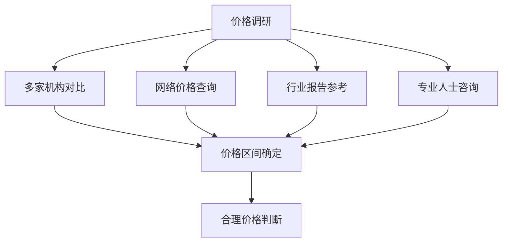
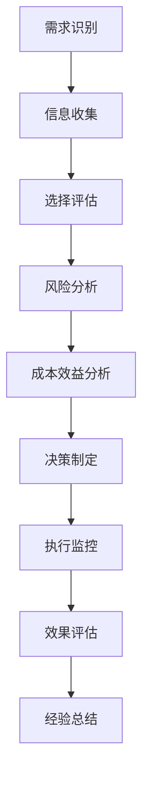

# 第二十三章：理性消费的智慧 - 避开医美消费陷阱

## 🧠 引言

在医美消费的过程中，消费者往往面临各种各样的陷阱和误区。这些陷阱不仅可能导致经济损失，更可能带来身体和心理的伤害。本章将深入分析常见的医美消费陷阱，并提供理性消费的策略和方法，帮助读者成为明智的医美消费者。

## 🕳️ 常见医美消费陷阱分析

### 价格陷阱

#### 低价诱饵策略
- **超低价吸引**：用超低价格吸引消费者
- **隐性收费**：在治疗过程中增加各种费用
- **质量缩水**：降低材料和服务质量
- **后续绑定**：通过低价绑定后续高价服务

#### 高价误导策略
- **价格等于质量**：误导消费者认为高价等于高质量
- **奢华包装**：通过奢华环境包装提高价格
- **稀缺性营销**：制造稀缺感提高价格
- **权威背书**：利用权威背书提高价格

### 营销陷阱

#### 情感操控技巧
- **焦虑制造**：制造外貌焦虑和年龄焦虑
- **完美幻象**：展示不现实的完美效果
- **社会压力**：利用社会比较制造压力
- **时间紧迫**：制造时间紧迫感

#### 信息不对称利用
- **专业术语**：使用复杂术语混淆消费者
- **选择性展示**：只展示成功案例
- **风险淡化**：淡化或隐瞒风险信息
- **效果夸大**：夸大治疗效果

### 技术陷阱

#### 新技术炒作
- **概念包装**：用新概念包装传统技术
- **效果夸大**：夸大新技术的效果
- **风险隐瞒**：隐瞒新技术的风险
- **价格虚高**：利用新技术抬高价格

#### 技术混淆
- **技术替代**：用低成本技术替代高成本技术
- **设备造假**：使用假冒或劣质设备
- **操作简化**：简化复杂的操作流程
- **标准降低**：降低技术操作标准

## 🎯 识别消费陷阱的方法

### 价格分析技巧

#### 市场价格调研

#### 成本构成分析
- **材料成本**：了解材料的真实成本
- **人工成本**：了解医生和护理的成本
- **设备成本**：了解设备使用的成本
- **运营成本**：了解机构运营的成本

### 营销话术识别

#### 常见话术模式
- **恐惧诉求**："再不做就来不及了"
- **从众压力**："很多人都在做"
- **权威背书**："某某明星也在做"
- **稀缺营销**："仅限今天"、"最后几个名额"

#### 话术背后的动机
- **销售压力**：完成销售任务的压力
- **利润驱动**：追求高利润的动机
- **竞争需要**：市场竞争的需要
- **客户获取**：获取新客户的需要

### 技术真实性验证

#### 技术成熟度评估
- **发展历史**：技术的发展历史和时间
- **临床数据**：临床试验和应用数据
- **同行认可**：行业内的认可程度
- **监管批准**：相关部门的批准情况

#### 设备和材料验证
- **品牌认证**：设备和材料的品牌认证
- **进口许可**：进口产品的许可证明
- **质量标准**：符合的质量标准
- **使用记录**：设备的使用和维护记录

## 💡 理性消费策略

### 信息收集策略

#### 多渠道信息收集
- **官方渠道**：从官方渠道获取权威信息
- **专业媒体**：关注专业医美媒体报道
- **学术文献**：查阅相关学术研究文献
- **用户反馈**：收集真实用户的反馈

#### 信息验证方法
- **交叉验证**：用多种方法验证同一信息
- **时效检查**：确保信息的时效性
- **来源追溯**：追溯信息的原始来源
- **专业咨询**：请专业人士帮助验证

### 决策框架应用

#### 理性决策模型

#### 决策标准设定
- **必要性标准**：是否真的有必要
- **安全性标准**：是否足够安全
- **有效性标准**：是否真的有效
- **经济性标准**：是否经济合理

### 风险管理策略

#### 风险识别和评估
- **技术风险**：技术失败的风险
- **经济风险**：经济损失的风险
- **健康风险**：健康受损的风险
- **心理风险**：心理创伤的风险

#### 风险控制措施
- **选择控制**：选择低风险的项目和机构
- **过程控制**：在过程中控制风险
- **保险保障**：购买相关保险保障
- **应急预案**：准备风险应急预案

## 🛡️ 消费者权益保护

### 法律权益了解

#### 基本权利
- **知情权**：了解服务内容和风险的权利
- **选择权**：自由选择服务的权利
- **安全权**：获得安全服务的权利
- **求偿权**：受到损害时的求偿权利

#### 法律保护途径
- **消费者权益保护法**：基本的消费者保护法律
- **医疗事故处理条例**：医疗事故的处理规定
- **广告法**：虚假广告的法律责任
- **合同法**：合同纠纷的处理规定

### 维权策略和方法

#### 预防性维权
- **合同审查**：仔细审查服务合同
- **证据保存**：保存相关证据材料
- **权利告知**：要求明确告知权利义务
- **风险告知**：要求充分告知风险

#### 事后维权
- **协商解决**：首先尝试协商解决
- **投诉举报**：向相关部门投诉举报
- **调解仲裁**：通过调解仲裁解决
- **诉讼维权**：通过法律诉讼维权

## 📊 理性消费评估工具

### 消费决策评估表

#### 项目评估维度
| 评估维度 | 权重 | 评分(1-10) | 加权得分 | 备注 |
|----------|------|-----------|----------|------|
| 必要性 | 25% |  |  |  |
| 安全性 | 25% |  |  |  |
| 有效性 | 20% |  |  |  |
| 经济性 | 15% |  |  |  |
| 时机性 | 10% |  |  |  |
| 可逆性 | 5% |  |  |  |
| **总分** | **100%** |  | **___** |  |

#### 评分标准
- **8-10分**：非常好，强烈推荐
- **6-7分**：较好，可以考虑
- **4-5分**：一般，需要慎重
- **1-3分**：较差，不建议进行

### 机构选择评估表

#### 机构评估维度
| 评估维度 | 重要性 | 机构A | 机构B | 机构C | 最佳选择 |
|----------|--------|-------|-------|-------|----------|
| 资质认证 | ★★★★★ |  |  |  |  |
| 医生水平 | ★★★★★ |  |  |  |  |
| 设备技术 | ★★★★☆ |  |  |  |  |
| 服务质量 | ★★★★☆ |  |  |  |  |
| 价格合理 | ★★★☆☆ |  |  |  |  |
| 地理位置 | ★★☆☆☆ |  |  |  |  |

### 风险承受能力评估

#### 风险承受力测试
1. **经济风险承受力**：如果项目失败，我能承受的经济损失是多少？
2. **健康风险承受力**：我能接受的健康风险程度是什么？
3. **心理风险承受力**：如果效果不理想，我的心理承受能力如何？
4. **社会风险承受力**：我能承受的社会压力和议论程度如何？

## 🎓 培养理性消费习惯

### 消费心理调节

#### 冲动控制技巧
- **延迟满足**：学会延迟满足的能力
- **冷静思考**：在冲动时强制冷静思考
- **成本意识**：时刻保持成本意识
- **长远考虑**：从长远角度考虑决策

#### 价值观澄清
- **核心价值**：明确自己的核心价值观
- **优先排序**：对价值进行优先排序
- **一致性检查**：检查决策与价值观的一致性
- **价值坚持**：在压力下坚持价值观

### 消费能力建设

#### 信息素养提升
- **信息识别**：提升识别真假信息的能力
- **批判思维**：培养批判性思维能力
- **逻辑分析**：提升逻辑分析能力
- **证据评估**：学会评估证据的能力

#### 决策技能培养
- **系统思考**：培养系统性思考能力
- **风险评估**：提升风险评估能力
- **选择比较**：学会科学比较选择
- **决策执行**：提升决策执行能力

## 🌟 成功案例分析

### 理性消费成功案例

#### 案例一：小李的双眼皮手术决策
**背景**：小李想做双眼皮手术，但没有冲动决策

**理性消费过程**：
1. **需求分析**：深入分析自己的真实需求
2. **信息收集**：花费2个月收集相关信息
3. **多方咨询**：咨询了5位不同的医生
4. **风险评估**：全面评估各种风险
5. **机构比较**：比较了3家不同的机构
6. **冷静期设定**：给自己设定了1个月的冷静期

**结果**：最终选择了最适合的医生和机构，手术效果满意，没有出现并发症

#### 案例二：小王避开低价陷阱
**背景**：小王想做激光祛斑，遇到超低价诱惑

**理性分析过程**：
1. **价格调研**：调研了市场平均价格
2. **成本分析**：分析了治疗的成本构成
3. **机构调查**：深入调查了低价机构的背景
4. **风险识别**：识别了低价背后的风险

**结果**：避开了低价陷阱，选择了价格合理、质量可靠的机构

### 失败案例警示

#### 案例一：小张的冲动消费教训
**背景**：小张在朋友的影响下冲动做了隆鼻手术

**问题分析**：
- 没有充分了解自己的需求
- 被朋友的成功案例误导
- 没有充分调研机构和医生
- 对风险认识不足

**结果**：手术效果不理想，花费了更多费用进行修复

#### 案例二：小陈的营销陷阱经历
**背景**：小陈被营销话术说服，做了不必要的项目

**问题分析**：
- 被恐惧营销影响
- 没有独立思考能力
- 过度相信销售人员
- 缺乏专业知识

**结果**：不仅浪费了金钱，还对身体造成了不必要的创伤

## 💬 本章反思

!!! question "深度思考"
    1. 你是否曾经遇到过本章提到的消费陷阱？你是如何应对的？
    
    2. 你认为自己的理性消费能力如何？在哪些方面需要提升？
    
    3. 面对营销压力时，你有哪些有效的应对策略？
    
    4. 你如何平衡理性分析与直觉判断？

## ➡️ 下一章预告

在掌握了理性消费的智慧后，下一章我们将探讨美丽的多元定义，帮助读者重新定义个人美学，建立更加健康和多元的美丽观念。

---

*"理性消费不是拒绝美丽，而是用智慧追求真正适合自己的美丽。"*