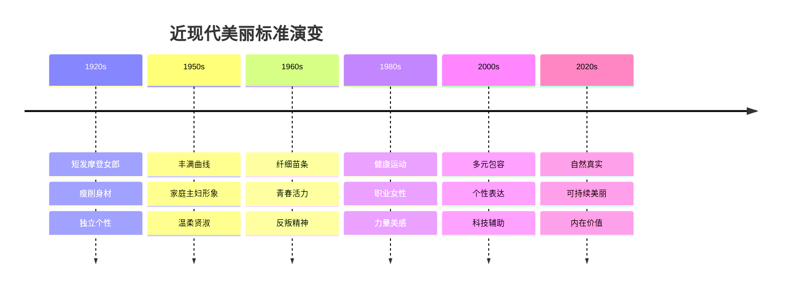
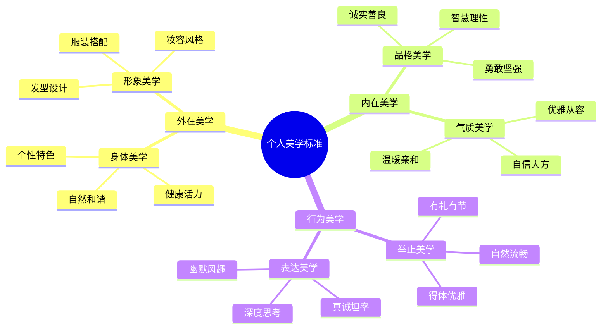

# 第二十四章：美丽的多元定义 - 重新定义个人美学

## 🌈 引言

在经历了前面章节对医美消费心理的深入分析后，我们需要回到一个根本问题：什么是美丽？美丽是否只有一种标准？本章将探讨美丽的多元定义，帮助读者重新审视和定义个人美学，建立更加健康、包容和个性化的美丽观念。

## 🎨 美丽标准的历史演变

### 不同时代的美丽标准

#### 古代美学观念
- **古希腊**：黄金比例、对称美、自然和谐
- **古中国**：温婉含蓄、内在修养、气质美
- **古埃及**：神秘优雅、线条流畅、装饰美
- **古印度**：丰满圆润、色彩丰富、灵性美

#### 近现代美学变迁


### 文化差异中的美丽观念

#### 东西方美学差异
<div class="comparison-table">
  <div class="comparison-item">
    <h4>🏮 东方美学特征</h4>
    <ul>
      <li>🌸 含蓄内敛：追求内在的气质美</li>
      <li>🎋 和谐统一：强调整体的协调美</li>
      <li>🌙 意境深远：注重意境和韵味</li>
      <li>🍃 自然朴素：崇尚自然的美感</li>
    </ul>
  </div>
  <div class="comparison-item">
    <h4>🗽 西方美学特征</h4>
    <ul>
      <li>💎 张扬个性：强调个性的表达</li>
      <li>🎯 精确定义：追求精确的美学标准</li>
      <li>🌟 外在表现：注重外在的视觉效果</li>
      <li>🚀 创新突破：勇于突破传统界限</li>
    </ul>
  </div>
</div>

#### 地域文化的美丽标准
- **北欧**：简约自然、健康活力
- **地中海**：热情奔放、曲线优美
- **非洲**：丰满健壮、色彩鲜艳
- **拉美**：性感魅力、节奏感强

## 🔍 单一美丽标准的问题

### 标准化美丽的负面影响

#### 个体层面的影响
- **自我否定**：不符合标准时的自我否定
- **焦虑抑郁**：因外貌焦虑导致的心理问题
- **身份迷失**：失去个人特色和独特性
- **价值扭曲**：过度重视外表而忽视内在

#### 社会层面的影响
- **审美趋同**：社会审美的单一化趋势
- **歧视偏见**：对不符合标准者的歧视
- **资源浪费**：大量资源投入外表改造
- **文化侵蚀**：本土文化美学的消失

### 媒体和商业的推波助澜

#### 媒体的作用机制
- **形象塑造**：通过媒体塑造理想形象
- **重复强化**：通过重复曝光强化标准
- **情感绑定**：将美丽与成功、幸福绑定
- **恐惧营销**：制造不美丽的恐惧感

#### 商业利益的驱动
- **需求创造**：创造对美丽产品的需求
- **标准操控**：操控美丽标准以获利
- **消费刺激**：刺激持续的美丽消费
- **市场细分**：通过细分市场扩大影响

## 🌟 多元美学的价值

### 多元美学的核心理念

#### 包容性原则
- **差异接纳**：接纳不同的美丽表现
- **个性尊重**：尊重每个人的独特性
- **文化多样**：保护文化美学的多样性
- **时代包容**：包容不同时代的美学观

#### 个性化原则
- **自我定义**：每个人定义自己的美丽
- **内在外在**：平衡内在美与外在美
- **动态发展**：美丽标准的动态发展
- **情境适应**：根据情境调整美丽表达

### 多元美学的表现形式

#### 身体美学的多元化
- **体型多样**：不同体型都有其美感
- **肤色包容**：各种肤色都是美丽的
- **年龄美学**：每个年龄段都有其美
- **能力美学**：身体能力也是美的体现

#### 风格美学的多元化
- **经典优雅**：传统经典的美学风格
- **现代简约**：现代简约的美学表达
- **个性前卫**：前卫个性的美学探索
- **民族特色**：具有民族特色的美学

## 🎯 建立个人美学体系

### 自我美学探索

#### 美学价值观澄清
!!! question "个人美学价值观探索"
    **请思考以下问题：**
    
    1. **什么样的美让我感到舒适和自信？**
    2. **我更看重外在美还是内在美？**
    3. **我希望通过外表传达什么信息？**
    4. **什么样的美学风格最能代表我？**
    5. **我的美学观念受到了哪些影响？**

#### 个人美学元素识别
- **色彩偏好**：喜欢的颜色和色彩搭配
- **线条偏好**：偏爱的线条和形状
- **质感偏好**：喜欢的材质和质感
- **风格偏好**：倾向的整体风格

### 个人美学标准制定

#### 美学标准的维度


#### 美学标准的平衡
- **内外平衡**：平衡内在美与外在美
- **个性共性**：平衡个性表达与社会接受
- **理想现实**：平衡理想追求与现实条件
- **稳定变化**：平衡稳定性与适应性

### 美学实践策略

#### 渐进式美学实践
- **小步尝试**：从小的改变开始尝试
- **反馈调整**：根据反馈调整美学表达
- **持续探索**：持续探索适合的美学风格
- **自信建设**：在实践中建设美学自信

#### 美学表达的技巧
- **整体协调**：注重整体的协调统一
- **重点突出**：突出个人的美学特色
- **情境适应**：根据不同情境调整表达
- **真实自然**：保持真实自然的状态

## 💪 内在美的培养

### 内在美的构成要素

#### 品格美
- **诚实正直**：诚实正直的品格
- **善良仁慈**：善良仁慈的心灵
- **勇敢坚强**：面对困难的勇气
- **谦逊包容**：谦逊包容的态度

#### 智慧美
- **知识丰富**：丰富的知识储备
- **思维敏捷**：敏捷的思维能力
- **判断准确**：准确的判断能力
- **创新思考**：创新的思考方式

#### 情感美
- **情感丰富**：丰富的情感体验
- **情绪稳定**：稳定的情绪管理
- **共情能力**：强大的共情能力
- **爱的能力**：给予和接受爱的能力

### 内在美的培养方法

#### 知识修养的提升
- **广泛阅读**：通过阅读丰富知识
- **深度学习**：深入学习感兴趣的领域
- **文化熏陶**：接受文化艺术的熏陶
- **思辨训练**：训练批判性思维能力

#### 品格修养的培养
- **道德实践**：在实践中培养道德品格
- **自我反思**：定期进行自我反思
- **榜样学习**：向优秀的人学习
- **服务他人**：通过服务他人提升品格

#### 情感修养的发展
- **情感表达**：学会健康地表达情感
- **情绪管理**：提升情绪管理能力
- **人际交往**：在交往中发展情感能力
- **艺术欣赏**：通过艺术培养情感美

## 🌍 美丽的社会责任

### 推广多元美学

#### 个人层面的责任
- **自我接纳**：接纳自己的独特美丽
- **他人尊重**：尊重他人的美丽选择
- **标准质疑**：质疑单一的美丽标准
- **多元倡导**：倡导美丽的多元化

#### 社会层面的责任
- **教育推广**：推广多元美学教育
- **媒体监督**：监督媒体的美丽表达
- **政策倡导**：倡导包容性的政策
- **文化保护**：保护多元的美学文化

### 可持续美丽观念

#### 环境友好的美丽
- **天然产品**：选择天然环保的美丽产品
- **减少浪费**：减少美丽消费的浪费
- **循环利用**：提倡美丽产品的循环利用
- **绿色生活**：践行绿色的美丽生活方式

#### 社会责任的美丽
- **公平贸易**：支持公平贸易的美丽产品
- **社会公益**：参与美丽相关的社会公益
- **弱势关怀**：关怀美丽弱势群体
- **文化传承**：传承优秀的美学文化

## 🎨 美学实践工具

### 个人美学档案

#### 美学自我画像
```
我的美学关键词：
1. _____________
2. _____________
3. _____________
4. _____________
5. _____________

我的美学风格：
□ 经典优雅  □ 现代简约  □ 浪漫甜美  □ 个性前卫
□ 自然清新  □ 成熟知性  □ 活力运动  □ 民族风情

我的美学价值观：
最重要的美学价值：_____________
最不能接受的美学观念：_____________
我希望通过美学表达：_____________
```

#### 美学发展计划
- **短期目标**（1-3个月）：_____________
- **中期目标**（3-12个月）：_____________
- **长期目标**（1-3年）：_____________
- **实现策略**：_____________

### 美学评估工具

#### 美学满意度评估
| 维度 | 当前状态(1-10) | 理想状态(1-10) | 差距 | 改进计划 |
|------|----------------|----------------|------|----------|
| 外在形象 |  |  |  |  |
| 内在修养 |  |  |  |  |
| 气质风度 |  |  |  |  |
| 个性表达 |  |  |  |  |
| 社会认同 |  |  |  |  |

#### 美学成长追踪
- **本月美学收获**：_____________
- **遇到的挑战**：_____________
- **下月改进重点**：_____________
- **需要的支持**：_____________

## 🌈 美丽的未来展望

### 技术与美学的融合

#### 数字化美学
- **虚拟试妆**：通过AR技术虚拟试妆
- **个性化定制**：基于数据的个性化美学方案
- **智能推荐**：AI驱动的美学风格推荐
- **数字美学**：数字世界中的美学表达

#### 生物技术与美学
- **基因美学**：基于基因的个性化美学
- **再生美学**：利用再生技术的美学应用
- **精准美学**：精准医学在美学中的应用
- **生物美学**：生物技术与美学的结合

### 社会美学的发展

#### 包容性美学社会
- **多元接纳**：社会对多元美学的接纳
- **平等机会**：每个人都有美丽的平等机会
- **文化融合**：不同文化美学的融合发展
- **代际传承**：美学文化的代际传承

#### 可持续美学发展
- **环保美学**：环保理念融入美学实践
- **循环美学**：美学资源的循环利用
- **共享美学**：美学资源的共享模式
- **责任美学**：承担社会责任的美学观

## 💬 本章反思

!!! question "深度思考"
    1. 你的个人美学观念是如何形成的？受到了哪些因素的影响？
    
    2. 你认为什么样的美丽标准是健康和可持续的？
    
    3. 你如何平衡个人美学表达与社会期望？
    
    4. 你愿意为推广多元美学做出哪些努力？

## ➡️ 下一章预告

在重新定义了个人美学后，最后一章我们将探讨持续成长的美丽之路，提供终身美丽管理的策略和方法，帮助读者实现可持续的美丽成长。

---

*"真正的美丽不在于符合标准，而在于展现独特的自己。"*