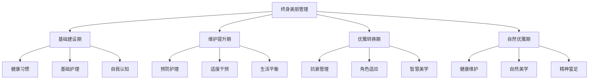
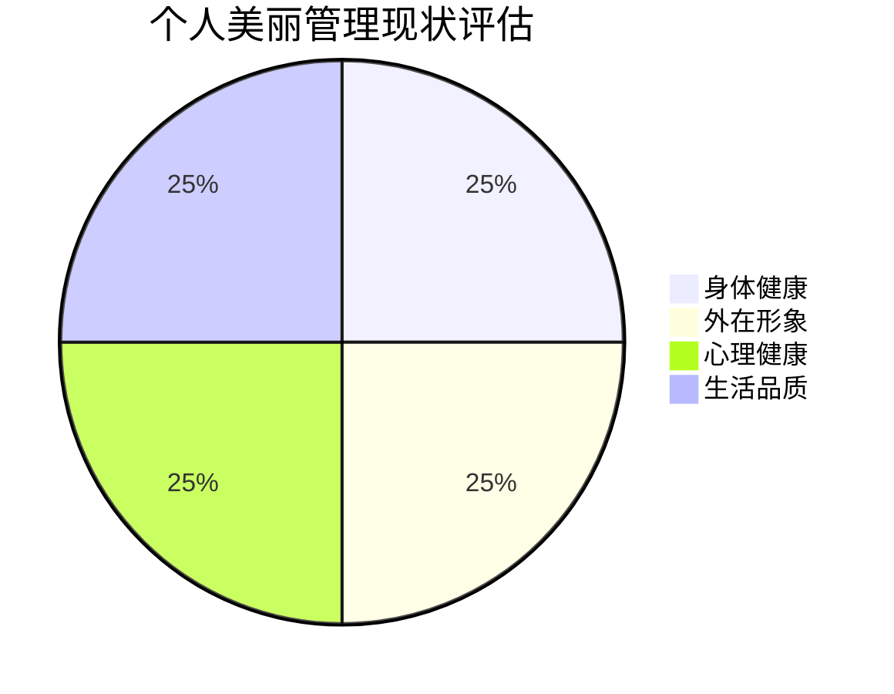

# 第二十五章：持续成长的美丽之路 - 终身美丽管理

## 🌱 引言

美丽不是一个终点，而是一个持续的旅程。真正的美丽管理不仅仅是外表的维护，更是一个涵盖身心健康、个人成长、生活品质的全方位系统。本章将为读者提供终身美丽管理的策略和方法，帮助大家在人生的不同阶段都能保持最佳的状态。

## 🔄 美丽的生命周期管理

### 不同人生阶段的美丽重点

#### 青年期（18-30岁）：建立基础
- **健康习惯养成**：建立良好的生活习惯
- **基础护理**：学会正确的护理方法
- **自我认知**：建立健康的自我认知
- **价值观形成**：形成正确的美丽价值观

#### 成年期（30-45岁）：维护与提升
- **预防性护理**：开始预防性的护理措施
- **生活平衡**：平衡工作、家庭与自我护理
- **适度干预**：根据需要进行适度的医美干预
- **内在修养**：注重内在修养的提升

#### 中年期（45-60岁）：优雅转换
- **抗衰老管理**：科学的抗衰老管理
- **角色适应**：适应人生角色的变化
- **智慧美学**：发展成熟的美学观念
- **健康优先**：将健康放在首位

#### 老年期（60岁以上）：自然优雅
- **健康维护**：重点维护身体健康
- **自然美学**：接受自然的衰老过程
- **精神富足**：追求精神层面的富足
- **传承智慧**：传承美丽的智慧和经验

### 生命周期美丽管理策略



## 🏗️ 构建个人美丽管理系统

### 美丽管理的四大支柱

#### 第一支柱：身体健康管理
- **营养管理**：科学合理的营养搭配
- **运动健身**：适合的运动和健身计划
- **睡眠管理**：优质的睡眠质量保证
- **疾病预防**：积极的疾病预防措施

#### 第二支柱：外在形象管理
- **护肤管理**：系统的护肤管理方案
- **形象设计**：适合的形象设计和搭配
- **医美规划**：科学的医美项目规划
- **形象维护**：日常的形象维护习惯

#### 第三支柱：心理健康管理
- **情绪管理**：有效的情绪管理技巧
- **压力应对**：健康的压力应对方式
- **自我认知**：准确的自我认知和接纳
- **心理成长**：持续的心理成长和发展

#### 第四支柱：生活品质管理
- **时间管理**：高效的时间管理方法
- **关系管理**：和谐的人际关系维护
- **兴趣发展**：丰富的兴趣爱好培养
- **目标实现**：人生目标的设定和实现

### 个人美丽管理计划制定

#### 现状评估


#### 目标设定框架
| 管理维度 | 现状评分 | 目标评分 | 改进重点 | 具体行动 | 时间计划 |
|----------|----------|----------|----------|----------|----------|
| 身体健康 |  |  |  |  |  |
| 外在形象 |  |  |  |  |  |
| 心理健康 |  |  |  |  |  |
| 生活品质 |  |  |  |  |  |

## 💡 可持续美丽的核心原则

### 内外兼修原则

#### 内在美的培养
- **品格修养**：诚实、善良、勇敢等品格的培养
- **知识积累**：持续的学习和知识积累
- **智慧发展**：人生智慧的不断发展
- **精神追求**：高尚的精神追求和理想

#### 外在美的维护
- **自然和谐**：追求自然和谐的美感
- **个性表达**：展现独特的个性魅力
- **适度干预**：适度的外在美维护和改善
- **整体协调**：注重整体的协调统一

### 平衡发展原则

#### 多维度平衡
- **工作与生活**：工作与个人生活的平衡
- **理想与现实**：理想追求与现实条件的平衡
- **个人与社会**：个人需求与社会期望的平衡
- **当下与未来**：当下享受与未来规划的平衡

#### 资源配置平衡
- **时间分配**：合理分配时间资源
- **精力投入**：科学分配精力投入
- **经济投资**：理性进行经济投资
- **情感投入**：适度的情感投入

### 持续改进原则

#### 学习成长
- **终身学习**：保持终身学习的态度
- **经验总结**：定期总结经验教训
- **方法优化**：不断优化管理方法
- **知识更新**：及时更新相关知识

#### 适应调整
- **环境适应**：适应环境的变化
- **年龄调整**：根据年龄调整策略
- **需求变化**：适应需求的变化
- **技术更新**：跟上技术的发展

## 🌟 美丽管理的实用工具

### 日常管理工具

#### 美丽管理日历
```
每日必做：
□ 基础护肤程序
□ 健康饮食搭配
□ 适量运动锻炼
□ 充足睡眠休息
□ 积极心态维护

每周必做：
□ 深度护肤护理
□ 形象整理搭配
□ 运动计划执行
□ 社交活动参与
□ 自我反思总结

每月必做：
□ 健康状况检查
□ 形象效果评估
□ 目标进度检查
□ 计划调整优化
□ 专业咨询服务
```

#### 美丽管理记录表
| 日期 | 身体状况 | 形象状态 | 心情指数 | 今日亮点 | 改进建议 |
|------|----------|----------|----------|----------|----------|
|  |  |  |  |  |  |
|  |  |  |  |  |  |
|  |  |  |  |  |  |

### 评估监控工具

#### 月度美丽指数评估
- **健康指数**：身体健康状况评分（1-10分）
- **形象指数**：外在形象满意度评分（1-10分）
- **心情指数**：心理状态满意度评分（1-10分）
- **生活指数**：生活品质满意度评分（1-10分）
- **综合指数**：整体美丽满意度评分（1-10分）

#### 年度美丽成长报告
- **年度目标达成情况**
- **重要改变和突破**
- **遇到的挑战和解决方案**
- **收获的经验和教训**
- **下一年的目标和计划**

## 🔬 科技与美丽管理的融合

### 数字化美丽管理

#### 智能监测工具
- **健康监测**：智能手环、体重秤等健康监测设备
- **皮肤检测**：专业皮肤检测仪器和APP
- **形象分析**：AI形象分析和搭配建议
- **数据记录**：数字化的美丽管理记录系统

#### 个性化服务
- **定制护肤**：基于肌肤检测的定制护肤方案
- **营养规划**：基于体质分析的个性化营养规划
- **运动指导**：基于身体状况的个性化运动指导
- **形象设计**：基于个人特征的形象设计服务

### 未来美丽管理趋势

#### 技术发展趋势
- **人工智能**：AI在美丽管理中的应用
- **基因检测**：基于基因的个性化美丽方案
- **虚拟现实**：VR/AR在美丽体验中的应用
- **生物技术**：生物技术在美丽领域的突破

#### 理念发展趋势
- **整体健康**：从外表美向整体健康美的转变
- **个性化**：从标准化向个性化的转变
- **可持续性**：从短期效果向可持续美丽的转变
- **科学化**：从经验导向向科学导向的转变

## 🌍 美丽管理的社会责任

### 环保美丽理念

#### 绿色消费
- **环保产品**：选择环保的美丽产品
- **减少浪费**：减少不必要的消费和浪费
- **循环利用**：提倡产品的循环利用
- **可持续发展**：支持可持续发展的美丽产业

#### 自然美学
- **天然护理**：优先选择天然的护理方法
- **简约生活**：倡导简约的生活方式
- **自然美感**：欣赏和追求自然的美感
- **生态和谐**：与自然环境和谐共处

### 社会美丽责任

#### 正面影响
- **榜样作用**：发挥积极的榜样作用
- **知识分享**：分享美丽管理的知识和经验
- **互助支持**：在美丽路上互相支持帮助
- **文化传承**：传承优秀的美丽文化

#### 社会贡献
- **公益参与**：参与美丽相关的公益活动
- **弱势关怀**：关怀美丽弱势群体
- **文化推广**：推广健康的美丽文化
- **行业监督**：监督美丽行业的健康发展

## 📚 美丽管理的学习资源

### 知识学习渠道

#### 专业书籍
- **医学美容**：医学美容相关的专业书籍
- **心理学**：心理健康和自我认知相关书籍
- **营养学**：营养健康相关的专业知识
- **形象设计**：形象设计和搭配相关书籍

#### 在线资源
- **专业网站**：权威的医美和健康网站
- **学术期刊**：相关领域的学术研究期刊
- **在线课程**：美丽管理相关的在线课程
- **专家讲座**：专家的讲座和分享

### 实践学习机会

#### 专业培训
- **护肤培训**：专业的护肤知识培训
- **形象设计**：形象设计和搭配培训
- **健康管理**：健康管理相关培训
- **心理成长**：心理成长和发展培训

#### 交流平台
- **专业论坛**：美丽管理相关的专业论坛
- **社群组织**：志同道合的社群组织
- **线下活动**：相关的线下交流活动
- **导师指导**：寻找合适的导师指导

## 🎯 制定个人美丽管理规划

### 短期规划（1年内）

#### 目标设定
- **健康目标**：具体的健康改善目标
- **形象目标**：明确的形象提升目标
- **心理目标**：心理成长和发展目标
- **生活目标**：生活品质改善目标

#### 行动计划
- **月度计划**：每月的具体行动计划
- **周度安排**：每周的详细安排
- **日常习惯**：需要养成的日常习惯
- **监控机制**：进度监控和调整机制

### 中期规划（3-5年）

#### 发展方向
- **专业发展**：在美丽管理方面的专业发展
- **技能提升**：相关技能的系统提升
- **经验积累**：丰富的实践经验积累
- **影响扩大**：扩大在美丽领域的影响力

#### 里程碑设定
- **年度里程碑**：每年要达到的重要里程碑
- **技能里程碑**：技能发展的重要节点
- **成果里程碑**：预期达到的重要成果
- **影响里程碑**：影响力扩大的重要标志

### 长期愿景（10年以上）

#### 人生愿景
- **美丽哲学**：形成独特的美丽哲学
- **生活方式**：建立理想的生活方式
- **社会价值**：实现个人的社会价值
- **传承意义**：为后人留下的传承意义

#### 遗产规划
- **知识传承**：传承美丽管理的知识和经验
- **文化影响**：对美丽文化的积极影响
- **社会贡献**：对社会的持续贡献
- **精神财富**：留下的精神财富

## 💬 本章反思

!!! question "深度思考"
    1. 你对终身美丽管理有什么新的认识？你最想改变的是什么？
    
    2. 在美丽管理的四大支柱中，你认为哪个最重要？为什么？
    
    3. 你如何平衡美丽管理与生活的其他重要方面？
    
    4. 你希望在美丽管理方面为社会做出什么贡献？

## 🎊 全书总结

经过25个章节的深入探索，我们一起走过了医美消费心理学的完整旅程：

- **第一部分**：我们探索了美丽渴望的心理根源
- **第二部分**：我们分析了从心动到行动的决策过程
- **第三部分**：我们揭示了塑造美丽标准的社会力量
- **第四部分**：我们理解了术后的心理历程和挑战
- **第五部分**：我们学会了理性决策和持续成长

### 核心收获

!!! success "关键洞察"
    1. **美丽是多元的**：没有标准答案，只有适合自己的选择
    2. **决策需要理性**：感性驱动，理性决策，才能获得满意结果
    3. **成长是持续的**：美丽是一个终身的成长过程
    4. **内外需要平衡**：真正的美丽来自内外的和谐统一
    5. **责任需要承担**：每个人都有推广健康美丽观念的责任

### 未来展望

美丽的定义在不断演变，医美技术在不断进步，但不变的是我们对美好生活的追求。希望通过这本书，每一位读者都能：

- 建立健康的美丽观念
- 掌握理性的决策方法
- 发展持续的成长能力
- 承担应有的社会责任

愿每一个人都能在追求美丽的路上，找到属于自己的答案，活出最美好的自己。

---

*"美丽的旅程没有终点，只有不断的成长和发现。愿你在这条路上，永远保持好奇心和成长的勇气。"*

**全书完**