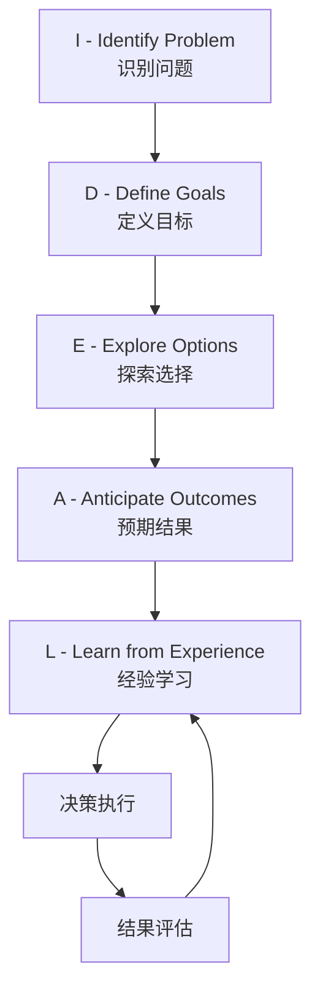

# 第五部分：回归理性 - 做清醒的医美决策者

    

        <h1 class="hero-title">回归理性</h1>
        
构建理性决策框架，成为清醒的医美消费者

    

## 🧠 本部分概述

经过前四部分的深入探索，我们了解了医美消费背后复杂的心理机制。现在，是时候将这些洞察转化为实用的工具，帮助读者做出更理性、更明智的决策。本部分将提供具体的决策框架和自我成长指南，让每一位读者都能成为清醒的医美决策者。

## 🎯 核心目标

### 决策理性化
- **系统思考**：运用系统性的思考方法
- **工具应用**：使用科学的决策工具
- **偏见识别**：识别和避免认知偏见
- **风险管理**：建立全面的风险管理体系

### 自我认知提升
- **动机澄清**：深入了解自己的真实动机
- **价值明确**：明确个人的核心价值观
- **能力评估**：客观评估自己的能力和资源
- **目标设定**：设定合理可达的目标

### 内在力量建设
- **自信重建**：建立真正的内在自信
- **价值多元**：发展多元化的价值体系
- **美学独立**：形成独立的美学判断
- **成长导向**：保持持续成长的心态

## 🗺️ 章节导航

### [第二十一章：你的"医美"决策自检清单](chapter21.md)
提供全面的自我评估工具，帮助读者在决策前进行系统性的自我检查。

### [第二十二章：拥抱真实的自己 - 构建内在的自信](chapter22.md)
探讨如何建立真正的自信，发展内在的美丽力量。

### [第二十三章：理性消费的智慧 - 避开医美消费陷阱](chapter23.md)
分析常见的医美消费陷阱，提供理性消费的策略和方法。

### [第二十四章：美丽的多元定义 - 重新定义个人美学](chapter24.md)
探讨美丽的多元化定义，帮助读者建立个性化的美学观念。

### [第二十五章：持续成长的美丽之路 - 终身美丽管理](chapter25.md)
提供长期的美丽管理策略，实现可持续的美丽成长。

## 💡 理性决策的核心原则

### 信息充分性原则
- **多元信息**：从多个渠道获取信息
- **交叉验证**：用不同方法验证信息
- **时效考量**：关注信息的时效性
- **质量评估**：评估信息的质量和可靠性

### 期望合理性原则
- **现实基础**：基于现实条件设定期望
- **专业指导**：在专业指导下调整期望
- **个体差异**：考虑个体差异因素
- **时间因素**：合理估计所需时间

### 风险可控性原则
- **全面评估**：全面评估各种风险
- **承受能力**：评估风险承受能力
- **应对准备**：准备风险应对方案
- **底线设定**：设定不可突破的底线

### 价值一致性原则
- **价值审视**：审视决策与价值观的一致性
- **优先排序**：明确价值的优先顺序
- **冲突解决**：解决价值冲突
- **长远考虑**：考虑长远的价值影响

## ✅ 决策准备度自评

在开始学习具体的决策工具之前，请先进行以下自我评估：

!!! question "动机清晰度"
    1. 我对自己想要医美的真实原因是否清楚？
    2. 这个动机主要是内在的还是外在的？
    3. 我是否考虑过其他实现目标的方式？
    4. 这个决策与我的核心价值观是否一致？

!!! question "信息准备度"
    1. 我是否收集了足够的项目信息？
    2. 我是否了解了所有可能的风险？
    3. 我是否咨询了多个专业意见？
    4. 我是否验证了关键信息的准确性？

!!! question "资源评估"
    1. 我是否有足够的经济资源？
    2. 我是否有足够的时间资源？
    3. 我是否有可靠的支持系统？
    4. 我是否具备必要的心理承受能力？

!!! question "决策环境"
    1. 我现在的决策环境是否合适？
    2. 我是否受到了不当的外部压力？
    3. 我是否给自己留了充足的思考时间？
    4. 我是否在最佳的心理状态下做决策？

## 📊 理性决策模型

### IDEAL决策模型

#### 各阶段要点
- **识别问题**：明确需要解决的真实问题
- **定义目标**：设定清晰、可衡量的目标
- **探索选择**：考虑所有可能的选择方案
- **预期结果**：评估每种选择的可能结果
- **经验学习**：从过程和结果中学习经验

### 医美专用决策框架

#### 第一层：基础评估
- **需求真实性**：评估需求的真实性和紧迫性
- **动机纯度**：分析动机的内在性和健康性
- **时机合适性**：评估当前时机是否合适
- **资源充足性**：评估各种资源是否充足

#### 第二层：选择评估
- **方案比较**：比较不同的解决方案
- **机构选择**：选择合适的医疗机构
- **医生评估**：评估医生的专业水平
- **技术选择**：选择适合的技术方案

#### 第三层：风险管理
- **风险识别**：识别所有可能的风险
- **风险评估**：评估风险的概率和影响
- **风险控制**：制定风险控制策略
- **应急预案**：准备应急处理方案

#### 第四层：决策执行
- **时间规划**：制定详细的时间规划
- **资源配置**：合理配置各种资源
- **过程监控**：监控执行过程
- **结果评估**：评估最终结果

## 🔧 实用工具预览

### 决策支持工具
- **动机分析表**：深入分析决策动机
- **风险评估矩阵**：系统评估各种风险
- **选择比较表**：比较不同选择方案
- **时间规划表**：制定详细的时间计划

### 自我成长工具
- **价值观澄清练习**：明确个人价值观
- **自信建设计划**：系统建设内在自信
- **美学独立指南**：发展独立的美学观
- **成长追踪表**：追踪个人成长进程

### 心理支持工具
- **情绪管理技巧**：管理负面情绪的方法
- **压力应对策略**：应对各种压力的策略
- **支持系统地图**：构建支持系统
- **危机应对预案**：处理心理危机的预案

## ⚠️ 特别提醒

!!! warning "理性决策的前提"
    理性决策需要以下前提条件：
    - 充分的信息和足够的时间
    - 稳定的情绪状态和清晰的思维
    - 最小化的外部压力和干扰
    - 明确的价值观和目标导向

!!! tip "提升决策质量的建议"
    1. **延迟决策**：重要决策不要急于做出
    2. **多方咨询**：寻求多个专业意见
    3. **情景模拟**：想象不同结果的情景
    4. **反向思考**：从反面角度思考问题
    5. **经验借鉴**：学习他人的经验教训

## 🎯 学习目标

通过本部分的学习，你将能够：

- **掌握系统化的决策方法**：学会运用科学的决策框架
- **建立个人决策标准**：形成适合自己的决策标准
- **提升自我认知能力**：深入了解自己的需求和能力
- **发展内在自信**：建立不依赖外表的内在自信
- **成为理性消费者**：在医美消费中保持理性和清醒

---

*"理性不是冷漠，而是在情感与逻辑之间找到最佳的平衡点。"*