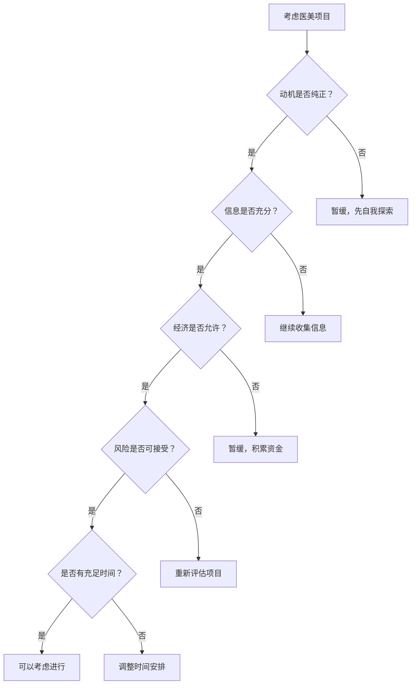

# 实用工具：医美决策助手

## 🔍 医美动机自检清单

在考虑任何医美项目之前，请诚实地回答以下问题：

  

    

      
💭

      <h3 class="category-title">动机分析</h3>
    

    

      <ul>
        <li>□ 我清楚地知道自己为什么想要做这个项目</li>
        <li>□ 这个想法已经持续了至少3个月以上</li>
        <li>□ 我的动机主要来自内在需求，而非外在压力</li>
        <li>□ 我能够接受项目可能达不到预期效果</li>
        <li>□ 我不是为了取悦特定的人而做这个决定</li>
      </ul>
    

  

  
  

    

      
💰

      <h3 class="category-title">经济评估</h3>
    

    

      <ul>
        <li>□ 这笔费用不会影响我的基本生活质量</li>
        <li>□ 我有足够的资金应对可能的修复费用</li>
        <li>□ 我不需要借贷或分期付款来支付</li>
        <li>□ 我已经为恢复期的额外开支做好准备</li>
        <li>□ 我了解所有可能产生的隐性费用</li>
      </ul>
    

  

  
  

    

      
🏥

      <h3 class="category-title">信息准备</h3>
    

    

      <ul>
        <li>□ 我已经充分了解这个项目的原理和过程</li>
        <li>□ 我清楚所有可能的风险和副作用</li>
        <li>□ 我验证了医生和机构的资质</li>
        <li>□ 我获得了至少2-3个专业意见</li>
        <li>□ 我了解术后护理的具体要求</li>
      </ul>
    

  

## ⏰ 冷静期计划

  

    <h4>第1周：信息收集</h4>
    <ul>
      <li>研究项目的基本信息</li>
      <li>查找权威医学资料</li>
      <li>了解真实案例和经验分享</li>
    </ul>
  

  

    <h4>第2-3周：咨询对比</h4>
    <ul>
      <li>预约至少3家机构咨询</li>
      <li>记录每次咨询的要点</li>
      <li>对比不同方案的优劣</li>
    </ul>
  

  

    <h4>第4周：最终决策</h4>
    <ul>
      <li>综合评估所有信息</li>
      <li>与信任的朋友或家人讨论</li>
      <li>做出最终决定</li>
    </ul>
  

## 📋 咨询问题清单

### 对医生的关键问题

  <li><strong>资质相关：</strong>您的执业证书编号是什么？可以查验吗？</li>
  <li><strong>经验相关：</strong>您做过多少例这样的手术？成功率如何？</li>
  <li><strong>风险评估：</strong>我的情况有哪些特殊风险？如何预防？</li>
  <li><strong>效果预期：</strong>根据我的条件，现实的效果预期是什么？</li>
  <li><strong>术后护理：</strong>恢复期需要注意什么？多久能看到最终效果？</li>
  <li><strong>失败处理：</strong>如果效果不满意，有什么补救措施？</li>

### 对机构的关键问题

  <li><strong>资质证明：</strong>机构的医疗许可证和相关资质</li>
  <li><strong>设备安全：</strong>使用的设备是否为正规渠道采购</li>
  <li><strong>应急处理：</strong>如果出现紧急情况，有什么应急预案</li>
  <li><strong>售后服务：</strong>术后跟踪服务的具体内容和时长</li>
  <li><strong>纠纷处理：</strong>如果出现医疗纠纷，处理流程是什么</li>

## 🚨 危险信号识别

如果遇到以下情况，请谨慎考虑：

  

    

      
⚠️

      <h3 class="comparison-title">营销话术警告</h3>
    

    <ul>
      <li>"限时优惠，今天不做就没有了"</li>
      <li>"绝对安全，没有任何风险"</li>
      <li>"明星同款，效果立竿见影"</li>
      <li>"不满意全额退款"（医美项目特殊性）</li>
    </ul>
  

  

    

      
🚫

      <h3 class="comparison-title">机构红旗</h3>
    

    <ul>
      <li>无法提供医生执业证书</li>
      <li>拒绝提供详细的风险说明</li>
      <li>强烈推荐多个项目打包</li>
      <li>催促立即签约付款</li>
    </ul>
  

## 🧮 医美费用计算器

### 总成本评估工具

  

    

      
💰

      <h3 class="category-title">直接费用计算</h3>
    

    

      <table>
        <tr><th>费用项目</th><th>预估金额</th><th>实际金额</th><th>备注</th></tr>
        <tr><td>手术/治疗费</td><td>_____元</td><td>_____元</td><td></td></tr>
        <tr><td>材料费用</td><td>_____元</td><td>_____元</td><td></td></tr>
        <tr><td>麻醉费用</td><td>_____元</td><td>_____元</td><td></td></tr>
        <tr><td>检查费用</td><td>_____元</td><td>_____元</td><td></td></tr>
        <tr><td>护理费用</td><td>_____元</td><td>_____元</td><td></td></tr>
        <tr><td><strong>小计</strong></td><td><strong>_____元</strong></td><td><strong>_____元</strong></td><td></td></tr>
      </table>
    

  

  
  

    

      
📊

      <h3 class="category-title">隐性费用预估</h3>
    

    

      <table>
        <tr><th>费用项目</th><th>预估金额</th><th>实际金额</th><th>备注</th></tr>
        <tr><td>恢复期护理</td><td>_____元</td><td>_____元</td><td>营养品、护理用品等</td></tr>
        <tr><td>交通住宿</td><td>_____元</td><td>_____元</td><td>往返及住宿费用</td></tr>
        <tr><td>误工损失</td><td>_____元</td><td>_____元</td><td>请假期间收入损失</td></tr>
        <tr><td>复查费用</td><td>_____元</td><td>_____元</td><td>术后复查费用</td></tr>
        <tr><td>修复预留</td><td>_____元</td><td>_____元</td><td>万一需要修复的费用</td></tr>
        <tr><td><strong>小计</strong></td><td><strong>_____元</strong></td><td><strong>_____元</strong></td><td></td></tr>
      </table>
    

  

**总费用预算：直接费用 + 隐性费用 = _____元**

## 📋 医美项目对比表

### 常见项目风险收益对比

  <table>
    <thead>
      <tr>
        <th>项目类型</th>
        <th>风险等级</th>
        <th>恢复时间</th>
        <th>效果持续</th>
        <th>费用范围</th>
        <th>适合人群</th>
      </tr>
    </thead>
    <tbody>
      <tr>
        <td>肉毒素注射</td>
        <td>🟢 低</td>
        <td>3-7天</td>
        <td>4-6个月</td>
        <td>2000-5000元</td>
        <td>轻度皱纹</td>
      </tr>
      <tr>
        <td>玻尿酸填充</td>
        <td>🟡 中低</td>
        <td>3-7天</td>
        <td>6-12个月</td>
        <td>3000-8000元</td>
        <td>面部凹陷</td>
      </tr>
      <tr>
        <td>双眼皮手术</td>
        <td>🟡 中</td>
        <td>1-2周</td>
        <td>永久</td>
        <td>5000-15000元</td>
        <td>单眼皮、内双</td>
      </tr>
      <tr>
        <td>隆鼻手术</td>
        <td>🟠 中高</td>
        <td>2-4周</td>
        <td>永久</td>
        <td>15000-50000元</td>
        <td>鼻型不满意</td>
      </tr>
      <tr>
        <td>面部轮廓</td>
        <td>🔴 高</td>
        <td>1-3个月</td>
        <td>永久</td>
        <td>30000-100000元</td>
        <td>骨骼问题</td>
      </tr>
    </tbody>
  </table>

## 🎯 个人适合度测试

### 医美准备度评估

请诚实回答以下问题，每题选择最符合的选项：

#### 心理准备度测试
1. **你对医美的了解程度？**
   - A. 非常了解，做过充分研究 (3分)
   - B. 有一定了解，看过一些资料 (2分)
   - C. 了解不多，主要听朋友说 (1分)
   - D. 几乎不了解，临时起意 (0分)

2. **你的决策动机主要是？**
   - A. 为了提升自信和生活质量 (3分)
   - B. 解决功能性问题 (3分)
   - C. 跟上潮流趋势 (1分)
   - D. 取悦他人或迫于压力 (0分)

3. **你对可能的风险和并发症？**
   - A. 充分了解并能接受 (3分)
   - B. 基本了解，有心理准备 (2分)
   - C. 了解一些，觉得不会发生在自己身上 (1分)
   - D. 不太了解，认为没有风险 (0分)

4. **你的经济承受能力？**
   - A. 完全在承受范围内，不影响生活 (3分)
   - B. 需要一些规划，但可以承受 (2分)
   - C. 需要贷款或分期，有一定压力 (1分)
   - D. 超出承受能力，但还是想做 (0分)

5. **你的时间安排？**
   - A. 时间充裕，可以安心恢复 (3分)
   - B. 时间较紧，但可以安排 (2分)
   - C. 时间很紧，需要尽快恢复 (1分)
   - D. 没有考虑过时间问题 (0分)

#### 评分标准：
- **12-15分**：准备充分，可以考虑进行
- **8-11分**：准备一般，建议再完善
- **4-7分**：准备不足，需要更多时间
- **0-3分**：强烈建议暂缓，先做功课

## 📞 专业资源推荐

### 权威信息查询渠道

  <li><strong>国家卫健委官网：</strong>http://www.nhc.gov.cn/ - 查询医疗机构资质</li>
  <li><strong>国家药监局官网：</strong>https://www.nmpa.gov.cn/ - 查询医疗器械和药品信息</li>
  <li><strong>中国整形美容协会：</strong>http://www.capa.org.cn/ - 行业标准和规范</li>
  <li><strong>医师执业注册信息查询：</strong>通过各省卫健委网站查询</li>
  <li><strong>消费者投诉平台：</strong>12315全国消费者投诉举报专线</li>

### 专业咨询服务

    

        <h3>如需专业咨询</h3>
        
📧 专业咨询邮箱：bccsw@cqlhlg.work

        
📞 咨询热线：023-68726872

        
🕐 服务时间：周一至周五 9:00-18:00

        
💬 在线咨询：扫描首页二维码添加专业顾问

    

## 🔬 医美风险评估工具

### 个人风险因子评估

  

    

      
🧬

      <h3 class="category-title">生理风险因子</h3>
    

    

      <table>
        <tr><th>风险因子</th><th>是否存在</th><th>风险等级</th><th>注意事项</th></tr>
        <tr><td>过敏体质</td><td>□ 是 □ 否</td><td>🟡 中</td><td>需要过敏测试</td></tr>
        <tr><td>疤痕体质</td><td>□ 是 □ 否</td><td>🔴 高</td><td>慎重考虑手术</td></tr>
        <tr><td>凝血功能异常</td><td>□ 是 □ 否</td><td>🔴 高</td><td>必须告知医生</td></tr>
        <tr><td>免疫系统疾病</td><td>□ 是 □ 否</td><td>🔴 高</td><td>需专科医生评估</td></tr>
        <tr><td>心血管疾病</td><td>□ 是 □ 否</td><td>🟠 中高</td><td>麻醉风险增加</td></tr>
        <tr><td>糖尿病</td><td>□ 是 □ 否</td><td>🟠 中高</td><td>愈合能力下降</td></tr>
      </table>
    

  

  
  

    

      
🧠

      <h3 class="category-title">心理风险因子</h3>
    

    

      <table>
        <tr><th>风险因子</th><th>是否存在</th><th>风险等级</th><th>注意事项</th></tr>
        <tr><td>身体畸形恐惧症</td><td>□ 是 □ 否</td><td>🔴 高</td><td>建议心理治疗</td></tr>
        <tr><td>完美主义倾向</td><td>□ 是 □ 否</td><td>🟠 中高</td><td>调整期望值</td></tr>
        <tr><td>抑郁焦虑症状</td><td>□ 是 □ 否</td><td>🟠 中高</td><td>先处理心理问题</td></tr>
        <tr><td>冲动性格</td><td>□ 是 □ 否</td><td>🟡 中</td><td>延长冷静期</td></tr>
        <tr><td>自尊心过低</td><td>□ 是 □ 否</td><td>🟡 中</td><td>建立内在自信</td></tr>
      </table>
    

  

### 项目特定风险评估

#### 注射类项目风险清单
- **肉毒素注射**
  - 常见风险：局部肿胀、瘀血、表情不自然
  - 严重风险：过敏反应、肌肉麻痹
  - 预防措施：选择正规产品、经验丰富医生
  - 应急处理：立即就医、停止活动

- **玻尿酸填充**
  - 常见风险：肿胀、不对称、硬结
  - 严重风险：血管栓塞、感染、失明
  - 预防措施：了解解剖结构、选择合适产品
  - 应急处理：立即按摩、溶解酶治疗

#### 手术类项目风险清单
- **双眼皮手术**
  - 常见风险：肿胀、瘀血、不对称
  - 严重风险：感染、疤痕增生、眼睑外翻
  - 恢复时间：1-2周基本恢复，3-6个月完全恢复
  - 修复可能：大部分问题可以修复

- **隆鼻手术**
  - 常见风险：肿胀、瘀血、感觉异常
  - 严重风险：感染、假体移位、鼻部塌陷
  - 恢复时间：2-4周基本恢复，6-12个月完全恢复
  - 修复难度：修复手术复杂，风险更高

## 📊 医美效果预期管理工具

### 效果预期现实性检查

  <table>
    <thead>
      <tr>
        <th>项目类型</th>
        <th>理想效果</th>
        <th>现实效果</th>
        <th>个体差异</th>
        <th>维持时间</th>
      </tr>
    </thead>
    <tbody>
      <tr>
        <td>肉毒素除皱</td>
        <td>完全消除皱纹</td>
        <td>明显减轻皱纹</td>
        <td>肌肉强度影响效果</td>
        <td>4-6个月</td>
      </tr>
      <tr>
        <td>玻尿酸填充</td>
        <td>立即饱满自然</td>
        <td>逐渐显现效果</td>
        <td>代谢速度不同</td>
        <td>6-18个月</td>
      </tr>
      <tr>
        <td>双眼皮手术</td>
        <td>立即完美双眼皮</td>
        <td>需要恢复期</td>
        <td>眼部条件差异大</td>
        <td>永久（可能松弛）</td>
      </tr>
      <tr>
        <td>隆鼻手术</td>
        <td>完美鼻型</td>
        <td>改善明显但有限制</td>
        <td>鼻部基础条件重要</td>
        <td>永久（可能变化）</td>
      </tr>
    </tbody>
  </table>

### 效果满意度预测工具

#### 满意度影响因素权重
- **术前期望合理性** (30%)：期望越合理，满意度越高
- **医生技术水平** (25%)：技术水平直接影响效果
- **个人基础条件** (20%)：基础条件好，效果更佳
- **术后护理质量** (15%)：护理好，恢复更佳
- **心理准备充分性** (10%)：心理准备充分，适应更好

#### 满意度预测公式
**预测满意度 = (期望合理性×0.3) + (医生水平×0.25) + (基础条件×0.2) + (护理质量×0.15) + (心理准备×0.1)**

*每项评分1-10分，总分1-10分*

## 🏥 医美机构评估工具

### 机构综合评估表

  

    

      
📋

      <h3 class="category-title">资质认证评估</h3>
    

    

      <table>
        <tr><th>评估项目</th><th>评分(1-5)</th><th>权重</th><th>加权得分</th></tr>
        <tr><td>医疗机构执业许可</td><td>____分</td><td>25%</td><td>____分</td></tr>
        <tr><td>医生执业资质</td><td>____分</td><td>25%</td><td>____分</td></tr>
        <tr><td>设备器械认证</td><td>____分</td><td>20%</td><td>____分</td></tr>
        <tr><td>产品来源正规性</td><td>____分</td><td>20%</td><td>____分</td></tr>
        <tr><td>行业认证资质</td><td>____分</td><td>10%</td><td>____分</td></tr>
        <tr><td><strong>资质总分</strong></td><td></td><td><strong>100%</strong></td><td><strong>____分</strong></td></tr>
      </table>
    

  

  
  

    

      
⭐

      <h3 class="category-title">服务质量评估</h3>
    

    

      <table>
        <tr><th>评估项目</th><th>评分(1-5)</th><th>权重</th><th>加权得分</th></tr>
        <tr><td>咨询专业程度</td><td>____分</td><td>30%</td><td>____分</td></tr>
        <tr><td>环境卫生状况</td><td>____分</td><td>25%</td><td>____分</td></tr>
        <tr><td>服务态度质量</td><td>____分</td><td>20%</td><td>____分</td></tr>
        <tr><td>术后跟踪服务</td><td>____分</td><td>15%</td><td>____分</td></tr>
        <tr><td>应急处理能力</td><td>____分</td><td>10%</td><td>____分</td></tr>
        <tr><td><strong>服务总分</strong></td><td></td><td><strong>100%</strong></td><td><strong>____分</strong></td></tr>
      </table>
    

  

### 机构选择决策矩阵

#### 多机构对比表
| 评估维度 | 机构A | 机构B | 机构C | 权重 |
|----------|-------|-------|-------|------|
| 资质认证 | ___分 | ___分 | ___分 | 30% |
| 医生水平 | ___分 | ___分 | ___分 | 25% |
| 服务质量 | ___分 | ___分 | ___分 | 20% |
| 价格合理性 | ___分 | ___分 | ___分 | 15% |
| 地理位置 | ___分 | ___分 | ___分 | 10% |
| **加权总分** | **___分** | **___分** | **___分** | **100%** |

## 💡 医美决策辅助工具

### 决策树工具

### SWOT分析工具

#### 个人医美SWOT分析表
| | 有利因素 | 不利因素 |
|---|---------|----------|
| **内部因素** | **优势(Strengths)** | **劣势(Weaknesses)** |
| | • 经济条件充足 • 心理准备充分 • 信息了解全面 • 支持系统完善 | • 风险承受能力低 • 恢复时间不足 • 期望过于理想 • 决策过于冲动 |
| **外部因素** | **机会(Opportunities)** | **威胁(Threats)** |
| | • 技术日趋成熟 • 选择越来越多 • 价格相对合理 • 社会接受度高 | • 市场鱼龙混杂 • 风险客观存在 • 效果个体差异 • 维护成本较高 |

## 📚 延伸学习资源

### 权威医学资源
- **中华医学会整形外科学分会**：http://www.cma.org.cn/
- **中国医师协会美容与整形医师分会**：专业医师培训和认证
- **国际美容整形外科学会(ISAPS)**：全球权威整形外科组织
- **美国整形外科医师学会(ASPS)**：国际先进技术和标准

### 心理健康资源
- **中国心理学会**：http://www.cpsbeijing.org/
- **中国心理卫生协会**：心理健康专业指导
- **身体意象研究中心**：专门研究身体意象问题
- **消费心理学研究机构**：消费行为心理分析

### 推荐阅读书籍

#### 心理学基础
- 《这才是心理学》- 基思·斯坦诺维奇
- 《思考，快与慢》- 丹尼尔·卡尼曼  
- 《社会心理学》- 戴维·迈尔斯
- 《消费心理学》- 迈克尔·所罗门

#### 身体意象专题
- 《身体意象心理学》- 托马斯·卡什
- 《美丽的代价》- 琳达·哈钦森
- 《完美的身体》- 苏珊·博多
- 《镜中的自己》- 凯瑟琳·菲利普斯

#### 决策科学
- 《决策的艺术》- 约翰·哈蒙德
- 《理性选择》- 斯科特·普劳斯
- 《行为经济学》- 理查德·塞勒
- 《可预测的非理性》- 丹·艾瑞里

### 专业期刊和研究
- 《中华整形外科杂志》
- 《中国美容医学》
- 《心理学报》
- 《消费者研究杂志》
- 《身体意象期刊》(Body Image)
- 《美容心理学期刊》(Aesthetic Psychology)

### 在线学习平台
- **中国大学MOOC**：心理学和医学相关课程
- **网易云课堂**：消费心理学专题课程
- **腾讯课堂**：医美行业知识普及
- **知乎Live**：专家分享和答疑

## 🧠 认知偏误识别工具

### 医美消费中的常见认知偏误

基于认知科学研究，人类在决策过程中容易受到各种认知偏误的影响。在医美消费中，了解这些偏误有助于做出更理性的决策。

#### 记忆相关偏误

  <h4>🧠 记忆扭曲类偏误</h4>
  

    

      <h5>可得性启发式</h5>
      
<strong>定义：</strong>根据容易回想起的信息来判断概率

      
<strong>医美表现：</strong>看到朋友成功案例就认为风险很低

      
<strong>应对策略：</strong>主动收集统计数据，不只看个案

    

    
    

      <h5>峰终定律</h5>
      
<strong>定义：</strong>主要记住体验的峰值和结尾

      
<strong>医美表现：</strong>只记得咨询时的好印象，忽略中间的疑虑

      
<strong>应对策略：</strong>记录完整的咨询过程和感受

    

    
    

      <h5>玫瑰色回忆</h5>
      
<strong>定义：</strong>倾向于记住积极的经历，淡化消极的

      
<strong>医美表现：</strong>他人分享时美化恢复过程的痛苦

      
<strong>应对策略：</strong>主动询问恢复期的真实感受

    

    
    

      <h5>虚假记忆</h5>
      
<strong>定义：</strong>记住从未发生过的事情

      
<strong>医美表现：</strong>误记医生承诺的效果或保证

      
<strong>应对策略：</strong>重要信息要求书面确认

    

  

#### 社会影响偏误

  <h4>👥 社会压力类偏误</h4>
  

    

      <h5>从众效应</h5>
      
<strong>定义：</strong>跟随大多数人的选择

      
<strong>医美表现：</strong>"大家都在做"成为选择理由

      
<strong>应对策略：</strong>关注个人需求，不盲从潮流

    

    
    

      <h5>权威偏误</h5>
      
<strong>定义：</strong>过度相信权威人士的观点

      
<strong>医美表现：</strong>盲信"专家"推荐，不做独立思考

      
<strong>应对策略：</strong>验证权威资质，寻求多方意见

    

    
    

      <h5>社会认同偏误</h5>
      
<strong>定义：</strong>认为他人的行为是正确的指导

      
<strong>医美表现：</strong>看到网红做某项目就认为安全有效

      
<strong>应对策略：</strong>关注科学证据，不只看社交证明

    

    
    

      <h5>光环效应</h5>
      
<strong>定义：</strong>一个积极特征影响整体判断

      
<strong>医美表现：</strong>因为医生长得好看就认为技术好

      
<strong>应对策略：</strong>分别评估不同维度的能力

    

  

#### 信息处理偏误

  <h4>📊 信息处理类偏误</h4>
  

    

      <h5>确认偏误</h5>
      
<strong>定义：</strong>只寻找支持既有观点的信息

      
<strong>医美表现：</strong>只看成功案例，忽略失败风险

      
<strong>应对策略：</strong>主动寻找反面信息和风险数据

    

    
    

      <h5>锚定效应</h5>
      
<strong>定义：</strong>过度依赖最初获得的信息

      
<strong>医美表现：</strong>被第一个价格"锚定"，影响后续判断

      
<strong>应对策略：</strong>多方比较，不被首次信息绑定

    

    
    

      <h5>代表性启发式</h5>
      
<strong>定义：</strong>根据相似性判断概率

      
<strong>医美表现：</strong>认为自己和成功案例相似就会成功

      
<strong>应对策略：</strong>关注个体差异，不过度类比

    

    
    

      <h5>框架效应</h5>
      
<strong>定义：</strong>信息呈现方式影响决策

      
<strong>医美表现：</strong>"95%成功率"vs"5%失败率"感受不同

      
<strong>应对策略：</strong>用多种方式理解同一信息

    

  

#### 概率判断偏误

  <h4>🎲 概率判断类偏误</h4>
  

    

      <h5>乐观偏误</h5>
      
<strong>定义：</strong>高估好事发生的概率，低估坏事

      
<strong>医美表现：</strong>"并发症不会发生在我身上"

      
<strong>应对策略：</strong>客观评估个人风险因素

    

    
    

      <h5>赌徒谬误</h5>
      
<strong>定义：</strong>认为过去结果影响未来概率

      
<strong>医美表现：</strong>"医生连续成功，该轮到失败了"

      
<strong>应对策略：</strong>理解每次手术都是独立事件

    

    
    

      <h5>基础比率忽视</h5>
      
<strong>定义：</strong>忽略基础概率信息

      
<strong>医美表现：</strong>忽略整体并发症率，只看个案

      
<strong>应对策略：</strong>了解项目的整体统计数据

    

    
    

      <h5>小数定律</h5>
      
<strong>定义：</strong>从小样本得出过度概括的结论

      
<strong>医美表现：</strong>看几个案例就判断项目效果

      
<strong>应对策略：</strong>寻找大样本的统计数据

    

  

#### 时间感知偏误

  <h4>⏰ 时间感知类偏误</h4>
  

    

      <h5>现在偏误</h5>
      
<strong>定义：</strong>过度重视即时满足

      
<strong>医美表现：</strong>急于看到效果，忽略长期风险

      
<strong>应对策略：</strong>制定长期规划，考虑未来影响

    

    
    

      <h5>规划谬误</h5>
      
<strong>定义：</strong>低估完成任务所需时间

      
<strong>医美表现：</strong>低估恢复时间和复杂程度

      
<strong>应对策略：</strong>预留充足的恢复时间

    

    
    

      <h5>时间折扣</h5>
      
<strong>定义：</strong>未来收益的价值被低估

      
<strong>医美表现：</strong>忽视长期维护成本

      
<strong>应对策略：</strong>计算项目的全生命周期成本

    

    
    

      <h5>持续时间忽视</h5>
      
<strong>定义：</strong>忽略体验的持续时间

      
<strong>医美表现：</strong>只关注最终效果，忽略恢复过程

      
<strong>应对策略：</strong>充分了解整个过程的体验

    

  

#### 自我认知偏误

  <h4>🪞 自我认知类偏误</h4>
  

    

      <h5>邓宁-克鲁格效应</h5>
      
<strong>定义：</strong>能力不足者高估自己的能力

      
<strong>医美表现：</strong>看了几篇文章就认为很懂医美

      
<strong>应对策略：</strong>保持谦逊，寻求专业指导

    

    
    

      <h5>自我服务偏误</h5>
      
<strong>定义：</strong>将成功归因于自己，失败归因于外界

      
<strong>医美表现：</strong>效果好是自己选择好，效果差是医生问题

      
<strong>应对策略：</strong>客观分析成败的多重因素

    

    
    

      <h5>控制错觉</h5>
      
<strong>定义：</strong>高估自己对结果的控制能力

      
<strong>医美表现：</strong>认为自己能完全控制手术效果

      
<strong>应对策略：</strong>接受结果的不确定性

    

    
    

      <h5>自我中心偏误</h5>
      
<strong>定义：</strong>过度关注自己的视角

      
<strong>医美表现：</strong>认为别人都在关注自己的外表

      
<strong>应对策略：</strong>理解他人的注意力有限

    

  

#### 损失厌恶偏误

  <h4>💸 损失厌恶类偏误</h4>
  

    

      <h5>损失厌恶</h5>
      
<strong>定义：</strong>损失的痛苦大于等量收益的快乐

      
<strong>医美表现：</strong>过度担心失败，错失改善机会

      
<strong>应对策略：</strong>平衡评估收益和风险

    

    
    

      <h5>沉没成本谬误</h5>
      
<strong>定义：</strong>因为已投入成本而继续错误决策

      
<strong>医美表现：</strong>已经花钱咨询就必须做手术

      
<strong>应对策略：</strong>基于未来价值做决策，不考虑沉没成本

    

    
    

      <h5>禀赋效应</h5>
      
<strong>定义：</strong>拥有的东西价值被高估

      
<strong>医美表现：</strong>过度珍惜现有外貌，抗拒改变

      
<strong>应对策略：</strong>客观评估现状和改善的价值

    

    
    

      <h5>后悔厌恶</h5>
      
<strong>定义：</strong>为了避免后悔而做出非理性决策

      
<strong>医美表现：</strong>因为怕后悔不做而冲动决策

      
<strong>应对策略：</strong>接受任何选择都可能有遗憾

    

  

### 认知偏误自检清单

#### 决策前自检
在做医美决策前，问问自己：

  <h4>🔍 信息收集检查</h4>
  <ul>
    <li>□ 我是否主动寻找了反面信息？</li>
    <li>□ 我的信息来源是否多元化？</li>
    <li>□ 我是否验证了关键信息的准确性？</li>
    <li>□ 我是否了解了统计数据而非只看个案？</li>
  </ul>

  <h4>🎯 动机分析检查</h4>
  <ul>
    <li>□ 我的决策是否受到社交压力影响？</li>
    <li>□ 我是否因为看到他人成功而冲动？</li>
    <li>□ 我是否过度相信某个权威的建议？</li>
    <li>□ 我的期望是否过于乐观？</li>
  </ul>

  <h4>⚖️ 风险评估检查</h4>
  <ul>
    <li>□ 我是否客观评估了个人风险因素？</li>
    <li>□ 我是否考虑了最坏情况的应对方案？</li>
    <li>□ 我是否高估了自己的控制能力？</li>
    <li>□ 我是否充分考虑了长期影响？</li>
  </ul>

### 理性决策框架

#### WRAP决策模型

  

    <h4>W - 拓宽选择 (Widen Options)</h4>
    <ul>
      <li>不只考虑"做"或"不做"</li>
      <li>探索多种解决方案</li>
      <li>考虑分阶段实施</li>
      <li>寻找创新替代方案</li>
    </ul>
  

  
  

    <h4>R - 现实检验 (Reality-Test)</h4>
    <ul>
      <li>寻找反对意见</li>
      <li>进行小规模测试</li>
      <li>咨询不同专家</li>
      <li>验证关键假设</li>
    </ul>
  

  
  

    <h4>A - 获得距离 (Attain Distance)</h4>
    <ul>
      <li>10-10-10法则：10分钟、10个月、10年后的感受</li>
      <li>给朋友建议的角度</li>
      <li>考虑核心价值观</li>
      <li>设置冷静期</li>
    </ul>
  

  
  

    <h4>P - 准备犯错 (Prepare to be Wrong)</h4>
    <ul>
      <li>制定应急预案</li>
      <li>设置检查点</li>
      <li>准备修正策略</li>
      <li>建立支持系统</li>
    </ul>
  

### 偏误纠正技巧

#### 具体纠正方法

  

    <h4>🔄 视角转换法</h4>
    
从不同角度看问题：

    <ul>
      <li>如果是朋友遇到这种情况，我会给什么建议？</li>
      <li>如果我是医生，我会如何客观评估？</li>
      <li>如果我是家人，我会有什么担心？</li>
    </ul>
  

  
  

    <h4>📊 数据导向法</h4>
    
用数据对抗直觉：

    <ul>
      <li>收集客观统计数据</li>
      <li>制作决策对比表</li>
      <li>量化风险和收益</li>
      <li>设定具体评估标准</li>
    </ul>
  

  
  

    <h4>🕐 时间延迟法</h4>
    
给决策留出时间：

    <ul>
      <li>设置强制冷静期</li>
      <li>分阶段做决策</li>
      <li>睡一觉再决定</li>
      <li>咨询后等待24小时</li>
    </ul>
  

  
  

    <h4>👥 外部输入法</h4>
    
寻求外部视角：

    <ul>
      <li>咨询信任的朋友</li>
      <li>寻求专业第二意见</li>
      <li>参考相似案例</li>
      <li>听取反对声音</li>
    </ul>
  

## 🆘 紧急求助资源

### 医疗紧急情况
- **120急救电话**：医疗紧急情况
- **当地卫生监督所**：医疗纠纷投诉
- **医疗事故鉴定委员会**：医疗事故认定
- **医疗保险机构**：医疗费用咨询

### 心理危机干预
- **400-161-9995**：全国心理危机干预热线
- **北京危机干预热线**：400-161-9995
- **上海心理援助热线**：021-64383562
- **当地心理健康中心**：专业心理支持

### 消费者权益保护
- **12315消费者投诉热线**：消费纠纷投诉
- **12345政府服务热线**：政府部门投诉
- **中国消费者协会**：消费者权益保护
- **法律援助中心**：法律咨询和援助

---

*记住：最好的医美决策，是经过深思熟虑的理性选择。这些工具只是辅助，最终的决定权在你手中。当遇到困难时，不要犹豫寻求专业帮助。*